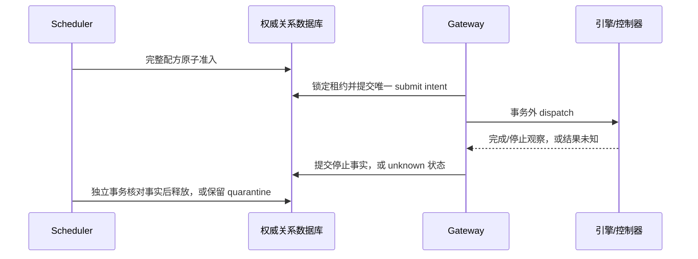

# 受控协调事务：程序实现方案与契约

依据 [ADR 0006](../decisions/0006-cluster-coordination-and-storage-portability.md)，
业务裁决从 PostgreSQL 函数迁入应用事务。集群是必须支持的部署形态，Node=1 使用
同一协议；不引入 etcd，Redis 只能缓存或唤醒。PostgreSQL 是唯一正式产品数据库，
MySQL/InnoDB 是协调路径迁移验证目标。

本次已交付精简 DDL、事务机器契约、权限生成工具，以及两个真实数据库共用的
测试原型。[首个生产 Job/outbox 事务](production-jobs.md)另行实现创建、完整身份重放、
只读未知结果恢复和版本化迁移；它不导入测试原型。其余生产领域规则、协调适配器、
Scheduler、Worker、网关外发和控制器接入仍待编码。物理多主机、真实引擎、故障切换与
备份恢复资格仍须独立验证。

## 1. 实现位置与依赖

| 职责 | 后续程序位置 | 允许依赖与边界 |
| --- | --- | --- |
| 配方完整性、预算计算、状态转换、证据裁决 | `speech/domain`；执行事实规则在 gateway domain | 框架无关的值对象和纯函数；不导入 SQL、Pydantic、生成 DTO 或 vendor SDK |
| owner、准入、释放、任务恢复 | `speech/application` | 按用例定义窄事务端口；一次完整准入只能用一个事务会话 |
| 外发提交、abort、停止事实 | gateway application | 先持久化 intent，提交后再外发；与 Scheduler 释放分属不同所有者事务 |
| PG 事务、锁、条件写入、时间、异常分类 | 各模块 `infrastructure` | 实现端口，不复制预算或证据策略；组合根装配 |
| MySQL 行为验证 | `tests/support` 与 `tests/integration` | 使用同一行为 oracle；不进入产品支持矩阵 |

不新建协调微服务、通用数据库插件系统、分布式事务管理器或另一套消息队列。
端口使用数据库无关的领域输入/结果，具体类型由机器契约生成或在边界校验。
目前 `tests/support/coordination.py` 仅用于验证事务方法；业务实现必须另按依赖规则组织。

## 2. 机器契约与共同约束

权威入口是
[`coordination-transactions.schema.json`](../../contracts/internal/coordination-transactions.schema.json)，
版本 `1.0.0`。这是进程内应用事务端口，不增加 HTTP 路由。公开语音和内部执行、
运行时协议保持原语义；Identifier、PoolId、ServiceClass、ResourceVector 分量、
执行状态、清理状态、停止证据与控制器输入通过 `$ref` 复用已有契约。

- 缺省值必须先按已有协议解析，形成不可变有效请求，再校验、规范化和计算摘要。
  新端口未声明默认值的字段必须显式提供。
- 新端口 JSON 数值上限为 `2^53-1`，以便 RFC 8785 精确规范化。预算和乘法、
  加法的中间值须再检查有符号 64 位范围；不得依赖 SQL 溢出来裁决业务。
  字符串 revision 解析后也须检查该范围。token/version 耗尽时停止写入，不能回绕。
- 预算单位沿用 manifest；`*_us` 是 UTC Unix 微秒，`ttl_ms` 是毫秒，
  `sample_*` 是 PCM 样本位置。时长由 samples/sample rate 派生。
- Identifier 先按共享小写 ASCII 域校验；数据库使用能保持该域精确比较的排序规则。
  本次 MySQL namespace 使用 `utf8mb4_0900_bin`、InnoDB、UTC、Read Committed。
- 所有正常运行写入都经具体事务方法；不能提供 `update_any_state` 一类入口。
  不接受客户端预算作为权威预算，不接受数据库 rowcount=0 作为成功。
- `committed/replayed` 返回持久身份的类型化快照；`conflict/rejected` 携带稳定错误码。
  `unknown` 只表示结果未知，恢复只能查询原身份、查询当前权威或进入协调。
  不能将它映射为“可新建执行的普通重试”。

schema 根入口同时接受命令与结果；`result.operation` 约束对应结果类型，所有定义均可
从根引用到达。九种既有执行命令均保留；ASR、对齐、说话人分离和 VAD 等非 PCM 阶段
使用 null 的 sample rate/output stream，不创建虚构音频流。完整规范提交请求及摘要
在 intent 同事务持久化，以便重启后恢复真实原请求，不能只留下无法重建命令的摘要。
文档列在 PG 使用 TEXT，在 MySQL 验证 adapter 中仅作 TEXT→LONGTEXT 的物理类型映射，
避免合法百万字符命令被较小的列容量截断；业务规则和 DML 不分叉。命令含私有业务内容，
只能留在部署内，不写日志或公开投影。`redact_execution_command` 在清理完成后清除正文，
同时保存删除任务/证据 tombstone，保留原摘要和最小协调事实；不能用永久保留执行历史
为由永久保存业务正文。

该正文清理已由 gateway 原生窄事务实现，要求显式可信删除许可，并在 pool → lease → submit
行锁下确认执行清理和 A 的 lease release，原子清正文/留 tombstone，不写预算。
默认没有许可签发器或 HTTP 删除入口，真实删除协调器仍待 A 接入；
同 Job/摘要的幂等确认与 FactSnapshot 语义见[执行网关](execution-gateway.md#10-redact_execution_command)。

契约示例与反例位于
[`transaction-examples.json`](../../tests/fixtures/coordination/transaction-examples.json)，
端口完整性检查位于
[`test_coordination_transactions.py`](../../tests/contract/test_coordination_transactions.py)。
schema 验证形状；跨记录身份、时间关系、阶段集合、预算与时序由下面的应用规则验证。

## 3. 事务接口与恢复身份

| 端口 | 生产者 → 消费者 | 原子写入/返回 | 重放与未知结果恢复 |
| --- | --- | --- | --- |
| `acquire_owner` | Scheduler → owner repository | 池 owner/token/expiry/version；返回新任期 | 以池和期望 version 查询当前权威；已被后续任期取代时不宣称原操作未提交 |
| `renew_owner` | 同上 | 校验当前未过期任期，再更新 expiry/version | 查询池当前 owner/token/expiry；过期只能重新获取，不能复活 |
| `seal_barrier` | 网关屏障观察 → gateway repository | 保存实际入口已封锁的证据和最低 token | 同 gateway/pool/token 返回原事实；较小 token 拒绝 |
| `activate_owner` | Scheduler reconciler → owner repository | 核对全部受影响入口、在途状态，再激活任期 | 读当前任期及屏障；version 冲突重新读取，不能跳过协调 |
| `admit_recipe` | Scheduler → admission transaction | quota、全部 host/instance 投影、attempt、全部 stage lease、Job/outbox | `(operation_id, attempt_id)` 加规范请求摘要；相同返回原租约，不重新加预算 |
| `create_job` | 任务应用用例 → Job/outbox transaction | 同时落 Job 与 outbox，返回原身份 | Job 业务键和摘要；同键异请求为冲突 |
| `claim_job` | Worker → job repository | owner、claim_version、claim deadline | 当前 claim_version 是执行权限；重认领不等于可以再外发引擎 |
| `create_submit` | gateway 应用 → submit transaction | 校验完整执行请求，提交唯一 intent | 唯一 stage/lease + submit ID +完整请求摘要；重放只读原 intent，不能再次外发 |
| `mark_execution_unknown` | gateway adapter/reconciler → execution transaction | 活动执行转 unknown/quarantined，保留全部身份 | 原 submit ID；终态不得降为 unknown |
| `record_stop` | 经核验的 engine/controller/operator 观察 → gateway transaction | 只追加停止事实，并关闭对应执行 | 原 submit/evidence ID 与完整事实；同 ID 不同事实拒绝 |
| `record_execution_observation` | gateway adapter → execution transaction | 沿用既有 ExecutionStatus 的完整身份/状态矩阵，记录外发事实或从未外发的失败 | 期望 version 和原 submit；已观察的外发关联不可变，不能反转终态 |
| `redact_execution_command` | 服务端删除协调器 → gateway cleanup transaction | 关闭执行且 lease 已释放后，清除规范请求正文并同事务留下删除 tombstone | 删除 Job 与证据摘要；相同返回原事实，清理不授予重新执行权限 |
| `quarantine_lease` | Scheduler reconciler → admission transaction | 已提交 unknown 执行的 held → quarantine 投影 | lease ID，首次观察与原因不改写；总占用不减少 |
| `release_lease` | Scheduler reconciler → admission transaction | 核验证据，关闭 lease，扣减所属账目；最后 stage 再释放 quota | lease ID/期望 version；已释放返回原事实，不能再扣一次 |
| `append_interval` | 计量所有者 → interval transaction | 按流串行检查重叠和硬上限，追加区间，推进 generated 水位 | interval ID +完整区间身份；相邻合法，部分重叠拒绝 |
| `create_runtime_intent` | Scheduler → runtime transaction | generation/head、加载预算、prepare/stop 意图及 outbox | `(target_node_id, intent_id)` 与规范请求摘要 |
| `observe_runtime` | controller/gateway 观察 → runtime transaction | 核对完整身份、证据、实例/意图版本，再改变基线预算/状态 | 同意图观察；旧 generation 的迟到响应不修改当前 generation |
| `query_outcome` | 上述调用者 → 所属 repository | 读取有类型的原身份与摘要，不引发执行；目标分支用 `x-nexus-result-kind` 声明对应快照：pool→OwnerSnapshot、attempt→AdmissionSnapshot、job→ClaimSnapshot、submit→ExecutionSnapshot、lease→LeaseSnapshot、interval→FactSnapshot、runtime_intent→RuntimeSnapshot | pool、attempt、job、submit、lease、interval、node/intent 分别有确定查询键 |

后续实现按职责拆为 owner、admission、job、execution、runtime、meter 小端口。
同一个 admission 端口负责完整配方；不能拆成多个独立事务 repository 调用，
再期待异常时逐项补偿。attempt/submit/runtime 等持久幂等身份的摘要不匹配必须报冲突；
pool/claim 的读取返回当前权威，后续任期已覆盖当前投影时不能据此证明旧事务未提交。
不能按新请求重新解释已存在的执行结果。

## 4. 锁序、隔离与数据库适配

基线采用短 Read Committed 事务和普通主键行锁，顺序如下：

```text
resource_pools
→ workspace_quotas
→ host_nodes
→ runtime_instance_heads
→ engine_instances
→ runtime_instance_intents
→ admission_attempts
→ admission_leases
→ gateway_fencing_barriers
→ submit_intents
→ output_stream_heads
→ execution_stop_evidence / output_sample_intervals
→ coordination_jobs
→ coordination_outbox
```

同表的全部参与键按契约字典序排序；先锁完所有池，再锁全部 host，不能逐 stage
锁完整链。只读定位可在事务前执行，但锁后必须重核对引用、状态、版本与 owner。
新增不存在的行先锁其必然存在的父权威行，例如 submit 锁 lease、输出追加锁 submit、
新 generation 锁 host/head。创建输出流先锁 attempt，追加则锁对应 submit 和
`(operation_id, attempt_id, output_stream_id)` 的流权威行；不能只按 submit ID 排斥，
否则不同 stage 可在同一逻辑流重复计量。外键父行的隐式锁也必须纳入此顺序。

生产 gateway 已实现该输出追加与原区间查询，两个不同 pool/stage 共享输出流的真实行锁等待
已在 PG/InnoDB 验证。用量取 generated 区间长度之和，max-end 水位不是消耗总量；
任意已记输出区间都阻止无外发清理结论，诊断 meter 不退生成用量。
结果沿用 FactSnapshot，不编造区间版本；详细身份/重放/恢复规则见
[执行网关](execution-gateway.md#11-append_interval-与原区间查询)。

等待锁以后，再从数据库取时间判断当前租期。新行的全局唯一键/FK 也可能在 INSERT 时
等待；竞争事务回滚后 INSERT 会成功，不能仅靠唯一冲突异常识别。创建路径必须在
最后一次可能等待的写入后重新核验 owner/请求及资格窗口，过期则整笔回滚。
PG 用 adapter 内的数据库时钟语句，
MySQL 用其数据库时钟；不把客户端时钟或事务开始前的旧时间当作续租依据。
Job 认领基线锁定候选行并执行带 claim_version/expiry 的条件更新；
`SKIP LOCKED` 仅是后续可测量的优化。没有 Redis 或通知时扫描持久 outbox/待办行。

只允许对**数据库已确认回滚**的 deadlock/serialization 冲突，回滚整个事务后有界
重试，最多 3 次，带短抖动且总耗时不越请求 deadline。业务容量不足、版本冲突、
摘要冲突不是驱动透明重试。连接断开、提交确认丢失或驱动不能证明回滚时，一律
按未知结果查询。错误分类由 adapter 根据实际 SQLSTATE/错误号实现并测试。

事务内禁止推理、HTTP、容器控制、对象上传、长编码和 sleep。私有 staging 写入
与数据库发布引用遵循既有对象发布协议。未提交事务被进程中断时由数据库回滚；
已提交但响应丢失时按原键恢复。两者都不能推导出“可以再做一次计算”。

## 5. 完整配方与预算算法

1. 事务前解析不可变 binding revision、manifest、policy 与 qualification，得到全部
   required stage、允许的实例类型、逐维预算和有效期。候选读取不构成准入。
2. 事务内按锁序取得全部 pool、quota、host、head、generation。核对当前 active
   owner/token、资格和策略版本、节点 ready、当前 generation ready、绑定与 manifest、
   gateway、service class、deadline；配方 stage 集合必须完全相等，不能缺阶段或重复。
3. 每阶段租约向量 `V(stage,d) >= slots(stage) × frozen_per_slot(stage,d)`；
   同 generation 支持多个 stage 时按 manifest 中逐维最大 per-slot 冻结为保守上界，
   各 stage 同时占用仍需累加。禁止把缺失/未知预算解释为 0。
4. unified 节点只计 unified 物理内存；离散节点只计 device/host。
   CPU decode、PCM buffer、scratch 各自计量。实例基线取加载 peak 或 ready 后的 steady，
   与全部未释放 stage 增量叠加；隔离占用同样消耗物理预算。
5. 每维满足 `held + quarantined + new <= allocatable`；实例满足
   `held_slots + quarantined_slots + new_slots <= max_slots`。
   同 host 的不同池竞争同一父预算，不能各维护一套余量。
6. batch/voice-creation 不借用 realtime floor：
   `batch_held + batch_quarantined + new_batch + realtime_reserved <= max_slots`，
   同时仍满足总槽位上限。realtime 已占用保留槽位时不再次扣同一 floor。
7. quota 按一次完整 attempt 占用一次，任一 lease 未释放时不归还；
   首次隔离时整 attempt quota 从 held 移到 quarantine，最后 lease 释放才归还。
   其他用量维度的 quota_reservations 由既有 quota 领域在同一事务加入；
   当前 DDL/原型只具体化并发 attempt quota，不宣称覆盖全部计费账本。
8. 一次提交 attempt、全部租约、所有投影以及相关 Job/outbox。任何失败整体回滚。
   投影与事实同步更新；后台对账只能发现漂移，发现后暂停相关资源并保留占用，
   不能在请求已经放行后靠异步对账修复超卖。

## 6. owner、提交、取消与释放时序

首次获取与接管均先进入 `reconciling_takeover`。激活前，受影响 gateway 必须实际
拒绝旧 token；数据库中写一个较大 token 不算入口被封锁的证据。还须协调旧 owner
的全部 submitting/执行中意图：终止后记停止事实，无法确定则隔离并保留预算。
未知执行的账目和入口屏障尚未完成时不得激活。已隔离并保留预算的未知执行不阻止
已证明安全的其他余量使用。



提交前同时校验 lease、operation/attempt/stage、workspace、pool、host、
gateway、generation、binding/policy revision、token、command digest 和 deadline。
gateway 的私有 staging namespace 由既有协议派生，不能接受客户端任意路径。
重复提交比较**完整有效请求**，不只比较 command digest；原结果可查询也不授予再外发权限。

精确停止证据只接受既有四类已验证事实；连接关闭、超时、TTL、心跳失效均不算。
这里的 `execution_stopped` 只证明该次执行停止及其增量资源归还，不要求共享引擎进程退出。
实例基线预算仍须依据独立的 RuntimeStopEvidence 中进程/容器退出与资源释放两项事实归还。
成功要求 terminal response；失败须稳定错误码；unknown 只能凭停止证据关闭为 aborted。
从未外发的失败可按既有执行契约进入 `not_required`，但必须同时证明无 request ID、
无 dispatch、无 staging、无生成样本；这条路径已通过 gateway 的
`record_execution_observation` 窄事务实现，PG/InnoDB 共用规则。该端口仅允许 submitting
确认未外发的失败，不能解除 unknown；成功和有清理的终态仍必须经确切停止事实关闭，
不能伪造 stop 代替 pre-dispatch 失败。版本、时间与原外发关联的规则见
[执行网关](execution-gateway.md#9-record_execution_observation)。

gateway 先提交执行事实，Scheduler 后核对并释放；两步间崩溃只会多占预算，不能提前释放。
从未创建 submit 的 lease 可以在锁定 lease 后直接释放，后续 submit 必须拒绝。
已隔离 lease 只有全部附属执行终止并取得释放事实后才减少隔离量。
清理可继续补充，Operation 的唯一结果终态不得翻转。

删除协调器先按既有删除契约核验当前删除任务及依赖范围，再向 Gateway 的受信应用
边界提交绑定 submit 的清理许可；不能让公开客户端自行构造许可或指定任意记录。
Gateway 不查询工作台或语音业务表，只在自己的清理事务中重核对 lease 已释放、
执行已终止以及期望 version，清除正文并保存删除 Job/证据/时间。隔离中的执行继续等待
清理，不能先报内容删除完成；已清理命令不再恢复正文或重新 dispatch，公开恢复语义
继续遵循 Operation/receipt 与 `response_not_replayable` 契约。许可的实际跨进程投影、
完整删除流程和备份恢复资格在生产接入时验收，当前原型只用受信合成许可验证此状态边界。

## 7. 实例生命周期与详细实施要求

create/query/observe 已具备[独立生产事务端口](production-runtime-intents.md)与真实 PG/InnoDB 的合成事实验证；批准计划/资格提供者、scheduler/controller 客户端和真实生命周期资格仍待接入，不代表生产进程或 GPU/多主机验收完成。

- `create_runtime_intent(prepare)`：锁 owner/quota（若需要）/host/head；核对获准模板、
  拓扑、绑定、manifest、config、加载策略；新 generation 必须大于持久 high water。
  旧 generation 仍有未知占用时不能移除其预算或冒充已停止。一次预留完整加载峰值，
  建立 generation、prepare 指针、意图与 outbox，提交后才调用受限 controller。
- 每个 generation/action 的未解决意图由普通当前指针串行化，prepare 与 stop 分别有指针；
  所有旧意图行保留。停止旧准备流程时仍须协调其迟到 prepare 结果，不能依赖删除指针
  阻止旧容器启动。迁移程序需根据旧记录还原指针，并验证每种 action 至多一个未解决项。
- `observe_runtime(ready)`：完整身份和期望版本一致、controller 加载完成且 gateway
  warmup/资格成立后，同事务把 host peak 换成 steady，记录 ready_at，关闭 prepare 意图。
  loading/warming_up 的暂时失败不能提前退还 peak。
- drain 先禁止新 submit/admission，再在事务外停止执行；`observe_runtime(stopped)`
  必须同时验证退出与资源释放、该 generation 全部 lease 已释放、所有 submit 已终结，
  方可扣除实例基线、写 stopped_at 并允许后继 generation。
- failed/quarantined generation 继续计 peak 或 steady，不自动恢复 ready。停止证据与
  readiness 观察时间一经确认不覆盖；实例隔离原因必须非空、非占位文本。
- 任何六维隔离量超过阈值，host 在同事务离开 ready。阈值降低后或隔离释放后也不能
  自动恢复接单，需重新验证 topology、入口和资格。

## 8. 旧规则到新执行位置

| 旧 SQL 机制/规则 | 新执行位置与原子范围 | 验证与消费者 |
| --- | --- | --- |
| `assert_host_capacity_accounting`、`assert_instance_slot_accounting`、延迟队列 | admission/runtime 用例同步修改事实和投影；全部参与资源同事务 | 真实跨池末预算、完整配方故障回滚；Scheduler/runtime；基线生命周期后续验收 |
| 状态转换、release/stop/cleanup matrix 触发器 | execution 规则 + admission/runtime 规则；先证据、后释放 | TTL 无效、unknown 隔离、终态反转、submit/release 两种锁序；gateway/Scheduler |
| pool/lease/gateway token 单调触发器 | owner、barrier、submit 用例锁权威行，条件 version 更新 | 同池争抢、过期不可续、旧 token、takeover/submit；owner/gateway |
| 活跃 generation partial unique | head.current_generation 与 high_water；普通 PK/FK | 历史 generation 不改写；runtime 生命周期接入后补完整并发验收 |
| 未解决 action partial unique | 锁 head 的 prepare/stop 当前指针，历史意图保留 | runtime 生产实现与跨库生命周期验收待完成 |
| admission 与 submit 复合身份 | DB 保留核心复合 FK；应用补齐全部身份及摘要核对 | 配方缺阶段、generation 错误、摘要冲突；Scheduler/gateway |
| 预算域、floor、溢出、内存架构 | 纯预算函数 + admission 事务；基础 CHECK 保留 | 六维、quota、乘法溢出、同实例多阶段；容量资格由真实 manifest 验收 |
| GiST 区间排他、watermark 触发器 | 锁 submit/output stream，检查 `[start,end)` 全部重叠并追加 | 重放、相邻/重叠/硬上限、真实锁等待；gateway/计量消费者 |
| append-only、禁止 delete/truncate、不可变身份 | 只追加 evidence/interval；角色无删除/DDL权限，仅可更新可变列 | 两库真实权限负例；可变行终态裁决属于应用保护边界 |
| `updated_at` 触发器 | 用例写入事实的 DB observation time 与 version | 不用更新时间判断停止；旧版时间语义留在历史测试 |
| Security-definer 函数与调用来源检查 | 目标无提升权限的业务函数；安装最小权限 | 旧原型安全回归仅过渡运行，按 [ADR 0007](../decisions/0007-legacy-coordination-retirement.md) 退出；目标权限检查独立运行 |

旧 24 个函数按职责完整归档如下；该清单是迁移审阅入口，不代表尚未编码的路径已验证：

| 旧函数 | 替代职责 |
| --- | --- |
| `enforce_output_interval_ceiling`、`advance_output_sample_watermark`、`enforce_submit_output_monotonic` | meter/submit 用例 |
| `reject_output_interval_mutation`、`reject_output_interval_truncate`、`reject_capacity_history_mutation` | 不可变列与 append-only 授权；可变终态由应用拒绝 |
| `enforce_resource_pool_fencing_monotonic`、`enforce_scheduler_lease_fencing_monotonic` | 合并后的 owner 用例 |
| `enforce_gateway_fencing_monotonic` | 屏障用例 |
| `enforce_engine_instance_fencing_monotonic` | runtime/submit 对 generation 的 last token 校验 |
| `enforce_engine_instance_identity_and_terminality`、`enforce_engine_instance_stop_cleanup` | runtime 生命周期 |
| `enforce_runtime_intent_identity_and_terminality` | runtime 意图与当前 action 指针 |
| `enforce_admission_lease_identity_and_release_terminality`、`enforce_admission_lease_terminality`、`enforce_admission_lease_live_topology` | admission/release/quarantine 用例 |
| `enforce_submit_intent_identity_and_terminality`、`enforce_submit_intent_live_lease` | submit/执行事实用例 |
| `assert_instance_slot_accounting`、`assert_host_capacity_accounting` | 同步预算规则与事务投影 |
| `enqueue_capacity_verification`、`verify_queued_capacity` | 移除数据库队列；受控事务在提交前完成计算/校验 |
| `set_updated_at` | 用例显式保存 DB 观察时间与 version |
| `configure_coordination_runtime_role` | 双库最小权限生成工具 |

这张表明确保护边界的变化：旧数据库能单独拒绝的许多任意直接 SQL，
现在由应用事务拒绝。基础约束、核心 FK、不可变列权限与追加事实仍有数据库保护，
但运行角色自行拼装任意 SQL 不在全部跨表业务保证内。禁止声称两者独立兜底能力相同。

## 9. 权限、迁移与回退

[`coordination-grants.py`](../../scripts/dev-env/coordination-grants.py) 只生成 SQL，
不连接数据库。由迁移角色针对**新建、非 owner、无全局/继承提权**的 speech/gateway
角色审核安装；PG schema 不授 CREATE，MySQL 不授 CREATE/DROP。运行角色没有
DELETE/TRUNCATE；evidence/interval 只有对应所有者的 SELECT/INSERT。
正文清理列作为受控单向擦除的显式 UPDATE 例外，身份、请求摘要和停止事实不改写；
读取未清理的正文进行执行恢复前，必须重新核验其规范摘要；已清理正文不可恢复。跨所有权
仅对 version 授 UPDATE，以支持行锁，不授对方状态更新。不要给运行角色全表 UPDATE。
配额上限、policy revision、topology digest、隔离阈值和 allocatable 容量配置属于控制面，
运行角色不获这些列的 UPDATE，因此无法自行放量、改身份或降低隔离阈值；规范请求正文
只对所属角色可读，非所有者角色只获身份/状态列级 SELECT。MySQL 输出仍绑定
`'role'@'%'`，安装前须按部署收紧到获准主机或网段。

```bash
uv run python scripts/dev-env/coordination-grants.py \
  --database postgresql --namespace speechnexus \
  --speech-role speech_runtime --gateway-role gateway_runtime
```

根目录活动 SQL 只用于新建隔离测试 namespace，不作为旧草案的原地升级。
生产使用独立包内版本化迁移：已有[Job/outbox 单元](production-jobs.md)及
[`0002_coordination` 存储基线](production-coordination-storage.md)，不导入原型工具。
涉及既有协调结构/运行态的部署升级，须先关闭新准入、封锁旧入口、完成/隔离在途执行；
在唯一权威库内备份并核对全部身份、generation/token high water、租约、提交、区间、
删除账本和证据，构造当前指针、配方集合、投影与摘要后，再启用新入口。
旧新结构或旧新数据库不得同时接受协调写入。

回退先暂停并封锁新入口；重新核对迁移期间新增事实，按唯一权威恢复。
不能直接执行旧 DDL 覆盖已写的新数据，也不能用删历史、重置 token 或释放未知资源
解决不兼容。数据库恢复若丢失已确认记录，须停止准入并重建可信高水位/执行事实；
未完成前不宣称恢复了协调资格。RPO/RTO 另按实际部署测量和冻结。

## 10. 验证范围与后续交接

真实双库入口见[集成测试说明](../../tests/integration/README.md)。
当前共享测试验证 owner、完整 ready 配方、attempt quota、六维增量预算、Job/outbox、
提交去重、停止/隔离释放、非 PCM 阶段、长文本规范请求往返、正文受控清理与跨 stage 输出区间；
使用独立连接和服务器锁等待观测覆盖关键交错。
它不启动真实 scheduler/worker/gateway 服务，不实施物理网络分区。
异常注入覆盖提交前回滚和提交后响应被丢弃；真实进程 kill、提交协议中途断网、
驱动 deadlock 重试、DB 主备切换和备份恢复仍列为后续强制验收。

生产编码按以下顺序交接，每步必须保持 Node=1 与多节点同构：

1. 从契约生成/校验边界类型，完成纯预算/状态/证据规则及 fake 用例；
   纳入加载 peak/steady、runtime 指针、pre-dispatch failure、quota 全部维度、
   日志脱敏与对象 staging 规则。
2. 完成 PG adapter、驱动异常分类与有界重试；沿用共享 oracle，补齐实际生产端口的
   全矩阵，安装并验证运行角色。不得把测试工具直接注入产品组合根。
3. 接入多个 Scheduler/Worker/gateway/controller 与持久轮询，补 Job claim fencing、
   重复 outbox 送达、真实外发未知恢复、旧 gateway 暂停恢复与入口隔离。
4. 在同机多进程后进行物理多主机、网络故障、数据库恢复资格和真实模型负载验证。
   没有通过的项目保留为未验证，不能将集群支持降级或把 MySQL 协调原型称为完整产品适配。
