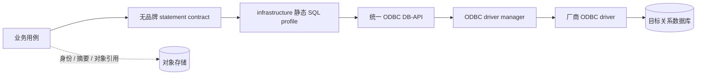
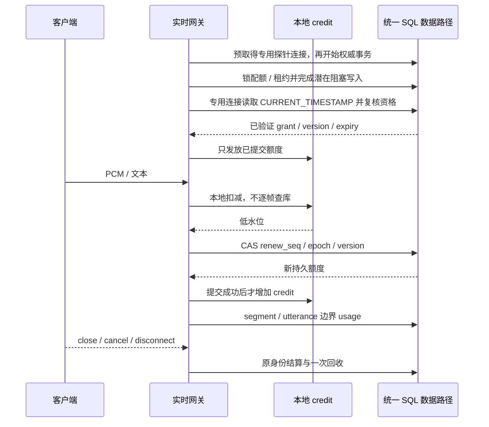

# 可移植数据契约与实时预算设计

本文冻结 PostgreSQL、MySQL、Oracle、OceanBase 共同的**应用数据契约**、逻辑 schema、事务语义与
驱动边界，作为 [ADR 0016](../decisions/0016-database-portability-core.md)的实施设计。同一应用产物
不得因品牌分叉领域、应用、事务、锁序、错误恢复或计量语义；目标库可通过受控的物理 DDL 和少量静态
SQL profile 表达数据库级差异。迁移数据库只改变 DSN、ODBC driver、实例、schema 部署制品和显式
profile 选择，不修改业务软件设计。

**首发数据库范围是 PostgreSQL。** 首发必须完成 PG 的实现、并发 / 故障 / 性能资格和 business consumer
联验；MySQL、Oracle、OceanBase 的 profile 与能力保持可扩展，但不作为首发门禁，也不得在完成目标库
资格前对外声明支持。

本文规定目标架构。当前 PostgreSQL 专用实现仍含 `FOR UPDATE`、`SKIP LOCKED`、upsert、
`RETURNING`、advisory lock、数据库通知、品牌时间和 SQLSTATE 分类；迁移完成前不得宣称目标已经达到。
允许方言差异不表示允许语义差异。除 PostgreSQL 外，目标库资格只在明确激活时建立，不会由设计存在
自动推导为已经支持。

## 1. 可移植性定义

### 1.1 必须成立的运行时条件

1. 同一应用产物不导入厂商数据库 SDK，不在领域、应用或业务用例中按数据库品牌分支，不加载品牌 repository。
2. 表、列、键、约束、索引覆盖和字段语义由同一 canonical 逻辑 schema revision 定义；目标库可使用受控物理 DDL profile。
3. 业务 DML 以同一规范化 statement contract 为默认路径；statement ID、参数形状、结果列、NULL 形状、事务边界、锁序和错误语义在全部 profile 中一致。
4. 仅当目标数据库无法执行同一 SQL 文本时，才允许在 `infrastructure` 内增加已登记、静态的 DML profile variant；不得在运行时探测数据库后拼接 SQL。
5. 所有 SQL 只使用 ODBC `?` 参数标记；数据库连接统一关闭 autocommit，由用例显式 `commit()` / `rollback()`。
6. 结果类型在公共 DB-API 边界统一为 `str`、`Decimal`、`datetime`、`None` 等稳定值。
7. 迁移数据库可替换 ODBC driver、DSN、连接配置、数据库实例、物理 DDL 制品和显式 SQL profile 选择；不修改领域、应用、事务和公开协议。

### 1.2 不等于运行时替换的部分

- 新数据库仍须从同一 canonical 逻辑 schema 的对应物理 DDL profile 执行一次 schema bootstrap。
- 存量数据仍需一次性复制、校验、切换与回退；这一过程可能使用独立运维工具。
- 数据库实例必须按共同前提配置：UTC、Unicode 编码、字符长度语义、足够的 ODBC driver 版本与最小权限。
- 目标数据库可能需要仓库内预置的静态 SQL profile；profile 选择属于部署配置，不是业务分支。

把数据搬迁或物理 DDL 生成也声称成“只换驱动”是不真实的。可验收的承诺是：**业务软件、逻辑
schema、statement contract、事务与恢复语义不因数据库品牌变化；数据库级差异只存在于已声明的
物理 DDL、部署期 DML 和受限运行时 SQL profile 中。**

## 2. 总体结构



应用不定义“PostgreSQL adapter / MySQL adapter”。业务用例依赖 statement contract，唯一数据访问入口
仍是共同 ODBC DB-API。`pyodbc` / `aioodbc` 一类统一 ODBC 接口可以保留。受限 SQL profile 是
`infrastructure` 内的声明式静态制品，不是按品牌分叉的 repository、业务 adapter 或查询生成器。

## 3. 驱动契约

厂商 ODBC driver 由统一 DB-API 使用，必须满足以下契约：

| 维度 | 契约 | 验证 |
| --- | --- | --- |
| 参数 | SQL 使用 ODBC `?` 参数；绑定 Python `str`、`Decimal`、`datetime`、`None` | 同一 statement contract 在全部目标 profile 执行；`%s` / `:1` / `$1` 被 guard 拒绝 |
| 事务 | autocommit 关闭；`commit()` 成功才表示提交，异常/断连视为 unknown | 提交未知探针 |
| 行数 | DML 后 `rowcount` 表示实际影响行数；0 为 CAS 失败 | 并发 CAS 测试 |
| 十进制 | `DECIMAL` 不经过 float；应用统一转 `Decimal` | 精确计数、预算与样本区间 |
| 时间 | 预取得专用主库连接执行 `SELECT CURRENT_TIMESTAMP`，统一转换为 UTC `datetime` 后作为参数传入事务；不依赖各库函数的事务时间语义 | 跨库时间 round-trip、锁等待与连接池耗尽反例 |
| 文本 | UTF-8 字符串原样往返；所有 `VARCHAR(n)` 在应用层按 UTF-8 字节数限制为不超过 `n`；Oracle 空串问题由应用禁止空串规避 | 多语言文本、边界长度、NULL、空串反例 |
| 异常 | 业务不读取 SQLSTATE / vendor error code | 注入品牌错误字符串仍不改变行为 |
| 结果 | 列名、顺序和 NULL 形状由 statement contract 固定 | 同一 behavior oracle 在已激活 profile 上逐行一致 |

任何 driver 不满足契约，只能标记“不支持”，不能添加业务适配分支绕开。

## 4. 共同 SQL 语义子集与受限方言

### 4.1 允许的语句

- 单行 `INSERT INTO ... VALUES (...)`。
- 按主键 / 唯一键读取，带固定列清单的 `SELECT`。
- 基础 `JOIN`、静态 `WHERE`、`GROUP BY`、确定性 `ORDER BY`。
- 条件 `UPDATE` / `DELETE`，以 `rowcount` 判定 CAS。
- `CASE`、`COALESCE`、`COUNT`、`SUM` 等四库共有标量或聚合表达式。
- 单行、显式事务内的 `SELECT ... FOR UPDATE`。

同一 statement contract 默认使用共同 SQL 文本。目标驱动无法执行共同文本时，可在 §4.4 的受控
profile 中提供等价实现；不得把 profile 当作引入不同事务模式或品牌快特性的通道。

### 4.2 禁止的语句与能力

| 禁止项 | 替代方案 |
| --- | --- |
| `ON CONFLICT` / `ON DUPLICATE KEY` / `MERGE` | 先 `INSERT`；失败回滚后按唯一键查询原身份 |
| `RETURNING` / `LAST_INSERT_ID` / sequence / identity | 应用生成 ULID；提交后按 ID 查询 |
| `SKIP LOCKED` / `NOWAIT` / advisory lock / `LOCK TABLE` | claim bucket + 单行 CAS；预算 / stream head 使用 `FOR UPDATE` |
| 数据库通知 / job 调度函数 / 触发器 | 持久 outbox + 轮询 + bucket |
| `LIMIT` / `OFFSET` | keyset 条件 + `cursor.fetchmany(page_size + 1)` |
| 动态 `IN (?, ?, ...)` 扩展 | 固定小集合，或逐身份读取；列表查询走分页与 join |
| CTE / 窗口函数 / `FILTER` / 递归查询 | 预计算列、单行 head 与普通索引查询 |
| JSON / JSONB / 数组 / 区间类型 / 枚举 / `BOOLEAN` | 列式短字符串、`CHAR(1)`、`DECIMAL`；大对象放对象存储 |
| `TEXT` / `CLOB` / `BLOB` | 对象存储 + `VARCHAR` 引用 / 摘要 |
| 存储过程、函数、触发器、运行期 DDL | 应用事务 + 部署期 SQL migration |

### 4.3 参数与 SQL 文本规则

- 只允许 ODBC qmark 参数 `?`；禁止字符串插值和手工 SQL 转义。
- 表、列、索引名使用 ASCII 小写、无引号、长度不超过 30；避免保留字。
- SQL 文本来自常量模块、经审查的查询构造器或 `infrastructure` 静态 profile catalog；领域、应用和业务用例中的品牌分支在静态检查中直接失败。
- 每个 statement 必须在 manifest 登记 ID、语义版本、参数形状、结果列、NULL 形状和行为 oracle；profile variant 不得增删这些契约。
- 每个部署显式选择最多一个 SQL profile；应用产物可以包含全部 profile，但不得在运行时按数据库元数据自动猜方言或拼接 SQL。
- `SELECT` 不只做 `SELECT 1`：Oracle 需要 `FROM`，健康检查统一读取 `schema_meta` 的单行。
- 动态排序字段不得来自用户输入；分页、过滤和投影集合固定。
- 权威数据库时间通过独立短探针读取：
  `SELECT CURRENT_TIMESTAMP, schema_rev, schema_fingerprint, authority_epoch FROM schema_meta WHERE meta_id = ?`。
  该行提供共同 `FROM` 锚点、schema 身份和权威代次，不持久化时间。调用方先预取得专用探针连接，在
  写事务完成最后一次潜在等待后读取该行；返回的 UTC `datetime` 只用于当前决定，并立即比对期望的
  schema revision / fingerprint / authority epoch。不得依赖 `CURRENT_TIMESTAMP` 在写事务内的事务开始语义。

### 4.4 受限 DDL / DML 方言边界

允许的数据库级差异：

- 物理 DDL 中的等价类型拼写、索引 / 约束声明顺序和语法、字符集 / 表空间等部署属性；
- schema bootstrap、数据搬迁、备份恢复和运维检查所需的目标库部署脚本；
- 共同 SQL 文本无法执行时，在静态 profile catalog 中登记的单 statement 等价 DML variant；
- ODBC driver、DSN、连接参数和目标实例差异。

不允许的差异：

- 表、列、键、NULL 性、唯一性、外键、索引覆盖或约束语义不同；
- statement 的参数形状、结果列、NULL 形状、排序、分页或幂等身份不同；
- 事务边界、锁序、锁类型、对默认隔离级别的依赖、CAS / `rowcount` 判定、重试或提交未知语义不同；
- 以 profile 名义引入 §4.2 禁止的 upsert、`RETURNING`、`SKIP LOCKED`、advisory lock、数据库通知等能力；
- 未登记的 profile、按品牌加载的 repository / adapter，或领域和应用层读取 profile 身份；
- 使用 ORM / SQLAlchemy 自动生成方言，或根据查询失败在运行时切换到另一 profile。

profile manifest 至少记录 `profile_id`、数据库族与模式、支持版本、statement ID、SQL 摘要、参数 /
结果签名、等价性依据和目标资格报告。新增 variant 必须说明为何共同 SQL 不可用；若差异改变任何
业务不变量，结论是该数据库不支持，而不是增加 profile。

## 5. 数据类型

| 语义 | 唯一类型 | 约定 |
| --- | --- | --- |
| ID | `VARCHAR(128)` | 新身份由应用生成 ULID；保留现有短 ASCII 身份，禁止为空 |
| 短标识 / 枚举 | `VARCHAR(64)` | ASCII 小写，禁止空串 |
| 摘要 | `CHAR(64)` | SHA-256 小写十六进制 |
| 状态 / 布尔 | `CHAR(1)` | 固定单字符；布尔 `Y/N` |
| 数量 / 预算 / 样本坐标 | `DECIMAL(38,0)` | 不用 float；Python `Decimal` |
| 时间 | canonical 语义为 UTC 时间 | 默认物理类型 `TIMESTAMP(6)`；目标 profile 的等价类型必须冻结范围、精度、UTC 转换和比较语义，NULL 表示未设置 |
| 对象引用 | `VARCHAR(1024)` | ASCII 规范引用；不进入唯一索引 |
| 用户可见短文本 | `VARCHAR(255)` / `VARCHAR(2000)` | 数据库 UTF-8；应用按 UTF-8 字节数限长；缺失用 NULL，空串在入口拒绝 |

禁止依赖数据库默认值、数据库时区、数据库 UUID、数据库序列和自动更新时间。所有值由应用显式写入。

## 6. canonical schema

### 6.1 canonical 逻辑 schema、命名与约束

- schema 只有一个 canonical 逻辑定义，按 revision 建立；目标库物理 DDL profile 可以不同，但不得改变表、列、键、约束、索引覆盖和字段语义。运行角色无 DDL 权限。
- 表名与现有 owner 表保持一致，使用 ASCII 小写且无品牌前缀；主键列名稳定，外键仅使用普通
  `FOREIGN KEY`，不使用级联删除。
- 唯一键承担幂等身份；业务多列不变量由应用事务维护，不依赖部分索引或数据库函数。
- 索引只使用普通 B-tree、固定列顺序，不使用表达式索引、部分索引、GiST 或覆盖索引语法。

### 6.2 核心表

| 表 | 职责 | 关键唯一键 / 索引 |
| --- | --- | --- |
| `schema_meta` | schema revision / fingerprint、权威代次、独立数据库时间探针所需的单行 `FROM` 锚点 | `meta_id` PK |
| `coordination_jobs` | Job 身份、状态、version、每 Job 事件游标 head、bucket、claim owner/lease | `job_id` PK；`(operation_id,attempt_id)` 唯一 |
| `public_job_events` | 公共 Job SSE 的持久事件与精确续读序号 | `(job_id,event_seq)` PK；`event_seq >= 0` |
| `coordination_outbox` | 可靠投递、唤醒与重复投递去重，不定义公共 SSE 顺序 | `event_id` PK；`(job_id,event_digest)` 唯一 |
| `coordination_claim_buckets` | 有限逻辑并发、bucket owner/lease/version | `bucket_no` PK |
| `admission_leases` | 执行 / 引擎 / 资源租约与 fencing | `lease_id` PK；`(operation_id,attempt_id,stage_id)` 唯一 |
| `workspace_quotas` | workspace 并发上限、held / quarantine / version | `workspace_id` PK |
| `admission_budget_grants` | 实时会话持久 grant、epoch、续租序号 | `grant_id` PK；`(session_id,epoch,renew_seq,meter_kind)` 唯一 |
| `usage_intervals` | 输入 / 输出不可变计量区间 | `interval_id` PK；`(stream_id,meter_kind,start_units,end_units)` 唯一 |
| `output_stream_heads` | 每个逻辑输出流的串行化 head / version | `(operation_id,attempt_id,output_stream_id)` PK |

### 6.3 设计 DDL 片段

以下 DDL 是 canonical 逻辑 schema 示例，只使用共同类型与基础约束；目标物理 DDL profile 可按 §4.4
调整等价语法，但必须生成相同逻辑 fingerprint。PostgreSQL 首发物理 DDL 必须在真实 PG 执行，其他目标
只在激活资格时执行；当前文件不代表已经验证。

```sql
CREATE TABLE schema_meta (
    meta_id VARCHAR(32) NOT NULL,
    schema_rev VARCHAR(64) NOT NULL,
    schema_fingerprint CHAR(64) NOT NULL,
    authority_epoch DECIMAL(38,0) NOT NULL,
    PRIMARY KEY (meta_id)
);

CREATE TABLE coordination_jobs (
    job_id VARCHAR(128) NOT NULL,
    operation_id VARCHAR(128) NOT NULL,
    attempt_id VARCHAR(128) NOT NULL,
    request_digest CHAR(64) NOT NULL,
    bucket_no DECIMAL(10,0) NOT NULL,
    job_state CHAR(1) NOT NULL,
    version DECIMAL(38,0) NOT NULL,
    last_event_seq DECIMAL(38,0) NOT NULL,
    claim_owner_id VARCHAR(128),
    claim_until TIMESTAMP(6),
    due_at TIMESTAMP(6) NOT NULL,
    created_at TIMESTAMP(6) NOT NULL,
    updated_at TIMESTAMP(6) NOT NULL,
    PRIMARY KEY (job_id),
    CHECK (last_event_seq >= -1),
    UNIQUE (operation_id, attempt_id)
);

CREATE INDEX coordination_jobs_ready_idx
    ON coordination_jobs (bucket_no, job_state, due_at, job_id);

CREATE TABLE public_job_events (
    job_id VARCHAR(128) NOT NULL,
    event_seq DECIMAL(38,0) NOT NULL,
    event_digest CHAR(64) NOT NULL,
    event_kind VARCHAR(64) NOT NULL,
    occurred_at TIMESTAMP(6) NOT NULL,
    payload_ref VARCHAR(1024),
    PRIMARY KEY (job_id, event_seq),
    CHECK (event_seq >= 0)
);

CREATE TABLE coordination_claim_buckets (
    bucket_no DECIMAL(10,0) NOT NULL,
    version DECIMAL(38,0) NOT NULL,
    claim_owner_id VARCHAR(128),
    lease_until TIMESTAMP(6),
    PRIMARY KEY (bucket_no)
);

CREATE TABLE workspace_quotas (
    workspace_id VARCHAR(128) NOT NULL,
    max_attempts DECIMAL(38,0) NOT NULL,
    held_attempts DECIMAL(38,0) NOT NULL,
    quarantined_attempts DECIMAL(38,0) NOT NULL,
    version DECIMAL(38,0) NOT NULL,
    updated_at TIMESTAMP(6) NOT NULL,
    PRIMARY KEY (workspace_id)
);

CREATE TABLE admission_budget_grants (
    grant_id VARCHAR(128) NOT NULL,
    session_id VARCHAR(128) NOT NULL,
    lease_id VARCHAR(128) NOT NULL,
    owner_id VARCHAR(128) NOT NULL,
    epoch DECIMAL(38,0) NOT NULL,
    renew_seq DECIMAL(38,0) NOT NULL,
    meter_kind VARCHAR(32) NOT NULL,
    granted_amount DECIMAL(38,0) NOT NULL,
    consumed_amount DECIMAL(38,0) NOT NULL,
    returned_amount DECIMAL(38,0) NOT NULL,
    version DECIMAL(38,0) NOT NULL,
    expires_at TIMESTAMP(6) NOT NULL,
    created_at TIMESTAMP(6) NOT NULL,
    PRIMARY KEY (grant_id),
    UNIQUE (session_id, epoch, renew_seq, meter_kind)
);

CREATE TABLE output_stream_heads (
    operation_id VARCHAR(128) NOT NULL,
    attempt_id VARCHAR(128) NOT NULL,
    output_stream_id VARCHAR(128) NOT NULL,
    version DECIMAL(38,0) NOT NULL,
    max_end_units DECIMAL(38,0) NOT NULL,
    updated_at TIMESTAMP(6) NOT NULL,
    PRIMARY KEY (operation_id, attempt_id, output_stream_id)
);

CREATE TABLE usage_intervals (
    interval_id VARCHAR(128) NOT NULL,
    session_id VARCHAR(128) NOT NULL,
    attempt_id VARCHAR(128) NOT NULL,
    stream_id VARCHAR(128) NOT NULL,
    meter_kind VARCHAR(32) NOT NULL,
    start_units DECIMAL(38,0) NOT NULL,
    end_units DECIMAL(38,0) NOT NULL,
    fact_hash CHAR(64) NOT NULL,
    PRIMARY KEY (interval_id),
    UNIQUE (stream_id, meter_kind, start_units, end_units)
);

CREATE INDEX usage_intervals_stream_idx
    ON usage_intervals (stream_id, start_units, end_units);
```

真实 schema 还包含 Operation、asset、artifact、binding、policy 等表，但只允许复用以上类型、
命名和约束规则。完整命令、正文、音频和大 JSON 只保存对象引用与摘要。

## 7. 事务模式

### 7.1 幂等插入

不在 SQL 中做“存在则更新”。业务使用确定性唯一键：

1. 应用先生成 ULID 和 `request_digest`。
2. `SELECT` 唯一键；已存在且摘要一致，返回原结果；摘要不同，冲突。
3. 不存在则执行单行 `INSERT`。
4. 任一未提交异常：尝试 `rollback` 后在新连接上按唯一键查询；不读取品牌错误码。
5. `commit()` 异常：返回 `commit_unknown`，后续只按原身份查询。

事务不依赖数据库默认隔离级别或品牌隔离语法。权威判断只来自条件写入的 `rowcount`、唯一约束和
显式行锁。未执行 `commit()` 前出现异常时，整笔事务按回滚处理；只有确认原身份不存在、仍满足
deadline 且使用完全相同业务键时才允许重新执行，不做基于品牌 error code 的透明重试。

需要数据库时间参与的写路径按以下顺序执行：

1. 先从独立探针池取得一条专用连接；容量不足时在开启写事务前限流，禁止持有写锁等待探针连接。
2. 开启写事务并按固定锁序取得权威行锁。
3. 完成全部可能在事务内等待的 `INSERT` / `UPDATE`，包括唯一键、外键和父行等待。
4. 在专用连接上执行一次只读时间探针，确认它属于同一权威主库和部署代次；把返回的 UTC `datetime`
   绑定到当前事务。
5. 回到写事务，对 owner、version、epoch、lease 和 deadline 做最后一次资格复核；此后不再执行会
   改变该决定的事实读取。
6. 复核通过后提交；任一步失败或共享硬 deadline 到期，整笔事务回滚。

不能只在行锁之后读取时间而忽略后续唯一键 / FK 等待，也不能让共享池中的写事务等待第二个连接而
形成池内互锁。探针池容量至少覆盖允许并发的写事务；探针必须连接同一权威主库并立即用于当前决定；
不能在不同数据库品牌间假定 `CURRENT_TIMESTAMP` 的事务快照语义相同。探针失败、超时或可能落到副本时，
当前写事务回滚，不授予资源、不释放预算，也不回退到应用时钟。`commit()` 仍按 `commit_unknown` 处理。

### 7.2 配额与预算准入

完整配方在同一事务中按固定锁序锁定需要变更的配额与资源权威行。workspace 并发额度示例：

```text
  SELECT max_attempts, held_attempts, quarantined_attempts, version
    FROM workspace_quotas
   WHERE workspace_id = ?
     FOR UPDATE
  校验剩余额度并计算新值
  UPDATE workspace_quotas
     SET held_attempts = ?, version = ?, updated_at = ?
   WHERE workspace_id = ? AND version = ?
```

随后按同一固定顺序锁 host/instance 预算行，并在同一事务插入 Job/outbox、lease 和 grant。
任何一步影响行数不符或约束失败，整个事务回滚。不在事务内执行推理、HTTP、对象上传或长编码。

### 7.3 Job / outbox claim bucket

不使用 `SKIP LOCKED`。固定数量 bucket 将竞争范围从全表缩小到单个 bucket：

```text
1. SELECT version, claim_owner_id, lease_until FROM coordination_claim_buckets WHERE bucket_no = ?
2. UPDATE coordination_claim_buckets SET version = ?, claim_owner_id = ?, lease_until = ?
    WHERE bucket_no = ? AND version = ?
      AND (claim_owner_id IS NULL OR lease_until <= ?)
3. rowcount = 0 时放弃并按退避重试
4. bucket 持有者读取该 bucket 的 ready Job，按 due_at, job_id 取第一个
5. 在认领该 Job 的同一事务再次校验 bucket、Job 与 outbox 的当前 owner / version / lease；任一不再
   匹配则重新扫描，不能继续使用 stale 候选
6. CAS 更新 Job / outbox version、state、claim_owner、claim_until；rowcount = 1 才执行
7. 结果发布再次校验 Job owner/version/epoch；旧 owner 只能失败或隔离
```

bucket lease 只限制 dispatcher 进入，不证明 worker 在任意后续时刻仍有排他调度资格；Job / outbox
lease 单独控制执行归属。每次实际认领都必须在同一事务按 `bucket → Job → outbox` 固定顺序复核 bucket
fencing，避免旧 dispatcher 在 bucket 过期后继续消费 stale 候选。这样无需数据库跳跃锁、通知或全表长期锁，
Job CAS 仍是单 Job 唯一执行权威。

### 7.4 outbox 与事件流

- 公共 Job SSE 使用每 Job 持久、连续、唯一的 `(job_id,event_seq)`；`event_seq` 在锁定
  `coordination_jobs` 权威行后生成，并与 Job 当前指针和事件行同事务提交。
- `coordination_jobs.last_event_seq` 从 `-1` 开始，作为每 Job 事件序号 head；事务内取
  `next_seq = last_event_seq + 1`，插入事件并更新 head。事件表以 `(job_id,event_seq)` 为主键；
  `Last-Event-ID` 只比较该序号，不使用 `created_at`、`event_id` 或提交墙钟排序。线路 `id` 保持
  `event_seq + 1` 的既有公开语义。
- 全局 `coordination_outbox` 只承担可靠投递与去重，可以继续使用应用生成 ULID `event_id`；它不定义
  公共 SSE 的跨事件顺序，也不引入全局 sequence。
- outbox 行与相关状态变更同事务写入；投递 worker 通过 bucket 获取待办，通知缺失时持久轮询继续推进。
- 重复投递按 `event_id` 与 `(job_id,event_digest)` 唯一键去重。SSE 历史过期返回
  `410 event_history_expired`，客户端再读取当前 Job，不伪造历史。

反例：事务 A 较早取得墙钟时间但晚提交、事务 B 较晚取得时间但先提交时，按 `(created_at,event_id)`
推进的客户端会永久跳过 A。每 Job `event_seq` 必须在同一权威 head 排序下生成，才能支持精确续读。

### 7.5 分页与批量读取

- 不使用 `LIMIT/OFFSET`。按 `(created_at, id)` 加 keyset 谓词，`ORDER BY` 使用相同方向和列。
- 多取一条判断 `has_more`；返回的整页对象按固定顺序读取。
- 禁止运行时拼接可变 `IN` 列表；需要批量关联时使用规范 join 或按身份逐项读取，并限制 fan-out。

### 7.6 区间追加

1. `SELECT version FROM output_stream_heads
   WHERE operation_id=? AND attempt_id=? AND output_stream_id=? FOR UPDATE`。
2. 在持有 head 锁的同一事务中执行当前读/锁定读，先按同一 stream、meter、
   `[start_units,end_units)` 和 `fact_hash` 查询精确重放；命中且摘要一致返回原区间，摘要不同冲突。
3. 再执行 `start_units < ? AND end_units > ?` 的重叠检查；任何非精确重叠都拒绝。
4. 插入 `usage_intervals`，更新 output stream head version 和 `max_end_units`，提交。

必须使用锁定读取或等价的锁后权威读取，不能让先建立的一致性快照决定重叠；唯一键只防完全相同的
区间，不能代替应用层部分重叠检查。不使用 GiST、范围约束、触发器或数据库函数。

## 8. 实时预算 grant 与本地 credit

### 8.1 数据路径



### 8.2 不变量

- 对每个 grant，`persisted_consumed + locally_unsettled_consumed + returned + outstanding_credit
  <= granted_amount`。
- `outstanding_credit >= 0`，`locally_unsettled_consumed >= 0`；结算只把本地已消费量迁移到持久量，
  不重复增加总消费。
- 每次新增本地 credit 之前，对应 grant / 续租已成功提交。
- 旧 epoch / version / owner 的续租或 usage 更新 `rowcount=0`。
- 数据库不可用短于 credit 余量时继续；超过余量时背压或有限 drain。
- 提交未知时保留本地和持久预算，不按应用估算退款。

### 8.3 崩溃恢复证据

本地 credit 可以避免逐帧查库，但不能成为崩溃后唯一的用量账本。每种 meter 必须在消费越过不可恢复
边界前冻结可由新进程读取的证据；证据缺失时保留原 grant 并进入 quarantine，不得伪造零消耗、自动
退款或宣称精确结算。

| meter | 冻结时点 | 恢复证据 | 证据缺失时 |
| --- | --- | --- | --- |
| ASR accepted samples | 把输入标记为 accepted 前或同一边界 | 持久接收区间 / 水位、可重放输入或上游回执 | 保留 grant，quarantine |
| TTS frozen input | 文本首次冻结并进入引擎前 | 正文摘要、codepoint 数、冻结 revision | 拒绝执行或保留预留 |
| TTS generated PCM | 生成区间事实形成后 | 网关 / 引擎生成区间、样本水位或可信停止证据 | 保留 grant，quarantine |

允许在 chunk、VAD 段、utterance 等有界边界批量持久化，不需要每帧查库。只有已提交 usage interval
或可恢复证据能证明消费；进程内计数器、投递字节数和本地播放进度都不能单独证明最终用量。

### 8.4 计量

| 流 | 单位 | 边界 |
| --- | --- | --- |
| ASR 输入 | accepted canonical samples | `[start,end)`，按 segment / utterance 聚合 |
| TTS 输入 | 首次冻结正文 Unicode scalar values | commit / finish 后写一次 |
| TTS 输出 | generated canonical PCM samples | 每个 attempt 的真实生成区间 |

credit 不需要每帧绝对精确，但持久授权不能超发，最终 usage interval 必须精确、可重放且只结算一次。
delivered / received / played 只作诊断，不替代生成或接受量。

## 9. 目标库边界条件

| 边界 | 统一规则 |
| --- | --- |
| Oracle 空字符串等于 NULL | 入口禁止 `""`；缺失统一 NULL；各激活目标验证同一行为 |
| 时间类型 / 时区 | 实例和会话 UTC；时间类型在 canonical schema 中统一语义，物理 DDL profile 必须逐库证明范围与时区转换；专用主库连接在最后一次潜在等待后读取 `CURRENT_TIMESTAMP`，driver 输出统一 UTC |
| MySQL 默认隔离级别 | 不依赖普通一致性读做权威判断；多行决策使用 `FOR UPDATE` 或 bucket CAS |
| OceanBase 双模式 | MySQL 与 Oracle 模式都作为独立目标运行同一逻辑 schema、statement contract 和行为 oracle |
| ODBC 参数 | 只允许 `?`；不使用 Python driver 的 `%s` / `:name` / `$1` 风格 |
| 分页 | keyset + cursor fetch；不用 `LIMIT/OFFSET` |
| 数值 | `Decimal`，禁止 float；所有预算与样本坐标用 `DECIMAL(38,0)` |
| 大对象 | 不进入数据库；对象存储保存正文、音频、完整命令和事件大 payload |
| Unicode | 数据库按 UTF-8 / Unicode 配置；所有 `VARCHAR(n)` 按 UTF-8 字节数限长，避免 Oracle 字节与 MySQL 字符长度口径分叉 |

## 10. schema 与数据迁移

### 10.1 schema 迁移

- schema 变更由单一 canonical 逻辑 revision 管理；每个目标物理 DDL profile 记录 SQL 摘要、apply 顺序和逻辑 fingerprint，部署角色执行，应用账号只有 DML 权限。
- expand / migrate / switch / contract 分开执行；运行时不检查后自动建表。
- 任何物理 DDL profile 必须在对应固定版本目标执行；差异只允许落在 §4.4 的类型拼写、约束 / 索引语法和部署属性内。
- 四个目标必须登记相同的表、列、键、约束、索引覆盖和字段语义 fingerprint；差异不在 allowlist 即资格失败。
- 迁移脚本可以重复检查 schema revision，但不得依赖品牌 upsert、database function 或 DDL 事务。

### 10.2 数据搬迁

数据搬迁不属于运行时驱动替换，具体要求：

- 从源库按业务身份导出，写目标库时使用同一 canonical schema 与同一应用写入路径。
- 切换前完成行数、摘要、预算、租约、outbox、区间和终态的逐项对账。
- 双写不作为默认方案；若临时使用，必须有单一胜出权威或明确的 fencing，不能产生双账本。
- 回退保留源库、源快照、导出摘要与切换窗口；数据搬迁成功不等于实时 / 物理集群资格完成。

## 11. 测试与资格

### 11.1 同一测试程序与数据

首发在固定 PostgreSQL 版本运行同一应用产物、statement contract 与行为 oracle，并验证所有并发、
提交未知、事件续读、区间、credit 崩溃恢复和实时 SLO 反例。PostgreSQL 的物理 DDL 与运行时
statement 是最先取得生产资格的 profile。

后续激活其他目标时，运行同一应用产物、statement contract 与行为 oracle，只切换 DSN、ODBC driver、
schema 物理 profile 和显式 SQL profile：

- PostgreSQL 固定版本。
- MySQL 固定 8.4 LTS 或项目实施时冻结的兼容版本。
- Oracle 固定版本（如 19c 或项目目标版本）。
- OceanBase MySQL 模式。
- OceanBase Oracle 模式。

数据库版本、ODBC driver 版本、Unicode / UTC / 字符长度配置、逻辑 schema fingerprint、物理 DDL
摘要、SQL profile、statement manifest 摘要和差异 allowlist 均写入对应目标资格报告。首发 PG 报告
必须包含真实业务消费者和实时链路；其他目标的报告只在该目标被激活时生成。

### 11.2 必测反例

- 在领域 / 应用层注入 PostgreSQL 导入、SQLSTATE、品牌分支、profile 身份或 `%s` 参数，static guard 变红。
- 未登记的 profile、profile 增删 statement、改变参数 / 结果 / NULL 形状或改变事务结构，manifest guard 变红。
- 在任一物理 DDL profile 删除列 / 键 / 约束、改变 NULL 性 / 唯一性 / 索引覆盖或引入 allowlist 外差异，schema fingerprint guard 变红。
- 把 `?` 改成另一个 driver 的参数风格，DB-API conformance 变红。
- 在任一 profile 中加入 `SKIP LOCKED`、`RETURNING`、`JSONB` 或 `LIMIT`，SQL subset guard 变红。
- 移除 Job version / epoch 条件，两个 worker 的“唯一赢家”测试变红。
- 在加本地 credit 前跳过 grant 提交，grant 上限测试变红。
- 允许空字符串写入，Oracle 语义测试变红。
- 锁等待 / 唯一键等待后用写事务内 `CURRENT_TIMESTAMP` 或应用时钟替代独立新鲜探针，测试变红。
- 写事务占满探针池或探针落入副本时仍成功授予，连接池 / 主库身份测试变红。
- 按 `(created_at,event_id)` 产生 SSE 顺序并以逆序提交重放，测试必须出现漏事件并失败；按 `(job_id,event_seq)` 必须无漏事件。
- bucket lease 过期后旧 dispatcher 仍认领下一个 Job，bucket fence 测试必须失败。
- 区间先做重叠检查或使用锁前快照，精确重放与逆序提交测试必须失败。
- ASR / TTS 在已接受或已生成后 kill 进程且没有恢复证据，必须进入 quarantine 而不是完成精确结算。
- 同一测试程序切换目标时，应用产物、逻辑 schema fingerprint 和 statement manifest 摘要保持不变。

### 11.3 资格边界

PostgreSQL 单元和合成集成通过，不等于：

- 真实引擎、真实音频、真实 GPU 或浏览器联验；
- 主备切换、备份恢复、网络分区、数据库故障窗口；
- 大规模数据搬迁或在线切换；
- 性能、容量、GC、锁等待和 P95/P99 达标。

## 12. 性能与高 ROI

| 优先级 | 方案 | 成本 | 收益 |
| --- | --- | --- | --- |
| P0 | 共同 SQL 语义、canonical schema、受限 profile 与静态 guard | 中 | 允许少量物理方言，同时阻止业务和语义分叉 |
| P0 | 应用 ULID、插入原身份查询、commit unknown | 低到中 | 首发 PG 可靠恢复，并为后续目标保留可移植语义 |
| P0 | claim bucket + 单行 CAS + outbox 轮询 | 中 | 替代 `SKIP LOCKED` 和通知，正确性可移植 |
| P0 | 实时 grant、本地 credit 与边界 usage | 中 | 数据库短抖不穿透音频热路径，预算不超发 |
| P1 | 目标库 contract / profile conformance harness | 中到高 | PostgreSQL 首发先验收，其他目标激活时复用 |
| P1 | 普通索引与 keyset 分页优化 | 低 | 弥补最低公分母查询的不足 |
| P2 | 数据搬迁工具与切换演练 | 高 | 解决实际迁移，同时保持应用和逻辑契约不变 |

先做前三项。新增品牌专用业务路径不再符合目标；接入其他数据库的方式是安装对应 ODBC driver、
应用同一 logical schema 的目标 DDL profile、选择已登记 SQL profile，并运行同一 behavior oracle。

### 12.1 实时语音性能与故障资格

“不逐帧查库”只证明架构隔离，不证明实时影响足够小。固定模型、拓扑、并发、数据库版本、驱动版本、
采样窗口和合成输入后，至少冻结并报告：

| 阶段 | 指标 | 接受边界 |
| --- | --- | --- |
| 会话准入 | P50 / P95 / P99 / P99.9、数据库耗时占比、超时率 | 不超过冻结的会话准入窗口；无未说明的连接池等待 |
| 首轮 grant | 首额度延迟、首个可播放 PCM / 有效 ASR 预览 | 控制面不得阻塞热路径；首包不回退到应用估值 |
| 持续会话 | 低水位续租 P99.9、credit 饥饿次数和最长持续时间 | 正常负载零饥饿；故障窗口只在已承诺 drain 内背压 |
| 结算 | segment / utterance 提交延迟、quarantine 率、未结量 | 不因结算排队超过有界 backlog |
| 双工与竞争 | ASR / TTS 首包和尾包、实时保留、batch 干扰 | batch 不占 realtime 保留；一个方向不得饿死另一个方向 |
| 数据库故障 | 延迟抬升、短断连、主备切换、副本误连 | 未超 credit 时连续；超时显式背压，且无预算外外发 |

每项同时报告数据库贡献与端到端总数，避免把模型、网络、浏览器或音频设备延迟误归因给 PG。SLO 值按
目标模型与硬件在资格报告中冻结；没有实测数据时只能标记未验证，不能写“影响足够小”。

## 13. 当前到目标的迁移

现有 PostgreSQL 路径必须分步收敛：

1. 清点 SQL 语句并收敛为 canonical statement ID，建立参数 / 结果 / 事务契约、允许 / 禁止清单和静态扫描。
2. 将应用生成 ULID、单行插入、rowcount CAS、回滚后原身份查询写入公共数据访问模块。
3. 把 Pool/Job/lease/outbox/usage 的 PG 专用 SQL 替换为共同 statement contract；只在无法执行共同文本时登记静态 profile；用 claim bucket 替代
   `SKIP LOCKED`，用应用区间检查替代 GiST / 触发器。
4. 将品牌异常、SQLSTATE、数据库时间、连接池和迁移工具移出业务层。
5. 建立 PostgreSQL 首发环境并验证 logical schema fingerprint、物理 DDL / SQL profile 和 ODBC driver；
   非 PG 目标只在激活时加入同一 harness。
6. 完成真实业务消费者的同一 behavior oracle 和 profile 资格后才允许切换或补充目标数据库。

迁移期间，旧 PostgreSQL 路径和新共同路径不能同时独占写入同一权威表；切换必须有 schema
revision、租约 / fencing 与回退证据。

## 14. 依据与核验

以下资料于 2026-11-21 核验；具体版本和实施资格仍需在目标环境锁定：

- [PEP 249](https://peps.python.org/pep-0249/)：DB-API 的 `paramstyle` 由实现定义，因此产品层需要
  固定统一接口，而不是假定厂商 Python driver 原生相同。
- [Microsoft ODBC 参数标记](https://learn.microsoft.com/en-us/sql/odbc/reference/syntax/sqlprepare-function?view=sql-server-ver17)：
  ODBC SQL 参数使用 `?`，适合作为统一 SQL 边界。
- [MySQL locking reads](https://dev.mysql.com/doc/refman/8.4/en/innodb-locking-reads.html)：显式事务中的
  `FOR UPDATE` 行锁可作为预算与 stream head 的单行串行化机制。
- [Oracle 事务控制](https://docs.oracle.com/en/database/oracle/oracle-database/26/zzpre/defining-controlling-transactions.html)：
  `SELECT FOR UPDATE OF` 锁定活动行，锁在事务结束时释放。
- [OceanBase SELECT FOR UPDATE](https://www.oceanbase.com/docs/enterprise-oceanbase-database-cn-10000000000377026)：
  MySQL / Oracle 模式均提供行锁查询。
- [PostgreSQL 日期时间函数](https://www.postgresql.org/docs/current/functions-datetime.html)：
  `CURRENT_TIMESTAMP` 在 PostgreSQL 取事务开始时间，说明锁等待后不能直接复用写事务内的该值；
  因此统一时间探针必须使用锁后的独立短事务。
