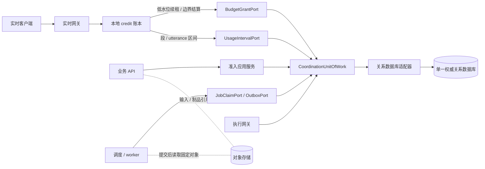
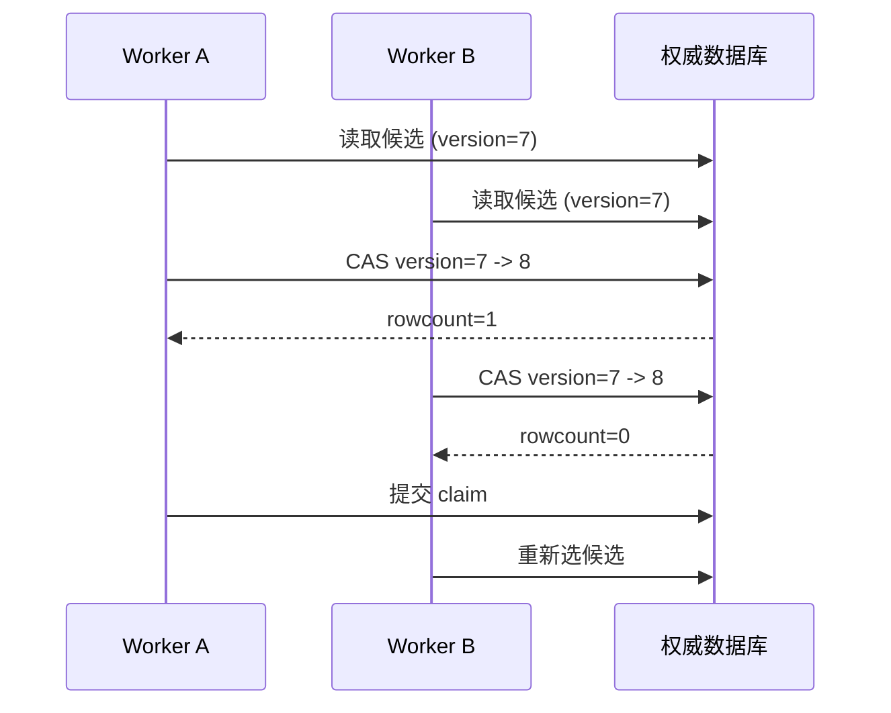
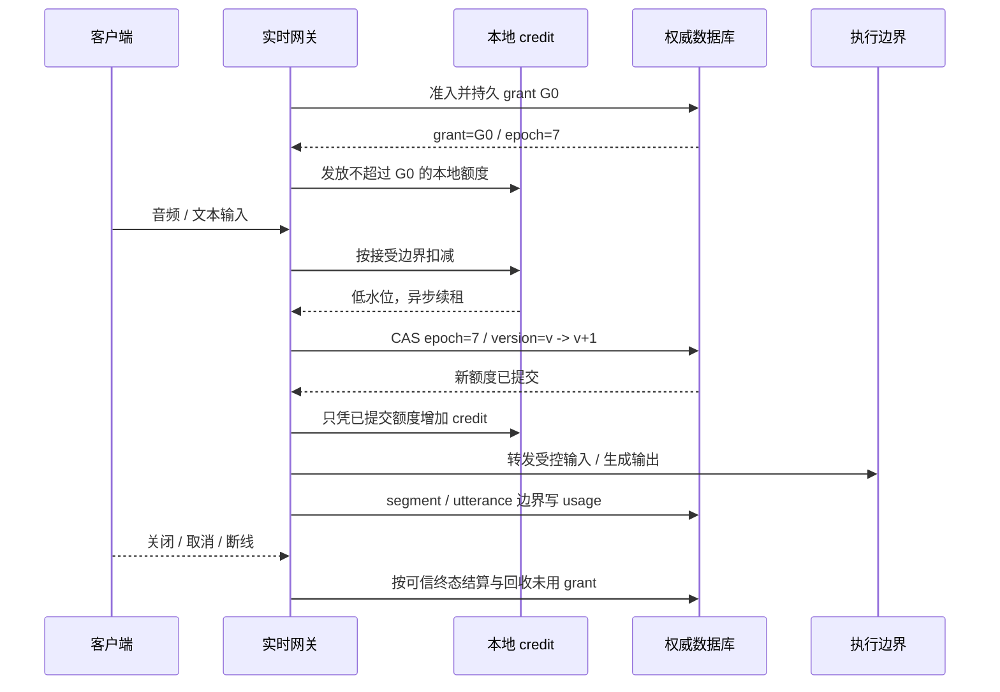

# 数据库可移植协调核心与实时预算设计

本文冻结数据库可移植协调核心、适配器边界与实时预算 grant / credit 方案，作为
[ADR 0016](../decisions/0016-database-portability-core.md)的实施设计。目标不是立即替换
PostgreSQL，而是在保留现有生产适配器的前提下，让业务正确性不再依赖特定数据库品牌。

本文规定目标语义。当前实现、适配器资格和实时链路证据仍以
[交付跟踪矩阵](../plans/delivery-tracking.md)为准；设计冻结不等于第二个适配器或实时链已交付。

## 1. 目标与边界

冻结以下约束：

1. 每个部署只使用一套权威关系数据库；配额、预算、租约、Job、outbox 和结算不跨权威库双写。
2. 领域与应用只依赖中立端口；品牌 SQL、驱动异常、SQLSTATE、数据库类型和专有通知留在适配器。
3. 基础正确性只依赖最小关系数据库能力；`SKIP LOCKED`、upsert、`RETURNING`、advisory lock、
   通知、JSONB、触发器和范围约束只作快路径或防御性优化。
4. 运行时 credit 可以保守聚合；持久 grant 不得超发；最终 usage interval 必须精确、可重放、
   只结算一次。
5. 实时语音不逐帧访问数据库；非实时内容不通过数据库传递；Job 表是协调事实，不是消息负载存储。

以下不在本文范围内：选择第二个数据库品牌、修改现有机器契约、实现公开实时路由、迁移生产数据、
取得主备切换或目标负载资格。

## 2. 当前事实与问题位置

PostgreSQL 是当前生产适配器；MySQL/InnoDB 只覆盖协调测试路径。现有代码中仍可看到 `FOR UPDATE`、
`SKIP LOCKED`、`ON CONFLICT`、`RETURNING`、advisory lock、`clock_timestamp()`、
`statement_timeout` 与 PostgreSQL SQLSTATE 分类。部分机制已经集中在基础设施，部分仍影响领域和
应用边界。

问题不在“是否使用 PostgreSQL”，而在“基础正确性是否只能由 PostgreSQL 证明”。如果 claim 只有
`SKIP LOCKED` 一种路径、预算续租依赖 advisory lock、通知丢失等同任务停滞，数据库品牌就事实上
进入了产品协议。

数据库在系统中的作用按负载区分：

| 负载 | 数据库职责 | 不应承担 |
| --- | --- | --- |
| 实时语音 | 会话准入、预算 grant、续租 CAS、epoch / owner 屏障、边界 usage、终态结算 | 每个音频帧、每个 TTS delta 的同步事务；音频内容传输 |
| 非实时语音 | 持久 Job、配方、配额 / 预算、outbox、重试、恢复与结果发布协调 | 音频正文、长推理、长 HTTP / 对象写入期间持有事务 |
| Job 调度 | 唯一身份、claim/version、lease、fencing、恢复和事件进度 | 消息总线式无限 payload、仅靠通知唤醒 |

## 3. 总体结构

实时音频数据只在客户端、实时网关与执行边界之间流动。数据库位于控制面；对象存储只承载
明确提交的输入和制品，不参与运行时音频帧转发。

## 4. 最小数据库能力契约

适配器必须对上层提供下列语义。机制可以不同，行为必须一致。

| 能力 | 契约 | 验证重点 |
| --- | --- | --- |
| 原子事务 | 多行、多表协调事实共同提交或回滚 | 中途失败无部分预算、lease 或 Job |
| 唯一约束 | 幂等键、业务唯一键和父子身份阻止重复事实 | 相同键并发只生成一个权威对象 |
| 无丢失更新 | 条件写入按 version / state / owner / epoch 成功或冲突 | 两写者竞争同一行只有一个赢家 |
| 稳定读取 | 事务内能读取本事务写入及已提交权威事实 | 不把旧 owner / 旧版本当作当前 |
| 事务时间 | 同一事务获得稳定 UTC 时间用于期限和锁后复核 | 应用时钟漂移不能提前释放或激活 |
| 错误分类 | 可区分冲突、重复、不可用、deadline、连接结果未知 | 应用不解析品牌 SQLSTATE |
| 迁移版本 | schema revision 可检查、可审计、只能由部署角色推进 | 应用启动不自动建表或猜迁移 |
| 原身份查询 | 可按 request / operation / claim / grant 身份读取原结果 | 提交未知不新建执行 |

“无丢失更新”可以由行级互斥、乐观 CAS 或可判定串行化冲突实现。适配器必须把底层冲突映射为
稳定错误类别；上层不得假定某个隔离级别名称天然等价。

### 4.1 明确不要求的品牌能力

- `SKIP LOCKED`、`FOR UPDATE`、`ON CONFLICT`、`RETURNING` 的具体语法。
- advisory lock、`LISTEN/NOTIFY` 或其他数据库内事件机制。
- JSONB、部分索引、表达式索引、触发器、GiST 范围约束。
- 单一 ORM、单一迁移工具或单一连接池实现。

这些能力可以获得性能或约束收益，但不能成为“缺少时无法保证正确性”的理由。

## 5. 端口与适配器边界

| 端口 | 上层语义 | 适配器负责 |
| --- | --- | --- |
| `CoordinationUnitOfWork` | 开启一个受限事务会话，提交或回滚全部协调事实 | 事务隔离、连接、语句边界、死锁 / 冲突转换 |
| `TransactionClockPort` | 在事务内取得 UTC 时间和 deadline 比较结果 | 品牌时钟函数或事务快照时间 |
| `DatabaseErrorPort` | 返回稳定错误分类与可重试提示 | 驱动异常、SQLSTATE、连接中断与提交未知映射 |
| `AdmissionPort` | 在一个事务内核对配额、预算、lease、Job/outbox | 条件写入、互斥、唯一冲突与影响行数 |
| `JobClaimPort` | 选出候选并取得唯一 claim/version | 候选查询、CAS 更新、可选跳过锁优化 |
| `OutboxPort` | 持久投递意图、待办位置和原身份重放 | 轮询、claim/version、可选通知唤醒 |
| `BudgetGrantPort` | 创建、续租、查询与回收持久预算 grant | epoch / version CAS、期限与幂等键 |
| `UsageIntervalPort` | 追加输入 / 输出区间并返回原事实 | 流级互斥、不可变追加、应用层重叠检查 |
| `IdentityQueryPort` | 按原身份查 Job、submit、grant 或 usage 结果 | 品牌查询与读取形状转换 |

领域对象只携带规范身份、版本、单位、区间与稳定错误枚举。适配器可以拥有 SQL、驱动类型、
连接池与方言分支；应用和领域不能导入它们。组合根选择适配器并注入。

## 6. Job / outbox 基础路径

### 6.1 无品牌特性的 CAS claim

基础路径不依赖 `SKIP LOCKED`：

1. 在一个短事务内按稳定排序读取候选 Job 身份、version、state 和 deadline。
2. 对每个候选执行条件更新：`WHERE id=? AND version=? AND state IN (...) AND deadline<=now`。
3. 影响行数为 1 者获得新 version / owner / deadline；0 表示竞争失败，重新读取候选。
4. 提交 claim 后才开始推理、HTTP、对象写入或长编码。
5. 结果发布再次验证 claim owner、version、lease、epoch 和策略；旧 claim 只能失败或隔离。

支持 `SKIP LOCKED` 的适配器可以在候选选择时跳过已锁行，减少空转；它不改变“唯一赢家、
提交后才执行、旧版本不可发布”的语义。候选扫描必须有界退避，不能因通知丢失无限空转。

### 6.2 outbox 与通知

- outbox 事实与 Job / 状态变更在同一事务写入，保存稳定事件身份、待投递状态和最小引用。
- worker 使用持久 claim/version 和轮询推进；数据库通知或 Redis 只缩短唤醒延迟。
- 通知丢失、发送者重启或消费者离线时，持久轮询仍能推进；通知重复不能产生重复业务事件。
- 投递结果未知时按 outbox 事件身份查询或重放，不创建新事件。

## 7. 时间、错误与提交未知

### 7.1 时间

租约、claim、grant、outbox 和 usage 的期限比较使用 `TransactionClockPort`。应用进程时钟只用于
本地 credit 的低水位估算、超时上限和日志，不用于判断数据库事实已经过期。数据库时间结果在同
一事务中稳定，防止“锁等待后使用旧 now”导致旧 owner 被错误接受。

### 7.2 稳定错误分类

上层至少需要以下分类：

| 类别 | 上层行为 |
| --- | --- |
| `conflict_retryable` | 重新读取权威事实并有界重试 |
| `duplicate_identity` | 查询原身份并返回原结果，不新建执行 |
| `unavailable` | 停止新准入或使用已有实时 grant；保留未知占用 |
| `deadline_exceeded` | 按事务语义回滚或进入有界背压 / 终态 |
| `commit_unknown` | 保持 unknown，按原身份查询；不退预算、不重复外发 |
| `invalid_request` | 确定性拒绝，不进入重试 |

适配器可以记录品牌错误码用于诊断，但业务分支只消费稳定类别。禁止在应用层散落 SQLSTATE 或驱动
异常判断。

### 7.3 提交未知

连接中断、超时或 deadline 后无法确认是否提交时，调用方不得自行推断“失败”。恢复流程使用原
request / operation / claim / grant 身份查询；查询失败继续保持 unknown。只有可信事实能证明未外发
或已停止时，才允许释放预算。

## 8. 实时预算 grant 与本地 credit

### 8.1 计量单位

| 流 | 权威消费单位 | 冻结 / 结算边界 |
| --- | --- | --- |
| ASR 输入 | 验证后 accepted canonical samples | `[sample_start,sample_end)`，按输入样本时钟去重 |
| TTS 输入 | 首次冻结正文的 Unicode scalar values / codepoints | append / commit / finish 冻结后只计一次 |
| TTS 输出 | 实际 generated canonical PCM samples | 每个 attempt 的真实生成区间分别计费 |

音频毫秒、文本字节数、网络 received、delivered 和 played 都不替代权威单位。半开区间避免相邻段
重复；相同身份和区间的重放返回原事实。

### 8.2 持久 grant

会话准入在业务数据库事务中写入：

- `grant_id`、`session_id`、`owner`、`epoch`、`meter_kind`；
- 已预留量与单位、version、创建时间和到期时间；
- 已结算 usage、未用回收和终态引用；
- 幂等键与续租序号。

grant 是预算额度，不是财务余额。一个 grant 可以在同一会话多个短窗口内由本地 credit 消费，
但每次新增额度必须先成功提交新的 grant 或续租版本。旧 epoch 的续租、usage 或回收必须拒绝。

### 8.3 本地 credit

本地状态至少维护：persisted granted、locally issued、locally consumed、in-flight 和 returned。
必须保持：

- `locally_issued <= persisted_granted - returned`；
- `locally_consumed <= locally_issued`；
- 任何新本地额度只在持久 grant / 续租提交成功后发放；
- 续租失败、epoch 变更或到期时停止新增输入；已有数据只能进入有界 drain。

低水位续租使用 `(session_id, epoch, renewal_seq)` 幂等；并发的两个续租只能有一个版本成功，
另一个查询原结果。数据库短抖发生在低水位之前时，现有 credit 维持流；抖到 credit 耗尽后，行为
必须是明确 `quota_exceeded`、backpressure 或有限 drain，不能继续转发或静默丢帧。

### 8.4 结算与回收

- ASR 在 segment close 或 utterance 边界聚合 accepted canonical sample 区间；相邻片段可合并，
  但合并前后总长度和身份必须可重建。
- TTS 在文本首次冻结时写一次输入 codepoint 区间；输出按 attempt 的真实生成 PCM 区间追加。
- 已交付或已播放不减少生成消耗，也不证明停止；它们只用于诊断与恢复判断。
- 终态到达后，用已持久 usage 计算实际消费；未用 grant 只有在没有在途外发、未知执行或未结算
  区间时才幂等回收。
- 数据库不可用或 unknown 未清除时保留预算，不按本地估算抢先退款。

### 8.5 精度是否需要绝对到每一帧

不需要。需要满足的是不同层级的精度：

1. **授权粒度保守：** 本地发放不能大于已提交 grant，宁可短暂背压也不能超发。
2. **用量结果精确：** 最终 usage 区间使用 canonical sample / codepoint，可重放、可审计且只结算一次。
3. **运行展示允许近似：** 水位、已交付、已播放和当前缓冲可以按块更新，不作为财务或预算权威。

这套分层比“每个 PCM 块同步扣数据库”成本更低，也更能处理提交未知和数据库短抖。

## 9. PostgreSQL 对实时性的影响

### 9.1 正常路径

数据库只出现在会话准入、grant 续租、段 / utterance usage 和终态结算。音频传输、VAD、TTS PCM 转发
不访问数据库。因此 PostgreSQL 延迟会影响控制面响应、续租余量和断线恢复，而不会在架构上天然
成为逐帧延迟源。

### 9.2 错误路径

- 数据库延迟低于本地 grant 余量：实时流可继续，续租在后台重试。
- 数据库延迟超过 grant 余量：停止新增输入或进入有限 drain，暴露明确 gap / quota / unavailable 终态。
- 数据库提交未知：保留 grant 和 unknown 事实，按原身份查询；不能提前回收预算。
- 数据库连接池争用：先通过 grant 降低事务频率；再按目标链路测量连接池大小、续租周期与事务耗时，
  不能照搬咨询连接池参数到其他主机。

若实现退化为每个 20 ms 音频帧一次同步查询，理论上每秒约 50 次控制操作，尚未计文本、TTS 输出和
多会话；这会放大 RTT、连接池和排队尾延迟，属于明确反例，而不是合理优化。

## 10. 高 ROI 实施顺序

| 优先级 | 方案 | 成本 | 收益 | 前置 |
| --- | --- | --- | --- | --- |
| P0 | 最小能力契约、稳定错误 / 时间端口、品牌类型 lint | 中 | 防止新品牌依赖继续扩散；为所有适配器建立同一验收面 | ADR 与本文合并 |
| P0 | 无 `SKIP LOCKED` 的 CAS claim + 持久 outbox 轮询 | 低到中 | 直接消除 Job 正确性的品牌硬依赖 | P0 能力契约 |
| P0 | 实时持久 grant + 本地 credit + 边界 usage | 中 | 数据库短抖不穿透帧循环，预算不超发，结算可恢复 | 准入与 usage 端口 |
| P1 | `SKIP LOCKED`、upsert、通知等适配器快路径 | 低 | 在不改变语义的前提下降低竞争和唤醒延迟 | P0 基础路径有测试 |
| P2 | 第二个完整产品适配器 | 高 | 只有真实部署需要时才兑现品牌替换 | 共享 conformance suite 稳定 |
| P2 | 跨品牌在线迁移 / 主备切换 | 高 | 属于部署作业，不是单纯代码适配 | 两适配器与恢复资格通过 |

优先做前三项。它们同时改善实时性、恢复性和品牌独立性；直接实现第二个适配器或全量迁移工具，
在这些基础边界尚未稳定时 ROI 较低。

## 11. 共享一致性测试

每个声明支持的适配器运行同一组行为 oracle；实现细节可以不同，外部结果必须相同。

### 11.1 竞争与身份

- 两个 worker 竞争最后一个预算或 Job，只有一个成功，总量不超限。
- 相同幂等键并发创建两次，只产生一个 Job、grant 或 outbox 事件；第二个返回原身份。
- 旧 version / owner / epoch 更新影响 0 行，不能发布结果或增加 credit。
- 过期 claim 只被一个新版本接管；旧执行之后不能通过完成或停止写回新状态。

### 11.2 恢复

- 连接在提交边界断开时保持 `commit_unknown`，查询原身份；查询失败不新建执行。
- 通知 / 唤醒完全丢失时，持久 outbox 和 Job 仍通过轮询推进。
- 未知执行、停止证据未齐全或 usage 未结算时，预算保持占用。
- 停止证据匹配原执行后只结算和回收一次。

### 11.3 实时

- 本地发放总额永不超过持久 grant；续租旧 epoch 被拒绝。
- 数据库不可用短于 grant 余量时，流不出现非预期输入 gap。
- 数据库不可用长于 grant 余量时，明确背压或有限 drain，不超发、不静默丢帧。
- 区间重复、相邻、乱序和部分重叠按同一业务规则处理；精确重放不重复计量。
- ASR accepted samples、TTS 冻结 codepoints 与 TTS generated PCM samples 分别使用正确单位。
- 未用 grant 只回收一次；unknown 或停止证据不全时不回收。

### 11.4 断言必须能红

共享门禁至少完成这些单点变异验证：

1. 在领域 / 应用测试夹具注入 PostgreSQL 类型、SQLSTATE 或品牌 SQL，类型 / 边界检查变红。
2. 移除 CAS version 条件，并发 claim 唯一赢家测试变红。
3. 移除 epoch 检查，旧续租 / 旧 owner 测试变红。
4. 移除 usage 区间去重，重放结算测试变红。
5. 让续租在持久提交前增加本地 credit，grant 上限测试变红。

每个变异只施加一处并记录失败用例；复合变异不能替代单点证据。

## 12. 适配器资格与迁移

一个适配器获得“支持”声明至少需要：

- 通过全部共享竞争、故障、unknown 和区间 oracle；
- 有明确 schema revision、升级 / 回滚边界和运行角色最小权限；
- 证明备份恢复、连接中断、数据库不可用、重连后原身份查询；
- 在目标部署测量准入、续租、claim 和边界 usage 的延迟分布；
- 记录快路径缺失时的行为，以及快路径存在时的等价外部结果；
- 明确未覆盖的拓扑、版本、规模和故障，不以 CI 通过代替生产资格。

迁移以能力契约和共享测试为门槛，不以“SQL 跑通”或 ORM 支持矩阵为门槛。当前 PostgreSQL 适配器
继续作为基线；第二个适配器的品牌和交付范围由独立实施卡决定。

## 13. 禁止事项

- 在领域或应用层导入驱动异常、SQLSTATE、数据库类型或品牌 SQL。
- 用通知、Redis 缓存或本地内存心跳证明租约、预算或引擎停止。
- 在数据库事务内执行模型推理、长 HTTP、对象上传或音频转发。
- 每个 PCM / 文本帧同步访问数据库。
- 数据库不可用时继续超发，或在 unknown 时提前回收预算。
- 用一个成功路径测试证明适配器支持；缺少竞争、故障和恢复反例不算通过。

## 14. 当前状态

本文冻结的是目标架构。当前 PostgreSQL 生产路径仍使用若干品牌能力；无品牌 CAS claim、完整
实时 grant / credit 链、第二适配器和目标部署故障资格尚未完成。对应实施由交付跟踪矩阵中的
独立 issue 管理，完成前不宣称数据库品牌无关或实时预算资格已取得。
