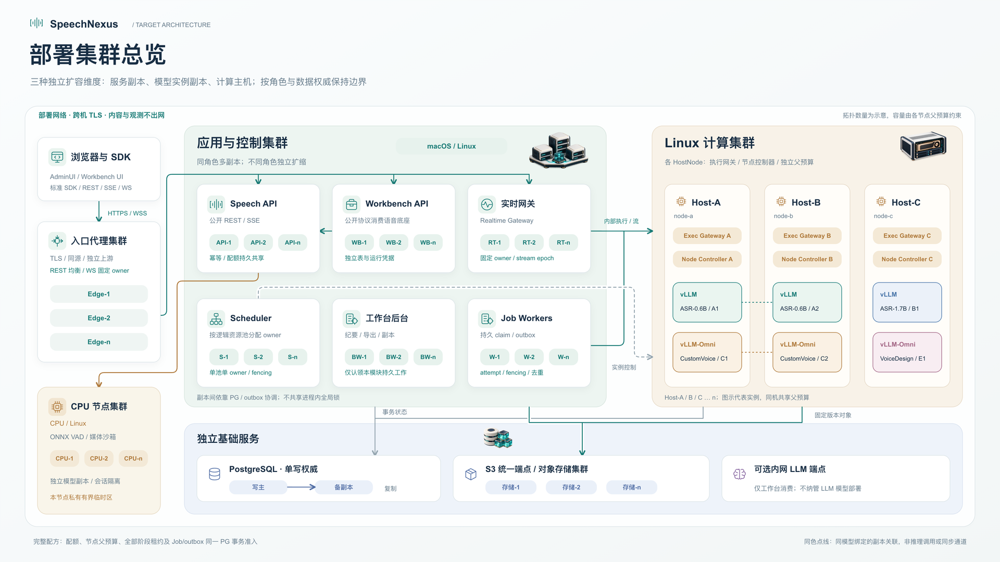
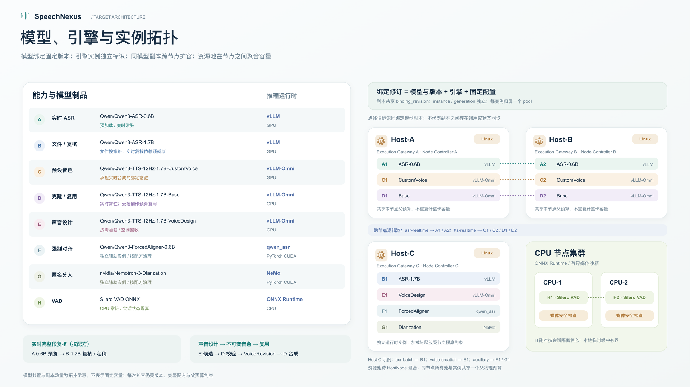

# SpeechNexus 部署单元与平台规划

本文维护部署单元、平台边界、节点绑定与装配顺序。决定依据为
[ADR 0011](../decisions/0011-distributed-deployment-and-platform-boundaries.md)，
集群与事务要求继续沿用 [ADR 0004](../decisions/0004-cluster-ready-architecture-and-single-node-mvp.md)
和 [ADR 0006](../decisions/0006-cluster-coordination-and-storage-portability.md)。

**分布式部署是产品目标，单节点是同一架构的验证拓扑。** 部署单元可以分布在不同主机，
同一 Python 包、仓库或镜像不意味着必须同机运行。以下平台要求是设计目标，
不表示跨平台、跨主机或高可用资格已经通过。

**以松耦合、尽量跨平台为目标。** 应用依赖公开或内部契约、显式配置和持久事实，
平台特定实现留在执行适配器；逻辑角色不自动增加网络服务、数据库或独立发布包。
同一制品可提供多个明确入口，但每个运行进程必须有确定职责、权限和依赖范围。

## 1. 部署单元

| 单元 | 职责与当前入口 | 平台目标 | 节点与依赖边界 |
| --- | --- | --- | --- |
| 入口代理、AdminUI、Workbench 前端 | TLS、同源路由、静态资源；两个 Web 应用独立构建 | 静态资源不绑定推理平台；代理按其运行时验证 | 可独立于业务与算力主机；工作台页面与 Workbench API 是不同单元 |
| Speech API | 公开语音资源、任务与管理投影；已有 `speechnexus-api` | 业务与控制代码不依赖 CUDA 或 Linux 内核 API；以 macOS、Linux 分别验证 | 通过 PG、对象存储及内部协议协作，不直接管理引擎或容器 |
| Workbench API | 项目、稿件、会议、纪要、保存副本；已有 `speechnexus_backend.workbench.runtime:create_app_from_env` 工厂 | 与 Speech API 相同的应用平台目标 | 独立配置和表所有权；只经公开语音协议消费底座，可选 LLM 是批准的内网端点 |
| Realtime Gateway | 实时连接、会话 owner / epoch 和有界流 | 不因实时接入而要求 GPU 或 Linux 专属 API | 按固定会话 owner 路由；独立进程部署与正式业务装配待补齐 |
| Scheduler、Job Worker | 完整准入、分池调度、任务 claim、outbox 与恢复 | 与推理运行时解耦，分别验证应用平台 | 以 PG 持久事实协调；独立启动入口及完整业务装配待补齐 |
| 工作台后台处理 | 纪要、导出、保存副本与删除恢复 | 按实际媒体依赖单独验证，不要求本机运行语音引擎 | 当前部分循环由 Workbench runtime 管理；独立 worker 入口待补齐 |
| 已有专用后台入口 | `speechnexus-runtime-delivery-worker` 投递运行时意图；`speechnexus-asset-maintain` 维护 Asset | 应用平台按入口分别验证 | 两者不代表通用 Job Worker 或全部 Scheduler 能力已经交付 |
| Execution Gateway | 持久提交屏障、执行、取消、观察与停止证据；已有 `speechnexus-gateway` | 协议和编排不要求 CUDA；当前节点适配器随 Linux 算力栈资格验证，其他平台未资格化 | 绑定受管 `node_id` / `gateway_id` 与引擎代次；现有 `fcntl` 入口锁要求同节点候选共享私有锁目录 |
| Node Controller | 批准模板的容器生命周期；已有 `speechnexus-node-controller` | 当前 Docker daemon 适配器服务于 Linux 容器节点；控制协议不绑定调用方平台 | 与实际受管 daemon 所在节点绑定；独占受限容器管理权限，不要求业务调用方同机 |
| 推理引擎、引擎扩展及模型 | 当前选定的 CUDA / vLLM、vLLM-Omni 和固定模型组合 | 当前路线以 Linux 为目标，按硬件、镜像与模型组合资格化 | 独立镜像、依赖锁和 Python 环境；API、工作台不安装或直接调用 GPU runtime |
| 音频安全检查 | 当前私有 `AudioInspectionProcess` 与媒体检查命令 | 现有沙箱需要 Linux，不需要 GPU | 是 CPU 媒体执行边界；优先复用受控执行组件，独立服务是否必要及跨机协议尚待设计，默认 API 未启用 |
| PostgreSQL、S3 兼容对象存储 | 全局权威记录与固定版本输入、制品 | 按各数据服务的平台支持和部署资格验证 | 两种数据服务可分别部署；不要求与业务或算力同机 |
| 迁移与部署工具 | 版本化 DDL、最小授权、批准模板和制品准备 | 按工具及目标环境验证 | 使用独立部署身份；正常业务启动不执行迁移或扩大权限 |

macOS 原生进程、Linux 原生进程与 macOS 上的 Linux 容器是不同验证对象。
同一单元在其中一种环境通过，不能替代另外一种；本规划不自动承诺其他操作系统支持。
CPU VAD、编解码与导出按 CPU、内存、磁盘和原生依赖验证，不因使用音频库就认定需要 GPU。
当前首批原生资格目标为 macOS、Linux。可移植协议应避免增加不必要的平台假设；
Windows 等平台保持未验证，支持范围扩展以单元的安装、启动和行为证据为准。

### 1.1 必须保留与可以消除的耦合

| 边界 | 规划决定 | 验证方式 |
| --- | --- | --- |
| 完整配方的 PG 事务 | 保留原子准入、预算、租约及 Job/outbox 的共同事务域；不拆成跨库补偿 | 复用协调事务验收，多进程部署不能改变一次提交或整体回滚 |
| 网关、引擎与控制器节点身份 | 保留真实节点、generation、入口所有权与停止证据；不得仅凭 HTTP 可达就迁走现有网关 | 同节点替换与旧进程恢复、错误节点/代次拒绝；物理接管另验 |
| API、工作台与后台循环 | 通过明确入口和配置独立运行；后台可暂由声明进程托管，不要求每个循环新增服务 | 关闭 Workbench 不影响 Speech；多副本不重复领取；入口声明与实际启动一致 |
| 包与依赖 | 按实际能力裁剪运行依赖；允许共用基础层，GPU runtime、daemon 权限和 Linux 沙箱不扩散到通用应用 | 干净环境只安装声明制品并启动，记录依赖闭包和权限 |
| 服务地址与进程通信 | 显式注入服务端配置；经既有协议或 PG/outbox 协作，不新建无必要 RPC | 独立上游、非回环端点与错误配置反例；禁用隐式本地回退 |

新适配器应复用稳定的能力接口。只有调用方和实现确实需要独立部署、扩缩或权限边界时，
才增加远程协议；更换操作系统本身不构成引入新协调服务或消息中间件的理由。

## 2. 物理拓扑

部署关系分为两张 **3840 × 2160** 终态目标图：总览表达服务与主机集群，细节图表达模型、引擎、实例和资源池。
主机与副本数量为拓扑示意，实际共置和容量受完整配方与各节点父预算约束。
实施与验收状态继续由本文后续章节及对应 issue 维护。

[集群总览 4K PNG](diagrams/deployment-clusters-v3-4k/01-cluster-overview-4k.png) ·
[可编辑 SVG](diagrams/deployment-clusters-v3-4k/01-cluster-overview-4k.svg)

[模型拓扑 4K PNG](diagrams/deployment-clusters-v3-4k/02-model-instance-topology-4k.png) ·
[可编辑 SVG](diagrams/deployment-clusters-v3-4k/02-model-instance-topology-4k.svg) ·
[构图分析、来源与验证](diagrams/deployment-clusters-v3-4k/README.md)

### 2.1 各类扩容关系

| 对象 | 扩容方式与持续成立的约束 |
| --- | --- |
| 入口代理、Speech API、Workbench API | 同角色增加副本；不同角色独立扩缩，幂等、配额与业务权威记录保持持久共享 |
| Realtime Gateway | 多副本承接不同会话，单会话固定 owner 与 stream epoch；故障接管遵守新 epoch 和缺口协议 |
| Scheduler | 多进程分配不同逻辑池；单池只有一个有效 owner，以 PG 租约和 fencing 约束接管 |
| Job Worker、工作台后台 | 并发认领各自模块的持久工作，保留 attempt、fencing、幂等与恢复证据 |
| 同模型引擎实例 | 相同绑定修订部署多个独立 `instance_id` / `generation`；每实例属于一个节点、一个逻辑池，准入选定实例后提交 |
| 不同模型与运行时 | ASR、CustomVoice、Base、VoiceDesign、对齐和分人使用各自实例；同机共置仍共享父预算，跨模型配方一次核算全部阶段 |
| 计算主机 | 各真实 HostNode 拥有自己的 Gateway、Controller 和父物理预算；新增主机、实例与容量声明后纳入池聚合 |
| CPU 执行能力 | CPU VAD 运行副本隔离会话状态，媒体沙箱按 Linux 隔离能力部署；具体装配依照第 4 节设计，不因图示自动增加 RPC 服务 |
| PostgreSQL、S3 | PG 保持单写权威与备副本；S3 通过统一端点提供存储集群，复制、持久性和接管按各数据服务方案验证 |

模型副本图中的同色点线表示同绑定的独立副本关联；请求路由、节点故障处理与容量隔离以运行时协议为准。
同模型横向副本与单实例多 GPU 切分分别规划和资格化。

同一资源池可覆盖多个算力节点，实例与物理父预算归属真实 `host_node_id`。
不能给不同主机配置相同节点身份来绕过绑定检查，也不能以主机有空闲 GPU 推断该节点具备资格。
业务服务和算力节点分机时，网络延迟与实时流缓冲须进入实际容量和延迟测量。

## 3. 通信、权限与持久状态

- **业务与执行分离**：Workbench 只消费公开语音协议；Scheduler / Worker 经内部协议请求
  Gateway 和 Controller。业务 API、工作台与通用 worker 不持有引擎凭据或 Docker socket。
- **单一事务权威**：完整配方的配额、节点/实例预算、全部阶段租约及 Job/outbox 仍在同一
  PostgreSQL 事务域内准入。按部署单元拆进程、表所有权或凭据，不拆成跨库双写。
- **内容传输**：跨单元的持久输入和制品使用固定版本、长度与摘要的对象引用；实时流使用
  约定的网络协议。不以共享宿主目录或本地文件描述符跨主机传递业务内容。
- **节点本地事实**：Gateway 的本地锁只保护同一节点网关的进程入口；Controller 的 SQLite
  保存本节点操作回执和停止检查点。它们不承担全局准入、预算或业务数据库权威，
  节点故障后不能仅凭本地记录缺失推断已停止或可释放预算。
- **服务配置**：各进程使用明确身份、服务端点、最小凭据、Host / Origin 与连接池配置。
  内部跨主机连接使用 TLS；业务内容、代理、浏览器资源与观测均遵守部署网络边界。
  `localhost` 仅表示该进程所在主机，不能作为远端服务的隐式发现或回退。

对象发布、删除账本、提交未知、取消与预算释放继续由既有契约和所有者负责。
本规划不新增状态、错误码、公开路由或用户身份体系。

## 4. Linux 媒体检查边界

现有 [音频检查沙箱](audio-asset-inspection.md)使用 pidfd、seccomp、bubblewrap、
prlimit 和 `/proc`，属于 Linux 平台实现。当前
[AssetRuntime](../../backend/src/speechnexus_backend/asset_runtime.py)装配 `TextAssetInspector`，
公开音频检查尚未启用；不能把沙箱代码位于 backend 包内等同于 API 启动必须使用 Linux。

为了保持业务服务的平台边界，应将 Linux 检查能力封装在明确的执行组件中。
先比较复用受控 Linux 检查 worker 与独立媒体服务，选择满足隔离和恢复要求的最小部署形态；
不为迁出平台代码强制新增常驻网络服务。确定形态前须完成调用、取消、停止与故障恢复设计。
现有本地接口接收 `BinaryIO` / 文件描述符，不能直接当作远程协议使用；跨机设计需要固定对象
引用、检查版本、限额和可验证回执，不能传任意路径、端点或容器命令。
Linux CPU 媒体组件可与算力组件同机，但要独立核算资源，不因此占用 GPU 槽位。

服务化之前先冻结相应机器契约并完成生产者、消费者和装配验证；本页不预先指定新路由。
不能通过忽略类型错误、改用普通 PID 或降低现有隔离/停止证据要求来取得跨平台通过。

## 5. 当前装配与证据（2026-10-26）

| 已核对事实 | 能证明的范围与缺口 |
| --- | --- |
| [当前 Compose](../../deploy/compose.yaml)包含 PG、MinIO、Speech API、Gateway、两个 Web 容器 | 单节点 bootstrap；不含独立 Workbench API、Controller、完整后台角色或真实模型装配 |
| [Web 代理](../../deploy/web/nginx.conf)将 `/v2/workbench/` 发往 `api:8000` | 默认预览没有接入独立 Workbench runtime；分布式部署需配置各服务上游及实时 owner 路由 |
| [Backend 主入口](../../backend/src/speechnexus_backend/main.py)固定启动 Speech ASGI 工厂 | `process_role` 是身份声明；设置为另一个角色不会自动选择其服务入口 |
| [Workbench 工厂](../../backend/src/speechnexus_backend/workbench/runtime.py)及专用后台命令已存在 | 具备分开启动的部分入口；不能据此认定全部后台职责已独立交付 |
| [Python 镜像](../../deploy/images/python.Dockerfile)当前同步所有 workspace 包 | 共享镜像不要求服务同机，但尚未按部署单元收敛运行依赖与检查范围 |
| [Backend 依赖](../../backend/pyproject.toml)直接包含 `av`，Workbench runtime 内托管部分后台循环 | 媒体原生依赖与 Web 生命周期仍有装配耦合；不证明必须使用 Linux，也不证明已经可以独立扩缩 |
| [现有 CI](../../.github/workflows/ci.yml)使用 Ubuntu runner | Linux 检查不替代 macOS 原生安装/启动/行为验证；共享镜像和模块导入均不能补足平台资格 |
| 四个 ASGI 模块在 macOS 上导入成功，未加载 Linux 音频沙箱 | 只证明模块导入；未证明各平台服务启动、数据库操作、媒体能力或完整业务链通过 |
| [开发脚本](../../scripts/dev-env/bootstrap.sh)固定 Linux ARM64 / APT / systemd | 当前开发环境约束；不能推广为所有产品部署单元的操作系统要求 |

历史审查与交接文档保留其原时点事实；当前支持声明应同时给出单元、平台、启用能力和证据。
全仓 `mypy --platform linux` 通过只证明相应静态检查，不能作为 macOS 兼容性或多机验收证据。

## 6. 装配顺序与验收

1. **整理部署制品**：为每个实际服务列出唯一启动入口、依赖、环境变量、身份、最小权限、
   镜像/依赖锁、持久目录、私有临时区及健康/就绪检查。按需提供应用、数据和算力节点配置，
   不复用 bootstrap owner；迁移与授权使用独立部署步骤。
2. **接通业务与后台角色**：补齐独立 Workbench 上游、正式 Job/调度入口、实时 owner 路由，
   明确各后台循环是嵌入哪个已声明进程还是独立 worker。关闭可选工作台不影响语音底座，
   worker 重启按持久队列恢复，不能因同机运行跳过 claim、fencing 或提交屏障。
3. **封装平台特定执行**：保持引擎环境独立锁定，媒体检查按上一节完成边界设计和资格验证。
   CPU 预处理若拆到另一节点，仍须纳入完整配方的原子准入、资源预算及恢复证据。
4. **建立分层平台检查**：业务与控制模块在 macOS、Linux 分别检查依赖安装、导入、配置、
   服务启动和适用测试；Linux 沙箱、daemon 与 GPU 测试在对应环境执行。平台专属代码按
   部署边界维护，不能只在全仓检查中屏蔽错误或把必要测试跳过记为通过。
5. **联调并验证分机拓扑**：可先把业务/控制服务与算力服务放在不同主机或隔离虚拟机中联调，
   经实际网络完成公开文件 ASR/TTS 链和已启用实时链；记录平台、版本、实例/代次、拓扑、
   延迟与容量。G5 正式资格须使用物理多主机，备用 GPU 接管另验；单机不同进程、
   回环 TLS 或隔离 VM 不替代既有物理要求。
6. **验证故障和内容边界**：覆盖网络中断、响应丢失、业务 worker/Gateway/Controller 重启、
   DB/对象存储不可用及引擎仍运行的取消未知；核对原身份恢复、无重复发布、无提前退预算，
   并验证内容不出部署网络。多副本接管与 HA/RPO/RTO 仍需各自验收。

上述未交付项按实际实现和验证逐项更新；设计状态不替代运行配置、部署制品或机器契约的交付。

## 7. 实施任务与门禁

2026-10-26 按“松耦合、尽量跨平台”完成[方案审查](../audits/2026-10-26-deployment-units-review.md)。
以下补充任务已创建；创建与文档修订不代表实现、CI 或运行资格通过。它们不改变原 25 个主工作包的范围和完成分母。

| 交付 | 跟踪项 | 范围与既有职责 |
| --- | --- | --- |
| 服务入口清单、按能力裁剪依赖及制品 | [#225](https://github.com/hrygo/SpeechNexus/issues/225) | 平台制品；不代替 #22/#24 的正式业务循环 |
| 独立 Workbench API 上游与部署装配 | [#226](https://github.com/hrygo/SpeechNexus/issues/226) | Web/Workbench 装配；真实业务分别按既有 Gate 验收 |
| Linux 音频检查部署适配决定与契约交接 | [#227](https://github.com/hrygo/SpeechNexus/issues/227) | 先确定最小形态；公开音频 ready 与真实检查仍由 #21/#30 负责 |
| macOS/Linux 原生 CI 与平台依赖隔离 | [#228](https://github.com/hrygo/SpeechNexus/issues/228) | 实施可失败的检查和必需汇总；当前尚未交付 |
| 松耦合与原生平台联合证据 | [Gate D1 #229](https://github.com/hrygo/SpeechNexus/issues/229) | 接收上述制品并核验实际行为，接入 G5，不自动放行 |

| 门禁 | 必需证据 | 放行限制 |
| --- | --- | --- |
| D1：服务与平台 | 逐单元/能力的入口、依赖、权限；macOS 与 Linux 原生安装、严格检查、启动、持久行为；独立上游和 Linux 专属执行验证 | 必需角色未装配、失败、跳过与未运行均保留缺口；不能靠忽略类型错误、Linux 类型模式或容器导入补齐 |
| G5：真实部署与发布 | 延续 [#18](https://github.com/hrygo/SpeechNexus/issues/18) 的前置与全部 AC；业务/控制面与算力分处物理主机，公开文件 ASR/TTS、已启用实时及跨机故障实际结果；备用 GPU、HA/RPO/RTO 各有证据 | 隔离 VM 可用于前置联调，但不替代既有物理多主机/备用 GPU 要求；D1 或 CI 绿灯不替代完整发布资格 |

检查结果应绑定集成版本、制品、平台/架构、配置能力与拓扑。门禁按对应维护者联合确认和
既定用户放行要求维护；子任务关闭、测试数量或文档状态不自动关闭 Gate。

[部署入口](../../deploy/README.md) · [整体技术方案](technical-blueprint.md) ·
[工程目录与依赖](repository-layout.md) · [验证指南](../agent-verification.md)
