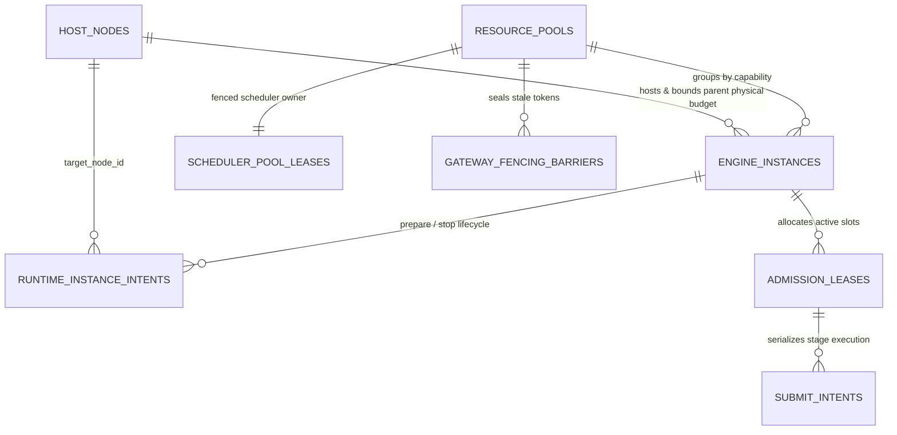

# SpeechNexus 分布式协调与容量治理 Schema 设计（P0-B 草案）

本文固化 [ADR 0004：集群就绪架构与单机 MVP 同构部署](../decisions/0004-cluster-ready-architecture-and-single-node-mvp.md)、[资源治理与持久化](runtime-governance.md)与[整体技术方案](technical-blueprint.md)中的 P0-B 核心协调表结构、所有权边界、锁顺序及原子事务模板。可执行 DDL 原型位于 [`backend/src/speechnexus_backend/speech/infrastructure/sql/0001_cluster_coordination_draft.sql`](../../backend/src/speechnexus_backend/speech/infrastructure/sql/0001_cluster_coordination_draft.sql)，配套内部控制契约为 [`contracts/capacity-manifest.schema.json`](../../contracts/capacity-manifest.schema.json)、[`contracts/internal/execution-control.openapi.yaml`](../../contracts/internal/execution-control.openapi.yaml) 与 [`contracts/internal/runtime-control.openapi.yaml`](../../contracts/internal/runtime-control.openapi.yaml)。

## 1. 表所有权与三级资源拓扑关系



| 表名 | 写入权威（DB 角色） | 核心职责与数据库级不变量 |
| --- | --- | --- |
| `host_nodes` | `speech`（scheduler） | 顶层算力节点父物理预算；强制 `reserved_resident + reserved_peak_loading + reserved_incremental + quarantined <= allocatable`，防止统一内存（如 ARM64 + GB10）将主机与设备内存重复计为两份独立余量 |
| `resource_pools` | `speech`（scheduler） | 逻辑资源池（`asr-realtime`、`tts-realtime`、`voice-creation` 等）与单调递增 `high_water_fencing_token` |
| `scheduler_pool_leases` | `speech`（scheduler） | 分池调度 Owner 租约；新 Owner 接管时先进入 `reconciling_takeover`，未完成旧网关屏障与在途协调前禁止转为 `active` |
| `engine_instances` | `speech`（scheduler） | 动态运行实例（含 `instance_generation`、常驻预算、加载峰值、最大/保留/已用/隔离槽位）；未就绪前禁止提前释放 `peak_reservation_active` |
| `runtime_instance_intents` | `speech`（scheduler / controller） | 节点级受限控制器（`node-controller`）的持久 `prepare` / `stop` 意图；`stop` 意图未同时取得 `process_or_container_exited` 与 `resources_released_confirmed` 前禁止标记 `succeeded` |
| `admission_leases` | `speech`（scheduler / worker） | 请求级跨层级容量租约；严格分离 `lease_state`（`reserved → executing → stopping → released / quarantined`）与 `cleanup_state`，`quarantined` 状态下禁止写入 `budget_released_at` |
| `gateway_fencing_barriers` | `gateway_control`（execution-gateway） | 网关按 `(gateway_id, pool_id)` 持久化的最小可接受 `fencing_token` 屏障，阻断旧 Scheduler 迟到提交 |
| `submit_intents` | `gateway_control`（execution-gateway） | 两阶段提交屏障权威记录；按 `(operation_id, attempt_id, stage_id)` 唯一去重，外发前先持久化 `submitting`，无确切停止证据禁止转入 `aborted` |

## 2. 全局死锁预防与加锁顺序

涉及跨表状态转换的 Read Committed 短事务，必须严格遵循以下行锁（`SELECT ... FOR UPDATE`）获取顺序：

```text
1. resource_pools
2. scheduler_pool_leases
3. host_nodes
4. engine_instances
5. runtime_instance_intents
6. admission_leases
7. gateway_fencing_barriers
8. submit_intents
```

禁止在持有下游表（如 `submit_intents` 或 `admission_leases`）行锁后再反向请求 `host_nodes` 或 `scheduler_pool_leases` 锁；任何外部 HTTP / WebSocket 推理、容器操作或对象存储上传均在数据库事务提交后执行。

## 3. 六大关键原子事务模板

### 3.1 分池 Scheduler 租约获取与单调 Fencing Token 递增

当某个池租约尚未创建或已到期需要接管时，新 Scheduler 实例在同一事务中递增 `resource_pools.high_water_fencing_token` 并写入 `scheduler_pool_leases`：

- 若存在未协调的旧 Owner，新租约状态必须先设为 `reconciling_takeover`（`previous_owner_reconciled = FALSE`），此时**不开放新请求准入**。
- 新 Owner 随后调用受管网关的 `POST /internal/v1/gateways/{gateway_id}/fencing-barrier`，封锁旧 `fencing_token` 并协调所有 `submitting` / `executing` 意图（或由 `node-controller` 隔离/重建实例）后，再将 `scheduler_pool_leases.lease_state` 更新为 `active`。

### 3.2 三级拓扑跨层级原子准入（HostNode + EngineInstance + AdmissionLease）

准入一次语音执行（或双工会话的组合资源）时，Scheduler 在单个事务内：

1. 锁定 `scheduler_pool_leases`，验证自身为当前 `active` Owner 且租期有效，读取当前 `fencing_token`。
2. 锁定目标 `host_nodes` 与 `engine_instances`（校验 `instance_state = 'ready'`、剩余槽位及实时保留比例）。
3. 原子累加 `host_nodes.reserved_incremental_unified_memory_bytes`（及设备/主机/CPU/PCM 缓冲向量）与 `engine_instances.reserved_active_slots`。
4. 插入 `admission_leases`（`lease_state = 'reserved'`, `cleanup_state = 'pending'`, 绑定 `fencing_token` 与 `instance_generation`）。

任一维度超出上限立即触发 `CHECK` 约束回滚，返回明确的容量或队列受限错误。

### 3.3 按需实例（VoiceDesign）加载峰值预留与稳态切换

1. **准备阶段（Prepare）**：Scheduler 锁定 `host_nodes`，将完整阶段的 `loading_peak_unified_memory_bytes` 计入 `reserved_peak_loading_unified_memory_bytes`，插入 `engine_instances`（`instance_state = 'loading'`, `peak_reservation_active = TRUE`）与 `runtime_instance_intents(action = 'prepare')`。
2. **就绪切换（Ready）**：当 `node-controller` 与 `execution-gateway` 均确认实例通过加载与 warmup 后，Scheduler 在同一事务内将 `host_nodes` 上的 `reserved_peak_loading_unified_memory_bytes` 减去加载峰值、将 `reserved_resident_unified_memory_bytes` 加上常驻稳态值，并将 `engine_instances` 更新为 `instance_state = 'ready'`, `peak_reservation_active = FALSE`。
3. **停止回收（Stop）**：先将实例设为 `draining`，由网关执行 `POST /internal/v1/instances/{instance_id}/drain`；确认 `active_intent_count = 0` 且 `submitting_intent_count = 0` 后下发 `runtime_instance_intents(action = 'stop')`。只有收到 `process_or_container_exited = TRUE` 与 `resources_released_confirmed = TRUE` 证据后，才从 `host_nodes.reserved_resident_unified_memory_bytes` 中扣减常驻预算。

### 3.4 Execution Gateway 两阶段提交屏障（Submit Intent）

Worker 或实时网关调用 `POST /internal/v1/executions/submit` 时，`execution-gateway` 在控制库短事务中：

1. 锁定 `(gateway_id, pool_id)` 对应的 `gateway_fencing_barriers`，若 `request.fencing_token < enforced_min_fencing_token` 立即以 `409 gateway_barrier_fenced` 拒绝。
2. 核对 `admission_leases` 状态为 `reserved` 或 `executing`，且 `instance_generation`、`binding_revision_id`、`policy_revision_id` 与有效资源状态一致。
3. 按 `(operation_id, attempt_id, stage_id)` 查找或插入 `submit_intents`：
   - 若已存在且 `command_digest` 一致，作为幂等重放返回当前状态；
   - 若已存在但 `command_digest` 或 `fencing_token` 冲突，返回 `409 submit_intent_conflict`；
   - 若不存在，先持久化 `execution_state = 'submitting'`, `cleanup_state = 'pending'` 并提交事务，再向推理引擎发送请求并回填 `engine_request_id` 与 `execution_state = 'executing'`。

### 3.5 取消、超时与 Quarantine 隔离裁决

当客户端取消、流断开或执行超时触发 `POST /internal/v1/executions/{submit_intent_id}/abort` 时：

- **确认停止**：网关通过引擎 adapter 收到明确的 abort 确认（`engine_abort_ack`）或控制器确认容器已销毁（`instance_terminated_by_controller`），在同一事务中将 `submit_intents` 更新为 `execution_state = 'aborted', cleanup_state = 'complete'`，随后 Scheduler 释放 `admission_leases` 与节点/实例增量预算，Job/Operation 方可进入 `cancelled`。
- **停止未确认（Quarantine）**：若在 drain / 取消期限内引擎无响应或不支持细粒度 abort，网关将 `submit_intents` 更新为 `execution_state = 'unknown_quarantined', cleanup_state = 'quarantined', stop_evidence_kind = 'unconfirmed_timeout'`；Scheduler 将 `admission_leases` 标记为 `lease_state = 'quarantined', cleanup_state = 'quarantined'`，并将该槽位与物理内存转入 `quarantined` 账目（**不释放可用预算**）。Job/Operation 以 `failed`（`error.code = cancellation_unconfirmed`）终结，在后台协调完成清理前拒绝重试（`409 execution_cleanup_pending`）。

[架构索引](README.md) · [资源治理](runtime-governance.md) · [整体技术方案](technical-blueprint.md) · [ADR 0004](../decisions/0004-cluster-ready-architecture-and-single-node-mvp.md)
