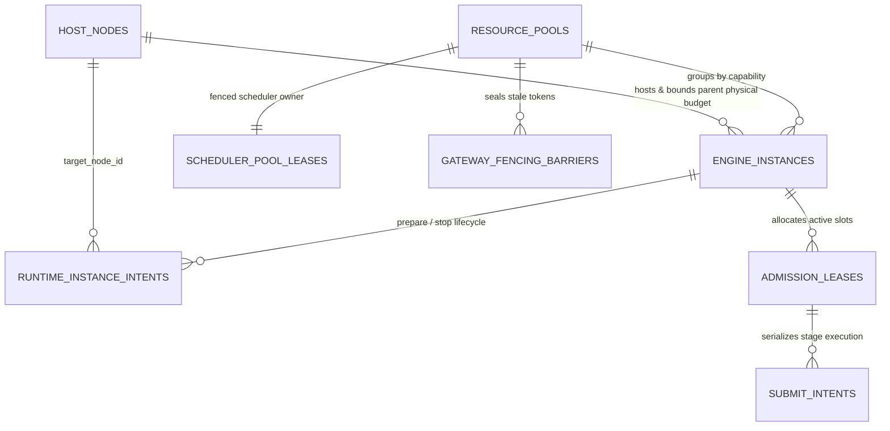

# SpeechNexus 分布式协调与容量治理 Schema 设计（P0-B 草案）

本文固化 [ADR 0004：集群就绪架构与单机 MVP 同构部署](../decisions/0004-cluster-ready-architecture-and-single-node-mvp.md)、[资源治理与持久化](runtime-governance.md)与[整体技术方案](technical-blueprint.md)中的 P0-B 核心协调表结构、所有权边界、锁顺序及原子事务模板。可执行 DDL 原型位于 [`migrations/0001_cluster_coordination_draft.sql`](../../migrations/0001_cluster_coordination_draft.sql)，配套内部控制契约为 [`contracts/capacity-manifest.schema.json`](../../contracts/capacity-manifest.schema.json)、[`contracts/internal/execution-control.openapi.yaml`](../../contracts/internal/execution-control.openapi.yaml) 与 [`contracts/internal/runtime-control.openapi.yaml`](../../contracts/internal/runtime-control.openapi.yaml)。

该 SQL 文件位于 Python 包外，是迁移草案与测试输入，不是应用运行时加载的资源，也不会随应用 wheel 发布；生产迁移必须由独立迁移角色通过版本化迁移工具执行，运行角色不持有 DDL 或安装扩展权限。

## 1. 表所有权与三级资源拓扑关系



| 表名 | 写入权威（DB 角色） | 核心职责与数据库级不变量 |
| --- | --- | --- |
| `host_nodes` | `speech`（scheduler） | 顶层算力节点父物理预算；各维度均执行 `reserved_* + quarantined_* <= allocatable_*`，并强制统一内存节点只使用 unified 计数器、离散节点只使用 device/host 计数器 |
| `resource_pools` | `speech`（scheduler） | 逻辑资源池注册表与单调递增 `high_water_fencing_token`；同一池可包含多个 `host_node_id` 上的实例。公开池标识域只在共享契约维护，DDL 不再复制枚举 |
| `scheduler_pool_leases` | `speech`（scheduler） | 分池调度 Owner 租约，只绑定 `owner_scheduler_id`，不绑定容量节点；新 Owner 接管时先进入 `reconciling_takeover`，未完成旧网关屏障与在途协调前禁止转为 `active` |
| `engine_instances` | `speech`（scheduler） | 动态运行实例（含 `instance_generation`、按内存架构分列的常驻 / 加载峰值 / 每槽预算、最大/保留/已用/隔离槽位）；`ready` 必须记录 `ready_at` 且没有停止时间，`quarantined` 必须记录非空且不可为占位空白的持久原因，其他状态不得携带隔离原因。未就绪前禁止提前释放 `peak_reservation_active`。同一 `instance_id` 可保留历史 `stopped` generation，但最多一个未停止 generation；generation 的 host / gateway / pool / binding / template / config 身份不可改写，`stopped` 后整行不可变，重启必须使用新 generation。转为 `stopped` 前，该 generation 不得仍有未释放 admission lease 或非终态 submit intent |
| `runtime_instance_intents` | `speech`（scheduler / controller） | 节点级受限控制器（`node-controller`）的持久 `prepare` / `stop` 意图；以 `(target_node_id, intent_id)` 作为节点内幂等键，同一键可在另一节点独立使用。按节点内存架构记录 peak / steady unified、device 与 host 向量。保留完整意图历史，仅对未解决状态去重；意图身份不可改写，`failed` 必须有非空稳定错误码，`succeeded` 不得携带错误码，`succeeded` / `failed` 终态不可复活，重试使用新 `intent_id`。`stop` 意图未同时取得 `process_or_container_exited` 与 `resources_released_confirmed` 前禁止记录 `stop_verified_at` 或标记 `succeeded` |
| `admission_leases` | `speech`（scheduler / worker） | 一个 operation attempt 的**每阶段**跨层级容量租约；完整执行配方在同一事务内为全部 required stage 各插入一行，多个 stage 可复用同一 pool / instance。按节点内存架构只使用 unified 或 device/host 增量计数，并通过复合外键绑定 stage、实例 host / generation / pool / gateway / binding revision 与 workspace。身份、预留向量和 deadline 在准入后不可变；严格分离 `lease_state`（`reserved → executing → stopping → released / quarantined`）与 `cleanup_state`，转入 `released` / `quarantined` 时附属 submit intent 必须已离开 active 状态，`released` 还不得遗留 `unknown_quarantined` 执行；`quarantined` 状态下禁止写入 `budget_released_at`；隔离观察时间与释放证据一经记录不可改写，观察时间不得晚于预算释放时间，`released` 后不可重新打开 |
| `gateway_fencing_barriers` | `gateway_control`（execution-gateway） | 网关按 `(gateway_id, pool_id)` 持久化的最小可接受 `fencing_token` 屏障，阻断旧 Scheduler 迟到提交；屏障一经建立保持 sealed，token 不得下降 |
| `submit_intents` | `gateway_control`（execution-gateway） | 两阶段提交屏障权威记录；按 `(operation_id, attempt_id, stage_id)` 唯一去重，外发前先持久化 `submitting`，无确切停止证据禁止转入 `aborted`。身份、command digest、engine request / dispatch 关联和 staging key 在观测后不可改写；`succeeded` / `failed` / `aborted` 结果、稳定错误码与停止证据不可改写，`unknown_quarantined` 只能凭停止证据关闭为 `aborted`。`submitting` / `executing` / `stopping` 只能保持 `cleanup_state = pending` 且 `stop_evidence_kind = none`；`succeeded` 必须有 engine terminal response 且无错误；`failed` 必须带稳定错误码。只有从未外发且没有输出 / staging / 终止事实的 `failed` 才能使用 `not_required`（`engine_request_id` / `dispatched_at` 为空、generated samples 为 0）；已外发执行必须以已验证终止的 `complete` 清理 |
| `output_sample_intervals` | `gateway_control`（execution-gateway） | 只追加的输出样本区间权威账本；同一 `(operation_id, attempt_id, output_stream_id, meter_kind)` 的 `[sample_start, sample_end)` 禁止重叠，既有区间禁止改写或删除，避免标量水位覆盖先前 attempt / 区间证据。毫秒数只从 samples 与 sample rate 派生，不单独存储 |

## 2. 全局死锁预防与加锁顺序

涉及跨表状态转换的 Read Committed 短事务，必须严格遵循以下行锁（`SELECT ... FOR UPDATE`）获取顺序：

```text
1. resource_pools
2. scheduler_pool_leases
3. host_nodes
4. engine_instances
5. runtime_instance_intents
6. admission_leases
7. gateway_fencing_barriers
8. submit_intents
9. output_sample_intervals
```

同表多行按主键字典序加锁（复合键按列顺序），所有池先锁完再锁所有 host，不能逐 stage
循环锁完整链。可以跳过不访问的表，但不可回头请求更早的锁；已有锁可复用且不得在
持有下游锁后升级父表锁。预先读取 ID 只用于定位，获得锁后重新核对状态和版本。

触发器锁也属于本顺序：插入 admission lease 时依次对 pool、host、instance 取
FOR SHARE；准入事务预先取得这些父行的 FOR UPDATE，触发器复用。插入 submit 时
对 lease 取 FOR UPDATE；释放/隔离 lease 时对 submit 取 FOR UPDATE。输出 interval
插入会更新 submit 水位，因此必须先锁对应 submit，再插入 interval。容量队列只
验证本事务已经锁定的目标，不反向升级父行锁；它不替代准入串行化。

禁止在持有下游表（如 `submit_intents` 或 `admission_leases`）行锁后再反向请求 `host_nodes` 或 `scheduler_pool_leases` 锁；任何外部 HTTP / WebSocket 推理、容器操作或对象存储上传均在数据库事务提交后执行。

## 3. 六大关键原子事务模板

### 3.1 分池 Scheduler 租约获取与单调 Fencing Token 递增

当某个池租约尚未创建或已到期需要接管时，新 Scheduler 实例在同一事务中递增 `resource_pools.high_water_fencing_token` 并写入 `scheduler_pool_leases`：

- 若存在未协调的旧 Owner，新租约状态必须先设为 `reconciling_takeover`（`previous_owner_reconciled = FALSE`），此时**不开放新请求准入**。
- 新 Owner 随后调用受管网关的 `POST /internal/v1/gateways/{gateway_id}/fencing-barrier`，封锁旧 `fencing_token` 并协调所有 `submitting` / `executing` 意图（或由 `node-controller` 隔离/重建实例）后，再将 `scheduler_pool_leases.lease_state` 更新为 `active`。

### 3.2 三级拓扑跨层级原子准入（HostNode + EngineInstance + AdmissionLease）

准入一次语音执行（或双工会话的组合资源）时，Scheduler 必须按完整执行配方的每个 required stage 在**单个事务内插入全部租约**：

1. 先按 pool_id 锁定全部 `resource_pools`，再锁对应 `scheduler_pool_leases`；验证自身为当前 `active` Owner 且租期有效，读取当前 `fencing_token`。
2. 随后按统一顺序锁定全部 `host_nodes → engine_instances`，校验每个 `instance_state = 'ready'`、剩余槽位及实时保留比例；若需 runtime intents，再锁其身份。
3. 原子累加每个目标 `host_nodes` 的增量向量与每个 `engine_instances` 的 active slots；同一 stage 不得重复计费，跨 stage 共用实例时按各自 per-slot 预算累计。generation 固定的六维 per-slot 向量来自核验后的 manifest，
   多个 stage 共用 generation 时采用所有允许 stage 的逐维最大值作保守上界，不能把
   同时占用算作一份。lease 各维至少为 reserved_slots × 对应 per-slot 值，使用
   NUMERIC 乘法避免溢出。每槽 CPU decode、PCM buffer、scratch 也冻结；零只表示
   manifest 明确该维不消耗，不能表示未知。预算变化创建新 generation。事务结束时，延迟约束触发器必须确认 host / instance 的 reserved 与 quarantine 投影等于实例基础预算和全部 admission lease 的权威聚合，不能留下应用侧漏加或重复加的计数。
4. 为每个 stage 插入一行 `admission_leases`（`lease_state = 'reserved'`, `cleanup_state = 'pending'`, 绑定 `stage_id`、`fencing_token` 与 `instance_generation`）；`(operation_id, attempt_id, stage_id)` 唯一。一个 stage 完成且停止证据成立后只释放该行预算，其他 stage 保持原租约。

任一维度超出上限立即触发 `CHECK` 约束回滚，返回明确的容量或队列受限错误。

### 3.3 按需实例（VoiceDesign）加载峰值预留与稳态切换

1. **准备阶段（Prepare）**：Scheduler 先锁对应 pool / scheduler owner，再锁 `host_nodes`；随后处理 instance / runtime intent，所有外键父行的隐式锁也须预先纳入顺序，将完整阶段的 `loading_peak_unified_memory_bytes` 计入 `reserved_peak_loading_unified_memory_bytes`，插入 `engine_instances`（`instance_state = 'loading'`, `peak_reservation_active = TRUE`）与 `runtime_instance_intents(action = 'prepare')`。
2. **就绪切换（Ready）**：重新按 pool / scheduler / host / instance / runtime intent 顺序取得当前事务所需行锁。当 `node-controller` 与 `execution-gateway` 均确认实例通过加载与 warmup 后，Scheduler 在同一事务内将 `host_nodes` 上的 `reserved_peak_loading_unified_memory_bytes` 减去加载峰值、将 `reserved_resident_unified_memory_bytes` 加上常驻稳态值，并将 `engine_instances` 更新为 `instance_state = 'ready'`, `peak_reservation_active = FALSE`。
3. **停止回收（Stop）**：各次短事务均先取得会修改的父行锁，再取得 runtime intent / lease / barrier / submit 锁；外部 drain/stop 在事务外。先将实例设为 `draining`，由网关执行 `POST /internal/v1/instances/{instance_id}/drain`；确认 `active_intent_count = 0` 且 `submitting_intent_count = 0` 后下发 `runtime_instance_intents(action = 'stop')`。只有收到 `process_or_container_exited = TRUE` 与 `resources_released_confirmed = TRUE` 证据后，才从 `host_nodes.reserved_resident_unified_memory_bytes` 中扣减常驻预算。

`node-controller` 以 `(node_id, intent_id)` 为节点内幂等键：完全相同的意图重放返回原记录与 `idempotent_replay = true`，响应回显 target / pool / gateway / instance generation / template / binding revision / manifest / config digest / action / fencing token 等不可变身份；同一节点上的相同 `intent_id` 携带任一不同字段时返回 `409 intent_conflict`，不得静默覆盖或创建第二份意图；不同节点可使用相同 `intent_id`。终态意图不可复活，重试必须使用新 `intent_id`。

### 3.4 Execution Gateway 两阶段提交屏障（Submit Intent）

Worker 或实时网关调用 `POST /internal/v1/executions/submit` 时，`execution-gateway` 在控制库短事务中：

1. 如需读取会变化的 pool/host/instance 准入状态，先按全局顺序锁其行；随后先锁
   对应 `admission_leases`，再锁 `(gateway_id, pool_id)` 的 `gateway_fencing_barriers`。
   barrier 未建立时按拒绝执行处理，由受控初始化建立，不能把缺失水位当成 0。
   `request.fencing_token < enforced_min_fencing_token` 以 `409 gateway_barrier_fenced` 拒绝。
2. 在已持有 lease 锁的情况下核对 `admission_leases` 状态为 `reserved` 或 `executing`，且 `instance_generation`、`binding_revision_id`（等于 `ModelBindingRevision.revision_id`）、`policy_revision_id` 与有效资源状态一致。
3. 按 `(operation_id, attempt_id, stage_id)` 查找或插入 `submit_intents`：
   - 若已存在且完整规范请求（含 command、deadline、预算及 fencing）一致，作为幂等重放返回当前状态；
   - 若已存在但任何规范请求字段冲突，返回 `409 submit_intent_conflict`；
   - 若不存在，先持久化 `execution_state = 'submitting'`, `cleanup_state = 'pending'` 并提交事务，再向推理引擎发送请求并回填 `engine_request_id` 与 `execution_state = 'executing'`。

### 3.5 取消、超时与 Quarantine 隔离裁决

当客户端取消、流断开或执行超时触发 `POST /internal/v1/executions/{submit_intent_id}/abort` 时：

- **事务划分**：网关提交停止证据与 Scheduler 释放预算是两个所有者各自的短事务。后者先锁 host / instance / lease，再读取已提交的 submit 证据；不得先更新 submit 再反向锁 lease / host。人工释放同样先按全局顺序锁全所需行，再闭合证据和扣账。
- **提交前置**：`submit_intents` 只能在对应 `admission_leases` 仍为 `reserved` 或 `executing` 且 `cleanup_state = 'pending'` 时插入；插入事务锁定 lease 行，与释放 / 隔离转换串行化，禁止对已释放或已隔离租约开始新的执行。
- **确认停止**：网关通过引擎 adapter 收到明确的 abort 确认（`engine_abort_ack`）或可证明该请求已终止且连接不可继续生成的 terminal response（`engine_terminal_response`），或控制器确认容器已销毁（`instance_terminated_by_controller`），或取得人工独立核验证据（`operator_verified_instance_terminated`）。在同一事务中将 `submit_intents` 更新为 `execution_state = 'aborted', cleanup_state = 'complete'` 后，Scheduler 才可释放 `admission_leases` 与节点 / 实例增量预算，Job/Operation 方可进入 `cancelled`。
- **停止未确认（Quarantine）**：若在 drain / 取消期限内引擎无响应或不支持细粒度 abort，网关将 `submit_intents` 更新为 `execution_state = 'unknown_quarantined', cleanup_state = 'quarantined', stop_evidence_kind = 'unconfirmed_timeout'`；Scheduler 将 `admission_leases` 标记为 `lease_state = 'quarantined', cleanup_state = 'quarantined'`，并将该槽位与物理内存转入 `quarantined` 账目（**不释放可用预算**）。Job/Operation 以 `failed`（`error.code = cancellation_unconfirmed`）终结，在后台协调完成清理前拒绝重试（`409 execution_cleanup_pending`）。
- **结果不可反转**：已写入的 submit intent 结果、runtime intent 终态、已释放租约和已停止 generation 都不因迟到响应回到执行态；后台只能补充 cleanup 事实，最终关闭仍须满足同一证据与状态约束。

### 3.6 Quarantine 释放与节点恢复

隔离中的容量只有一个退出路径：取得“旧执行已停止且资源已释放”的可审计证据后，在一个事务中减少对应实例 / 节点隔离计数、释放租约并恢复可分配预算。

1. **机器证据优先**：`execution-gateway` 的 abort / terminal 响应或 `node-controller` 的 `process_or_container_exited + resources_released_confirmed` 证据由后台 reconciler 消费。`engine_terminal_response` 只有在 adapter 证明该响应终止了对应请求且连接不可继续生成时才可作为证据；仅“连接已断开”不足以释放。
2. **人工兜底**：机器证据不可得时，运维通过 `POST /v1/nexus/admin/admission-leases/{lease_id}/quarantine-releases` 提交 `operator_verified_instance_terminated`、不可变证据摘要、观察时间与原因。接口只记录经独立核验的停止事实；服务端仍须先关闭该租约下全部未解决 `submit_intents` 并写入对应证据，再原子扣减隔离账目。响应按字典序列出被关闭的 submit intent，并回声同一证据时间、原因及 `idempotent_replay`；同一 Idempotency-Key / 规范证据重放返回原释放结果，同 key 不同证据返回 `409 idempotency_conflict`，已释放租约与提交证据不一致返回 `409 quarantine_release_conflict`。只写证据或只释放租约不算释放。
3. **阈值与节点状态**：任一物理维度的隔离量超过 `quarantine_threshold_ratio` 时，节点不能保持 `ready`，同一事务改为 `quarantined` 或 `draining`。隔离计数低于阈值后也不自动恢复接单；须由部署健康检查重新确认节点、引擎入口和容量资格后才能转回 `ready`。
4. **禁止捷径**：重启 scheduler / gateway、删除 lease 行、换实例 generation 或新建 attempt 都不能清除未协调的隔离容量。释放证据与摘要保留到审计与账本保留期结束。

### 3.7 数据库行为门禁

`tests/integration/test_cluster_coordination_schema.py` 在隔离 PostgreSQL 16 中为每个模块创建独立 schema，实际应用 DDL，并用正例和预期失败的事务验证 generation 历史与终态不可复活、实例 readiness / quarantine 原因证据、意图去重与终态不可变、内存架构互斥、quarantine 阈值与释放证据、pool / gateway / binding revision 与租约执行身份一致性、已释放租约与预留向量不可改写、fencing 与输出水位单调性、输出流 / 采样率不可变、`updated_at` 触发器、输出区间不重叠 / 不越硬上限 / 不可改写。submit intent 不得插入已释放 / 已隔离租约；活动 submit intent 不得记录停止证据；租约不得在活动或未关闭 unknown 执行上释放；实例不得在仍有未释放租约或非终态执行时转为 `stopped`。新 admission lease 只允许绑定 active pool、ready host 与 ready instance generation，状态检查与 drain / quarantine 转换通过行锁串行化。事务提交时，host / instance 的 reserved、incremental 与 quarantine 计数必须等于由实例基础预算和 lease 状态推导的值；active 与 quarantine 槽位必须分别等于对应 lease 的 `reserved_slots` 之和。host、engine generation 与 admission lease 的会计历史不可删除或 truncate。标量 `generated_pcm_samples` 必须等于权威 generated 区间的最大终点，不能被直接推进。`runtime-control` 契约同时要求 peak 内存向量不小于 steady、succeeded 意图无错误码，并拒绝同一 `(instance_id, instance_generation)` 在一个协调快照中重复出现。CI 使用一次性 PostgreSQL service 运行该组测试；字符串包含断言只保留作快速结构冒烟，不作为数据库不变量证据。

[架构索引](README.md) · [资源治理](runtime-governance.md) · [整体技术方案](technical-blueprint.md) · [ADR 0004](../decisions/0004-cluster-ready-architecture-and-single-node-mvp.md)


## 4. 历史、角色与容量验证队列

协调历史禁止 DELETE/TRUNCATE，pool、scheduler lease 和 gateway barrier 的作用域
身份也不可重命名。terminal runtime intent 与所有已接受请求字段（六维预算、期限
在内）不可改写。归档只能由迁移角色在保留不可下降的 fencing 水位和必要执行
证据 tombstone 的协议下实施；当前草案不开放在线历史回收。

部署迁移角色调用 DDL 的 `configure_coordination_runtime_role(role, plane)` 配置
非 owner、非超级用户、无角色管理权限的运行角色。speech 写拓扑/准入，gateway_control
写 barrier/submit/interval；双方可读对账事实。跨所有权只授予不可变主键的 UPDATE
列权限，以支持 FOR UPDATE 行锁，不能更新对方状态。运行角色无 schema CREATE、
DELETE、TRUNCATE、触发器管理、角色授权或容量验证队列访问权。部署必须验证没有
额外继承授权；迁移账户和运行账户不得复用。

host 聚合仅扫描活跃/隔离 lease 与未停止 generation，配套 partial indexes；instance
槽位也只读活跃 lease。历史永久保留不会加入这些热路径聚合。每次写入只向私有
capacity_verification_queue 幂等加入本事务受影响 host/generation；延迟触发器在
提交或 SET CONSTRAINTS 时每目标校验一次后删除队列项。后续写入重新排队，不能用
“本事务已验证”标志跳过新的修改。队列及安全定义者触发器由迁移角色拥有，固定
可信 search_path，运行角色不得清空队列规避校验。活跃集合大小仍影响成本，未做
吞吐或延迟资格声明。

集成测试以两个独立连接实际等待同一锁，观察 pg_blocking_pids 后放行，覆盖最后
一个槽位、submit/release、admission/drain、takeover/submit 的两个先后方向。
这是事务模板和 DDL 原型的证据；业务 scheduler、网关 dispatch 及真实停止行为仍待实现。
