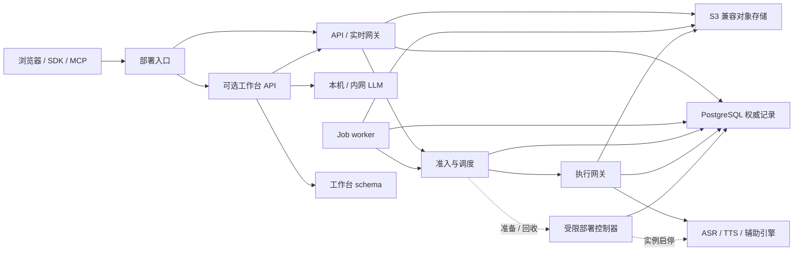

# SpeechNexus 整体技术方案

本文把[产品主设计](../speechnexus-product-architecture.md)、[语音协议](speech-api.md)、[资源治理](runtime-governance.md)和已接受 ADR 衔接为可实施的工程方案，负责组件协作、技术选型、内部协议、事务和交付顺序。公共语义仍由语音协议及后续机器契约负责；本文不重复定义字段默认值、范围、状态枚举或错误码。

**当前实现仅包含工程骨架、运营健康检查与两个 Web 外壳。** 下文新增工具、控制协议、迁移、调度、音色、LLM 和观测路径均待实现；模型选型不等于运行资格。首批模型与加载策略沿用 [ADR 0002](../decisions/0002-speech-models-engines-and-loading.md)，业务内容不出网的约束见 [ADR 0003](../decisions/0003-workbench-llm-network-boundary.md)，集群就绪架构与单机 MVP 同构部署见 [ADR 0004](../decisions/0004-cluster-ready-architecture-and-single-node-mvp.md)。

## 1. 技术基线与职责

| 层面 | 采用方案 | 实施约束 |
| --- | --- | --- |
| 应用运行时 | Python 3.14、FastAPI、Pydantic、Uvicorn、HTTPX | 保持现有 uv workspace；重型解码和推理不在事件循环内执行 |
| 领域与应用 | 领域对象、服务中立端口、显式用例、Repository / Unit of Work | domain 不导入框架、生成 DTO、数据库或 vendor；adapter 在边界转换 |
| 数据访问 | 现有 Psycopg 3，业务实现增加有界异步连接池与显式 SQL | 每个进程管理自身连接池；不跨实时会话长期占用连接 |
| 数据迁移 | Alembic 版本化迁移，SQLAlchemy 仅用于迁移环境 | 不将 ORM 模型作为业务权威，不以自动建表代替迁移 |
| 任务与协调 | PostgreSQL Job / outbox / 租约，短事务 claim 与 reconcile | 不引入 Celery、Kafka 或强制 Redis 作为首期基础依赖 |
| 对象与媒体 | S3 兼容存储、MinIO 开发验证；PyAV / FFmpeg 有界媒体处理 | 对象提交和数据库引用分开协调；编码、重采样、临时磁盘纳入预算 |
| 公共和内部协议 | HTTP / JSON 控制、SSE 持久事件、WebSocket 实时流 | 公共、执行网关、部署控制器分别拥有契约，不透传 vendor 协议 |
| 契约工具 | OpenAPI 3.1、JSON Schema 2020-12；Python DTO 生成 / 校验；TypeScript 类型与客户端生成 | 生成器与模板锁版本，验证语义而非只检查 schema 语法 |
| Web | 现有 React / TypeScript / Vite；TanStack Query 管理服务端状态，显式 reducer 管理实时会话 | 两个应用独立构建；PCM 缓冲与音频时钟不放入 React 查询缓存 |
| 模型服务 | ADR 0002 的 vLLM、vLLM-Omni、NeMo、官方对齐和 ONNX Runtime | 与应用独立镜像、依赖锁和 Python 版本，逐组合验证 ARM64 / GB10 |
| 可观测性 | 结构化日志、OpenTelemetry、Prometheus，部署内收集与展示 | 不记录正文、音频、特征或凭据；遥测故障不能改变业务计量事实 |

新增依赖在对应工作包实施时纳入 uv / pnpm 锁文件；上表不表示已经安装或通过 Python 3.14 / Node 26 兼容验证。新增 Node 依赖集中使用 pnpm catalog；不根据可变文档直接指定未经验证的最新版。

## 2. 进程、网络与所有权

首轮部署使用单节点 Compose / 运维基础设施，架构层面遵循 [ADR 0004](../decisions/0004-cluster-ready-architecture-and-single-node-mvp.md) 的集群原生同构原则（单节点为 `Node=1, Replica=1` 特例）：逻辑角色按职责分离，每个进程显式声明 `node_id`、`process_role` 与唯一实例身份（`instance_id` / `gateway_id`），backend 与 execution-gateway 独立部署，禁止使用进程内存态或共享本地目录传递业务状态。单机 MVP 可将 scheduler / job-worker 折叠进 `api` 进程以减少容器数量，但必须保留独立身份、连接池、租约、worker claim 与协议边界；`node-controller` 不与业务 API 合并。单节点验收覆盖受控故障与恢复，不声称节点级高可用；扩容先增加已资格化节点与实例，再验证按节点划分的父物理预算与 owner 路由。

| 所有者 | 写入权威 / 执行动作 | 边界 |
| --- | --- | --- |
| 语音用例与 Job worker | 语音版本、Job / Step、Operation 结果、制品引用与业务 outbox | 不直接调用引擎，不以 HTTP 断开推断执行停止 |
| scheduler | 物理父预算、实时保留、准入租约、owner / fencing、准备与回收意图 | 不持有引擎凭据，不自行伪造停止事实 |
| execution-gateway | submit intent、引擎执行关联、入口屏障、abort / 完成证据 | 不发布音色、修改工作台稿件或扩容预算 |
| 部署控制器 | 批准模板对应实例的创建 / 停止事实及 reconcile | 不接收业务音频、正文、任意镜像 / 挂载 / shell |
| 工作台 | 项目、业务轮次、稿件、纪要、独立导出与保存副本 | 通过公开语音协议调用底座，不共写底座表 |

内部协议只在部署管理网络可达，使用独立组件凭据，跨主机连接使用 TLS；这些凭据是组件边界，不引入首期用户目录。普通业务进程不挂载 Docker socket。只有部署侧受限执行器接触运维权限，入口不接受用户提供的引擎地址或容器参数。

首轮可共用一个 PostgreSQL 实例，但按表的所有者设置运行凭据和写入权。gateway 获得校验租约、锁定提交屏障和写入执行事实所需的最小数据库操作权限；它不能绕过 scheduler 增加预算，也不能直接发布业务结果。迁移由单独的部署角色执行。

## 3. 契约与类型生成

P0 机器契约已按以下文件交付；它们冻结协议形状与样例，但业务路由、运行时行为和真实模型资格仍待实现。公共、管理与内部契约分别维护，不用空文件冒充已冻结协议。

| 交接契约 | 生产者 / 消费者与职责 |
| --- | --- |
| `speech-openapi.yaml` | API、Web、SDK、MCP；OpenAI Audio / Realtime 声明子集与 `/v1/nexus` 语音、Job、资产、音色和发音资源 |
| `workbench-openapi.yaml` | 工作台 API / Web；项目、转写、会议、助手、提词、有声书、保存副本与导出 |
| `admin-openapi.yaml` | AdminUI、调度、部署与发布流程；工作空间、绑定发布、实例、资源池、策略、诊断与审计 |
| `realtime-events.schema.json` | 实时网关与客户端；标准 ASR 事件子集、`nexus.*` 事件、联合、顺序、重放和终态语义 |
| `scenario-profile.schema.json` / `voice-resource.schema.json` | 管理面、语音用例与 Web；预设 revision、覆盖范围、音色候选 / 校验 / 发布与不可变版本 |
| `internal/execution-control.openapi.yaml` | scheduler / worker 与 gateway；提交、查询、取消、封锁与 drain |
| `internal/execution-stream.schema.json` | 实时网关与 gateway；控制信封、音频 descriptor、序号、样本坐标、credit、背压和二进制 PCM framing |
| `internal/runtime-control.openapi.yaml` | scheduler 与部署控制器；批准实例的准备、查询、停止及证据 |
| `model-binding.schema.json` / `model-instance.schema.json` / `capacity-manifest.schema.json` / `qualification-report.schema.json` | 管理面、调度、控制器与发布流程；分离静态绑定、动态实例、容量租约和资格证据 |

公共、内部控制和 vendor DTO 分别建模，不能把私有字段通过公共响应泄漏。规范源放在 `contracts/`，公共与内部文件分目录组织；跨文件引用在构建时按所在文件解析，不在运行时访问网络。OpenAI SDK 的 REST 请求 / 响应形状与 Realtime 客户端事件由 `tests/contract/test_p0_public_contracts.py` 使用官方 Python SDK 的 mock transport / 实际序列化路径校验；这只是契约门禁，服务端实现后还须以同一组样例运行 HTTP / WebSocket 集成测试。兼容范围与扩展规则见[OpenAI 兼容与增强边界](openai-compatibility.md)。

Python 首选 datamodel-code-generator 生成 Pydantic v2 边界 DTO，再映射为领域命令。TypeScript 的 OpenAPI 类型与客户端使用 openapi-typescript / openapi-fetch；独立事件 schema 生成对应类型，并用 Ajv 的 2020-12 实现校验运行时消息。生成产物不手改，业务层不得依赖生成 DTO 的内部布局。

生成器只处理可表达的结构约束；布尔冒充数字、额外字段、可判别联合、跨字段关系、规范意图、事件序列与状态竞争仍须经过同一组正负样例。Python、TypeScript、fake adapter 和 MCP 运行样例必须一致。契约门禁还要比较 FastAPI 的实际投影、生成产物差异和不兼容变更；只有结构校验通过不能冻结协议。

## 4. 绑定、资格与实例分离

模型绑定描述不可变的模型 / 引擎 / 配方版本及其发布资格；运行实例描述某次进程 / 容器、所属节点、generation、实际配置与运行事实。容量租约再关联具体执行与实例。三者不能用同一生命周期状态代替。

VoiceDesign 空闲卸载只改变实例就绪与可立即执行的事实，不退役绑定或删除 VoiceRevision。重建实例获得新的实例身份与 generation，重做加载和热身检查；配置摘要或部署组合变化时重新匹配资格。能力读取无副作用，分别展示支持、资格、实例就绪、可排队与可立即准入的事实，具体字段和状态在机器契约中冻结。

实时准入使用**完整执行配方**：模型表只是清单，不是一次请求只涉及一个模型的保证。父物理预算覆盖同机全部受管实例及部署内其他已知占用；不能把共享物理内存当成主机与设备两份独立容量。

## 5. 语音与音色执行配方

| 路径 | 阶段与产物 | 预算和结果约束 |
| --- | --- | --- |
| 实时 ASR | canonical PCM → Silero VAD / 有界段 → 0.6B 预览 → 预设指定的定稿 → 可选对齐 / 分人 | 预览可修订，正文与整体 Operation 终态分开 |
| 实时完整段复核 | 关闭的有界段 → 1.7B 复核 → 固定正文 revision | 1.7B 是该实时配方的依赖，不因也服务文件任务就落入普通 batch 冷启动队列 |
| 文件 ASR | 有界解码 / 重采样 → 交叠单元 → 1.7B 识别 → 去重合并 → 所需辅助与导出 | 记录切分 / 合并版本与样本映射；不按文本长度伪造时间戳 |
| 预设 / 已发布音色 TTS | 固定文本 / voice / 词典 / planner → CustomVoice 或 Base → codec → PCM → 目标编码 | 文本冻结与音频交付独立；声学连续性按真实能力声明 |
| 描述设计 | VoiceDesign 候选 / 参考 → Base 克隆与换文复用校验 → 显式发布 → 后续 Base 合成 | 全阶段峰值先预留；preview_only 不能发布 |
| 样本克隆 | 已提交参考材料 → Base → 试听 / 校验 → 显式发布 | 素材、来源、参考正文及兼容绑定版本固定 |

启用实时 `full_segment` 预设时，1.7B 复核必须已经可服务，其执行预算和等待期限纳入实时资格；required 辅助依赖同样纳入完整准入。不能先只准入 0.6B，再等待一个无保障的复核 / 辅助槽位。若资源不足，明确不发布或不准入该配方；只有协议允许且调用方明确接受时，才使用另行验证的降级配方。文件任务可复用同一实例的剩余预算，不能在引擎内部排队阻塞实时复核。

VAD 的滞回、去抖和前缀缓冲与识别段策略版本化；预览与正文定稿不等待非正文的重型辅助结果，整体 Operation 仍按 required 规则等待。required 辅助作为父 Operation 的必需步骤，best_effort 使用可独立终结的子执行。取消、drain 与计量覆盖全部阶段，不因正文已经发布而遗留无主计算。

分人维护独立于 ASR 切段的有界会话状态和匿名标签映射。文件长音频也必须采用有界处理，不能每块重新编号后直接拼接。先验证最多八位说话人的跨块连续、重叠与 reset；无法恢复模型状态时明确产生新的标签连续性边界，不冒充无缝接管。辅助结果只挂到匹配的正文 revision，不能用新词级对齐证据覆盖旧正文。

内部模型采样率、公共 canonical / wire 时钟与原文件时钟分别保留版本化映射，所有 span 转换使用采样数及明确舍入规则。重采样、切块与编解码必须验边界、尾部、无语音与长时累计误差。TTS 按冻结文本顺序发布 PCM；首可播放 PCM 与完整 MP3、浏览器收到、播放结束分别计时。

音色的可重建材料和校验证据由数据库 / 对象存储管理，vendor 内存句柄和缓存只是派生状态。明确提交并被音色版本引用的声音资产随音色生命周期保留，原始上传输入可按自身保留策略清理，不能靠无限续租普通上传维持声音。缓存绑定模型、codec 与音色 revision；实例重建后由批准材料恢复，不能把旧进程的 handle 当成永久资产。材料缺失或不兼容时报告不可用，不偷偷重新设计一个声音。

## 6. 执行网关与部署控制协议

内部控制使用 HTTP / JSON，实时数据使用 WebSocket 的 JSON 控制事件与二进制 PCM。流连接绑定固定执行身份；二进制块的 framing、长度、序列与描述符关联由内部机器契约冻结。公开 Realtime 的编码不因此改变。文件与制品通过受控 Asset / Artifact 引用传递，禁止提交任意路径、对象 key 或外部 URL。

一次执行至少能够追溯规范命令、Operation、attempt、reservation、binding / recipe、实例 generation 与 fencing。重复提交同一意图只关联原执行；意图不一致则拒绝。查询区分未提交、正在协调与已知执行事实，传输失败不等于引擎未执行。控制响应不能凭“已接收取消”生成停止证据。

提交屏障继续由 gateway 拥有：核对当前准入、owner、配置 / 策略与实例 → 持久化唯一 submit intent 并占住预算 → 放行外发 → 关联真实引擎执行。数据库 token、进程内锁或一次检查均不能撤回迟到外发；接管前必须封锁旧入口并协调其提交与在途执行，必要时隔离 / 重建受控实例。详细不变量以[多进程一致性](runtime-governance.md#14-多进程一致性与-fencing)为准。

部署控制器按持久意图 reconcile，只接受批准模板、不可变实例身份、配置摘要和已预留资源。启停命令可去重；迟到停止命令不得命中替代实例。控制器报告进程 / 容器事实，gateway 报告入口与执行事实，scheduler 结合两者决定何时释放预算。控制器不可用时停止新的准备 / 回收协调，已有就绪实例只在有效的执行和资源租约内服务。

实例运行状态、控制意图和执行证据持久化在各自拥有的控制表中；数据流不写入控制账本。WS 断线后停止新增输入并协调取消，查询可以恢复执行事实，但不从元数据重放未保存音频。任何清理未知都保留 quarantine，不能以重试、换副本或重启 worker 绕过。

## 7. PostgreSQL 事务、迁移与对象一致性

运行时采用显式短事务、行锁、条件更新与唯一约束。默认业务事务使用 Read Committed；需要跨行不变量时锁定对应权威行，统一锁顺序，并在明确可安全重试的事务边界处理死锁 / 序列化失败。不能用“先读余量，再无条件写入”维护容量。

| 原子边界 | 同一事务内必须成立的事实 |
| --- | --- |
| 接受新意图 | 幂等 claim、固定配置、资源 / 草稿版本、Job 与 outbox 一致；重放不重新解析默认值 |
| 准入 | 物理父预算、能力 / 阶段预算、累计额度与执行租约一起成立，双工不分段持槽等待 |
| 提交 | reservation / attempt / owner 校验与唯一 submit intent 对齐；外部请求在事务提交后受 gateway 屏障控制 |
| 结果发布 | 当前取消 / 功能策略 / 资源禁用、attempt / fencing、制品引用、步骤 / Job 成功和 outbox 一致 |
| 用量 | 稳定输入区间、各 attempt 输出区间、预留转消耗和余额释放一致 |
| 默认指针与版本 | 新 revision 不可变，发布 / 退役 / 强制禁用与正在提交的使用有明确串行化边界 |

claim Job / outbox 可使用 `FOR UPDATE SKIP LOCKED`，仅用于竞争分派；容量校验仍需锁定对应预算权威，不能把跳过锁当成配额证明。领取后尽快提交，推理、HTTP、对象写入和长时编码不占用数据库事务。PostgreSQL 通知仅用于唤醒，轮询 / reconcile 以持久记录为准。

用量按稳定样本 / 文本区间和单调水位校验；唯一键只能防完全相同记录，还必须处理部分重叠区间。输入跨 attempt 去重，输出按实际生成分别计入；清理未知时不伪造零消耗或提前释放。

Alembic 迁移由唯一部署步骤执行，并发迁移使用数据库互斥。speech、gateway 控制记录和 workbench 分别维护明确表所有权与可兼容的迁移顺序；运行角色无 DDL 权限。迁移以显式 SQL / 经审核操作为准，禁止应用启动自动建表或自动猜测破坏性修改。优先采用先扩展、迁移数据、切换消费者、后收缩的过程，回滚应用前验证旧版本能读取当前 schema。

对象先写私有 staging，验证内容、摘要与实际长度后原子发布数据库引用；数据库和对象存储不做虚构的跨服务事务。对象写完但事务未提交的内容保持不可见，reconcile / GC 只处理明确作用域的孤儿。下载经公开受控入口校验可用性并支持 Range，存储 key 不成为公共资源标识。

普通删除先列出有效的持久依赖与执行租约并拒绝破坏，包括当前没有任务执行的已发布声音及其重建材料；明确的级联 / 强制删除才进入停止新用、取消依赖和清理流程。清理必须取得执行证据，不能删除仍被有效声音版本引用的材料后继续宣称复用成功。已提交工作台副本按自身生命周期处理，跨模块级联范围必须显式列明。

## 8. Web、实时音频与客户端资格

AdminUI 与 Workbench 继续使用独立 Vite 应用、同源 API 与共用 SDK。`web/shared` 只放稳定组件、生成的公共客户端和无业务所有权的音频工具；不加入项目、会议或音色发布业务。页面按功能加载代码，未配置能力显示真实原因和可执行的下一步。

TanStack Query 负责资源、任务、版本与能力缓存，缓存键包含部署 / workspace 与必要 revision。SSE 按持久游标更新查询；历史过期时读取当前事实，不重做命令。发布、取消与配额不做伪成功的乐观更新；编辑提交携带契约要求的版本前提。

实时会话、ASR 替换预览、TTS utterance 与播放器 generation 使用独立 reducer / 会话服务。AudioWorklet 和有界缓冲管理采样与播放，计算量大的转换移到 worker；不把每个 PCM 块变成 React 渲染。以实际采样时钟处理 credit、样本缺口和播放进度；浏览器停止播放与服务端确认算力停止分别呈现。

首轮客户端资格从桌面 Chromium 与实际使用的操作系统组合开始，再按证据扩展。麦克风、文件、标签页 / 屏幕音频分开验收；合成设备冒烟不能代替真实权限、设备切换、后台休眠、长时漂移和跨设备播放验证。未验证组合不宣称正式支持，也不靠 User-Agent 猜测能力。

## 9. 工作台与内网 LLM

LLM 集成遵循 ADR 0003：默认关闭，只接受部署批准的本机 / 内网端点。首个 adapter 对接已有内网服务的 OpenAI 兼容文本接口，并锁定实际支持子集；不要求底座部署 LLM，也不硬编码托管模型。模型配置、连接凭据、超时与预算只在服务端管理，普通请求不能提供任意端点。

工作台以服务中立 LLM 端口承接助手与纪要；固定稿件 / sealed 转写 revision、模板 revision、实际模型标识及生成参数，记录无正文的执行事实。只提交该任务选择的内容，界面展示处理范围。模板与项目内容分开，生成结果作为不可信候选，不写回声学原文或执行配置。

助手拥有业务 turn、插话、LLM 输出和播放 generation。新输入可先停止旧音频播放并取消旧任务，但新 TTS 计算仍须等旧计算清理和准入；只有稳定并冻结的文本送入 TTS。LLM 中断保留明确的部分生成事实，不把半句自动重播或重新执行整个语音轮次。

纪要由工作台独立持久任务生成，显式保存后形成项目制品；来源变化使其候选过期。LLM 失败不改变已完成 ASR，也不自动把内容发送到另一个端点。任务重试固定原依赖并建立明确 attempt；切换模型 / 模板属于新意图。

LLM 与底座的队列、计量和结果分开；共享主机时仍要计入父物理预算与资格负载。LLM 出站、内网代理、观测和浏览器资源共同验业务内容不出网，不能只检查 URL 是否看起来像内网。

## 10. 观测、运维与故障协调

采用结构化 JSON 日志与 OpenTelemetry 追踪，跨 API、队列、scheduler、gateway、controller、adapter 传播关联信息；异步重试关联原意图并保留独立 attempt。不得把输入正文、prompt、音频、声音特征、对象私有路径或凭据放入 span / baggage / 异常详情。观测组件只部署在本机或内网。

Prometheus 分别统计队列等待、准入、模型准备 / 热身、引擎排队、执行、首有效预览、首 PCM、abort 确认和回收延迟。容量、实例峰值、实时保留余量、quarantine、outbox lag、GC / 删除待办和连接池等待进入运维视图。指标标签限于有界的能力、执行类别和当前部署绑定；高基数关联 ID 放在无内容日志和 trace。

`healthz` 表示进程存活，`readyz` 表示该进程所需基础设施条件；模型就绪、质量资格和可准入分别发布。VoiceDesign 卸载不应令整个 API 失去 readiness。遥测写入失败只产生有界降级与丢弃统计，任务、租约、用量和停止证据仍以 PostgreSQL 权威记录协调。

告警对应可执行动作：停止新准入、隔离实例、查询 / abort、协调旧 owner、恢复依赖或重跑资格。诊断只读操作不触发模型加载；自动修复不扩大预算、不清除未知执行记录，也不改写已经发布的唯一结果终态。

## 11. 部署、发布与恢复

应用、推理与部署控制器分别锁定镜像和权限。模型 / tokenizer / codec 使用只读、固定摘要的本地制品；运行中不下载。部署入口、控制网络、对象网络和观测网络显式定义，应用与 LLM 服务的出站仅允许批准的内部依赖，前端不加载外部 CDN / 追踪脚本。当前 bootstrap Compose 只用于开发验证，不能当作这些规则已落实的证据。

一次发布提供版本化资格包：应用 / schema / 契约版本、各推理镜像和模型文件集摘要、stage 配置、主机与共享内存拓扑、容量 manifest、语料清单、测试结果及未验证项。源音频和私有材料不提交仓库；资格包只保存可复核的引用、摘要与无内容统计。

升级先迁移兼容 schema，再准备新实例、完成资格并切换新请求；旧会话和 Job 使用其固定版本完成或明确取消。回滚还原入口 / 默认指针和可兼容应用，不删除旧音色和制品，不以回滚掩盖未清理计算。

备份协调 PostgreSQL、对象清单、版本依赖与删除账本。恢复进入禁止新业务准入的协调阶段，核对已提交引用、重做删除 / 强制禁用、隔离未知执行并重建实例，再开放服务。缺失对象报告不可用，不由孤儿对象猜测 Job 成功；RPO / RTO 在目标部署实测后冻结。

## 12. 当前实施顺序与退出条件

既有[分阶段计划](../plans/2026-10-22-speechnexus-implementation-plan.md)保留原时点预算；以下是本方案的工程交接顺序，不代表阶段已经完成。

| 顺序 | 交付 | 退出证据 |
| --- | --- | --- |
| P0-A | 公共 / 内部契约、身份关联、绑定 / 实例 / 资格分离、正负与时序样例、类型生成 | 多消费者语义一致；不存在靠 prose 或手写 DTO 补出的默认值 |
| P0-B | 数据迁移与关键事务原型、fake engine / controller | 真实隔离 PG 验并发抢槽、提交 / 取消 / 禁用 / 发布竞争、重复 outbox、迟到 fencing 与区间计量 |
| P1-A | Asset / Artifact、Job、基础治理与标准文件 ASR / TTS | 无 WebUI 可运行；假引擎和真实版本分别记录验证范围 |
| P1-B | 实时配方、VAD、0.6B / 1.7B 复核、TTS 流、取消和背压 | 全阶段准入，1 路实时 ASR + 1 路实时 TTS 达到 ADR 0002 的首轮延迟要求 |
| P1-C | VoiceDesign 按需、Base 复用、实例回收、辅助模型与音色发布 | 完整创作闭环；冷加载与实时共存、停止证据和未知清理均可验证 |
| P2–P4 | 两个 Web 入口、客户端资格及可选工作台 / 内网 LLM / 有声书 | 公开底座调用、业务版本依赖、播放 / 取消、内容网络边界和独立导出验证 |
| P5 | 长时、故障注入、容量、恢复、迁移 / 回滚与部署交付 | 只对实际通过的功能 / binding / 拓扑发布资格；缺失和跳过明确列出 |

P1-B 的“首轮延迟达标”必须先冻结同一套测量口径，再附实测分解。场次、并发、绑定 revision、模型 / 引擎版本、主机拓扑、采样率和客户端组合进入资格报告；任一阶段没有测量时不能只用端到端一次结果宣称达标，也不能把跳过项算作通过。

| 指标 | 计时起点 | 服务端归因观测点 | 计时终点 | 首轮门槛 |
| --- | --- | --- | --- | --- |
| ASR 首个有效预览 | 服务端已接受使最低识别窗完整所需的最后一个 PCM sample | VAD / 段边界、预览请求入队、0.6B 首个有效 hypothesis 生成 | realtime gateway 写出首个有效标准 delta 或 `nexus.transcription.hypothesis` | 同一绑定 / 拓扑下 p95 ≤ 1000 ms |
| TTS 首个可播放 PCM | 首个可合成文本单元被 commit / finish 接受并冻结 | 准入完成、模型首个 codec 输出、解码与编码完成 | 交付 transport 写出首个完整非空 PCM frame | 同一绑定 / 拓扑下 p95 ≤ 800 ms |

网络接入到客户端接收、浏览器解码 / 播放启动和 1.7B 复核分别记录 p50 / p95，作为独立观测，不用客户端慢速播放掩盖服务端首块超时。每段预算上限在 P1-A 真实 adapter 基线后按实际测量冻结；没有基线时不填写推测数字。样本量与并发组合在资格报告中固定，至少覆盖 1 路实时 ASR 与 1 路实时 TTS 共存的批准负载。

首个真实 adapter 接入后设置一次契约复审点：核对 `engine_request_id` 关联、commit 顺序、terminal 与 abort 证据、`stop_evidence_kind`、输出 watermark / reset、TTS 首帧与 `stream_format`、以及 duration / token usage 的真实可观测性。复审只允许在上述证据语义与内部协议字段上作有 ADR 的兼容修订；OpenAI 标准路径、字段含义和错误 envelope 不得因此漂移，扩展仍只使用 `nexus` 命名空间。

质量阈值应按首批普通话 / 中英混说与代表性噪声、数字、专名、说话人和音色语料冻结。先建立对照基线再锁阈值，不因暂缺真实测量就编造 CER / WER / DER 或音色相似度指标。默认确定性测试使用 fake、合成或获准公开材料，不使用私人音频。

P0 机器契约与协调 DDL 已交付并通过仓库门禁，但业务路由、完整迁移体系、控制器实现和真实模型测试仍待落地。实现时按仓库门禁验证，并分别提交实现证据与部署资格。

## 13. 上游依据与版本锁定

核验日期为 2026-10-22。以下来源只说明工具 / 协议的用途；其发行版和与项目工具链的兼容组合在实际接入时锁定。

- [OpenAPI 3.1 规范](https://spec.openapis.org/oas/v3.1.1.html)、[JSON Schema 2020-12](https://json-schema.org/draft/2020-12)：HTTP 与共享 schema 方言。
- [Psycopg 异步连接池](https://www.psycopg.org/psycopg3/docs/advanced/pool.html)、[PostgreSQL 16 SELECT / 锁定](https://www.postgresql.org/docs/16/sql-select.html)、[Alembic 迁移](https://alembic.sqlalchemy.org/en/latest/tutorial.html)：连接、并发 claim 和版本化迁移。
- [datamodel-code-generator](https://github.com/datamodel-code-generator/datamodel-code-generator)、[openapi-typescript](https://openapi-ts.dev/introduction)、[openapi-fetch](https://openapi-ts.dev/openapi-fetch/)、[Ajv schema 方言](https://ajv.js.org/json-schema.html)：生成与运行时校验，不能替代语义测试。
- [TanStack Query](https://tanstack.com/query/latest/docs/framework/react/overview)：服务端状态同步；不是实时音频缓存。
- [OpenTelemetry 数据处理](https://opentelemetry.io/docs/security/handling-sensitive-data/)：观测采集边界与内容排除。

[架构索引](README.md) · [文档索引](../README.md) · [资源治理](runtime-governance.md)
