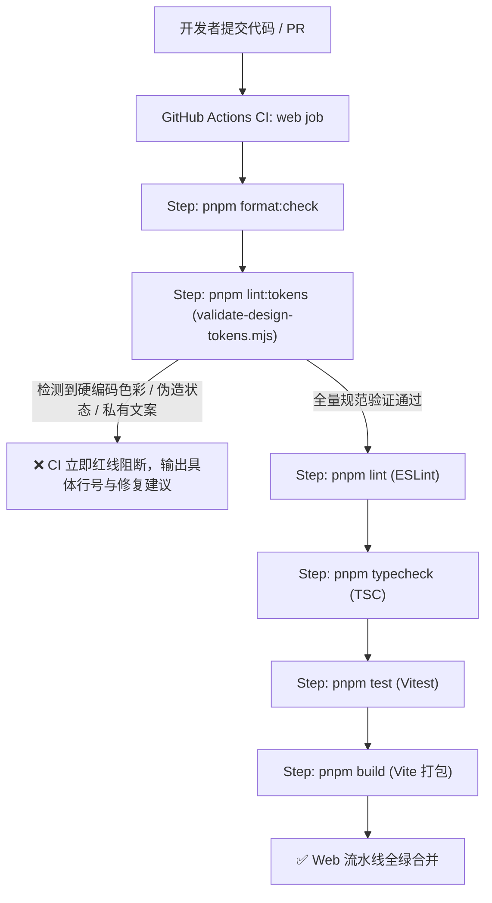

# SpeechNexus UI/UX 设计框架与设计 Token 系统

## 1. 概述与核心定位

SpeechNexus 是面向 Linux 原生环境的企业级自部署语音服务底座与创作者平台。在产品表现层，SpeechNexus 通过两大独立 Web 入口服务不同诉求的使用者：
- **AdminUI (`/admin`)**：面向服务与模型维护者，聚焦“**运行事实管理（Precision Fleet Cockpit）**”，提供拓扑观察、模型绑定、资源预算、配额租约、持久任务与全链路诊断。
- **个人语音工作台 (`/workbench`)**：面向最终业务使用者，聚焦“**声学创作者工坊（Next-Gen Audio Atelier）**”，提供录音转写、长文配音、实时会议、同传字幕、音色设计与有声书多角色编排。

本规范确立了 SpeechNexus 的统一 UI/UX 设计框架和三层设计 Token（Design Tokens）体系。它系统性吸收了 **2026 年现代专业级 AI 与声学软件的最佳实践**，深度融合了 **SpeechNexus 独特的品牌基因与严格的架构治理红线**，并系统提炼了 **VoiceStudio (`/Users/hrygo/Documents/voicestudio`)** 的工程与交互经验。

---

## 2. 2026 专业级设计最佳实践调研

经过对 2026 年主流专业级开发者工具（如 Linear、Apple Pro Tools、DeepSeek UI、v0/Next.js 等）及高密度生产力套件的研究，SpeechNexus 确立了以下四大设计基线：

### 2.1 色彩空间革命：OKLCH 与感知一致性
- **摆脱传统 sRGB/HEX/HSL 局限**：传统颜色模型在不同色相（Hue）下的感知明度（Perceived Lightness）剧烈波动。2026 年现代 Web 标准全面拥抱 **OKLCH (Oklch Lightness, Chroma, Hue)** 与 **Display P3 广色域**。
- **数学级对比度保证**：OKLCH 保证了明度（L）的一致性，在亮色模式（Light Mode）与暗黑模式（Dark Mode）切换时，无须逐一手工微调每种强调色的明暗，即可严格满足 **WCAG 2.2 Level AAA** 以及 **APCA (Accessible Perceptual Contrast Algorithm)** 对比度标准。
- **黑曜石深色画布（Obsidian Slate Canvas）**：暗色模式告别生硬死板的纯黑（`#000000`）或浑浊灰，采用带深蓝紫微弱偏向的黑曜石深色（`oklch(0.12 0.015 250)`），结合细腻的发光边框营造现代极客与工业级精密度。

### 2.2 标高物理与微材质：空间流体拟态（Glassmorphism 2.0 / Liquid Glass）
- **多层级标高（Elevation Layers）**：不依赖沉重脏乱的投影，而是通过表面明度增量（Surface Luminance Increment）、细腻的内侧高光（Inner Specular Highlight `inset 0 1px 0 rgba(...)`）与 1px 微发光边框划分层级：
  - `Level 0 (Canvas)`：底层工作区基底画布；
  - `Level 1 (Card/Section)`：内容组织卡片与常规网格容器；
  - `Level 2 (Panel/Raised)`：可拉伸侧边栏、控制面板与底部浮动栏；
  - `Level 3 (Overlay/Popover)`：模态对话框、下拉菜单、命令面板（`Cmd+K`）。
- **空间玻璃质感**：采用 `backdrop-filter: blur(12px-20px) saturate(1.15)` 配合带有透明度的色彩混频（`color-mix(in srgb, ...)`），在保证文字可读性的同时赋予界面通透悬浮感，并严格提供 `@media (prefers-reduced-transparency)` 降级回退。

### 2.3 极致人机工效：折叠导轨、自适应画布与全局中心
- **双模导轨布局（Rail-to-Canvas Paradigm）**：
  - **极简紧凑导轨（Compact Nav Rail, 48px/64px）**：保留高频功能图标，双击或单击可即时展开，最大限度将视口面积留给波形轨与转写文本；
  - **弹性上下文侧栏（Resizable Sidebar, 220px-360px）**：带有像素级拖拽手柄，用于展示音色库、项目树、预设清单。
- **全局命令中枢（Command Palette `Cmd+K`）**：支持键盘模糊匹配，实现模型检索、任务跳转、音色切换与快捷操作的一键直达。
- **常驻式状态与媒体基座（Bottom Telemetry & Playback Dock）**：屏幕底部固化 40px-56px 控制底座，将播放进度时码、实时音频波形振幅、引擎健康状态与后台 Outbox 事务提交状态统一收敛。

### 2.4 声学与 AI 原生交互范式
- **多阶转写文本流呈现（Multi-Stage Word Stream）**：对 ASR 实时流区分三段渲染状态：
  1. *定稿词（Finalized Token）*：坚实主色显示，已不可逆封存；
  2. *推测修订词（Speculative Token）*：轻微倾斜或微透明，带有呼吸感等待声学边界修正；
  3. *低置信度警告词（Low Confidence Warning）*：琥珀色虚下划线，提示人工复核。
- **音频波形双态渲染（Synchronized Waveform Scrubbing）**：未播放部分呈现低对比度静音线，已播放轨迹注入动态品牌高亮色，支持微秒级平滑跟随与区间循环选择。
- **非破坏性试听对比（A/B Voice Audition Dock）**：在确认发布不可变音色前，提供双轨声谱对比与盲测试听切换器。

---

## 3. SpeechNexus 品牌特点与架构边界融合

### 3.1 品牌核心理念：SpeechNexus · 声枢（Acoustic Hub）
“Nexus（声枢）”象征模型与引擎的交汇点、标准与增强协议的枢纽、机器智能与声学艺术的连结。品牌体系定名为 **SpeechNexus（中文品牌名：声枢）**，配定中文标语“**自部署的语音服务与创作中枢**”与英文标语“*Self-Hosted Speech Engine & Studio*”。

图形标志（BrandMark）采用 **声波轨道环（Acoustic Orbital Ring）**：在 `36×36` 黑曜石微高光圆角方框（Squircle）内，以 `-35°` 开口谐振环包裹 5 柱对称圆角脉冲声波，并在右上轨道豁口处布置发光拓扑卫星节点（Nexus Satellite Node）。矢量品牌资产由以下文件统一承载：
- `web/shared/src/assets/brand-mark.svg`：主品牌声枢徽标（翡翠绿至赛博蓝双色交汇轨道）；
- `web/shared/src/assets/brand-banner.svg`：横版品牌字标与 Slogan 组合头图；
- `web/admin/public/favicon.svg` 与 `web/workbench/public/favicon.svg`：两个入口各自匹配主题色（Emerald / Cobalt）的独立站点图标。

SpeechNexus 采用 **“同根双面，一脉相承”** 的双生色彩系统：

| 产品面 | 定位与意向 | 主题识别 | 品牌主色 (Primary / Accent) | 界面材质与氛围 |
| :--- | :--- | :--- | :--- | :--- |
| **AdminUI** | **精准舰队座舱** (Precision Fleet Cockpit) | `data-tone="admin"` | **苍松翡翠绿 / 极光青**<br>Light: `oklch(0.50 0.16 165)` (`#087B62`)<br>Dark: `oklch(0.78 0.15 168)` (`#5EEAD4`) | 严谨、高密度、清晰遥测、数字刻度感、稳健高可用 |
| **工作台** | **新一代声学工坊** (Next-Gen Audio Atelier) | `data-tone="workbench"` | **电光皇家蓝 / 赛博青**<br>Light: `oklch(0.52 0.22 260)` (`#1D4ED8`)<br>Dark: `oklch(0.70 0.20 255)` (`#60A5FA`) | 流畅、通透、波形律动、沉浸创作、低延迟反馈 |

### 3.2 架构红线与设计道德约束（硬性规则）
SpeechNexus 的架构原则在 UI/UX 层面必须得到 100% 忠实表达，绝不允许通过“界面美化”掩盖系统真实状态：

1. **三态真实性原则（Strict Tri-State Honesty）**：
   - 界面功能与卡片必须显式标识三种受控状态：
     - `ready`（基础就绪）：运行时、接口及底层实现已联通并可复现运行；
     - `contract`（契约已交付）：公共/内部协议已冻结并通过验证，后端路由或引擎尚未对接；
     - `planned`（规划阶段）：中长期演进能力，当前不予加载虚假交互。
   - **严禁伪造状态**：绝不得使用随机数 Mock 虚拟 GPU 占用率、虚拟并发数或虚拟模型能力。
2. **共享部署无假私有原则（Shared Deployment Transparency）**：
   - 首期无多租户、无角色权限、无登录体系。所有数据在当前部署内完全共享。
   - 界面全局常驻“**共享部署（Shared Deployment）**”标签，严禁使用“仅自己可见”、“我的个人私密空间”或“仅管理员可操作”等误导性文案。
3. **本地离线与不出网保障原则（Air-Gapped & On-Premises Assurance）**：
   - 界面显著位置设立安全守卫指示器：“**本地离线推理**”、“**音频不出网**”。
   - 明确提示 LLM 默认关闭且仅支持合规配置的内网端点，禁止客户端随意输入公网模型 URL。

---

## 4. 参考 VoiceStudio 的经验提炼与演进升级

通过对 `/Users/hrygo/Documents/voicestudio` 的代码架构与交互模式的深入剖析，SpeechNexus 提炼并升级了以下核心能力：

| 维度 | VoiceStudio 做法 | SpeechNexus 继承与突破升级 |
| :--- | :--- | :--- |
| **Token 架构** | 基于 Tailwind CSS v4 与 `t3-theme.css`，定义基础变量与语义别名。 | **升级为系统化三层 Token 体系**：图元层（Primitives）、语义层（Semantics）、领域层（Domain/Tone），直接以 OKLCH 宽色域重构，原生支持 AdminUI 与 Workbench 双面无缝自适应切换。 |
| **侧边栏导航** | `WorkspaceSidebar` 支持 Mini-Rail（48px/64px）与 Resizable Drawer，结合 `usePaneResize`。 | **延续微型导轨 + 拖拽扩展模式**，在 Web 端去除 Electron 原生窗口依赖，补充完备的键盘快捷键绑定（`Cmd+B` 切换折叠）与无障碍焦点环管理。 |
| **音频播放体系** | 集成 WaveSurfer.js + `@vidstack/react`，动态计算波形颜色（`waveColors`）。 | **标准化声学组件接口**：定义专门的声学波形 Token（`--waveform-wave`, `--waveform-progress`, `--waveform-handle`），支持实时流式增量绘制与高 DPI 渲染。 |
| **后端容错与恢复** | 提供 `BackendGate`、`SetupGate`、`RepairAgentDock` 进行运行时守护。 | **升级为分布式网关与租约感知底座**：界面感知节点存活（`/healthz`）、依赖就绪（`/readyz`）、租约持有（Lease Fencing）及 Outbox 事务未决队列。 |
| **产品宿主环境** | 面向单机 Desktop Electron 应用。 | **面向企业级 Linux 容器与浏览器跨端运行**：完全解耦桌面私有 API，基于标准 Web Audio API 与 AudioWorklet 实现有界缓冲采集与播放。 |

---

## 5. 三层设计 Token 规范详细定义

### 5.1 第一层：基础图元 Token (Primitive Tokens)

基础图元层定义整个设计系统不可分割的度量单位与色板原子。

#### 5.1.1 基础色彩图元 (OKLCH 基础色板)
```css
:root {
  /* 黑曜石中性色族 (Obsidian Neutrals) */
  --nexus-color-obsidian-950: oklch(0.12 0.015 250); /* 最深画布底色 */
  --nexus-color-obsidian-900: oklch(0.16 0.018 250); /* 抬升卡片与面板 */
  --nexus-color-obsidian-850: oklch(0.20 0.020 250); /* 浮层与弹窗 */
  --nexus-color-obsidian-800: oklch(0.26 0.022 250); /* 分割线与弱边框 */
  --nexus-color-obsidian-700: oklch(0.34 0.020 250); /* 强边框与控件轮廓 */
  --nexus-color-obsidian-500: oklch(0.55 0.018 250); /* 次级弱化文字 */
  --nexus-color-obsidian-300: oklch(0.72 0.012 250); /* 正文副色 */
  --nexus-color-obsidian-100: oklch(0.92 0.008 250); /* 高对比正文 */
  --nexus-color-obsidian-50:  oklch(0.98 0.002 250); /* 纯白天光 */

  /* 暖沙亮色纸感色族 (Warm Parchment Neutrals - Light Mode) */
  --nexus-color-sand-50:      oklch(0.985 0.008 85);  /* 纸白画布 */
  --nexus-color-sand-100:     oklch(0.965 0.012 85);  /* 次级底色 */
  --nexus-color-sand-200:     oklch(0.920 0.015 85);  /* 弱边框线 */
  --nexus-color-sand-300:     oklch(0.850 0.018 85);  /* 强结构线 */
  --nexus-color-sand-700:     oklch(0.420 0.025 85);  /* 辅助说明字 */
  --nexus-color-sand-900:     oklch(0.180 0.028 85);  /* 浓墨正文字 */

  /* 翡翠与青绿图元 (Emerald / Teal - Admin Fleet) */
  --nexus-color-emerald-300:  oklch(0.82 0.12 168);
  --nexus-color-emerald-400:  oklch(0.72 0.15 168);
  --nexus-color-emerald-500:  oklch(0.60 0.17 165);
  --nexus-color-emerald-600:  oklch(0.48 0.15 165);
  --nexus-color-emerald-900:  oklch(0.24 0.08 165);

  /* 皇家蓝与赛博青图元 (Cobalt / Cyan - Workbench Studio) */
  --nexus-color-cobalt-300:   oklch(0.80 0.14 255);
  --nexus-color-cobalt-400:   oklch(0.68 0.18 255);
  --nexus-color-cobalt-500:   oklch(0.55 0.22 260);
  --nexus-color-cobalt-600:   oklch(0.44 0.20 260);
  --nexus-color-cobalt-900:   oklch(0.22 0.10 260);

  /* 状态警示与多路说话人图元 */
  --nexus-color-amber-500:    oklch(0.72 0.16 75);    /* 契约/告警 */
  --nexus-color-rose-500:     oklch(0.62 0.21 25);    /* 阻断/异常 */
  --nexus-color-violet-500:   oklch(0.64 0.19 300);   /* 说话人 B */
  --nexus-color-coral-500:    oklch(0.68 0.18 45);    /* 说话人 C */
}
```

#### 5.1.2 排版与尺寸图元
```css
:root {
  /* 字体族 */
  --nexus-font-sans: "Inter Variable", -apple-system, BlinkMacSystemFont, "Segoe UI", Roboto, "PingFang SC", "Noto Sans SC", sans-serif;
  --nexus-font-mono: "JetBrains Mono", "SFMono-Regular", Consolas, "Liberation Mono", monospace;

  /* 字号与行高梯次 */
  --nexus-text-xs:   0.75rem;    /* 12px / 16px - 遥测标签/时码 */
  --nexus-text-sm:   0.8125rem;  /* 13px / 18px - 紧凑表格/状态 */
  --nexus-text-base: 0.875rem;   /* 14px / 20px - 正文标准大小 */
  --nexus-text-md:   1.0rem;     /* 16px / 24px - 标题与强调内容 */
  --nexus-text-lg:   1.125rem;   /* 18px / 28px - 卡片主标题 */
  --nexus-text-xl:   1.375rem;   /* 22px / 32px - 模块区域大标题 */
  --nexus-text-2xl:  1.75rem;    /* 28px / 36px - 主视口标题 */
  --nexus-text-hero: clamp(2.5rem, 6vw, 4.5rem); /* Hero 超大标语 */

  /* 圆角尺度 */
  --nexus-radius-xs: 4px;
  --nexus-radius-sm: 6px;
  --nexus-radius-md: 10px;
  --nexus-radius-lg: 14px;
  --nexus-radius-xl: 20px;
  --nexus-radius-full: 9999px;

  /* 空间栅格 (8px 标准步进基线) */
  --nexus-space-1: 4px;
  --nexus-space-2: 8px;
  --nexus-space-3: 12px;
  --nexus-space-4: 16px;
  --nexus-space-5: 20px;
  --nexus-space-6: 24px;
  --nexus-space-8: 32px;
  --nexus-space-12: 48px;
  --nexus-space-16: 64px;
}
```

---

### 5.2 第二层：全局语义 Token (Semantic Tokens)

全局语义层负责屏蔽底层具体色彩值，建立与组件交互意图强绑定的语义映射。

```css
:root {
  /* 亮色模式语义映射 (Light Theme Defaults) */
  color-scheme: light;
  --bg-page: var(--nexus-color-sand-50);
  --bg-surface: var(--nexus-color-sand-100);
  --bg-surface-raised: #ffffff;
  --bg-surface-overlay: #ffffff;
  --bg-surface-glass: color-mix(in srgb, #ffffff 82%, transparent);

  --text-primary: var(--nexus-color-sand-900);
  --text-secondary: var(--nexus-color-sand-700);
  --text-muted: oklch(0.55 0.02 85);
  --text-inverse: #ffffff;

  --border-subtle: var(--nexus-color-sand-200);
  --border-strong: var(--nexus-color-sand-300);
  --border-highlight: rgba(0, 0, 0, 0.06);

  --shadow-sm: 0 1px 3px rgba(0, 0, 0, 0.05);
  --shadow-md: 0 4px 12px rgba(0, 0, 0, 0.06);
  --shadow-lg: 0 12px 36px rgba(0, 0, 0, 0.08);

  /* 通用状态语义 */
  --status-ready-text: var(--nexus-color-emerald-600);
  --status-ready-bg: oklch(0.95 0.04 165);
  --status-ready-border: var(--nexus-color-emerald-300);

  --status-contract-text: oklch(0.48 0.15 75);
  --status-contract-bg: oklch(0.96 0.05 75);
  --status-contract-border: var(--nexus-color-amber-500);

  --status-planned-text: oklch(0.50 0.03 250);
  --status-planned-bg: oklch(0.92 0.01 250);
  --status-planned-border: oklch(0.80 0.02 250);
}

@media (prefers-color-scheme: dark) {
  :root {
    /* 暗黑模式语义映射 (Obsidian Dark Theme) */
    color-scheme: dark;
    --bg-page: var(--nexus-color-obsidian-950);
    --bg-surface: var(--nexus-color-obsidian-900);
    --bg-surface-raised: var(--nexus-color-obsidian-850);
    --bg-surface-overlay: var(--nexus-color-obsidian-800);
    --bg-surface-glass: color-mix(in srgb, var(--nexus-color-obsidian-900) 78%, transparent);

    --text-primary: var(--nexus-color-obsidian-50);
    --text-secondary: var(--nexus-color-obsidian-300);
    --text-muted: var(--nexus-color-obsidian-500);
    --text-inverse: var(--nexus-color-obsidian-950);

    --border-subtle: rgba(255, 255, 255, 0.07);
    --border-strong: rgba(255, 255, 255, 0.14);
    --border-highlight: rgba(255, 255, 255, 0.09);

    --shadow-sm: 0 1px 3px rgba(0, 0, 0, 0.4);
    --shadow-md: 0 6px 18px rgba(0, 0, 0, 0.5);
    --shadow-lg: 0 16px 48px rgba(0, 0, 0, 0.65);

    --status-ready-text: var(--nexus-color-emerald-300);
    --status-ready-bg: rgba(94, 234, 212, 0.12);
    --status-ready-border: rgba(94, 234, 212, 0.35);

    --status-contract-text: oklch(0.80 0.14 75);
    --status-contract-bg: rgba(245, 158, 11, 0.12);
    --status-contract-border: rgba(245, 158, 11, 0.35);

    --status-planned-text: var(--nexus-color-obsidian-300);
    --status-planned-bg: rgba(255, 255, 255, 0.05);
    --status-planned-border: rgba(255, 255, 255, 0.12);
  }
}
```

---

### 5.3 第三层：领域与双面特异 Token (Domain & Tone Tokens)

#### 5.3.1 AdminUI 入口特异 Token (`[data-tone="admin"]`)
```css
.app-shell[data-tone="admin"] {
  /* 品牌强调与高光：苍松翡翠与遥测青 */
  --accent-primary: var(--nexus-color-emerald-500);
  --accent-soft: oklch(0.92 0.05 165);
  --accent-glow: rgba(8, 123, 98, 0.25);

  /* 运维与运行时指示专属 */
  --metric-healthy: var(--nexus-color-emerald-500);
  --metric-busy: var(--nexus-color-amber-500);
  --metric-danger: var(--nexus-color-rose-500);
  --telemetry-grid-line: color-mix(in srgb, var(--border-subtle) 60%, transparent);
}

@media (prefers-color-scheme: dark) {
  .app-shell[data-tone="admin"] {
    --accent-primary: var(--nexus-color-emerald-400);
    --accent-soft: rgba(94, 234, 212, 0.12);
    --accent-glow: rgba(94, 234, 212, 0.3);
  }
}
```

#### 5.3.2 个人工作台入口特异 Token (`[data-tone="workbench"]`)
```css
.app-shell[data-tone="workbench"] {
  /* 品牌强调与高光：电光蓝与赛博青 */
  --accent-primary: var(--nexus-color-cobalt-500);
  --accent-soft: oklch(0.92 0.06 260);
  --accent-glow: rgba(29, 78, 216, 0.25);

  /* 声学专属 Token (参考 VoiceStudio 并针对 Web 优化) */
  --waveform-bg: var(--border-subtle);
  --waveform-unplayed: var(--text-muted);
  --waveform-played: var(--accent-primary);
  --waveform-scrubber: #ffffff;
  --waveform-region-select: color-mix(in srgb, var(--accent-primary) 18%, transparent);

  /* 转写与字幕专属 Token */
  --karaoke-stable: var(--text-primary);
  --karaoke-speculative: color-mix(in srgb, var(--text-primary) 60%, transparent);
  --karaoke-highlight: var(--accent-primary);

  /* 多说话人调色板 */
  --speaker-1: var(--nexus-color-cobalt-500);
  --speaker-2: var(--nexus-color-emerald-500);
  --speaker-3: var(--nexus-color-violet-500);
  --speaker-4: var(--nexus-color-coral-500);
}

@media (prefers-color-scheme: dark) {
  .app-shell[data-tone="workbench"] {
    --accent-primary: var(--nexus-color-cobalt-300);
    --accent-soft: rgba(96, 165, 250, 0.14);
    --accent-glow: rgba(96, 165, 250, 0.35);
  }
}
```

---

## 6. UI/UX 架构蓝图与交互框架

### 6.1 全局视口框架 (Global Masthead & Shell Architecture)
整个应用视口由四层核心区域构成：
```
+-----------------------------------------------------------------------------------------+
| [SN Mark] SpeechNexus  | [Admin / Workbench]  |  [共享部署]  [本地离线·不出网]  |  [Cmd+K]  |
+-----------------------------------------------------------------------------------------+
| [Rail] | [Resizable Context Pane] | [Center Stage / Adaptive Canvas]                    |
|        |                          |                                                     |
| (48px) | (256px - 320px)          | - Admin: 运行事实全景 / 模型绑定 / 租约拓扑 / 诊断     |
|        |                          | - Workbench: 转写编辑 / 配音录制 / 会议纪要 / 有声书  |
|        |                          |                                                     |
+-----------------------------------------------------------------------------------------+
| [Bottom Telemetry & Playback Dock] [▶ 01:23 / 04:50] [〰〰〰波形〰〰〰] [Engines: OK] [Fencing 0] |
+-----------------------------------------------------------------------------------------+
```

1. **统一顶栏 (Global Masthead)**：
   - **品牌识别**：带有极简几何切角的 `SN` 标志与品牌字标；
   - **入口指示器**：明显区分 `AdminUI` 或 `个人语音工作台`，支持轻触快速了解当前产品面定位；
   - **治理合规徽章（Architecture Badges）**：
     - `共享部署 (Shared Deployment)`：明确标注无个人私有数据，当前网络下数据对等共享；
     - `本地离线 · 音频不出网 (Air-Gapped & Local Inference)`：向使用者传递底层安全承诺；
   - **全局快捷搜索（Cmd+K）**：呼出 Command Palette 模态浮层。
2. **微型导轨 + 弹性上下文栏（Dual-Mode Navigation）**：
   - 移动端或专注模式下自动收拢为 48px 图标轨；
   - 桌面端双击或拖拽可展开至 256px-320px，用于快速过滤音色分类、书稿章节、预设版本；
   - 导航采用严格键盘焦点可达性（Tab & 方向键穿透）。
3. **内容舞台与网格系统 (Adaptive Center Stage)**：
   - 采用 CSS Grid 与 `@container` 容器查询，平滑适配不同分栏与分屏模式；
   - 引入三态能力卡片体系（`CapabilityCard`），杜绝虚拟伪造数据。
4. **常驻式状态与控制底座 (Persistent Dock)**：
   - 承载音频预览波形与控制；
   - 实时反馈后台事务状态（如执行屏障已提交、租约剩余倒计时、Outbox 队列深度）。

---

## 7. 前端工程落地与规范约束

1. **依赖与构建规范**：
   - 核心基础样式与设计 Token 统一定义在 `web/shared/src/ui/styles.css`；
   - AdminUI 与 Workbench 通过统一引入 `@speechnexus/shared` 消费样式与核心组件，**严禁在具体子应用中硬编码散落的十六进制色彩或魔数尺寸**。
2. **样式隔离与命名空间**：
   - 设计系统变量统一以 `--nexus-*` 为图元前缀，语义级变量以 `--bg-*`, `--text-*`, `--border-*`, `--accent-*` 组织；
   - 关键功能类采用 BEM 或明确语义类名，杜绝未约束的内联样式。
3. **性能与辅助功能质量门禁 (A11y & Performance Gates)**：
   - 页面必须提供无障碍跳过导航链接（`.skip-link`）；
   - 所有交互控件必须具备明显的 `:focus-visible` 焦点指示环；
   - 全面支持 `@media (prefers-reduced-motion)` 与 `@media (prefers-reduced-transparency)`；
   - 字体与图标加载遵循本地化与零外部网络请求原则，严格贯彻物理不出网要求。

---

## 8. CI 自动化门禁与编码规范拦截能力 (CI Automated Guardrails)

为了防止未受控样式、硬编码色彩及违反产品边界的代码进入主干，SpeechNexus 建立了基于 `scripts/dev-env/validate-design-tokens.mjs` 的自动化拦截流水线，并在 GitHub Actions CI (`.github/workflows/ci.yml`) 与本地 `pnpm lint` 中强制执行。

### 8.1 自动化拦截的六大规则矩阵

| 规则项 | 拦截目标与检测模式 | 违规后果与修复建议 |
| :--- | :--- | :--- |
| **规则 1：Token 与样式精确集合及双向同步** | 使用 `/(--[a-zA-Z0-9_-]+)\s*:/g` 提取 `styles.css` 声明的全部 CSS 变量集合，校验 `tokens.json` 与 `tokens/index.ts` 中所有 `var(--...)` 均精确存在，且 `tokens/index.ts` 与 `tokens.json` 保持同步。 | 阻止在设计 Token 中引入未生效的幽灵 CSS 变量或漏登记 Token。必须在 `styles.css` 与 `tokens.json` 中同步补齐。 |
| **规则 2：全面禁止硬编码色彩** | 扫描 `web/admin/src`、`web/workbench/src` 与 `web/shared/src` 内的所有 TS/TSX 文件（含 `brand-mark.tsx` 与 `tokens/index.ts`），拦截 `#hex`、`rgb()`、`rgba()`、`hsl()`、`hsla()` 与 `oklch()` 硬编码色值。 | **CI 阻断**。开发者必须从 `@speechnexus/shared` 引入 `NEXUS_TOKENS` 或使用 `var(--nexus-*)` / 语义变量。 |
| **规则 3：架构边界文案守卫** | 检测 UI 中出现误导性私有化文案：`仅自己可见`、`私有空间`、`个人专属`、`仅管理员可见`、`仅管理员可操作`。 | **CI 阻断 (ADR 0001)**。首期为共享部署，必须标示为“当前部署共享”，严禁误导使用者拥有独立私有数据。 |
| **规则 4：能力三态受控约束** | 检测 `CapabilityCard` 与 `AppShell` 的 `state` / `statusState` 属性（含字符串字面量与 JSX 表达式 `state={"..."}`），强制仅允许枚举值：`ready` \| `contract` \| `planned`。 | **CI 阻断**。严禁开发者自定义未受控的状态（如 `mock`、`beta`、`simulated`），必须实事求是。 |
| **规则 5：禁止生产组件伪造遥测** | 检测生产 UI 组件中调用 `Math.random()` 伪造 GPU/CPU 占用率、并发或时延。 | **CI 阻断**。真实数据未接入前，组件应展示确定的契约占位与能力状态，绝不伪造虚假数据。 |
| **规则 6：物理不出网外部资源守卫** | 扫描 `web/` 下所有 `.html`、`.css`、`.svg`、`.ts`、`.tsx` 文件，拦截任何外链 `http(s)://` 字体、样式表、脚本或图片（仅豁免标准 W3C XML 命名空间 `http://www.w3.org/2000/svg`）。 | **CI 阻断 (ADR 0003)**。前端静态资源必须 100% 本地自包含，严禁发起任何外部 CDN 或公网字体请求。 |

### 8.2 CI 集成与本地验证链路



本地执行命令：
```bash
# 单独执行设计 Token 与边界拦截校验
pnpm lint:tokens

# 执行全量代码门禁校验 (包含设计校验与 ESLint)
pnpm lint

# 本机完整验证脚本
./scripts/dev-env/verify.sh
```

