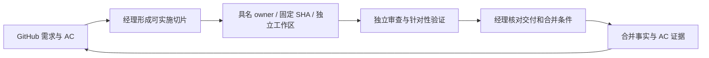

# SpeechNexus Paperclip 工作流与团队

Paperclip 负责派工、依赖、工作区、交付物和执行记录；GitHub 保留需求、原始验收条件、代码审查和合并事实。
项目经理对进度与验收结论负责。项目目标是交付集群语音底座与正式工作台的完整业务链，不能用任务完成数代替产品完成度。
本方案由新负责人在用户完整授权下制定；取代旧三队计划的自动执行顺序，保留其历史范围、证据和未完成项。

**当前阶段：只准备环境，七个 agent 全部暂停，不派业务任务。** 模型连接、三机工具链、隔离服务及源码传递的实际结果见
[环境准备与验收](paperclip/environment-readiness.md)。下文的业务流转为后续工作约定，环境检查通过也不自动恢复派工。

## 当前依据与目标

2026-10-26 收尾核验：GitHub `main` 为 `fe4a825ed025b7ebca3aa3d577bcb54bc9ea8de7`，#220、#221、#222 已合入。
当前接管依据见 [项目经理基线](../plans/2026-10-26-project-manager-baseline.md)。原始连接/传输探针固定在 `54daef6ae4792b69a0e5e8645b09240ff715082e`；
三机已按新主干重新完成锁定依赖与媒体导入检查，后续默认源码基线已更新。每次派工仍重新核对当前 head。Paperclip 原有 SpeechNexus 三项任务均已完成，
所检查的是旧基线 `4b08c396` 的局部范围，不代表当前产品验收。

旧项目配置有两处需要修正：隔离工作区仍固定旧基线，GitHub 仓库选择误指向 SpeechRail。
三台执行环境已通过平台连接探测；这只证明环境入口可达，实际 agent 的工具、checkout、交付回写须另行验证。

完整公开 ASR/TTS 生产链仍按交接记录计为 **0/2**，25 个原工作包和六个 Gate 的完整验收均未完成。
后续先取得可追溯的公开链证据，保留未验条件；有声书恢复与提交身份问题、公共媒体资格、真实停止及预算释放均属高优先级。
本文件不把历史测试、fake、静态检查、私有引擎探针升级为完整资格。

## 团队与职责

保留现有六个 agent 的接入，增加一名项目专属经理。既有其他项目的历史任务和项目设置保留；
六个执行者仍可接收其他项目的明确派工，SpeechNexus 的任务使用下表分工。组织汇报统一到项目经理，任务所有权以实际项目和指派为准。

| 职责 | 执行环境 / Harness | 默认模型 | 主要交付 |
| --- | --- | --- | --- |
| 项目经理 | 本机 / Codex Runner | `gpt-6.1-sol`, `xhigh` | 排序、分解依赖、指定 owner/reviewer、证据与 issue 同步、集成决定 |
| A 契约与集成 | 本机 / Codex Runner | `gpt-6.1-sol`, `high` | 契约、生成消费者、协调事务、共享媒体及跨层复杂修复；承担 C 的复杂后端逻辑 |
| B 执行与调度 | MegaCube / Codex CLI | `gpt-6.1-sol`, `high` | 网关/控制器/调度、持久执行、隔离集成与真实引擎资格；修改回传后由本机提交 |
| C 工作台 | 本机 / Claude Code | 保留已配置 DeepSeek 模型 | 明确边界的 Web/工作台实现、错误与恢复体验；复杂持久语义交 A 实施或联合设计 |
| 独立验收 | MacBook / Codex CLI | 保留已配置 DeepSeek 模型 | 独立 checkout 的浏览器、消费者及故障验证，报告实测边界 |
| 交叉审查 | 本机 / Claude Code | 保留 MiMo 模型 | 方案/代码/验收反证；不能单独放行高风险协调与恢复变更 |
| 证据与文档 | 本机 / OpenCode | `paperclip/omlx-sage-a1.5` | 限定范围的证据索引、文档与 issue 差异草稿；产品写入与最终结论由经理复核 |

角色正文的版本源见 [roles](paperclip/roles/manager.md)，只描述职责和必要交接，不复制整个仓库规则。
模型目录可发现、基础工具可执行、复杂任务质量分别判断。保留现有模型的历史资格；新配置后的实际派工结果记录在本项目的 bootstrap 任务。
复杂工作优先交 A/B 的 Sol；高风险恢复、协议与事务变更由另一名 Sol 审查，MiMo 提供第二视角。

## 一项工作如何流转

GitHub 的 Epic/工作包保留完整 AC。Paperclip 只拆当期可独立审查的切片，不镜像创建 25 个长期在跑任务。
每个开发任务通常产出一个 PR；准备、实现、相关测试、文档和修复审查意见属于同一交付。
审查或物理环境验证可建子任务，显式依赖受检提交，避免作者自行验收。

任务进入 `todo` 前须写清：

1. 对应 GitHub issue/AC，触发条件与预期结果，排除范围。
2. 固定的完整 base SHA、目标分支、输入制品版本与依赖任务。
3. owner、reviewer、允许修改的目录/文件，以及跨队接口接收人。
4. 实际执行环境、该主机 `SPEECHNEXUS_TOOLCHAIN_ENV` 的准确路径、必要工具/隔离服务、允许的运行态操作和资源窗口。部署路径从 DEL-36 交接文档取得，不能让执行者猜测。
5. 最小充分检查及预期证据；失败时的停止条件与解阻责任人。

优先级先按依赖和数据正确性排序：

- 第一阶段：完成三机环境准备，收敛工作区与计量阻塞；用户要求暂缓派工期间只做环境检查。后续恢复执行前再验收任务准入与回写，复核 #220–#222 并固定新集成基线。
- 第二阶段：A/B/C 联合交付一个固定语音配方的公开 ASR 或 TTS 闭环，补齐权威绑定、输入资格、准入、执行、制品和正式消费者。先选依赖就绪的一条，另一条复用已验证结构。
- 并行窄线：C 负责有声书提交/恢复缺陷的稳定复现和 UI 修复；A 审核持久 intent、同键异体、固定版本与 CAS，B 接收执行身份和停止证据要求。恢复身份未收敛前，不扩张高级编排功能。
- 第三阶段：在已有公开闭环上覆盖取消/崩溃/重放、停止与预算释放、质量及物理多机，再推进实时、会议、提词和有声书完整验收。

这是一项依赖顺序决定，不把范围变更、缺失产品选择或资源占用默认为已验收。经理根据首轮基线审查更新近期队列。

## A/B/C 协作与文件所有权

| 边界 | 提供方 | 接收方 | 接收条件 |
| --- | --- | --- | --- |
| 公开机器契约与生成类型 | A | B、C、QA | 固定版本、正负 fixture、错误/状态语义、生成校验一致；先冻结再实施路由 |
| 输入资格、固定资源及有效命令 | A | B | receipt/版本/摘要和重放规则可核验；私有回执不冒充公开 ready |
| 执行、制品与停止/释放证据 | B | A、C、QA | 明确 Job/attempt/instance/generation、制品版本、停止与释放事实；取消不等于已释放 |
| 正式消费与恢复体验 | C | A、B、QA | 实际生产者/消费者接线、原键与固定版本恢复、错误边界、刷新/取消证据 |
| 集成与验收事实 | QA、reviewer | 经理及 GitHub owner | 受检 SHA、实际拓扑/命令、结果/跳过/未验范围及可校验制品位置 |

每次派工按切片指定唯一写者。A 默认维护 `contracts/`、生成链与共享协调/媒体；B 默认维护 gateway、node-controller、执行/调度；
C 默认维护工作台与 Web。组合根、共享 DTO、README 和同一后端模块由经理在任务中明确单一 owner。
跨边界改动由 owner 提交给接收方审查；发现并行写入先核实，不覆盖或整文件替换他人改动。
引用旧三队会话时先读取当前内容，旧会话没有自动执行权限；以 Paperclip 的新任务接续。

## 工作区与三机执行

项目仓库关联为 `hrygo/SpeechNexus`。主源码使用平台管理的 repo-only 源，隔离 `git_worktree` 默认基线固定为上述收尾主干完整 SHA，
分支使用 `codex/paperclip-{{issue.identifier}}-{{slug}}`。每次集成后由经理核对 GitHub 合并事实，再更新后续任务的基线。
已在执行的任务保留原 SHA，不能静默移动。

本机使用 Paperclip Runner。B 与 QA 显式使用平台的 `codex_local` / Legacy runner：当前 Paperclip Runner 的 SSH 探针只取得远端空目录，未完成源码传递。
Codex CLI 路径已通过独立的适配器传输检查：Paperclip 在宿主准备隔离 checkout，通过平台的 bundle/restore 路径传给 SSH 环境；
远端任务不使用本机绝对路径，不自行 push，不依赖远端主检出或共享目录。派工后必须从实际任务上下文读取工作区并执行
`pwd`、`git rev-parse HEAD`、`git status --short`，将结果与任务 SHA 核对。空目录、错仓库、错 SHA 时先阻塞，不能写成已开工。
恢复/回收以平台工作区记录和最终化结果为准；`workspace_finalize=failed` 时保留产物并暂停依赖任务。

当前远端只交付工作区修改和报告，不执行 Git commit / push。本机经理接收回传后审查、提交并建立 PR。
两机的合成已跟踪修改及新文件回传、原基线和宿主索引保持均已实测；远端新提交虽可回传，MegaCube 探针出现宿主索引仍保留旧状态的问题，
因此远端 commit 模式未获放行。修复并重新验收前，不将这一模式列入岗位能力。

源码与合成测试数据可以经平台传递。真实音频、转写、书稿、声音参考和业务派生内容须留在部署网络与获准存储，
不进入 agent 提示、Paperclip 附件、模型请求或 GitHub。真实探针的内容处理与执行资源另在任务中明确，不复制生产凭据。

不开启默认自动启动的服务。需要数据库/对象存储/浏览器服务时，在任务专属隔离环境按仓库验证指南准备并记录；
不修改本机共享 PostgreSQL、oMLX 或 MegaCube 既有 LLM/Embedding 服务，不下载或加载模型来验证管理链路。

## 并发、预算与失败恢复

环境准备期间全部 agent 保持 `paused`。后续放行使用事件派工：timer heartbeat 关闭，`wakeOnDemand=true`，每 agent `maxConcurrentRuns=1`。
每个 agent 只处理一个活动切片，经理同时放行最多两个开发切片；本机最多两个计算密集任务、MegaCube 最多一个重型验证、
MacBook 最多一个浏览器/设备验证。多个 agent 的主机总量由经理的活动队列控制，不能把单 agent 限额描述成全机硬锁。

保留项目当前已配置的 **10000 billed cents lifetime** 预算、80% 提醒、hard stop 和 `unpricedUsagePolicy=block`。
金额与定价来源以平台预算页为准，零已记账金额不证明免费。不得通过换项目、拆任务、关计量或关硬停绕过预算。
无明确新预算时不自动加额度。现有其他项目预算与历史任务不改动。

本轮早期环境探针产生两条未计价记录，项目仍因该策略硬停。用户已确认相关 Responses 连接的固定订阅包含这两次运行，不额外按量收费；平台尚未完成相应审计调整。保存与计量修复候选见 [Delegra PR #21](https://github.com/hrygo/Delegra/pull/21)。发布后须按原事件保存确认依据并核验预算重新判定；不能把已知金额为零当作依据，或提高额度、关闭未计价阻止、改用其他项目来消除阻塞。

保留 per-turn 生命周期，continuation 最多一次。开始前列明预期完成窗口；工作未完成时保存已有任务文档检查点和下一步。
同一配置/鉴权/工作区错误不自动循环重试；保存一次失败后交经理，修复原因并取得新证据才重新派工。
服务重启、手工停止和运行恢复隔离不能通过大批量清除历史记录来处理。

## 证据与状态

| 状态 | 含义 |
| --- | --- |
| `backlog` | 计划候选，依赖/资源/AC 尚未就绪，不应自动执行 |
| `todo` / `in_progress` | 任务就绪 / 已开始；执行者记录实际工作区和受检版本 |
| `in_review` | 实现和证据已交付，等待具体 reviewer 或验收者 |
| `blocked` | 写明阻塞条件、解阻 owner 和动作；存在依赖时同时建立平台依赖关系 |
| `done` | 本切片的交付与验收满足；不代表父工作包或 Gate 整体通过 |
| `cancelled` | 执行单被替代或取消，保留原因、替代任务和原成果，不删除历史 |

最小报告包含完整 SHA、主机/环境、实际命令、通过/失败/跳过/未运行、覆盖限制、制品位置与摘要、下一接收人。
Paperclip 文档更新前先读最新 revision，写入时带基版本；MCP 写操作保存并复用同一 `requestId`，结果未知时先查询原动作。
报告与 issue 正文有机维护当前状态，历史版本由平台 revision 与 Git 保存，不按轮次无限追加。

代码审查、fake、隔离数据库、浏览器合成、真实引擎、物理多机和质量分别标明证据等级。
经理检查受检 SHA 与最终交付 SHA 的关系，按影响补验。PR 合并后才按仓库技能同步 GitHub 的任务清单、AC 和状态；
完整条件不足的工作包保持 open。未经验证的指标写 `not_run` 或未知，不能用子任务 `done`、成功退出码或健康检查抵扣。

## 管理入口与变更回退

Codex 的全局 MCP 名称为 `delegra-assistant`，使用官方 CLI 的 `mcp proxy` 和既有授权链。
先调用 `paperclip_connection` 确认当前公司，再查询项目/agent/task；使用返回 ID，写前重新读取。
当前连接已发现 37 个工具并完成原生项目查询。agent 建立、运行参数与工作区策略尚不在该连接器的可写工具范围内，
用既有认证的 `delegra` CLI 管理，不读取或复制凭据。可移植入口使用 `delegra`，不把本机安装缓存路径写成其他机器的要求。

配置变更前保存脱敏配置、revision、角色正文 hash、项目工作区/策略和预算；新建 agent/任务记录准确 ID。
回退时先停本轮任务调度，保留运行与制品，再按记录逐项恢复角色与工作区策略。回退不重置 Git、删除旧任务或修改产品数据库。
机器路径、连接引用与详细回退清单留在部署内的 bootstrap 交付文档，不进入公开仓库。

本轮配置与实际验收结果见 [实施与验收计划](../plans/2026-10-26-paperclip-bootstrap-plan.md)。
