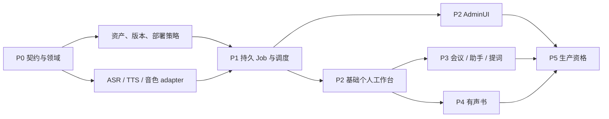

# SpeechNexus 分阶段实施计划

计划基准日期为 2026-10-22，依据[项目主设计](../speechnexus-product-architecture.md)、[语音接口](../architecture/speech-api.md)与[资源治理](../architecture/runtime-governance.md)。P0 的公共、管理与内部机器契约已交付并通过仓库校验；领域实现、fake、服务端路由、真实模型适配、容量与质量资格仍待实施。契约文件不等于运行时能力。

## 1. 阶段与退出条件

阶段按验收推进。P0–P5 不依赖登录、用户目录、SSO、角色权限或租户体系。表中人周包含实现、针对性验证与评审，不包含硬件采购、语料准备和外部流程；是本方案的粗估，不是交期承诺。

| 阶段 | 工作包与交付物 | 退出条件 | 依赖 / 粗估 |
| --- | --- | --- | --- |
| P0 产品与契约冻结 | 三个产品面的边界、OpenAI 子集、nexus 音色 / Job / 管理协议、WS schema、参数预设、领域类型、部署访问假设、模型矩阵、ADR 与 fake | 无 nexus 的标准调用与增强调用都可校验；四类语音、音色生命周期、幂等、取消和资源规则无关键歧义；无身份前置 | 本设计；2–3 人周 |
| P1 企业语音底座 | headless API、默认 workspace、资产、版本、PG Job / outbox、manifest、调度、四类 ASR/TTS adapter、音色设计 / 克隆 / 校验 / 发布、基础管理 API | 不部署 WebUI 即可完成四类语音和音色创作闭环；取消 / 恢复成立；在获准环境验证能力与一组混合负载 | P0；7–10 人周 |
| P2 AdminUI 与基础个人工作台 | 两个入口、共享组件；管理能力 / 模型绑定 / 预设 / 资源 / 任务 / 诊断；工作台转写、配音、音色创作、任务中心与实时字幕 | 无登录即可完成全流程；入口不伪装角色权限；共享资源文案准确；采集停止、试听、下载、取消与重试可验证 | P1；6–9 人周 |
| P3 实时场景工作台 | 会议保存 / 校对 / 分人 / 可选纪要；助手轮次与播放取消；提词跟随与手动接管 | 业务状态可恢复；纪要有明确来源；无抢答 / 旧音频串播 / 错稿误跳；关闭工作台不影响底座接口 | P2；8–12 人周 |
| P4 有声书与创作效率 | TXT、章节 / 角色、声音与词典选用、固定 render_unit、项目结果副本、局部失效、试听 / 质量记录、工作台导出 API / worker | 换声 / 改文只重做相应单元；重试不重复发布；章节 / 整书完整性可验；不把匿名确认当双人审核 | P1/P2；7–10 人周，可与部分 P3 并行 |
| P5 生产资格与交付 | 多副本 / owner 路由、故障注入、混合负载 / 长时、备份恢复、迁移 / 回滚、SDK / MCP 与运维文档 | 针对目标部署冻结容量 / SLO、质量 / 恢复 / 数据生命周期报告；访问边界明确，未验证能力禁用 | 已发布功能；6–9 人周 |

总量初估 36–53 人周。2–3 名有相关经验的工程师在部分并行条件下约为 4–7 个月量级，真实模型适配和浏览器验证会影响关键路径。第一项可独立验收的底座试点包含标准文件 ASR、文本 TTS、实时 ASR/TTS 及一条可复用音色创作路径；对应 WebUI 在 P2 交付，不把已有 API 误报为已有页面。

截至 2026-10-22，P0 已交付 `contracts/` 下的公共 speech / workbench / admin OpenAPI、Realtime 事件、预设、音色、绑定、实例、容量与资格 schema，以及执行控制和部署控制内部协议；OpenAI Python SDK 的 REST 请求 / 响应形状由 mock transport 覆盖，Realtime 客户端事件由 SDK 实际连接序列化路径覆盖。协调 DDL 已在隔离 PostgreSQL 16 schema 中应用并验证关键正负事务不变量。上述交付不包含业务路由、完整迁移体系、真实 adapter、模型加载、质量阈值或部署资格。

身份与授权列入后续独立候选阶段，触发条件见 [身份体系演进](../speechnexus-product-architecture.md#65-未来身份体系的独立演进)；未确定需求、迁移与投入前，不放入当前关键路径，也不据此声称首期可服务不互信多租户。

### 1.1 依赖顺序



### 1.2 可交接的工作包边界

| 工作包 | 拥有范围 | 交接契约 / 验收 |
| --- | --- | --- |
| WP-A 契约与领域 | 标准子集、增强 DTO、错误 / 状态机、profile / receipt / voice schema | 样例与负例、无扩展标准调用、增强与便捷入口等价 |
| WP-B 资源与数据 | 默认 workspace、对象元数据、音色版本、策略 / 生命周期、操作记录 | 引用一致、默认共享边界、禁用 / 发布竞争、保留 / 删除；无身份表前置 |
| WP-C 推理适配 | vLLM ASR、vLLM-Omni TTS / VoiceDesign / Base、辅助 port、manifest | fake / real 语义一致，候选复用证据、preview_only、abort 完成证据 |
| WP-D 调度与 Job | 准入、全局 / 分组配额、fencing、outbox、steps、Artifact 发布 | 并发 / 故障注入、用量与取消一致，音色任务不绕过池预算 |
| WP-E Web 两入口 | AdminUI、基础工作台、采集 / 播放 / 试听、任务与音色页面 | 无登录启动、任务路径、设备释放、键盘 / 无障碍、共享资源提示 |
| WP-F 可选应用工作流 | 工作台 API、会议 / 助手 / 提词 / 有声书、项目副本与独立导出 Job / worker | 公开语音 API 调用、依赖固定、确认点、局部重做 / 导出恢复，headless 底座不受影响 |
| WP-G 运维与发布 | 镜像 / 模型锁、部署入口、监控、备份 / 回滚、资格报告 | 无用户体系的明确入口规则、恢复演练与真实容量 / SLO |

先冻结 schema 再实现消费者；同一文件只有一个写入执行者。每个工作包交付实际验证范围、未验证项与回退点。实际部署、模型准备、数据采集和发布各自按目标环境开展。

## 2. P1 可独立验收的闭环

| 里程碑 | 交付与通过条件 |
| --- | --- |
| P1-A 标准非实时路径 | 资产上传、文件 ASR、完整文本 TTS、默认 MP3 / 显式 WAV / PCM、持久 Job、产物下载；无 WebUI 或 nexus 包装也能完成标准 REST 调用 |
| P1-B 实时路径 | 会话协商、预览 / 正文终态、增量文本冻结、音频背压、取消证据、双工原子准入与故障协调 |
| P1-C 音色与综合准入 | 至少一条真实可复用音色路径，描述设计与样本克隆按各自能力通过；preview_only 不发布；音色修改后再生成 / 校验 / 发布；四类语音混合负载不突破预算 |

每个闭环先以 fake 验证状态与故障路径，再在选定版本的获准环境验证真实引擎。P1-C 未通过的创作模式不得对外宣称可用，不用试听成功替代后续 TTS 可复用证据。

## 3. P0 必须消除的实施不确定性

1. 冻结 OpenAI Audio / Realtime 子集、默认值和 SDK 样例；为每个字段确定接受、拒绝或按能力启用的行为，生成明确错误。
2. 冻结音色生成 revision、幂等重放、校验 / 发布以及当前 head / 历史 revision 的 schema 与负例。
3. 冻结额度预留 / ASR accepted / TTS frozen / 各 attempt 输出的结算与去重；包括 append 后取消、重复 commit、重试和跨日预留。
4. 验证目标引擎的输入格式、commit 语义、request_id、status / abort、停止证据及强制输出上界；无证据的绑定限制为 experimental。
5. 以测试数据库证明并发 claim、取消 / 发布、禁用 / 发布、fencing 与网关接管的事务边界；TTL 不能单独触发算力重分配。
6. 冻结首批语言、代表性语料、质量阈值和部署资格报告模板；确认浏览器 / 采集支持列表。
7. 将依赖图、人员可用性和真实 adapter 探针结果转为可执行排期，重新估算 P1–P5。

上述事项是后续契约与工程验证工作；本次文档审查已消除已发现的设计冲突，不把未来机器契约或真实运行验证标为已完成。

## 4. P0 交接产物

以下目录定义交付职责；P0 机器契约已创建，代码与运行时交付仍待完成。

```text
contracts/
  speech-openapi.yaml           OpenAI 子集、nexus 语音 / Job / 资产 / 音色
  workbench-openapi.yaml        可选工作台应用资源
  admin-openapi.yaml            管理面、绑定、实例、资源池、策略与审计
  realtime-events.schema.json   实时事件 union 与字段域
  scenario-profile.schema.json  预设、覆盖与所需能力
  voice-resource.schema.json    候选、校验、发布与兼容绑定
  capacity-manifest.schema.json 容量、取消与资格声明
backend/
  speech/domain/                语音 / 音色状态机、策略、版本、receipt
  speech/application/           语音、音色、Job 与管理用例
  speech/interfaces/            REST、WS、MCP 投影
  speech/infrastructure/        PG、对象存储、部署上下文、outbox
  workbench/                    可选项目、会议、助手、提词、有声书与独立导出
execution-gateway/              提交屏障、引擎请求身份与 adapter
web/
  admin/                        管理视图
  workbench/                    个人任务、采集、播放与创作
  shared/                       共用组件、SDK 与能力呈现
deploy/                         拓扑、入口、配置 schema 与发布资格
docs/                           产品、ADR、运维与验收记录
```

P0 已产生机器可校验 schema、正负样例与 OpenAI SDK 形状测试；P1 才据此实现运行路径。默认值、单位、范围与错误码从 schema 生成或检查，不在 Python、TypeScript、MCP 三处手写独立副本。SpeechNexus 契约保存在自己的仓库中，不与 SpeechRail 公共契约混用。

## 5. 预算与关键路径

36–53 人周和 2–3 人约 4–7 个月仅为初始预算假设，未经过详细工时分解或真实模型适配测量，不用于固定日期承诺。并行度取决于共享契约冻结、执行网关与调度基础、真实音色可复用路径及浏览器验证；增加人数不能消除这些顺序依赖。P0 结束及 P1 首条真实路径完成后分别重估，并记录范围变化、证据和偏差。

首批投入优先使独立底座可验证。P2 不以账号体系为前置，P3 / P4 不阻塞已经通过资格的底座交付；完整产品的生产资格仅覆盖实际通过的功能和部署拓扑。
