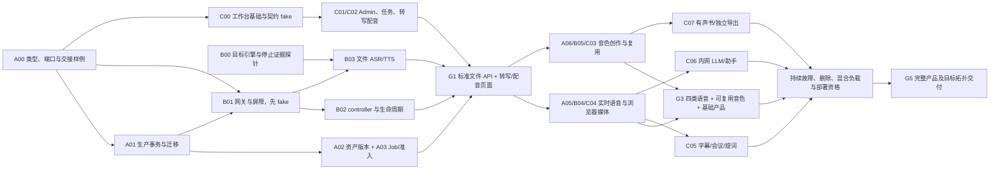

# SpeechNexus 三团队整体实施计划

本计划覆盖 SpeechNexus 从当前工程骨架到完整产品交付，SpeechRail 仅作为固定来源的复用参考。代码事实基准为 `390f121`，日期按 Asia/Shanghai 记录。三个实施团队均为用户指挥的 agent 团队，按长期组件责任组织，以贯穿 API、执行、数据和页面的业务闭环验收。启动编码时使用指挥者指定、已包含本计划的集成基线，不能把事实审计 SHA 当作永久开发基线。

本计划细化[原 P0–P5 计划](2026-10-22-speechnexus-implementation-plan.md)的任务归属、依赖和排期，后续三团队执行以本文为调度入口；产品范围与协议仍服从有效架构、机器契约和 ADR。原计划与[集群协调重构记录](2026-10-23-cluster-coordination-refactor.md)保留历史证据，不据此把原型或计划标为产品完成。实施通过 [GitHub 总控 #6](https://github.com/hrygo/SpeechNexus/issues/6)与[跟踪矩阵](2026-10-23-implementation-tracking.md)编排；A00/B00/C00 初始可开工，其余待实施，当前全部尚未实施。

## 1. 实施基线与交付边界

| 范围         | 当前事实                                                       | 对实施顺序的影响                                          |
| ------------ | -------------------------------------------------------------- | --------------------------------------------------------- |
| 服务运行时   | backend 与 execution-gateway 仅注册 `/healthz`、`/readyz`      | 先建生产用例、存储、执行链路；不能直接进入页面联调        |
| Web 与工作台 | 两个 Web 外壳；workbench 后端各层主要为包占位                  | 工作台后端、版本与浏览器媒体链路需要真实工程投入          |
| 契约         | 公共、管理、工作台、实时、内部执行和 18 个协调事务端口已定义   | 可以通过契约与 fake 并行；仍需类型生成和消费者行为验证    |
| 数据与协调   | 精简 DDL 草案、权限工具及双库测试原型已交付                    | 生产 Alembic、领域规则、适配器、Scheduler/Worker 尚待实现 |
| 原型缺口     | 4 个端口缺行为原型；已有原型未返回契约要求的完整 `value` 快照  | 对生产实现逐端口验收，不能直接导入 `tests/support`        |
| 引擎与部署   | 模型路线已选；真实模型、停止证据、混合负载及完整集群资格未完成 | 第一迭代启动可行性验证；后续资格以 binding 和拓扑为单位   |

四个尚缺行为原型的端口是 `create_runtime_intent`、`observe_runtime`、`query_outcome`、`record_execution_observation`，依据[最新架构与契约审查](../audits/2026-10-23-architecture-contract-post-refactor-review.md)。本次规划核对了 CBM 结构与关键源码覆盖，再直接读取组合根及页面源码；没有重跑历史测试，没有验证真实环境。

交付保持以下边界：

- 独立语音底座、可选 AdminUI 与工作台；首期可信共享部署，不建设登录、RBAC、多租户或个人私有空间。
- PostgreSQL 是唯一正式产品数据库；MySQL/InnoDB 只验证约定协调行为。不引入 etcd 或新的权威队列。
- Node=1 与集群使用同一协议；多进程竞争、owner、fencing、未知恢复从首个闭环开始验证。
- 工作台只经公开语音协议消费底座；不共写底座表，不直接访问引擎。LLM 默认关闭，仅允许部署批准的本机或内网服务。
- 业务内容及派生内容保留在部署网络；基础能力、音色、LLM、浏览器和目标拓扑分别取得实际验证证据。

## 2. 三个 agent 团队的责任与环境

| 团队          | 长期主责                                                                                                                  | 主要代码与制品                                                             | 对其他团队的交付                                                   |
| ------------- | ------------------------------------------------------------------------------------------------------------------------- | -------------------------------------------------------------------------- | ------------------------------------------------------------------ |
| A：平台与协调 | speech 领域/应用、生产 PG、迁移/权限、资产/版本、Job/outbox、Scheduler/Worker、预算/计量、公开 speech/admin API、底座删除 | `backend/.../speech/`、基础迁移、协调行为测试；契约生成工具与 CI 集成      | 可消费的公开 API、完整租约/查询快照、规范命令、恢复与删除语义      |
| B：语音与执行 | 执行网关、提交屏障、引擎 adapter、媒体流水线、受限节点控制器、执行/停止事实、模型与容量资格                               | `execution-gateway/`；新增 controller 的独立部署单元；模型镜像/锁定清单    | 支持能力、manifest、PCM/结果、可信停止证据、实例生命周期和真实性能 |
| C：应用与体验 | workbench 后端/迁移、AdminUI、Workbench、浏览器采集播放、会议/提词/助手/有声书、独立保存副本和导出、内网 LLM              | `backend/.../workbench/`、`web/`、工作台 schema/对象区、独立 export worker | 可操作的业务闭环、版本化内容、准确能力呈现和浏览器验收             |

用户是唯一总指挥，决定范围、冲突取舍和关口推进。每队由一个主 agent 对外汇报，可在自己范围内分派子 agent；同一文件只有一个写入者。每队负责自身测试、观测和故障处理，不再增加第四个实施团队。A 队主 agent 兼任代码集成维护者，汇总三队证据供用户判断，不能代替 B/C 宣称专业资格通过。

建议环境分配如下；这是执行布局，不表示当前已连接其他主机或验证其可用性。

| 团队 | 主环境                        | 在该环境验证                                                                                  | 不能据此声称                                                     |
| ---- | ----------------------------- | --------------------------------------------------------------------------------------------- | ---------------------------------------------------------------- |
| A    | 当前云开发环境                | 契约/类型、fake、生产模块单元、隔离 PG/InnoDB/MinIO、逻辑集群；先检查环境能力，缺依赖显式记录 | 真实 GPU 性能、Mac 浏览器体验或跨主机故障已通过                  |
| B    | MegaCube GPU 服务器上的 Codex | Linux 引擎/镜像/权重、真实执行与停止、完整配方资源、混合负载/长时、GPU 侧部署                 | 只有一个 GPU 主机时已通过多算力节点故障或 GPU 横向扩容资格       |
| C    | MacBook 上的 Codex 与浏览器   | Web/workbench、客户端与 fake、浏览器音频/设备/权限、键盘和交互；后端仍需 Linux 目标验证       | macOS 上通过即代表 Linux 后端/镜像、所有浏览器或所有系统采集通过 |

MegaCube 的 OS、架构、GPU 型号、内存与驱动由 B00 实测；不能仅凭设备名称推断已满足 ADR 中 Linux ARM64/GB10 的组合资格。跨主机联调使用明确批准的入口和 TLS/浏览器安全上下文；MacBook 的 localhost 麦克风通过不代表远端 HTTP 页面有采集权限。服务器、MacBook、云环境的网络可达性尚待检查，不预设 VPN、端口或凭据。

B 是唯一 GPU 运行态维护者。其他团队通过 B 提供的已知服务/资格制品消费能力，不在同一 MegaCube 上各自加载模型、改驱动或并发跑负载。GPU 实验排队，并记录模型/配置、开始结束和清理结果；探针前先核对现有进程/端口/资源，不能破坏既有服务。

S0 三环境先做只读前检：架构/运行时、容器能力、可用内存/磁盘、隔离依赖与已配置网络；B 另查 GPU/驱动/CUDA 和现有占用。MegaCube 命令由该机 Codex 执行，当前云 agent 不假设已有 SSH 或凭据。不为方便联调直接开放数据库、引擎或控制器端口；未有批准网络通道时先传代码/测试制品，继续 fake 验证。

现有资源可依次覆盖云端 fake/双库、MegaCube 单机逻辑集群，以及网络允许时“云端控制角色 + MegaCube 执行 + Mac 浏览器”的实际跨主机拓扑。该跨主机结果仍只有一个 GPU 故障域；多 GPU 节点接管、算力节点横扩及其可用性需要额外合格算力主机，作为独立资格项列明资源缺口。单 GPU 节点丢失可以验证安全隔离和恢复，不能证明备用 GPU 能接管。G5 按预先明确的目标拓扑验收，不隐含覆盖所有未来部署。

C 内部保留基础创作/管理体验与实时媒体/工作台后端两条泳道，每条最多一个大包。G3 后 A/B 把已空出的 agent 执行槽用于 C 的联调、导出与恢复验证，代码所有权不变；不能同时让多个 agent 修改相同页面、契约或迁移。

### 2.1 共享资产只设一个维护者

| 资产或决策                                      | 唯一维护者       | 必须参与评审的消费者                 |
| ----------------------------------------------- | ---------------- | ------------------------------------ |
| 契约生成器、共享 schema、公共 speech/admin 契约 | A                | B、C                                 |
| 执行控制/执行流契约、引擎事实与停止证据         | B                | A；涉及浏览器行为时加 C              |
| workbench 契约、业务版本/导出与 LLM 语义        | C                | A；涉及语音能力时加 B                |
| 迁移执行框架、全局锁序、运行角色和授权生成      | A                | B、C；模块自己的表变更由所属团队提供 |
| Web Token 与共享组件                            | C                | 两个 Web 入口的实际消费者            |
| `deploy/`、共享 CI/锁文件、组合根等公共写入点   | A 指定集成维护者 | 变更所属团队；同一文件串行合入       |
| 目标拓扑与模型资格                              | B                | A 的资源负责人、C 的客户端负责人     |

完整 admission 用例归 A：配额、父节点/实例预算、全部 required stage 租约与相关 Job/outbox 必须同一个数据库事务提交。B 持久化网关执行事实后，A 用独立事务核验并释放预算；任何团队都不能把“取消已接受”转换成停止/释放事实。运行时准备意图与预算归 A，控制器启停与观察归 B，观察经 A 的 runtime 用例裁决，避免混写所有权。

18 个事务端口按现有表所有权分配实现，A01 维护总矩阵与验收，不表示 A 实现全部网关事务：

| 实现者                   | 事务端口                                                                                                                                                                     |
| ------------------------ | ---------------------------------------------------------------------------------------------------------------------------------------------------------------------------- |
| A，speech/runtime        | `acquire_owner`、`renew_owner`、`activate_owner`、`admit_recipe`、`create_job`、`claim_job`、`quarantine_lease`、`release_lease`、`create_runtime_intent`、`observe_runtime` |
| B，gateway               | `seal_barrier`、`create_submit`、`mark_execution_unknown`、`record_stop`、`record_execution_observation`、`redact_execution_command`、`append_interval`                      |
| 按查询事实所有者分别实现 | `query_outcome`；A 汇总类型/结果映射，B 实现自身事实查询，公开投影不得泄漏私有正文                                                                                           |

B 拥有输出流区间账本，A 消费用量事实并维护业务 quota/结算，不各写一份 PCM 区间权威。首轮接力为 A01 接口/基础迁移子包→B01/B02 fake/自有适配器→A03 联合场景；任务表中的“真实联调依赖”不是整包关闭后才能开工，避免 A03 与 B01/B02 相互等待。

## 3. 总路线与关键路径

实施顺序为：**契约与风险探针 → 首条文件闭环 → 四类语音与音色 → 基础产品稳定 → 高级工作流 → 完整部署资格**。类型生成、引擎探针、浏览器媒体研究从起点并行，不以整个前一阶段完成作为所有任务的开工条件。



图中的依赖表示真实联调或里程碑关闭条件；任务可先按已冻结协议对 fake 开工。实时配方中的 VAD、1.7B 完整段复核和 required 辅助能力仍须在实际准入前全部可用，见任务表。各团队不得以 fake 验收替代真实闭环验收。

关键路径通常为 `A00 → A01 → A03/B01/B02 → A04+B03+C02 → 实时/音色 → 业务集成 → 目标拓扑资格`。另外两条可能成为关键路径的是 B00 的硬件/停止能力，以及 C 的高级工作流吞吐。G0、G1、G3 后按实际 agent 周期、测试耗时和阻塞重估，不把传统人周或“agent 数量”换算为交期。

## 4. 可分派任务清单

表中“开工”指可以开始实现，“联调”指关闭任务必须满足的生产依赖；纯内部原型或页面只能报告其实际完成层级。规模 S 表示一个明确验收单元，M 表示需拆成 2–3 个单元，L 表示需按子域或故障场景拆成至少 4 个单元；不代表日历时长。一个单元应适合一次 agent 执行、独立评审和针对性验证，过大时先拆分。

### 4.1 A 团队：平台与协调

| ID                                                        | 任务与交付物                                                                                                                                | 开工 / 真实联调依赖                                            | 验收重点                                                                                       | 规模 |
| --------------------------------------------------------- | ------------------------------------------------------------------------------------------------------------------------------------------- | -------------------------------------------------------------- | ---------------------------------------------------------------------------------------------- | ---- |
| [A00 #19](https://github.com/hrygo/SpeechNexus/issues/19) | 锁定生成器；Python/TS 边界类型、事件校验、生成漂移门禁；18 端口/表/契约责任矩阵                                                             | 现有契约；B/C 同步评审                                         | 同组正负例跨 REST/WS/MCP 一致；完整结果快照；domain 不依赖生成 DTO                             | M    |
| [A01 #20](https://github.com/hrygo/SpeechNexus/issues/20) | speech/runtime 领域规则与窄事务端口、PG adapter、有界连接池、Alembic/运行角色；汇总跨模块端口验收                                           | A00 的相关接口冻结即可分批开工；网关自有事务由 B01/B04 实现    | 锁序、数据库取时、回滚/未知分类；优先补 4 个端口缺口；18 端口联合完成，在 G3 前通过            | L    |
| [A02 #21](https://github.com/hrygo/SpeechNexus/issues/21) | 默认 workspace、资产/Artifact、对象 staging/发布、版本/预设/发音资源、Operation/receipt；预设合并/override/exact、发布资格/CAS/默认指针回滚 | A00、A01 的基础迁移；媒体联调 B03                              | 摘要/引用一致；不可变 revision；无任意路径/URL；对象成功不等于业务发布成功                     | L    |
| [A03 #22](https://github.com/hrygo/SpeechNexus/issues/22) | owner/接管、全配方准入、Worker claim、持久 Job/outbox、重放恢复、quota/结算和输入去重；消费 B 的输出区间事实                                | A01；对 B01 fake 先行，生产联调 B01/B02                        | 两 Scheduler/多 Worker、跨池末预算、原子多阶段、重复通知、未知查询；全部 quota 不只 attempt 数 | L    |
| [A04 #23](https://github.com/hrygo/SpeechNexus/issues/23) | 文件 ASR/TTS、模型/能力、持久任务和管理 REST/SSE；同步请求与 Job 共用规范命令；公开 profiles/词典端点及无状态 MCP 发现/调用                 | A02/A03；B03 真实结果、C01/C02 消费                            | 标准 SDK 无 nexus 包装可调用；默认/显式音频格式；取消/重试/进度/receipt 和断线恢复一致         | M    |
| [A05 #24](https://github.com/hrygo/SpeechNexus/issues/24) | 公共 Realtime、owner/epoch、输入/输出水位、双工原子准入及恢复                                                                               | A04；可对内部流 fake 开工；联调 B04/C04                        | 预览与正文分离；空成功；旧 epoch 拒绝、显式 gap；append/commit/finish、去重与硬上界            | L    |
| [A06 #25](https://github.com/hrygo/SpeechNexus/issues/25) | 音色候选/revision、再生成、校验、发布/退役/禁用、管理策略与配方                                                                             | A02/A04；对 voice fake 先行；联调 B05/C03                      | preview_only 禁止发布；同键摘要幂等；换文复用；禁用/发布/在途使用竞争明确                      | L    |
| [A07 #26](https://github.com/hrygo/SpeechNexus/issues/26) | 底座删除/保留/正文清理、对账与恢复；生产迁移/备份恢复、入口与集群资格集成；SDK/MCP 交付、许可决策与 RPO/RTO 实测                            | A02 首个资源落地即开始；持续对接 B01/B02/C00，最终覆盖全部闭环 | 版本化预检、明确确认、删除账本/tombstone；恢复先重放删除；未知占用不清空；运行角色无越权       | L    |

A01 是可分阶段验收的端口包：G0 冻结全部签名与样例，G1 完成文件闭环所用端口，G2 补齐生命周期和流计量，G3 关闭全部 18 个端口及完整返回快照。不能为了等待端口全量完成而阻塞首条闭环，也不能把缺口无限推迟。

### 4.2 B 团队：语音与执行

| ID                                                        | 任务与交付物                                                                                 | 开工 / 真实联调依赖                                        | 验收重点                                                                                      | 规模 |
| --------------------------------------------------------- | -------------------------------------------------------------------------------------------- | ---------------------------------------------------------- | --------------------------------------------------------------------------------------------- | ---- |
| [B00 #27](https://github.com/hrygo/SpeechNexus/issues/27) | 目标硬件、引擎/模型/镜像摘要和许可；文件/实时/音色最小探针；manifest 与停止证据草案          | 批准环境、制品和最小授权/合成语料；首轮开始                | request ID、status/abort、停止与资源事实、强制输出上界、加载峰值；不满足的能力保持未资格化    | M    |
| [B01 #28](https://github.com/hrygo/SpeechNexus/issues/28) | fake engine/controller；网关持久 intent、完整有效命令、提交屏障、查询/取消/unknown、结果观察 | A00；纯规则/fake 可先行，PG 联调 A01/A03                   | 同意图不重复外发；提交确认丢失查原身份；实际封锁旧入口；未外发失败不能伪造 stop               | L    |
| [B02 #29](https://github.com/hrygo/SpeechNexus/issues/29) | 受限 node-controller、prepare/stop、generation、peak→steady、drain/停止/释放                 | 内部契约可先做 fake；生产联调 A01/A03 的 runtime 端口、B01 | 批准模板/固定节点；迟到旧 generation 不伤新实例；退出与资源释放双证据；未知保留预算           | L    |
| [B03 #30](https://github.com/hrygo/SpeechNexus/issues/30) | 文件 ASR、CustomVoice/Base TTS、受控输入输出引用、有界解码/编码与采样时钟映射                | B00/B01；首条真实闭环联调 A02/A03/A04/B02                  | 长文件/尾部/无语音、交叠去重、MP3/WAV/PCM、正确时间戳；取消与有界资源                         | L    |
| [B04 #31](https://github.com/hrygo/SpeechNexus/issues/31) | 流式 ASR/TTS、内部 WS/二进制 PCM、credit/背压、冻结文本顺序及双工执行、输出区间账本          | B01/B03；B06 的 VAD 先行；联调 A05/C04/B02                 | 音频与控制关联、旧帧拒绝、有界缓冲/区间去重；1.7B full_segment 和 required 辅助随完整配方准入 | L    |
| [B05 #32](https://github.com/hrygo/SpeechNexus/issues/32) | VoiceDesign→Base 复用、样本克隆、参考材料恢复、加载热身/回收                                 | B00/B02/B03；联调 A06/C03                                  | 候选试听和可复用资格分开；不可只保留内存 handle；重启后按固定材料恢复声音                     | L    |
| [B06 #33](https://github.com/hrygo/SpeechNexus/issues/33) | CPU VAD、版本化切段/对齐/分人及辅助结果；逐能力支持矩阵                                      | VAD 在 B04 前交付；对齐/分人随 ASR 结果与 C05 场景联调     | 匿名标签、跨块连续/重叠/reset；辅助只挂匹配正文 revision；required 不得隐式降级               | L    |
| [B07 #34](https://github.com/hrygo/SpeechNexus/issues/34) | 模型部署包与观测、真实质量/容量/混合负载、逻辑与物理集群故障、长时和发布资格                 | B00 起建模板；每个实际能力持续补证；最终与 A07/C08 合并    | 真实 stop/断网/节点丢失；冻结 binding/拓扑/语料/门槛；负载不过预算，无内容遥测                | L    |

首轮同时检查文件、实时、VoiceDesign/Base 的关键可行性；正式 adapter 按文件→实时/音色→完整辅助逐批交付，避免同时展开全部模型的完整工程化。B00 的调查可以并行，实际 GPU 加载与负载实验串行或按已验证的安全资源上限执行。

### 4.3 C 团队：应用与体验

| ID                                                        | 任务与交付物                                                                                                     | 开工 / 真实联调依赖                                                         | 验收重点                                                                                      | 规模 |
| --------------------------------------------------------- | ---------------------------------------------------------------------------------------------------------------- | --------------------------------------------------------------------------- | --------------------------------------------------------------------------------------------- | ---- |
| [C00 #35](https://github.com/hrygo/SpeechNexus/issues/35) | 生成客户端消费、契约 fake/错误场景、项目/稿件版本、独立 schema/对象区与迁移、共享交互                            | A00 相关接口冻结；可直接基于已有契约起步                                    | 不写底座表、不导入 speech 内部；并发版本冲突；公开字段与本地资源；与 A07 对齐独立删除         | M    |
| [C01 #36](https://github.com/hrygo/SpeechNexus/issues/36) | Admin 能力/绑定/实例/预算/预设/策略/任务/诊断、预设校验/发布/回滚与 CAS 冲突，工作台任务中心                     | C00；fake 首轮开始，真实联调 A04，逐步接 A06/B02                            | 展示实际事实、ready/contract/planned；管理写入有版本/确认；SSE 恢复与取消不伪成功             | L    |
| [C02 #37](https://github.com/hrygo/SpeechNexus/issues/37) | 文件转写→校对→导出；文本配音→试听/下载，两条基础闭环                                                             | C00；真实依赖 A02/A04/B03                                                   | 原文与校对 revision 分开；固定 voice/profile/文本；刷新可恢复；重试不重复发布，Range/过期明确 | L    |
| [C03 #38](https://github.com/hrygo/SpeechNexus/issues/38) | 音色工作室：设计/克隆、候选、再生成、试听、校验、显式发布和复用                                                  | C00；页面可先 fake，真实依赖 A06/B05                                        | 模式分别资格化；preview_only 不可发布；已发布声音真实参与后续合成                             | M    |
| [C04 #39](https://github.com/hrygo/SpeechNexus/issues/39) | AudioWorklet、有界 PCM、播放 generation、实时 reducer/字幕、设备与页面生命周期                                   | C00 后立即并行；真实依赖 A05/B04/B06.VAD                                    | 离开/失败/取消释放设备；丢弃迟到音频；权限拒绝、后台节流、重连 gap 明确                       | M    |
| [C05 #40](https://github.com/hrygo/SpeechNexus/issues/40) | 会议要点标记/版本保存/封存/校对/导出、匿名分人消费；提词跟随/手动接管                                            | C02/C04；分人/对齐依赖 B06；普通会议不依赖 LLM                              | preview/final/辅助版本正确；封存后不改原文；旧稿/旧 epoch 不推动提词；未保存音频不承诺重识别  | L    |
| [C06 #41](https://github.com/hrygo/SpeechNexus/issues/41) | 工作台 LLM 端口、内网纪要；助手 turn/插话/取消/迟到结果隔离                                                      | C00 可做 fake；纪要依赖 C05；助手还依赖 C02/C04/A05/B04，启用需部署出站资格 | 默认关闭、固定服务端端点、无公有云回退；固定转写/模板/模型；失败不改成功语音，旧音频不串播    | L    |
| [C07 #42](https://github.com/hrygo/SpeechNexus/issues/42) | 有声书稿件/章节/角色/render_unit、词典/音色固定、局部失效、独立质量/试听/匿名确认记录、保存副本与独立导出 worker | C00/C02、A02/A04；音色创作消费依赖 C03；与 C06 无依赖                       | 改文/换声仅重做相关单元；校验摘要/receipt；导出清单固定、有界/可取消/可续作、无缺章或空成品   | L    |
| [C08 #43](https://github.com/hrygo/SpeechNexus/issues/43) | 实际浏览器流程、键盘/焦点/无障碍与小窗口、工作台删除恢复、文档与应用交付资格                                     | C00 起建用例；各闭环持续补证；最终汇入 A07/B07                              | 采集/播放/断网/恢复真实证据；共享部署文案；服务关闭工作台后独立可用；内容不进入日志/外网      | M    |

C05/C06/C07 按执行槽分批展开：先会议/字幕和基础提词，再在文件写入范围分离时并行有声书与 LLM/助手，或接受 A/B 的联调支援。C07 不等待助手完成。C02/C05 的校对文本/字幕导出须先检查工作台契约，缺少形状时由 C 主责补契约、A 评审后实施，页面不得自创服务端接口。

## 5. 阶段路线、里程碑与关闭条件

按 **六个验收波次 S0–S5** 推进，每个波次包含多轮 agent 编码、评审与集成，不等同于一次聊天或固定天数。总指挥按证据放行下一关；已满足开工条件的非关键任务可跨波次提前推进。记录实际墙钟时间、GPU/测试时间、返工和等待，G1 后才形成有依据的交付时间估计。

| 波次               | A 重点                                      | B 重点                                           | C 重点                                 | 阶段出口                                                 |
| ------------------ | ------------------------------------------- | ------------------------------------------------ | -------------------------------------- | -------------------------------------------------------- |
| S0：接口与探针     | A00；A01 首个事务和迁移骨架                 | B00；B01/B02 fake 与停止语义                     | C00；C01/C02 fake；C04 媒体探针        | G0：接口可交接、风险可判断、任务可分派                   |
| S1：文件闭环       | A01 文件所需端口、A02/A03/A04、A07 基础删除 | B01/B02/B03；B06.VAD 前置                        | C01/C02 真实接入；C04 持续             | G1：标准文件 API 与转写/配音页面首条真实闭环             |
| S2：实时与音色     | A05/A06；生命周期/计量与恢复                | B04/B05/B06、真实取消/实例回收                   | C03/C04；C01 管理写路径                | G2：实时和音色各自具备可验证的闭环与故障证据             |
| S3：底座与基础产品 | 完成 18 端口和管理面；跨池/双工/删除收敛    | 四类语音与音色混合负载；辅助能力资格             | 基础产品稳定；会议/提词与有声书骨架    | G3：原 P1 完成、P2 基础能力可交付，形成受限试点资格包    |
| S4：高级工作流     | 保障高级场景、持久恢复、物理集群/DB 演练    | 真实分人/对齐、长时/故障、容量调优，支援应用联调 | C05 完成；按容量推进 C06/C07，C08 持续 | G4：会议/提词/有声书/可选内网 LLM 与助手全部完成业务验收 |
| S5：完整交付       | A07 发布迁移、唯一权威与恢复总验收          | B07 目标拓扑、版本/模型锁、质量与负载总验收      | C08 浏览器/内容生命周期/运维与交接     | G5：完整产品及明确目标拓扑通过发布资格                   |

S1 内先 fake 全链路，再第一条真实文件 ASR，再接 TTS 与基础页面，最后关闭 G1。探针失败、环境排期或事务恢复缺陷触发重排，不以“agent 已完成代码”替代证据，也不通过缩减停止、删除和集群保证推进关口。

### 5.1 里程碑证据

| 关口 | 必须有的证据                                                                                                                                                       | 不足以关闭的证据                                                              |
| ---- | ------------------------------------------------------------------------------------------------------------------------------------------------------------------ | ----------------------------------------------------------------------------- |
| G0   | 三队消费的生成类型/正负例；18 端口所有权及缺口表；首个生产事务；引擎/硬件/许可/停止探针结论；冻结首批语料与浏览器矩阵                                              | schema 通过、页面截图、模型能启动                                             |
| G1   | 无 Web 的标准 SDK 文件 ASR/TTS；上传→Job→原子准入→唯一外发→staging/发布→下载；基本页面；进程重启/取消/同键重放；基础删除                                           | 全部 fake 通过、HTTP 200、只在内存保存的任务、直接调用引擎绕过网关            |
| G2   | 实时 ASR/TTS 的样本/文本水位与背压；可信 abort/stop；设计和克隆各自的候选→复用→发布；加载/回收/unknown 证据                                                        | 试听成功、断开连接、TTL 到期、只写较大 fencing token                          |
| G3   | 四类语音与至少一条真实可复用音色；全部 18 生产端口/完整快照；双库协调行为；最低 1 路实时 ASR+1 路实时 TTS 与 VoiceDesign 共存；基础管理/工作台；对应拓扑的试点资格 | 以文件切片替代完整 P1、只验证 happy path、只验证单个数据库、开发 Compose 健康 |
| G4   | 会议封存/校对、提词手动接管、助手插话取消、版本化有声书局部重做/完整导出；各自删除/恢复；LLM 启用时通过内网内容边界                                                | UI 页面齐全、LLM 只配置内网 URL、仅测整章重新生成                             |
| G5   | 物理多主机、网络分区/节点丢失、旧入口隔离、目标数据层切换/备份恢复、迁移/回退、长时/质量/容量、浏览器及内容出站、许可/交接资料完整                                 | 单机逻辑集群替代物理资格、CI 绿灯、历史原型测试数或源码覆盖率                 |

最低混合负载的既有首轮要求保持：在指定 binding、语言、语料与 Linux ARM64/GB10 目标拓扑下，ASR 首有效预览 P95 ≤1000ms，TTS 冻结文本接受至首可播放 PCM P95 ≤800ms；必须同时运行至少 1 路实时 ASR 与 1 路实时 TTS，并另测 VoiceDesign 冷加载/回收的影响。客户端网络与播放时间单独报告。其余候选 SLO、CER/WER/DER、TTS 质量及长时持续时间在 S0 冻结具体标准，见[产品验收口径](../speechnexus-product-architecture.md#112-初始服务目标与口径)和[模型决策](../decisions/0002-speech-models-engines-and-loading.md)。

G3 可以交付已经取得对应资格的语音底座和基础工作台试点，高级应用继续推进。Node=1 或单机多进程证据只支持其实际范围；完整集群支持的交付仍需 G5 的目标物理拓扑证据，不能借试点阶段取消此要求。

## 6. 首轮派工与接力清单

| 接力点      | A                                               | B                                                             | C                                              | 联合产物                                       |
| ----------- | ----------------------------------------------- | ------------------------------------------------------------- | ---------------------------------------------- | ---------------------------------------------- |
| 0：同时下发 | 端口/表所有权与首闭环事务草图、生成器选型       | 硬件/镜像/权重/许可/停止查询条件清点                          | 首闭环页面与项目版本模型，核对导出契约         | 三队报告基线 SHA、环境能力、写入范围和阻塞     |
| 1：接口交接 | 最小生成流水线/样例、迁移角色；完整准入端口签名 | 文件 ASR/TTS 探针；实时/音色关键兼容与 stop 探针；fake engine | 先消费既有契约/生成产物，补交互和媒体 fake     | A 提供接口包，B/C 确认；不等待全部生产实现     |
| 2：实现接力 | 首个 PG 生产事务、锁/回滚/unknown、Job/outbox   | 持久 intent/停止观察、controller fake/generation              | 任务/SSE 恢复、版本冲突、合成媒体/设备释放场景 | 同键重放、丢响应、取消未知三类统一故障样例     |
| 3：G0 收敛  | 文件闭环端口与 18 端口分批清单                  | 首批 binding/manifest 草案与阻塞证据                          | 完整 fake 业务演示、真实接入任务与浏览器缺口   | A 汇总同一集成 SHA 的证据；用户决定是否进入 S1 |

首轮使用单独的[三队启动指令](2026-10-23-agent-team-startup-briefs.md)，可直接下发到对应 Codex 会话。启动时落实语料、跨主机可达性和 DB 演练条件；G0 对目标路线给出“可继续/有条件继续/需调整”的证据判断。真实探针受环境阻塞时继续独立任务，不关闭相关门槛。环境准备、模型下载、真实测试和部署按具体任务授权执行，本规划本身没有开展运行态操作。

## 7. 跨团队交接协议

| 交接方向 | 输入与输出                                                                                                            | 接收方验收方式                                                             |
| -------- | --------------------------------------------------------------------------------------------------------------------- | -------------------------------------------------------------------------- |
| A → B    | 不可变 binding/recipe、完整有效命令、operation/attempt/stage、lease、node/generation、owner token、deadline、查询快照 | B 用生产 validator 拒绝过期/错误身份；重复命令只返回原执行；私有内容不公开 |
| B → A    | 可服务能力、manifest/资格、实际执行关联、输出水位、可信停止/资源事实、屏障与实例观察                                  | A 用原身份/版本核验；unknown 保留占用；执行增量和实例基线分别释放          |
| A/B → C  | 公开 API/SSE/Realtime、生成客户端、fake 故障场景、实际能力/资格/就绪原因、Artifact/receipt                            | C 不连接内部引擎；未知/禁用/过期可解释；刷新重读权威状态                   |
| C → A/B  | 固定业务版本、标准语音命令、导出/保存副本需求、客户端时钟和无内容统计                                                 | A/B 不读取/修改工作台内部业务状态；工作台关闭不影响 headless 底座          |

每个接口变更由生产者提出“schema/类型、正负/时序样例、fake、升级影响”四件套，消费者确认后才能更改实现。首轮保持现有 `query_outcome` 目标→快照映射，先按现有语义落地；发现问题再走显式契约变更，避免三队各自解释。

现有自动兼容比较以 OpenAI 标准面为主。A00 应补齐管理、工作台及内部协议的版本/破坏性变更清单与可自动比较部分的门禁；复杂语义仍由样例和消费者验证。不得把“工具未报 diff”作为全部协议兼容的证明，也不默认扩大向后兼容范围。

## 8. 持续验证与故障路线

| 验证类别           | 开始时间与主责                         | 必测行为                                                                                                              |
| ------------------ | -------------------------------------- | --------------------------------------------------------------------------------------------------------------------- |
| 契约/类型          | S0；各契约维护者，A 汇总               | 生成漂移、正负样例、状态/错误/未知结果、Python/TS/SDK/后续 MCP 一致性                                                 |
| 事务/权限          | 首个持久端口；A/B 各自模块             | 两种数据库真实独立连接的协调 oracle；版本与摘要；无私有正文越权，无运行角色扩容/改策略；全部结果快照                  |
| 逻辑集群           | S1 起；A+B，C 验收恢复体验             | 至少两逻辑节点/两个 Scheduler/多 Worker，重复通知、跨池同父预算、两个方向的竞争交错、旧 token/迟到提交                |
| 执行与实例         | B01/B02 起；B 主责、A 释放裁决         | 外发成功丢响应、提交确认丢失、lease 过期但引擎仍跑、Gateway/Controller 故障、旧 generation 返回、无停止证据不得退预算 |
| 对象/删除/恢复     | 首个业务资源；A/C 各自内容，B 网关正文 | staging 中断、发布/取消竞争、版本化预检/确认、独立副本不误删、命令正文清理、删除账本重放后开放内容                    |
| 引擎/质量/混合负载 | B00 先探针，逐能力验收；B              | 文件/实时/音色/辅助、强输出上界、采样映射、1+1/VoiceDesign 共存、授权语料质量与长时曲线                               |
| Web/媒体           | C04 起；C                              | 采集权限拒绝、停止/离开/重连、旧音频、后台节流、设备释放、焦点/键盘/小窗口及实际支持矩阵                              |
| 入口与内容网络     | S0 定方案，G1 起按部署验证；A+B+C      | Host/Origin/TLS/内部凭据；浏览器、代理、LLM、推理和观测无内容出网；LLM 同设备时计入父预算                             |
| 物理集群/发布      | S0 预约环境、S3 起演练；A+B，C 联验    | 跨主机分区/节点丢失、实际入口封锁、DB 切换/恢复、高水位不倒退、未知占用不变空闲、迁移失败保持唯一权威                 |

协调修改使用 `make coordination-test`、`make integration-test`，同时提供项目隔离 PG/MySQL 测试 DSN，无跳过；MySQL 证据只覆盖约定协调行为。其他 Python/Web/契约检查按 [AGENTS.md](../../AGENTS.md) 与任务改动范围执行，完整 `make verify` 用于适当集成关口。本文未运行这些实现验证。

真实引擎、质量、长时、物理故障、备份恢复与 UI 流程单独出证，不以 schema、健康检查或 mock 替代。每份证据记录 commit、协议/软件/模型/镜像版本、拓扑、数据集/浏览器、负载/时长、通过标准、结果及未验证项。首轮表中质量和时长参数未冻结时，对应资格不关闭。

## 9. 指挥、同步与任务管理

- 每个工作包拆为可由一次 agent 执行并评审的验收单元；单个子任务只有一个 owner。父包保持统一验收，不以代码量、测试数量或 agent 的完成声明计完成度。
- 总指挥每轮只下发三张任务卡，包含共同基线、可写范围、依赖与退出条件。三队各返回一份交接包，A 汇成一份集成摘要；用户处理范围取舍和关口推进，不需要手工拼接零散技术结果。
- A 先发布接口/样例子包供 B/C 消费；其余队继续独立任务。依赖未满足的任务暂停关闭，不能凭记忆猜测前一队的字段或结果。
- 使用 `task/<team>-<id>-<slug>` 一类短分支和小范围合入，公共文件排队维护，不积累三条长期分支最后合并。`main`/集成分支只由指定集成维护者在获授权后更新。
- 前置接口可用 fake 时允许消费者开工；依赖任务未通过生产验收时，下游保持“已实现待联调”，不能标完成。
- 阻塞出现时立即报告依赖 ID、已尝试证据和可继续的独立工作；契约/所有权冲突由 A 汇总，产品取舍交总指挥。不能靠绕过准入、共写底座表或放宽证据解决阻塞。
- G0–G5 由生产者、消费者及集成负责人共同核对退出条件。未通过项列明 owner、下一动作和影响的里程碑。

三个环境不共享工作目录。同步以 Git 中的确定提交和契约版本为准：同一轮先固定 `integration_base_sha`，团队交付记录 `base_sha`、`head_sha`、改动路径、测试环境和结果，集成后在同一新 SHA 上重新验证受影响链路。其他环境显式 fetch/更新到该 SHA，不能以“我已拉最新”替代标识。

代码交付按总指挥给出的当前授权执行：明确授权提交和推送时交付短分支，经 PR 和所需检查集成；尚无授权时交付包含新增文件的补丁包、基线 SHA 和校验值，由集成维护者核对后应用。补丁不等同远端同步完成。运行数据、模型权重、凭据、私有音频和日志不进入 Git 或补丁包；大制品只传摘要及部署内存储引用。

迁移由单独部署角色在各隔离环境验证，业务运行角色不执行 DDL；版本顺序由 A 协调，B/C 提交自己模块的迁移需求与用例。推荐由 B 托管 MegaCube 上隔离的 Linux 集成拓扑，部署 A 汇总的确定 SHA；A 云环境保留快速独立验证，C 仅通过批准入口联调。S0 前检确认托管节点、管理员、唯一权威 PG/对象存储组合和可达条件，若 MegaCube 不宜承载则由指挥者选定其他合格 Linux 主机。各队不能并行迁移同一集成库，自己的测试库也不能充当全局生产权威。跨环境服务地址由配置注入，不写死各自主机 localhost 或本地绝对路径；无安全可达入口时真实跨环境联调保持阻塞。

子任务统一采用以下交接卡，不必为每个小改动单独建过程文档：

```text
ID / 父工作包 / 团队 / owner / 状态
目标行为与不在本任务内的范围
开工依赖 / 真实联调依赖 / 对外契约和唯一写入位置
产物 / 验收样例 / 故障样例 / 验证命令与环境
base_sha / head_sha 或补丁校验值 / 实际墙钟与测试耗时
退出证据 / 未验证项 / 回退点 / 下一接收方
```

建议状态为待实施、可开工、实施中、待联调、待资格验证、完成、阻塞。只在对应工作包的全部退出证据存在时标完成；“待资格验证”不对外宣称 ready。

## 10. agent 调度、风险与调整规则

共 **25 个父工作包**：A 8、B 8、C 9，按下游验收依赖逐次拆分。首轮每队最多一个主要写入单元和一个只读调查/评审单元；可使用子 agent 并行调查和独立文件实现，合并与共享文件编辑保持串行。GPU 实验始终受 B 的资源排队约束，增加 agent 不增加物理算力。

不沿用针对人类工程师的 36–53 人周，也不给出未经测量的固定日历工期。G0 记录首批 agent 单元的编码、评审、集成时间，G1 再以真实模型/测试耗时校准后续关口；长时测试、模型加载、网络/环境排期等墙钟时间独立计算。预留返工单元处理协议偏差、故障与环境不确定性，不能假设一次 agent 输出即可关闭一个大包。

| 风险/触发                                                       | 主责                     | 处理与排期影响                                                                           |
| --------------------------------------------------------------- | ------------------------ | ---------------------------------------------------------------------------------------- |
| ARM64/GB10、vLLM/vLLM-Omni、模型组合不兼容或真实停止/硬上界不足 | B                        | B00 尽早暴露；按证据调整 binding/运行组合并修订设计，不虚报 ready；重排依赖能力          |
| 首个生产事务或网关屏障失败                                      | A+B                      | 优先修复原子边界、旧入口封锁与未知恢复；暂停新增依赖功能的真实准入                       |
| C 的并行工作流超出产能                                          | C、集成负责人            | 限制 WIP；G3 后引入 A/B 支援；先基础转写/配音/会议，再高级分支，保持有声书与助手互不阻塞 |
| 多主机/DB 演练场地晚到                                          | A+B                      | S0 预约、S3 起演练；明确阻塞 G5；逻辑集群可以继续但不抵消物理资格                        |
| LLM 端点或出站限制缺失                                          | C 与部署负责人           | 基础语音、会议、提词、有声书继续；LLM/助手保持关闭，不能关闭其相关完整产品验收           |
| 类型生成或语义不一致                                            | A，契约所属团队          | 统一生成/运行时校验与样例；不得三队手写默认值解决进度问题                                |
| 内容清理/恢复或预算证据不完整                                   | A+B+C 各自边界           | 不释放未知预算、不报告删除完成；保持暂停/隔离并收敛事实，再恢复服务                      |
| 许可或来源不清                                                  | 各制品负责人、B 汇总资格 | 仓库项目 LICENSE 尚待确定；模型/依赖/声音素材分别核对；未解决前不关闭对外发布资格        |

SpeechRail 复用仍锁定[复用文档](../architecture/speechrail-reuse.md)中的 `3f57647a3ee7`，本次 pull 到更新版本不自动改变来源基线。提取保留版权/许可证、来源文件和变更范围，重新验证 SpeechNexus 契约；不移植 MLX/CoreML、私有 IPC、LaunchAgent、单机锁或本地 spool 作为集群实现。

## 11. 发布范围与回退

独立交付单元依次为标准文件 API/基础页面、四类语音与可复用音色底座、完整基础工作台、高级业务及目标集群拓扑。每次只启用对应 binding、场景和拓扑已经通过资格的能力；未实现或未验证能力保持明确状态。

发布包由 A 汇总：生产迁移/角色、配置/入口/出站策略、镜像与模型锁、manifest/资格报告、API/SDK 示例、监控/告警、备份恢复/删除/故障 runbook；B 签署模型/执行/停止/容量证据，C 签署业务与浏览器证据。无状态 MCP/SDK 消费端纳入 A04/A00 的标准命令一致性与 A07 的交付验收，不另造执行路径。

回退先暂停新准入、封锁旧入口，完成或隔离在途执行，再恢复唯一权威；保存任期/版本高水位、幂等身份、停止/计量/删除账本。不得用清空历史、重置 token、释放未知容量或重新暴露已删内容完成回退。不可逆数据迁移须提供恢复路径并按具体变更单独审查，不能预设所有迁移都可直接 downgrade。

## 12. Issue 编排与整体跟踪

采用 **总控→6 个阶段 Epic→25 个工作包及 6 个独立 Gate** 的 GitHub 原生子 issue 层级，共 38 个 issue。每个工作包只有一个主 Epic，按完整范围收敛阶段归属；首轮/中间交付使用具名检查项，不能把所有关联包都设成整包 `blocked_by`。工作包完整完成率和 Gate 通过率分开计算。

| Epic                                                                    | 验收 Gate                                                | 主归属工作包                      |
| ----------------------------------------------------------------------- | -------------------------------------------------------- | --------------------------------- |
| [S0 #7](https://github.com/hrygo/SpeechNexus/issues/7) 接口与探针       | [G0 #13](https://github.com/hrygo/SpeechNexus/issues/13) | A00、B00、C00                     |
| [S1 #8](https://github.com/hrygo/SpeechNexus/issues/8) 文件闭环         | [G1 #14](https://github.com/hrygo/SpeechNexus/issues/14) | A02、A03、A04、B01、B03、C02      |
| [S2 #9](https://github.com/hrygo/SpeechNexus/issues/9) 实时与音色       | [G2 #15](https://github.com/hrygo/SpeechNexus/issues/15) | A05、A06、B02、B04、B05、C03、C04 |
| [S3 #10](https://github.com/hrygo/SpeechNexus/issues/10) 底座与基础产品 | [G3 #16](https://github.com/hrygo/SpeechNexus/issues/16) | A01、B06、C01                     |
| [S4 #11](https://github.com/hrygo/SpeechNexus/issues/11) 高级工作流     | [G4 #17](https://github.com/hrygo/SpeechNexus/issues/17) | C05、C06、C07                     |
| [S5 #12](https://github.com/hrygo/SpeechNexus/issues/12) 完整交付       | [G5 #18](https://github.com/hrygo/SpeechNexus/issues/18) | A07、B07、C08                     |

A01 在 G0/G1/G2 交接口/文件/runtime 子项，到 G3 才关闭完整包；B02 在 G1 交 prepare/ready，到 G2 关闭完整生命周期；B06 的 VAD 在实时前先交，到 G3 收敛辅助矩阵。A07/B07/C08 从首个资源/能力持续补证，到 G5 才完整关闭。A03/A04 等文件主包的后续增强也在相应 Gate 继续补证，Epic 归属不是必须串行关包的时间表。

原生阻塞只记录真正可用整包表达的前置：G0 依赖 A00/B00/C00 基础交接，G1–G5 依次依赖上一 Gate，共 8 条。接口/迁移/绑定等部分制品依赖在矩阵中列明；真实服务/执行/页面的相互引用是联合验收集合，不能制造循环。早期 Gate 是否通过以证据为准，不等待前一 Epic 所有子包关闭。

GitHub issue 的状态/唯一 `status:*` 标签与 Gate 检查项是实施事实来源。[编排清单 JSON](2026-10-23-implementation-issues.json)记录编号、唯一父项、具名开工制品、联调伙伴及分段证据；[跟踪矩阵](2026-10-23-implementation-tracking.md)是可刷新的状态快照。每轮派工、集成或 Gate 变更后执行：

```bash
python3 scripts/dev-env/refresh-implementation-tracker.py
```

刷新脚本仅只读 GitHub、更新本地矩阵，不自动关闭 issue、调整标签、更新总控正文或启动任务。需要更新总控快照时用 `--root-body <本地输出文件>` 导出正文，经维护者核对后显式更新；总控原生子 issue 进度本身由 GitHub 实时维护。不得把静态矩阵的时间戳当作持续监控或自动化计划。

整体交付另以 D01–D16 覆盖矩阵核对：标准接口/SDK、MCP、四类语音、音色、预设/词典、持久协调、两个 Web 面、辅助能力、会议/提词、内网 LLM/助手、有声书、删除恢复、浏览器/内容网络与部署资格均映射到责任团队、工作包和 Gate。MCP 的语义一致性归 A00，无状态 REST 代理及工具发现/调用归 A04/G3，SDK/MCP 可运行交付、项目许可决策和冻结 RPO/RTO 的恢复证据归 A07/G5；不能只在总计划出现名称而缺少远端 issue 的退出项。

预设/发音资源还需逐项验收合并顺序、allowlist/ranges、exact 拒绝、发布资格/CAS、默认指针回滚和公开端点，由 A02/A04/C01 在 G3 收敛；C05/G4 包含会议要点标记和版本保存，C07/G4 包含独立质量检查、试听及匿名确认记录。上述已有产品设计范围均已补入对应工作包，不增加新的产品阶段或父工作包。

首轮直接派 [A00 #19](https://github.com/hrygo/SpeechNexus/issues/19)、[B00 #27](https://github.com/hrygo/SpeechNexus/issues/27)、[C00 #35](https://github.com/hrygo/SpeechNexus/issues/35)。规划材料与跟踪工具随同一 PR 集成，三队使用包含这些文件的集成 SHA 启动；远端 issue 正文提供可独立阅读的任务与验收条件。团队 A 的持续执行目标与首轮退出条件见[团队 A 目标](2026-10-23-team-a-goal.md)，团队 B 的持续执行目标见[团队 B 目标](2026-10-23-team-b-goal.md)。

[计划索引](README.md) · [项目主设计](../speechnexus-product-architecture.md) · [整体技术方案](../architecture/technical-blueprint.md) · [协调事务](../architecture/coordination-transactions.md)
