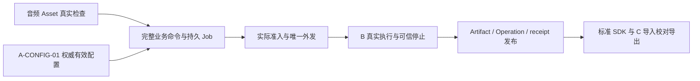

# 从底层部件走到可执行配置与文件 ASR 闭环

本轮依据用户“回归总结以全大局，更新清理 issue 以及其状态，立于现实看清目标，设定新目标”复核。
共同代码基线为 main `a8ea85b9fcbafee2b79bcad43bc17bcff91043db`；日期按北京时间。
原 A00–A07 与三队方案保持，当前优先级收敛到文件 ASR 的实际依赖。

## 现实基线

38 条规划 issue 已核对：总控 1、Epic 6、Gate 6、工作包 25。工作包全部 open，其中
21 个 in-progress、4 个 planned（A05/A06/B05/B07）；完整包 0/25、Gate 0/6。
这些数字表示整包验收尚未完成，不表示已交付部件为零，也不按 PR 或测试数量换算产品完成率。

| 范围 | 已有证据 | 尚未证明的能力 |
| --- | --- | --- |
| A00/A01 | 同源生成/解析/样例、漂移与有限结构门禁；A 自有 10 个写端口、PG/最小角色、原键恢复及隔离加固 | 18 端口跨 owner 联合、全部协议/真实消费者语义 |
| A02 | 文本 Asset/Workspace；Profile/Binding 草稿；显式默认快照的原子存储、原键恢复和真实 HTTP | 音频检查、持久发布/CAS、权威配置/最终参数、Artifact/Operation/receipt |
| A03/A04 | owner/claim、完整配方窄事务、持久 runtime 意图投递、受控资源 HTTP | 业务策略/readiness、完整调度/结算、公开业务 Job/SSE、标准文件 ASR/TTS 生产链路 |
| A05/A06/A07 | 实时/音色契约；首个文本 Asset 保留/删除账本 | 实时/音色业务；通用删除、备份恢复、目标拓扑与发布资格 |
| B | 有界媒体、原生文件 ASR/CustomVoice、固定输入核验、停止查询等分段交付 | 真实请求完成/取消/释放、完整参数与最终制品的联合闭环；本地 worker 扩展尚未交付 |
| C | 作者最新报告已有真实 runtime/PG/本机模型/浏览器纪要，以及 sweeper/重启账本重放 | 仍基于 `4b08c396…` 未提交/推送，尚未进入共同 main；目标环境与联合验收仍待 |

当前 `app.py` 注册的是健康、Asset、Workspace、Profile 草稿和 Binding 草稿入口。
`speech/domain/jobs.py::CreateJob` 是六字段协调身份，`JobFact` 只有 Job ID/摘要；
`OriginalBusinessCommand` 校验规范正文/摘要，不证明业务语义和资源资格。
这些事实不足以构造公开 `Job` 所需的真实状态、有效配置、结果、用量和 Operation。

`TextAssetInspector` 对非文本返回不可用。B03 已有有界媒体实现，但还没有接成 A 的音频
Asset 检查；不能从文件名/MIME 生成 ready，也不能让 backend 导入 gateway 应用层来绕过边界。

## 本轮有限交付与 CI 实情

- #133/#134 已交付默认快照原子存储与显式四表 producer HTTP；0011 已占用。
- #135 CI 审计已合入 `944ab54`，合前/合后 13 项成功，265/210 秒。
- #136 发布/激活**契约前置**已按受审 `e62c59c` 管理合入 `a8ea85b`；合前/合后
  [40152572208](https://github.com/hrygo/SpeechNexus/actions/runs/40152572208) /
  [40153162439](https://github.com/hrygo/SpeechNexus/actions/runs/40153162439) 均 13 项成功，
  366/310 秒。3732 非集成通过、81.47%，1243 集成通过与 22 个既有不适用跳过分列。
  合前六 ZIP 大小/摘要/来源与完整互斥并集已独立核验。

运行器排队和执行时间仍有波动，五分钟反馈目标尚未稳定达到。本轮不重复 B #132 的 CI
分流、不放宽检查，也不把绿色检查当作业务上线或真实模型资格。

## 新目标 A-CONFIG-01：从草稿到可执行配置

**围绕文件 ASR 所需的配置，把可信校验、持久发布/CAS、实际受控 HTTP 与固定查询接通，
再完成最终参数解析，产出可供完整业务 Job 固定的有效配置。**

主责 A02，A00 支持同源消费者，A01 支持窄事务，A03/A04 接后续业务命令与公开任务。
实施顺序如下；每个子单元独立评审，最多一个主要写入单元，公共源/生成/迁移/组合根串行。

| 顺序 | 可交付子单元 | 前置与退出证据 |
| --- | --- | --- |
| P1，下一项 | 可信校验 provider、固定目标与发布/激活领域边界 | 复用 #136 的请求/响应；明确 ProfileValidation 与权威证据的解析/归属，验证目标、层级和当前适用性；客户端 digest/validation 不能自证资格。缺可信事实时明确不可用 |
| P2 | 私有发布结果账本、不可变历史与当前指针 CAS | 基于 P1；原键/完整原意图重放在新 CAS 前裁决；发布与指针同事务；旧 revision/default snapshot/Job 不重写。真实 PG 的并发、丢 COMMIT 回执、读取受压、取消与恢复；迁移序号开工时重新核对 |
| P3 | 真实受控 POST/固定已发布查询、发布/激活消费者 | 基于 P2；独立最小 writer 生命周期，检查会话/有效身份；真实 PG + Python/TS HTTP，正确 404/409/503、keyless 未知及有界入口；只把已注册操作加入 operational OpenAPI |
| P4 | 文件 ASR 最终参数解析与不可变有效配置 | 固定权威 Binding/默认快照、可选 published Profile 和策略；allowlist/ranges、绑定域、跨字段/硬约束及 exact 拒绝；输出真实有效值、来源版本、摘要，交给完整业务命令生产者 |

P1 先列清既有权威事实的 owner 与可消费版本，再实现最小领域/应用单元；不先造一套公开报告协议。
Profile 是 `AsrJobCreate` 的可选字段，不强制让每个请求都经过预设发布。有 Profile 时必须解析
已发布固定引用；无 Profile 时同样需要权威 Binding 与显式默认，不能从草稿、示例、能力范围
或引擎未声明行为补值。绑定默认 → 已发布预设 → 允许覆盖，之后执行硬约束和最终检查；
只允许原产品规则声明的段预算协商，`require_exact_parameters` 必须拒绝自动收紧。

ModelBinding 发布/资格来源若是 P4 的实际缺口，单独登记同源/生产者交接与验收，不能用草稿
替代，也不同时扩展全部资源家族。真实质量/容量/引擎资格继续由 B 的具名事实证明。

本目标完成需要真实隔离数据库、原身份恢复、最小角色和真实 HTTP 消费证据；合成报告/媒体
只能证明相应代码路径。生产迁移/grant/部署、真实发布和跨队 Gate 仍按用户原授权边界执行。
没有可信配置时保持不可用，不能为了让示例跑通而激活假预设或回填历史默认。

## 文件 ASR 整体路线与三队交接

| 依赖 | owner | 需要交付什么；何时算解除 |
| --- | --- | --- |
| 音频 Asset 检查 | A02 + B03 | 对齐可消费的媒体检查边界，沿用 A 的 AssetInspector/对象发布/7 天默认 TTL；实际媒体事实、有界解码、损坏/超限/取消、原键与重启恢复通过真实 A HTTP/PG/对象存储。与配置主线分别登记，不跨服务导入或复制实现 |
| B 正常/取消/异常执行 | B01/B03，A03 消费 | 精确绑定/引擎/拓扑/输入版本；可验证完成、停止与释放事实；未知仍占用，A 原事务才退预算。A 不操作 B 硬件 |
| 完整公开业务 Job | A02/A03/A04 | 使用真实输入和固定有效配置，持久化业务事实/事件/结果；不能把协调 JobFact 投影成假公开 Job。随后接实际查询、取消、SSE 与 SDK |
| C 共同版本交付 | C；A 集成 | 可获取、可评审的制品与 exact base/head、迁移片段/组合根及消费者证据；本机未提交包不能算共同 main。A 不替 C 修改 issue 或提交其本机工作 |
| 联合关闭文件链路 | A04/B03/C02 | 同一 SHA 的真实模型→受控制品→SDK/工作台消费，含重放、取消未知、重启与失败。文件 ASR 子链路通过不自动关闭还包含 TTS 的 G1 |

## C 最新证据与 A00 排队项

已读取 C 在北京时间 2026-10-25 的 [#40](https://github.com/hrygo/SpeechNexus/issues/40)、
[#41](https://github.com/hrygo/SpeechNexus/issues/41)、[#43](https://github.com/hrygo/SpeechNexus/issues/43)
顶部现实核对：纪要由真实 lifespan 派发 worker 认领，本机模型与浏览器链路成功；删除/恢复也有
真实 sweeper 与启动期账本重放证据。这里记录的是作者本机报告，A 未独立复跑，制品仍未提交/推送。
助手成功状态必须携带公开 `speech_job_id` 且需要已发布音色，分别依赖 A04 与 A06/B05；
Profile 发布不替代音色发布。目标网络/设备/Linux/部署与联合恢复资格继续开放。

共同源已声明以下四操作，runtime bindings 尚未选择；TypeScript 全量 OpenAPI 类型并不补齐 runtime：

| 操作 | 成功媒体 | 当前边界 |
| --- | --- | --- |
| generateRenderUnit | 202 application/json | 尚未入 Workbench runtime profile |
| downloadSavedAsset / downloadBookExport | 200/206 application/octet-stream | 投影/消费者尚不支持此二进制路径 |
| streamExportEvents | 200 text/event-stream | 现生成器 HTTP 投影限定 application/json，不能当作完整事件消费者 |

这些列入 A00 后续串行队列，需正负/错误/流终止与实际消费者验收；本次只读核对，不立即改生成器，
不扩展已完成的 #136。

## issue 清理与执行纪律

A #19–#26 已统一唯一当前目标，修正已交付子任务；旧“当前”归档折叠，原始失败/取消/修复与
SHA/测试证据保留。历史复选框改用 ☑/☐ 保留当时状态，不混入当前待办。#6 汇总现实缺口；
B 的并发交接按原文本保留，B/C 的 issue 未由 A 修改。A05/A06 保持 planned，其余 A 为 in-progress。
没有完整验收的父包/Gate不关闭，也不为显示进展另造重复工作包或放宽退出条件。

后续先更新 issue 的当前单元/依赖/验收，再实施。P1 完成后按实证推进 P2，缺外部事实时继续
独立工作并写清 owner/解除条件；不反复重跑已完成单元，不以文档/契约交付替代产品闭环。
