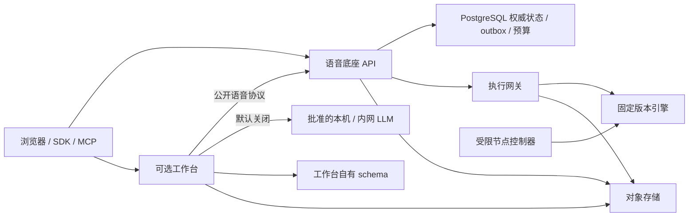

# SpeechNexus 项目经理接管基线

本文件承接用户任命及三队最终交接，作为后续项目经理的当前入口。核验日期为 **2026-10-26（Asia/Shanghai）**；以远端 `main`、当前 issue 和精确提交的检查为准。原三队的目标、范围、AC 和历史失败继续保留，旧计划不自动恢复执行。

## 1. 项目处于什么阶段

SpeechNexus 是可信部署网络内的 Linux 语音底座和创作工作台：独立语音 API、AdminUI、Workbench 三个产品面，共享服务数据，首期没有登录、RBAC、多租户或个人私有空间。目标包含文件与实时 ASR/TTS、音色创作及资源治理；会议、提词、助手、有声书属于可选工作台。

项目已有大量组件、持久事务、正式消费者及真实隔离模型执行成果，当前主要问题是把它们装配为可恢复、可准入、可发布的完整业务链。**公开上传→音频 ready→Job/准入→真实执行→发布→SDK/页面下载，两条 ASR/TTS 链仍未同版验收。** 默认 Compose 的 UI 预览、健康检查、私有检查成功和内部模型结果各有边界。

| 管理事实 | 接管结论 |
| --- | --- |
| issue 总量 | 全部 40 项 open；34 项 `status:in-progress`，6 项 `status:planned`（#18/#24/#25/#32/#34/#149） |
| 完整范围 | 工作包完整验收 0/25，Gate 放行 0/6；表示完整要求未通过，不是实施量为零 |
| 编排 | 原清单 38 项，另有阶段 #142 和依赖 #149；后两项不增加工作包分母 |
| C 验收证据 | 41 条原 AC、278 个子条件仍全部 `not_run`；丢失 82 份原件影响 214 个引用，重建不能冒充原件找回 |
| 当前权威入口 | [总控 #6](https://github.com/hrygo/SpeechNexus/issues/6) → 各工作包/阶段 issue → 固定版本证据；本地跟踪矩阵是快照 |
| 本次集成 | [A #221](https://github.com/hrygo/SpeechNexus/pull/221)、[B #220](https://github.com/hrygo/SpeechNexus/pull/220)、[C #222](https://github.com/hrygo/SpeechNexus/pull/222)分别审查和集成；精确 head、合并时间与 merge commit 以 PR 回执为准 |
| A 的接管修复 | #221 最终 head `f326f5d`，合入 `41e29b6`；[精确 PR CI](https://github.com/hrygo/SpeechNexus/actions/runs/40312196799)全 14 项成功，修复了原私有 WAV 检查忽略尾部 chunk 的缺陷 |
| A 合后检查 | [main41e29b6 的 CI](https://github.com/hrygo/SpeechNexus/actions/runs/40313468861)首轮分片 2 达到 10 分钟时限，314 项测试通过后作业被取消、汇总失败；浏览器准备约 354 秒。补跑以同一 run 的最新 attempt 为准，首轮失败不改写为成功 |
| B 的接管修订 | #220 最终 head `4e55041`，合入 `8b1466d`；[精确 PR CI](https://github.com/hrygo/SpeechNexus/actions/runs/40313607678) 2 项适用检查成功、7 项跳过，补请求音频上限风险及原件接收边界 |

三队详细交接继续分别查阅：[A](2026-10-26-team-a-final-handoff.md)、[B](../audits/2026-10-26-team-b-handoff.md)、[C](2026-10-26-team-c-final-handoff.md)。[原项目交接](../audits/2026-10-26-project-handoff.md)保留交接时点快照；当前组合版本和后续管理以本文件及 #6 为入口。

## 2. 必须掌握的架构与边界



图表示有效设计的职责和数据流，不表示所有箭头已经生产装配。应用为 Python/FastAPI，前端为 React/TypeScript/Vite；版本以 `.python-version`、`.nvmrc`、workspace 和锁文件为准。实现定位见[目录与依赖边界](../architecture/repository-layout.md)，设计依据见[产品主设计](../speechnexus-product-architecture.md)、[技术方案](../architecture/technical-blueprint.md)和[ADR 索引](../decisions/README.md)。

- PostgreSQL 是唯一正式产品数据库；InnoDB 只验证关键协调行为。无 etcd，Redis 只能丢失而不影响事实恢复。Job、outbox、完整配方租约与预算由同一关系事务维护。
- 集群是实现和验收要求，`Node=1` 使用同一持久协议。业务内容不走共享本地目录或进程内全局锁；实例、节点、owner、generation/fencing 显式关联。
- 网关管理提交屏障、引擎凭据和执行/停止证据；控制器只操作批准模板。业务 API/worker 不持任意容器权限。工作台经公开协议消费底座，不共写底座表。
- 完整有效意图、固定资源版本和原身份先持久化再外发；未知结果沿原身份恢复。取消接受、TTL、断线或进程退出均不能代替停止和资源释放双证据，预算由 A 原事务幂等归还。
- 音频、稿件、声音参考与派生内容留在部署网络。LLM 默认关闭、服务端批准端点，无公有云回退；“内网地址”不能替代实际出站验证。
- 删除使用固定版本预检、明确确认及持久账本；恢复先重放账本再开放内容。跨模块独立副本按自身所有权保留，执行、租约和计量证据不随内容删除。

ADR 0001–0010 继续有效。0001–0007 覆盖产品身份/边界、模型与加载、内容网络、集群同构、完整生命周期、应用事务与数据库可移植性、旧协调原型退出；0008 区分持久 runtime 意图和实际控制器观察，0009 保留严格 v1 并以 v2 表达工作台显式绑定，0010 要求先升级音频回执读取者再启用生产者。决策中的历史“待实现”须结合当前源码核对，本次不另设架构或修改公共协议。

## 3. 已有能力与真正缺口

| 领域 | 已有成果 | 仍需完成的业务接线或资格 |
| --- | --- | --- |
| A 契约与平台 | 同源 Python/TS 消费者、配置草稿、私有词典草稿与固定 revision GET、18 端口/7 查询证据地图、协调/意图组件、删除账本 | 音频公开 ready/错误、权威配置/默认/资格、完整 Job/准入/Worker、Artifact/Operation/原子发布、管理/MCP 与迁移恢复 |
| #221 媒体 | 独立 `packages/media`、同对象兼容导出、PCM WAV/raw PCM 私有检查、成功回执及窄消费者；接管审查补严格 RIFF 遍历 | 默认仍为 `TextAssetInspector`，未启用公开音频链；B 专业兼容接收、批准检查镜像和实际装配另验 |
| B 文件与执行 | 固定 ASR/CustomVoice/VAD 制品和注册输入、真实默认工厂、私有 staging/回执、隔离整代停止和原租约结算 | 权威注册与正式生产事实；请求音频硬上限缺陷、单请求释放、TTS base、完整参数/长文本、实时、声音材料与目标拓扑 |
| C 应用 | 持久项目/稿件/会议/turn/有声书、正式页面与部分真实 PG/MinIO/HTTP 消费、删除恢复、公开二进制下载 | 真实公开来源和助手成功链、SSE/实时、持久意图/CAS/公平扫描/上下文隔离、完整导出/续作、物理设备及全状态无障碍 |
| 联合验收 | 六个双库分片、契约/生成漂移、Web/a11y、构建和各原版本隔离实验 | 真实公开两链、完整故障矩阵、混合/长时负载、质量、物理多机、升级/备份恢复、许可和运维交接 |

直接定位已经读取的生产装配入口：`backend/src/speechnexus_backend/app.py`、同目录 `asset_runtime.py` 和 `workbench/runtime.py`；B 文件 TTS 为 `execution-gateway/src/speechnexus_gateway/interfaces/file_tts_command.py` 与 `application/file_tts.py`；C 风险入口见 [C 交接](2026-10-26-team-c-final-handoff.md#必须接住的未决风险)。索引服务未提供本工作区的已索引项目或建索引入口，本次使用精确路径源码和文档核对；未声称完成全仓逐行审计。

## 4. 接管后的风险与决策队列

下表用于后续排期评估。它不启动业务实施、GPU 实验或部署，也不降低现有 AC；实际 owner 和窗口须在 #6 与对应 issue 明确。

| 顺位 | 对象与事实 | 下一项可评审产物及退出条件 |
| --- | --- | --- |
| 优先修复 | [#30](https://github.com/hrygo/SpeechNexus/issues/30) / [#142](https://github.com/hrygo/SpeechNexus/issues/142)：请求 `max_output_audio_ms` 只核对不超 binding，未收紧执行 policy | 先回归再修复时长/PCM 上界传播；覆盖恰好上限、超过一帧、低于 binding、重放和编码制品。接管时合成复现：请求 100 ms，policy 仍 600000 ms，实际接受 200 ms；未运行真实模型 |
| 优先修复 | [#42](https://github.com/hrygo/SpeechNexus/issues/42)：先外发后登记、同键异体/可变快照、锁前读和 CAS/source、保存键刷新丢失 | 按相互独立的小单元修复；用受理后崩溃/丢回执、并发更新/删除、旧 Job/generation 和刷新反例证明唯一意图与来源一致性 |
| 可并行修复 | #42 分类不匹配、最老批次饥饿/无持久退避、SQL 全读再切片、页面乱序/加载/焦点 | 各自给持久恢复、公平/数据库资源上界或旧上下文拒绝证据；参数转发、最近 100 条和 ARIA 不能代验全部行为 |
| 首个业务切片候选 | [#14](https://github.com/hrygo/SpeechNexus/issues/14) / #21/#22/#23/#30/#37/#142 | 以固定 ASR 为先导，接公开音频 ready→权威配置→Job/准入→B→A 发布→SDK/C 下载；随后同口径 CustomVoice。先确认当前具名制品/迁移/环境，不等待长工作包全部关闭 |
| 协议待决 | #19/#21/#23/#30/#37/#42：固定 binding、未知提交/删除后重放、指令上限 | A/B/C 提交同版正负与时序样例，明确公开可表达字段；不虚构 `binding_revision_id` 或按幂等键查询资源，不静默截断 |
| 证据与运行条件 | #13/#26/#34/#35/#43：原件接收/重建、模型许可、真实出站/设备/多机、迁移/恢复 | 按证据可取得性和真实容量拆资格窗口；未取得原件标缺失，恢复账本和升级回退另验，原失败保持原版本 |

文件 CustomVoice 的既有边界为一次 intent 一次合成、≤400 codepoints、`pronunciation_revision=null`。Nexus instructions 2000、标准/内部命令 4096、固定 pipeline 默认 500 分列；模板目标 2000 不代表实际 adapter 已生效。请求时长缺陷与这些文本/指令上限是不同问题。

#218 仅证明该隔离版本整代停止和原执行 lease 结算；16 GiB base 是未结 fixture。ASR 旧实验的 base 结算、HTTP 取消、本地播放器释放、单请求 GPU 释放不能合并成一个“资源已释放”结论。C07 独立于助手 #149；普通会议/提词不增加 LLM 前置，builtin CustomVoice 不等待完整设计/克隆包。

仓库尚无项目 `LICENSE`；模型权重、引擎/依赖、声音材料和 SpeechRail 复用来源各自核对，当前隔离运行或开源源码不代替完整再分发/交付许可。

## 5. 项目管理规则入口

接管、排期、协作、集成验收、进度维护和证据清理统一见[项目经理工作约定](../project-manager-guide.md)。长期规则在该文档维护；本基线保留接管时点的事实、风险与待决队列，当前进度以 #6 和相关 issue 核实。

## 6. 证据接收、清理与恢复

| 来源 | 接管核验状态 | 后续取用 |
| --- | --- | --- |
| A 最终原件 | 作者在 `/workspace/.speech-nexus-team-a-evidence/2026-10-26-final-handoff/` 报告归档；经理未取得该环境完整字节 | 固定 PR/公开 CI 可复核；私有 wheel/日志按 manifest 接收后再称核验，环境失效则依固定源码重建 |
| B 最终原件 | 作者报告稳定根及 manifest/bundle，经理未访问远端 5308 文件/512351757 字节；#220 已明确区分 | 依 [B 恢复指引](../audits/2026-10-26-team-b-handoff.md)在批准环境校验，不把作者成功报告当接收方复验 |
| C 最终原件 | `/Users/hrygo/.codex/team-c-evidence/20261026T101715Z-final-handoff/`，19 份文件；经理已逐文件校验 | manifest SHA-256 为 `39fbabcd20b9ad49d98b0199a36f763585b9c5e1247538c67187d8ca6e57acb5`；是本轮新归档，不是失踪 82 原件 |
| 本次经理集成 | `/Users/hrygo/.codex/project-manager-evidence/20261026T104016Z-integration/`，位于工作树外 | 保存 RIFF 红/绿与两项变异、请求时长复现、issue 前后/不变量、精确 CI/合并回执及清理记录；最终 manifest 以目录内文件为准 |
| 本机工作树 | PM 工作树保留为后续工作入口；C 收尾树合入并保护原件后可归档 | 旧主目录的目标 diff、贡献模板和未知 `.paperclip` 仍受保护；未合并历史提交先保留 bundle，不强行删除外来 worktree |

原 A/B 会话最后报告其本地已对齐 `54daef6` 并做可恢复清理；这是会话报告，不代表经理已更新远端机器到本次新 main。本次合并不会自动同步部署或重启服务，也没有运行模型、操作生产数据库或删除运行数据。

只读确认组合版本和刷新快照可用：

```bash
git fetch origin main
git log -5 --oneline origin/main
gh pr view 220 --json state,mergedAt,mergeCommit,headRefOid,url
gh pr view 221 --json state,mergedAt,mergeCommit,headRefOid,url
gh pr view 222 --json state,mergedAt,mergeCommit,headRefOid,url
python3 scripts/dev-env/refresh-implementation-tracker.py --output /tmp/speechnexus-tracking.md
```

完整工程验证按[验证指南](../agent-verification.md)和受影响范围执行；Linux 隔离 PG/InnoDB/MinIO、真实模型、设备与物理拓扑各有前置。原件恢复在独立目录先校验再使用，不覆盖当前源码、数据库、对象区或配置。
