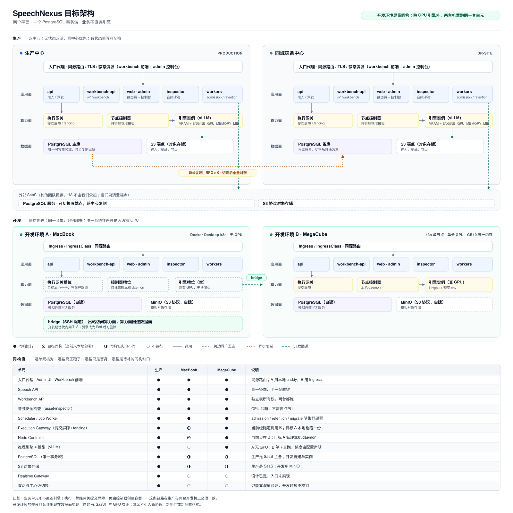

# MegaCube 安装 k3s：执行方案

约束：不影响 QwenPaw、npm 私服与 SSH。SSH 是硬约束，任何步骤都不允许冒险。

k3d 已排除。实测三次（默认、换旧版 k3s、加 `--gpus all`）都卡在节点容器不启动，根因是
Docker 29.6.2 使用 containerd 镜像存储（`io.containerd.snapshotter.v1`），而 k3d 依赖经典
overlay2 才能把 `k3d-entrypoint.sh` 注入节点。改动镜像存储等于重装 Docker，放弃。

## 零、目标架构图



图按[部署单元与平台规划](../architecture/deployment-units.md)与
[ADR 0011](../decisions/0011-distributed-deployment-and-platform-boundaries.md)的口径：
**两个平面（应用面 / 算力面）+ 一个 PostgreSQL 事务域**，业务单元不直连引擎。

### 开发环境的原则：尽量同构

开发环境的存在理由是**验证生产形态**，不是"能跑就行"。这条原则已固化为
[ADR 0014](../decisions/0014-development-environment-isomorphism.md)，本方案的实施以它为准。
默认规则是：

1. **同一套单元，两台机器都部署**——应用面全部单元、执行网关、节点控制器、数据面替身，
   只要不依赖 GPU，就两边各跑一份
2. **允许的差异只有两类**：数据面实现（自建 PG / MinIO 代替 SaaS）、GPU 有无
3. **不因为"开发环境不需要"而省略单元**——省略掉的单元就是没被验证过的路径
4. **同构缺口必须画出来**，不能靠读者猜；图中用 ⊙ 与虚线槽位标出

### 同构度逐项核对

| 单元 | 生产 | MacBook | MegaCube | 说明 |
| --- | --- | --- | --- | --- |
| 入口代理 · AdminUI · Workbench 前端 | ● | ● | ● | A 用本地 caddy，B 用 Ingress |
| Speech API | ● | ● | ● | 同一镜像、同一配置键 |
| Workbench API | ● | ● | ● | 独立表所有权 |
| 音频安全检查 | ● | ● | ● | CPU 沙箱，不需要 GPU |
| Scheduler / Job Worker | ● | ● | ● | admission / retention / migrate 随集群部署 |
| Execution Gateway | ● | ⊙ | ● | 当前经隧道调用 B；目标 A 本地也跑一份 |
| Node Controller | ● | ⊙ | ● | 当前只在 B；目标 A 管理本机 daemon |
| 推理引擎 + 模型 | ● | ○ | ● | A 无 GPU；B 单卡真跑，额度由配置声明 |
| PostgreSQL | ● | ◐ | ◐ | 生产是 SaaS 主备；开发自建单实例 |
| S3 对象存储 | ● | ◐ | ◐ | 生产是 SaaS；开发用 MinIO |
| Realtime Gateway | ● | ○ | ○ | 设计已定、入口未实现 |
| 双活与中心级切换 | ● | ○ | ○ | 只能靠演练验证 |

● 同构运行　⊙ 目标同构（当前未本地部署）　◐ 同构但实现不同　○ 不运行

### 当前的两个同构缺口

- **执行网关与节点控制器只在 B 上**：A 的业务单元经隧道借用 B 的网关。补齐方式是 A 本地
  各起一份，隧道只保留数据面回连
- **推理引擎永远不可能在 A 上**：无 GPU 是物理事实，用虚线槽位标出，不假装

补齐网关与控制器后，同构度从 7/12 升到 9/12；余下的三项（实时链路、中心级切换、
平台侧 GPU 行为）不是部署缺口，而是开发环境客观上验证不了，已在
[部署单元与平台规划](../architecture/deployment-units.md) 第 8 节声明。

## 一、为什么 SSH 不会断（先论证，再动手）

SSH 连到本机走的是 **INPUT 链**，已核实为 `-P INPUT ACCEPT`。k3s 只会写它自己的链
（`KUBE-*`、`FLANNEL-*`），不动 INPUT 策略。

k3s 会改的东西，逐项核对过：

| k3s 动作 | 是否影响 SSH | 说明 |
| --- | --- | --- |
| 写 KUBE-* / FLANNEL 链 | 否 | 只挂到 FORWARD |
| 建 `cni0`、`flannel.1` | 否 | 新增接口，不碰 `wlP9s9` |
| 加 `10.42/10.43` 路由 | 否 | 宿主当前无任何 `10.x` 路由，不冲突 |
| 占 6443 | 否 | 该端口空闲 |
| 默认路由 | **不动** | 安装脚本不碰路由表 |
| Docker 容器 | 不动 | k3s 用自己的 containerd 与镜像目录 |

结论：结构上不会断。但"结构上不会"不等于"一定不会"，所以下面还有四道保险。

## 二、四道保险

### 保险 1：deadman switch（最关键）

动手前先设一个定时回滚：**15 分钟后自动卸载 k3s**，除非我们主动取消。

deadman 执行的是一个**桩脚本**，不是直接指向 `k3s-uninstall.sh`：

```sh
#!/bin/bash
# /usr/local/bin/k3s-deadman.sh
if systemctl list-unit-files k3s.service >/dev/null 2>&1 && [ -x /usr/local/bin/k3s-uninstall.sh ]; then
  /usr/local/bin/k3s-uninstall.sh
  echo "deadman: uninstalled at $(date)" >> /tmp/k3s-deadman.log
else
  echo "deadman: nothing to undo at $(date)" >> /tmp/k3s-deadman.log
fi
```

这样安装前它空跑（无副作用），安装后它能真正回滚，一个脚本覆盖两个阶段，不需要中途重设。

计时 **25 分钟**，不是 15 分钟：镜像拉取与二进制下载在这台机器上实测偏慢，窗口太短会在
安装中途触发卸载，留下半成品状态。

装完验收通过后 `sudo systemctl stop k3s-deadman.timer`。

### 保险 2：tmux 承载，不靠连接

所有变更放进 tmux 会话执行，SSH 只用来下发与读取：

```sh
tmux new-session -d -s k3s 'bash /tmp/k3s/install.sh 2>&1 | tee /tmp/k3s/install.log'
```

SSH 断了进程照跑，重连后 `tmux attach -t k3s` 或直接看日志。观察用另一条独立 SSH，
只读不改。

### 保险 3：不通过管道执行远程脚本

`curl … | bash` 会消费 stdin，把 SSH 会话一起吃掉——本机已实测断连一次。因此：

- 安装脚本先落到文件：`curl -o /tmp/k3s-install.sh`
- 再执行：`bash /tmp/k3s-install.sh`
- 本机到远端统一用 `ssh -n`（不把本地 stdin 接过去）

### 保险 4：变更前后逐项比对

```sh
ip -4 route > /tmp/before-route.txt
ip addr > /tmp/before-addr.txt
ss -lnt > /tmp/before-listen.txt
sudo iptables-save > /tmp/before-iptables.txt
docker ps --format '{{.Names}} {{.Status}}' > /tmp/before-docker.txt
```

装完逐项 `diff`。允许新增：`10.42/10.43` 路由、`cni0`/`flannel.1` 接口、`KUBE-*` 链。
**不允许**出现：`172.18.24.0/22` 相关变化、INPUT 策略变化、Docker 容器状态变化。

任一项越界 → 立即回滚。

## 三、安装

版本与参数：

```sh
export INSTALL_K3S_VERSION=v1.35.5+k3s1
export INSTALL_K3S_MIRROR=https://rancher-mirror.rancher.cn/k3s/
export INSTALL_K3S_EXEC="server \
  --disable traefik \
  --disable servicelb \
  --write-kubeconfig-mode 0644"
curl -fsSL -o /tmp/k3s-install.sh https://get.k3s.io
cat ~/.passwd | sudo -S -p "" bash /tmp/k3s-install.sh
```

说明：

- 用国内镜像，避免从 GitHub 拉二进制（本机拉 GitHub 实测很慢）。
- 禁用 traefik 与 servicelb：不需要入站负载均衡，少两个可能占端口的组件。
- 保留默认 `10.42/10.43` 网段：已核实与宿主及 Docker 网段都不冲突。
- 保留 coredns 与 metrics-server，它们不产生对外暴露。

## 四、验收（逐条看结果，不看退出码）

| # | 检查 | 通过标准 |
| --- | --- | --- |
| 1 | `systemctl is-active k3s` | `active` |
| 2 | `k3s kubectl get nodes` | 节点 `Ready` |
| 3 | QwenPaw 两个端点 | 8012/8013 都是 `200` |
| 4 | npm 私服 | 4873 返回 `200` |
| 4b | 外部入口 `172.18.24.247:80` | 与安装前同状态（本机回环正常不代表外部可达） |
| 5 | `diff` 五份快照 | 只有允许的新增 |
| 6 | `docker ps` | 与安装前完全一致 |
| 7 | 新会话能否登录 | 能 |

第 3、4、6 条任一失败 → 回滚。

## 四之二、执行记录与两处真实故障

安装完成，验收七条全绿。过程中撞到两个只有真机才会暴露的问题，都已修复并写回方案。

### 故障一：安装脚本会等 sudo 口令

不带 sudo 执行安装脚本时，脚本自己调 sudo 并**在 tmux 前台等口令**，日志停在
`[2/4] run installer` 不动。改为 `cat ~/.passwd | sudo -S -p "" env …` 显式传入口令。

### 故障二：10010 端口被 nginx 占用

k3s 内置 containerd 的流式服务固定监听 `127.0.0.1:10010`，该端口已被宿主 nginx 占用
（`0.0.0.0:10010`），containerd 直接 `fatal`：

```
level=fatal msg="Failed to run CRI service" error="stream server error:
listen tcp 127.0.0.1:10010: bind: address already in use"
```

k3s 没有对应命令行开关，只能改 containerd 配置模板：

```sh
sudo cp /var/lib/rancher/k3s/agent/etc/containerd/config.toml \
        /var/lib/rancher/k3s/agent/etc/containerd/config.toml.tmpl
sudo sed -i 's/stream_server_port = "10010"/stream_server_port = "10011"/' \
        /var/lib/rancher/k3s/agent/etc/containerd/config.toml.tmpl
sudo systemctl restart k3s
```

**不改 nginx，改我们自己这一侧**。10011 已核实空闲。

### 验收结果

| 检查 | 结果 |
| --- | --- |
| `k3s.service` | active |
| 节点 Ready | 是 |
| QwenPaw 8012 / 8013 | 200 / 200 |
| npm 私服 `/-/ping` | 200 |
| 外部入口 caddy | 308（与安装前一致） |
| Docker 容器集合 | 完全一致 |
| 路由新增 | 仅 `10.42.0.0/24 dev cni0` |
| INPUT 策略 | 仍为 ACCEPT |
| 默认路由 | 仍走 `wlP9s9`，未变 |

两处校验方法在首次运行时判红，都是**校验写错而不是服务坏**，已修正：

- npm 私服根路径返回 404 属正常，健康检查应用 `/-/ping`
- 容器比对不能带 `Up 23 hours` 这类随时间的字符串，只能比名字集合

## 五、GPU 接入（第二阶段，单独验收）

k3s 用自己的 containerd。宿主已配好 CDI（`/var/run/cdi/nvidia.yaml`），需要两步接进集群：

1. containerd 模板里打开 CDI（`enable_cdi = true`，`cdi_spec_dirs = ["/var/run/cdi"]`），
   写到 `/var/lib/rancher/k3s/agent/etc/containerd/config.toml.tmpl` 后重启 k3s。
2. 部署 NVIDIA device plugin，让节点上报 `nvidia.com/gpu`。

分数切分不依赖 device plugin：已实测 `libvgpu.so` 以 `LD_PRELOAD` 注入即可生效，容器内
`torch` 看到 6.00 GiB、分配 8 GiB 直接 OOM。因此第二阶段只需要"能调度到 GPU 节点"，
切分参数由环境给出。

注意：容器内 `nvidia-smi` 始终显示 `[N/A]`，判断限额只能用
`torch.cuda.get_device_properties(0).total_memory`。

## 五之二、GPU 接入现状（未完成）

集群本身已经可用：节点 `Ready`，三个系统组件 `Running`，普通 Pod 能正常调度运行。

GPU 接入卡在两个地方，都还没解决。

### 问题一：k3s 拉不到系统镜像

刚建好集群时三个系统 Pod 全部 `ContainerCreating` 十几分钟不动。原因是 Docker 配了
`registry-mirrors`，而 **k3s 用自己的 containerd，不读 Docker 的配置**。

修法：写 `/etc/rancher/k3s/registries.yaml`，把 `docker.io`、`registry.k8s.io`、`ghcr.io`
指向镜像站，然后重启 k3s。改完三个 Pod 一分钟内全部就绪。

### 问题二：GPU 设备插件镜像拉不下来

`nvcr.io/nvidia/k8s-device-plugin:v0.17.0` 在这台机器上拉了半小时仍未完成。镜像站代理
`nvcr.io` 的路径实测无效（`docker.m.daocloud.io/nvcr.io/...` 直接失败）。

绕开设备插件的尝试也失败了：用 CRI 的 CDI 注解（`cdi.k8s.io/gpu: nvidia.com/gpu=0`）
直接注入设备，分别在默认 runc 与 `nvidia` RuntimeClass 下测试，容器内都没有出现
`/dev/nvidia*`。宿主侧 CDI spec 本身是好的（`nvidia-ctk cdi list` 能找到 3 个设备），
说明问题在 CRI 侧的注入没有生效，而不是 spec 缺失。

### 问题三：设备插件在 GB10 上无法工作（硬件限制）

打通代理后镜像能拉了，插件也能跑起来，但最终卡在初始化：

```
error building GPU device map: error visiting device:
error building Device: error getting device memory: Not Supported
```

根因是硬件：GB10 是统一内存，**NVML 不报告设备显存**。

```sh
$ nvidia-smi --query-gpu=name,memory.total --format=csv,noheader
NVIDIA GB10, [N/A]
```

NVIDIA 设备插件必须按设备显存建立 device map，拿不到就直接失败。这是平台限制，不是配置
能绕过的。

### 这个限制改变了什么

凡是**依赖 NVML 显存总量做记账**的调度器，在这台机器上都不可用，包括 HAMi 的按显存切分。
反过来说，纯靠 CUDA 拦截 + 显式配额的方式不受影响——因为它不需要查询硬件总量，只按配置
的 MiB 上限拦截分配。这一点已实测：`libvgpu` + `CUDA_DEVICE_MEMORY_LIMIT=6g` 把可见显存
限到 6 GiB 并真实拒绝 8 GiB 分配。

所以在这个硬件上，显存切分的正确形态是：

| 环节 | 做法 |
| --- | --- |
| 配额来源 | 部署配置给出的 MiB，不查硬件 |
| 执行方式 | `libvgpu` 以 `LD_PRELOAD` 注入，环境变量给上限 |
| 准入判断 | 由我们按配置记账，不依赖 device plugin 上报 |

代价是失去 `nvidia.com/gpu` 这种标准化资源声明，收益是这台机器上唯一能真跑通的路。

### 集群侧结论

GPU 额度改由配置声明、经 `libvgpu` 注入执行，决定记录在
[ADR 0015](../decisions/0015-gpu-memory-quota-by-configuration.md)。

k3s 可用于应用面（已验证：节点 Ready、系统组件运行、普通 Pod 调度正常、镜像经代理可达）。
GPU 目前**不进集群**：引擎继续由控制器以容器方式启动，显存上限走环境配置。

## 五之三、显存额度改为部署配置（已实现）

结论先行：不看 GPU 调度，只看显存真的被限住。额度由部署配置给出，因为**我们已经知道卡
多大**，不需要向硬件询问。

### 改了什么

| 文件 | 变更 |
| --- | --- |
| `deploy/cluster/compute/approved-templates.json` | 删除 `--gpu-memory-utilization 0.25` |
| `settings.py` | 新增 `engine_gpu_memory_mib` / `engine_gpu_memory_utilization` / `engine_libvgpu_path` |
| `docker_runtime.py` | 追加 utilization、注入 `CUDA_DEVICE_MEMORY_LIMIT` 与 `LD_PRELOAD`、绑定 shim |
| `deploy/cluster/init-env.py` | 生成三个键，开发默认 12316 MiB / 0.9 |
| `deploy/cluster/check-parity.py` | 新增规则：已提交模板不得含 `--gpu-memory-utilization` |
| 节点主机 | shim 安装到 `/opt/speechnexus/libvgpu.so`（0555） |

运行时行为：

- 模板有 GPU 且部署配了 `ENGINE_GPU_MEMORY_MIB` → 容器拿到
  `CUDA_DEVICE_MEMORY_LIMIT=<N>m`、`LD_PRELOAD=/opt/speechnexus/libvgpu.so`，
  以及一个只读 bind
- 命令里没有 `--gpu-memory-utilization` 时按配置追加；模板已显式给出则不覆盖
- 模板命令为 `None`（走镜像 ENTRYPOINT）时保持 `None`，不伪造空列表
- 未配置额度 → 完全不注入，不猜默认值

### 为什么额度不能留在模板里

同一份 approved template 在 48 GB 生产卡和这台统一内存机器上都会被批准。写死的比例只对
其中一种是正确的。所以判据是：**库里出现显存数字就是错误**，由 `check-parity.py` 拦。

### 验证

| 项 | 结果 |
| --- | --- |
| 新增 3 条单测 | 通过 |
| 注入禁止项后规则变红 | 是（`RESULT FAIL (1 problems)`），回退后恢复 OK |
| 变异测试（去掉环境注入） | 对应断言失败 |
| `check-parity.py --selftest` | OK |
| controller 单测 | 372 passed |
| ruff / mypy | 通过 |

### 尚未验证

控制器镜像还没重建，所以真机上的端到端尚未跑：需要重建 `node-controller` 镜像、给容器
传入三个环境键、启动一次引擎并确认容器内可见显存等于配置值。

## 五之四、引擎为什么不进 k3s（结论已修正）

问题问得对。之前写"GPU 不进集群"，容易读成"这台机器做不到"。**做不到的只是标准调度路径，
不是 GPU 不可用**。补测如下。

### 设备插件之外还有一条路（已实测可用）

不带 `nvidia.com/gpu` 资源声明，只指定 `runtimeClassName: nvidia` 并显式给出
`NVIDIA_VISIBLE_DEVICES=all`，容器内就能看到设备：

```
$ kubectl run ... --overrides runtimeClassName nvidia, env NVIDIA_VISIBLE_DEVICES=all
/dev/nvidia-modeset
/dev/nvidia-uvm
/dev/nvidia-uvm-tools
```

也就是说 vLLM 作为 Pod 跑在这台机器上**当前就能成立**。阻塞点不在硬件，在代码：

| 阻塞点 | 性质 |
| --- | --- |
| 设备插件报不了 `nvidia.com/gpu` | 硬件限制，绕开即可（不走资源声明） |
| 控制器只有 `DockerNodeRuntime` | **工程缺口**，需要 `KubernetesRuntime` |
| 无调度记账 | 本机只有一张卡、额度由配置给，可接受 |

### 所以引擎还在 Docker 的真实原因

1. `NodeRuntimePort` 目前只有 Docker 实现，控制器不会创建 Pod
2. 生产上引擎本来就跑在第四范式智算平台（Kubernetes）里，**开发机用 Docker 是临时偏差，
   不是目标形态**

第 2 点更重要：目标架构里引擎是 Pod。开发环境继续用 Docker，等于这条链路在开发机上没有
被验证。补 `KubernetesRuntime` 不只是"让开发环境也用 k8s"，而是把生产唯一形态的路径
在开发环境跑通。

### 需要先清掉的两个前提

- `deploy/cluster/compute/engine-port-shim.py` 与 `deploy/cluster/bridge/` 是为了跨主机
  转发引擎端口而存在的，引擎成为 Pod 后应当整体删除
- 显存额度注入逻辑要跟着 `RuntimePort` 走，不能只写在 Docker 实现里

## 六、回滚

```sh
cat ~/.passwd | sudo -S -p "" /usr/local/bin/k3s-uninstall.sh
```

卸载会停服务、删 `/var/lib/rancher/k3s`、恢复它加的 iptables 链。Docker 与 QwenPaw 不受影响。

回滚后必须复验第 3、4、6 条。

## 六之二、审查结论

方案自查后改了四处，都是会在真机上出问题的地方：

| 问题 | 原方案 | 改为 |
| --- | --- | --- |
| deadman 在安装前指向不存在的脚本 | 直接指向 `k3s-uninstall.sh` | 改为桩脚本，两阶段通用 |
| 15 分钟窗口偏短 | 15min | 25min（本机拉取实测偏慢，中途触发会留半成品） |
| 只验回环，不验外部入口 | 只 curl 127.0.0.1 | 增加 `172.18.24.247:80`（caddy 外部入口） |
| 变更直接跑在 SSH 前台 | 前台执行 | 放进 tmux，SSH 只下发与读日志 |

另外补上是本地脚本先落盘再执行、`ssh -n` 一律带上，避免再次出现 stdin 被吃掉导致的断连。

## 七、执行顺序

1. 快照五份 + 开 tmux 会话 + 挂 deadman
2. 下载安装脚本到文件
3. 执行安装（脚本内带超时）
4. 立即重设 deadman 指向真实的卸载脚本
5. 跑验收七条
6. 全绿 → 停 deadman；任一红 → 回滚
7. 第二阶段 GPU 接入，单独再来一遍保险与验收

## 八、不做的事

- 不改 Docker 的镜像存储（等于重装环境）
- 不重启 Docker（QwenPaw 是 `restart: no`，不会自己回来）
- 不动宿主默认路由与 INPUT 策略
- 不通过 `curl | bash` 执行远端脚本
- 不在没有 deadman 的情况下执行安装