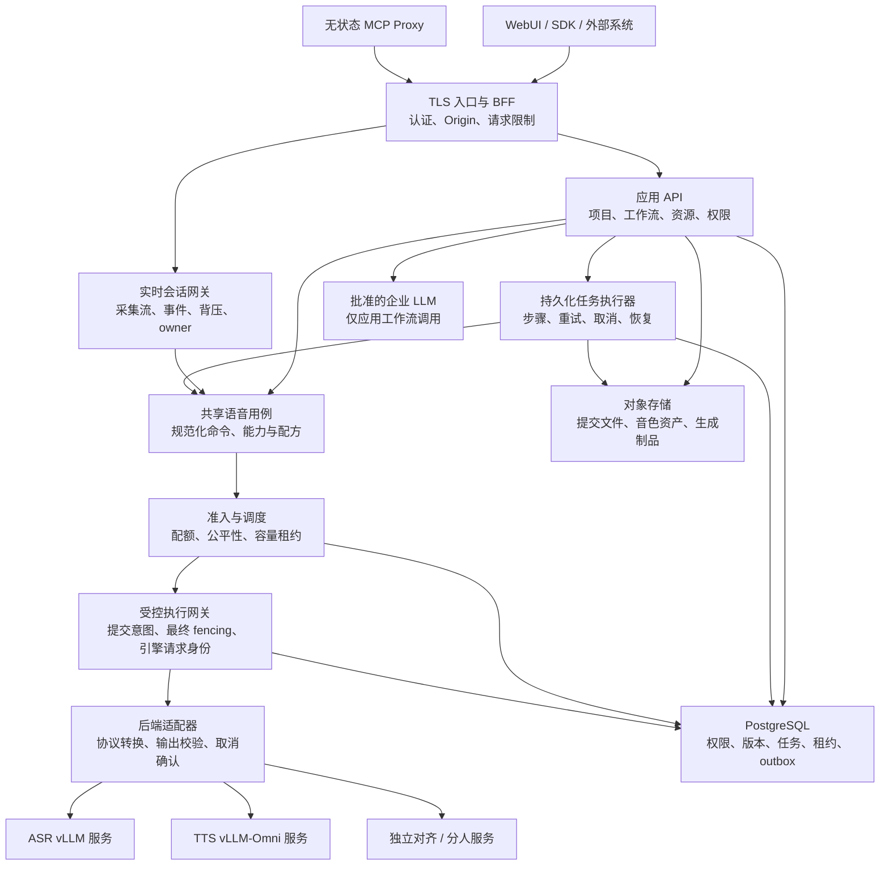
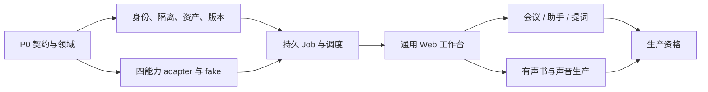

# SpeechNexus 产品与架构设计

SpeechNexus（中文工作名：声枢）是面向企业私有化部署的共享语音平台。平台以 Linux 上的 vLLM / vLLM-Omni 为主要推理后端，通过 WebUI、REST、WebSocket 和 MCP 提供实时与非实时 ASR/TTS，并以场景预设和业务工作流支撑语音助手、会议助手、提词器、实时字幕与有声书制作。

本文定义待评审的产品、接口和架构方案，不代表 SpeechRail 已具备企业功能，也不改变其公共契约。参数值是设计起点，性能数值是验收目标；二者均不属于实测结果。硬件型号、设备数量与并发容量在部署资格验证中确定，不写入公共产品协议。

阅读入口：[产品工作流](#2-产品结构与用户工作流) · [统一接口](#4-统一接口与传输契约) · [实时协议](#5-实时协议与状态机) · [参数预设](#6-场景参数与预设) · [企业权限](#7-企业身份权限与隔离) · [资源调度](#8-硬件无关的资源准入与调度) · [复用矩阵](#14-speechrail-复用矩阵) · [实施计划](#15-分阶段实施计划) · [调用示例](#18-调用示例与阶段产物)

## 1. 已确认需求与设计建议

### 1.1 已由用户确认

- 产品名称为 **SpeechNexus**，由 SpeechRail 的产品经验与架构启发。
- 部署于提供 vLLM 推理能力的 Linux 环境，使用 WebUI。
- 同时提供实时 ASR、非实时 ASR、实时 TTS、非实时 TTS。
- 支持通过参数和场景预设适配语音助手、会议助手、提词器、实时字幕、Audio Book 等业务。
- 本阶段不绑定具体硬件，产出产品、接口、权限、资源调度、复用与分阶段实施方案。

### 1.2 本文作出的设计建议

| 决策 | 建议与理由 |
| --- | --- |
| 部署形态 | 优先企业私有化部署；首个试点服务一个组织的多个工作空间。数据模型与验收从第一天覆盖两个组织的隔离，不把公共 SaaS 运营作为首版范围 |
| 项目关系 | 建立独立的 SpeechNexus 仓库，按模块提取 SpeechRail 的领域代码与测试，不给现有 macOS 产品增加 Linux / 多租户分支 |
| 核心分层 | 应用工作流、语音服务、推理执行分层；LLM 编排和业务记录属于应用层 |
| 接口方向 | REST 采用明确的 OpenAI Audio 兼容子集；企业资源使用 `/v1/nexus/`；实时 ASR 使用声明的 OpenAI 风格子集，TTS 和修订使用 `nexus.*` 扩展 |
| 后端组织 | 首版采用模块化 FastAPI 后端、独立实时网关与任务执行进程、独立推理服务；不预先拆成大量微服务 |
| Web 技术 | React + TypeScript；采用浏览器原生采集与播放能力。业务 API 与 WebUI 同源部署，BFF 管理浏览器登录会话 |
| 数据权威 | PostgreSQL 保存任务、权限、版本、调度租约和业务记录；S3 兼容对象存储保存用户明确提交的文件与生成制品 |
| 队列 | PostgreSQL 持久化任务与事务性 outbox；Redis 仅作为可选加速层，不成为任务、权限或调度租约的唯一真相 |
| 推理环境 | 应用与推理容器独立锁定依赖；在 P0 根据上游支持矩阵确定 Python、vLLM、vLLM-Omni 和设备运行时版本 |
| 产品交付 | 先验证四类基础能力与混合负载，再交付通用工作台，最后逐步完善五类业务工作流 |

以上是可评审建议，不把未确认的实现选择写成用户既定决定。SpeechNexus 当前完成仓库与设计文档初始化；应用、依赖环境、模型与服务部署按后续获授权的实施阶段推进。

### 1.3 目标、非目标与失败条件

目标是让企业员工和系统使用同一套可治理、可追溯的语音能力；场景差异可以配置，模型差异不泄漏到业务代码，运行故障具有明确结束状态和恢复路径。

首版不提供公共 SaaS 计费、多地域容灾、电话交换系统、跨会话实名声纹识别、模型训练平台或通用 Agent 工具市场。助手和纪要可以接入企业批准的 LLM，但语音服务不实现完整 OpenAI Realtime LLM、工具调用或会话记忆协议。

以下情况属于设计失败：后台配音挤占实时字幕；权限只在页面隐藏按钮；后端超时后仍在计算却提前归还资源；把临时识别结果当作不可修改终稿；把 TTS 已生成当作用户已听到；恢复任务重复发布成品；通过改参数宣称获得并不存在的分人、对齐或模型能力。

## 2. 产品结构与用户工作流

### 2.1 用户与工作空间

平台面向普通使用者、内容制作者、审核者、系统集成开发者、组织管理员和平台运维。组织是数据隔离边界，工作空间是协作、配额和策略边界，项目是业务内容与成员授权边界。

WebUI 首先选择工作空间，显示当前可用功能与正在执行的任务。普通用户选择业务场景，填写完成任务必需的信息；模型、推理采样参数、协议和资源详情放在高级选项或管理员页面。功能不可用时显示具体原因及可执行的下一步。

### 2.2 信息架构

| 导航 | 首屏任务 | 主要产物 |
| --- | --- | --- |
| 工作台 | 最近项目、继续任务、开始转写或配音 | 项目与任务入口 |
| 实时工作室 | 选择字幕、会议、助手或提词，选择输入后开始 | 直播文字、会话记录或提词状态 |
| 文件转写 | 上传文件、选择语言与预设、提交 | 可校对转写、可选说话人和字幕文件 |
| 配音与有声书 | 输入文本或导入 TXT、分配声音、生成与试听 | 单段音频、章节、整书制品 |
| 资源库 | 管理自己的项目资源与获授权的共享音色、词典 | 带版本与权限的资产 |
| 任务中心 | 查看排队、执行、失败、取消、续作与导出 | 可追溯任务历史 |
| 管理中心 | 成员、角色、预设、模型服务、配额、审计与运维 | 管理策略与运行事实 |

用户只看到获得授权且具备可用能力的入口。状态至少区分未配置、准备中、可用、容量已满、执行失败和需要用户处理；“服务健康”不能替代“当前模型可执行这个任务”。

### 2.3 五类场景的完整路径

1. **语音助手**：选择批准的助手与声音 → 开始会话 → ASR 预览 → 输入轮次完成 → 应用调用 LLM → 稳定文本送入 TTS → 浏览器播放。是否允许插话由应用控制；取消旧回复时同步停止播放并取消相应 TTS operation。
2. **会议助手**：创建会议并明确采集来源与保存策略 → 实时转写 → 可选匿名分人 → 用户标记要点 → 保存封存文本 → 对明确的来源版本生成纪要 → 校对与导出。没有保留源音频时不承诺会后重新识别整场会议。
3. **提词器**：导入稿件 → 开始跟随 → 通过可修订 ASR 预览匹配稿件位置 → 用户随时暂停、手动定位或继续。稿件位置与识别段身份独立，识别修订不能无界跳转。
4. **实时字幕**：选择输入与字幕显示方式 → 开始 → 立即显示可修订文字 → 定稿后封存 → 可选保存与导出字幕。换行和显示行数不决定模型切段；未定稿与定稿应有可识别的视觉状态。
5. **有声书**：导入 TXT → 自动整理章节并建议角色 → 用户确认稿件和声音 → 按章生成 → 质量检查与试听 → 局部重生成 → 成品导出。保留原文、编辑稿、角色归属和输出版本；局部修改只使依赖它的片段失效。

助手的预算切段不等于用户完成一轮发言，会议的说话人事件也不决定文字定稿。业务应用以自己的轮次与项目状态完成编排。

### 2.4 Web 采集与播放边界

麦克风、文件和外部系统推流是首批输入来源。浏览器麦克风使用 HTTPS；系统声音、共享窗口或标签页声音受浏览器与操作系统支持限制，需建立客户端资格列表，不能承诺与原生 App 等价的全局采集能力。[MDN 采集说明](https://developer.mozilla.org/en-US/docs/Web/API/MediaDevices/getUserMedia)、[屏幕音频限制](https://developer.mozilla.org/en-US/docs/Web/API/MediaDevices/getDisplayMedia)

客户端通过 AudioWorklet 在有界缓冲中转换 PCM，明确申请采集权限；离开功能、停止或会话失败时释放设备。播放器维护自己的播放进度、缓冲和 generation；旧 generation 的迟到音频一律丢弃。页面关闭、休眠、后台节流和网络断开都必须产生可见状态，不能静默假装仍在记录。

## 3. 领域模型与架构边界

### 3.1 核心概念

| 对象 | 语义与权威 |
| --- | --- |
| `Organization` | 组织隔离根；身份源、保留策略和组织级预算 |
| `Workspace` / `Project` | 协作策略、成员与业务资源归属 |
| `Principal` | 人或服务账号；身份和有效权限由服务端解析 |
| `ScenarioProfileRevision` | 不可变场景预设，定义语音策略与允许的覆盖范围 |
| `ModelBindingRevision` | 逻辑模型到已资格验证的后端、制品与执行配置的绑定 |
| `VoiceRevision` / `PronunciationRevision` | 不可变声音与发音资源；拥有独立使用和导出权限 |
| `SpeechCommand` | 一次 ASR 或 TTS 意图的规范化内部输入 |
| `Operation` | 命令的执行身份；HTTP、作业子任务和实时会话都使用它 |
| `RealtimeSession` | 有界、短期、有 owner 的实时连接与资源租约，不承载业务历史 |
| `Job` / `JobStep` | 持久化后台任务及可恢复步骤；一次重试生成新的 attempt |
| `Artifact` | 明确保存的输入或输出制品，带归属、来源、摘要和保留期限 |
| `ExecutionReceipt` | 实际执行的模型、预设、音色、参数、输入输出摘要与结果状态 |
| `ResourcePool` / `AdmissionLease` | 逻辑资源池、容量事实与具有 fencing token 的准入租约 |

识别段 `segment_id`、助手轮次 `turn_id`、有声书片段 `render_unit_id` 和任务 `job_id` 不互相复用。它们通过显式关联字段连接，不能靠数组下标或到达顺序猜测。

### 3.2 结构图



### 3.3 模块职责与进程模型

| 模块 | 拥有 | 不拥有 |
| --- | --- | --- |
| WebUI / BFF | 登录会话、采集、播放、页面工作流 | API key、模型进程、全局权限判定 |
| 应用 API | 项目与文本版本、助手与纪要、有声书编排 | vendor 会话格式、GPU 调度实现 |
| 语音用例 | 命令校验、执行配方、结果与能力语义 | 企业业务历史与 LLM prompt 编排 |
| 实时网关 | 音频时钟、段身份、连接状态、背压 | 音频永久存储、客户端已播放状态 |
| 作业执行器 | durable steps、检查点、重试与产物发布 | 不经准入的模型请求 |
| 调度器 | 配额、池容量、租约、资源释放事实 | 文本内容、声学质量判断 |
| 受控执行网关 | 最终提交入口、submit intent、引擎 request_id、旧 owner 封锁屏障 | 业务角色授予、直接修改项目内容 |
| 后端适配器 | 引擎版本、原生协议、输出验证、abort 与完成证据 | 用户角色和项目成员权限 |
| 推理运行时 | 模型计算、内部 batching、引擎 KV / 显存管理 | 用户身份权威、业务数据库 |

模块化应用可以同镜像分进程运行；首版角色为 `api`、`realtime-gateway`、`job-worker`、`scheduler`。推理引擎使用独立镜像与网络边界。扩容 API 进程不会复制模型；模型副本由资源池部署显式管理。

所有引擎调用经过受控执行网关；adapter 可以是其中的协议转换库，worker 和 API 不持有可绕过网关的引擎网络访问或凭据。vLLM 的内部 batching 与外部企业调度分工：前者优化已获准请求的执行，后者控制谁能进入、何时进入、占用多少预算。

## 4. 统一接口与传输契约

### 4.1 统一的含义

四种能力共享 `SpeechCommand → Admission → Operation → Result / Receipt` 语义，分别通过适合的传输交付。统一不要求把文件上传、持久作业和音频流塞进同一个 HTTP 请求。

```text
SpeechCommand
  kind: asr | tts
  context: 服务端解析的 principal / organization / workspace / project
  input: audio_asset | inline_text | text_asset | live_audio | incremental_text
  profile: profile_id + revision
  binding: model_binding_id + revision
  parameters: 严格类型的场景策略与允许的覆盖
  output: 文本或音频格式、辅助结果、保存策略
  constraints: deadline、可接受的降级、版本前提
```

`context` 不是客户端可自由声明的请求体；客户端提供工作空间与项目引用后，服务端从身份和授权关系构建它。所有字段为 `snake_case`，未知字段、布尔冒充数字、单位错误与未知枚举均拒绝。

### 4.2 入口清单

| 接口 | 用途与返回 |
| --- | --- |
| `GET /v1/models` | 当前主体可见的逻辑模型列表；不暴露私有模型路径 |
| `GET /v1/nexus/capabilities` | 按工作空间、权限和已发布绑定生成的一致能力快照 |
| `GET /v1/nexus/profiles`、`GET /v1/nexus/profiles/{profile_id}/revisions/{revision}` | 列出与读取可用的不可变预设 |
| `POST /v1/audio/transcriptions` | multipart 文件 ASR；成功返回 JSON / text 等声明格式 |
| `POST /v1/audio/speech` | JSON 文本 TTS；返回完整音频或声明的音频流 |
| `POST /v1/nexus/jobs` | 创建持久化 ASR/TTS 作业；返回 `202`、Job 和 Location |
| `GET /v1/nexus/jobs`、`GET /v1/nexus/jobs/{job_id}` | 游标分页与作业状态；包含执行版本与结果引用 |
| `POST /v1/nexus/jobs/{job_id}/cancellations` | 幂等请求取消；进行中为 `202`，已终结为 `200` |
| `POST /v1/nexus/jobs/{job_id}/retries` | 创建关联原任务的新 Job；不复活旧任务或覆盖旧成品 |
| `GET /v1/nexus/jobs/{job_id}/events` | SSE 持久任务事件，支持事件游标续读 |
| `GET /v1/nexus/operations/{operation_id}` | owner 可协调同步执行的状态与 receipt；不承诺重放未保存内容 |
| `POST /v1/nexus/assets`、`GET /v1/nexus/assets/{asset_id}` | 有界流式上传文件与读取元数据；上传结束校验后才为 `ready` |
| `GET /v1/nexus/assets/{asset_id}/content` | 按权限下载内容，支持 Range；不暴露对象存储 key 或服务器路径 |
| `POST /v1/nexus/realtime/sessions` | 验证并固定会话配置，返回 `201`、session_id、连接地址和过期时间 |
| `GET /v1/nexus/realtime/sessions/{session_id}` | owner 可查询会话状态、operation 终态与输入确认位置 |
| `POST /v1/nexus/realtime/sessions/{session_id}/cancellations` | 从 HTTP 请求关闭会话，便于 WS 不可达时停止执行 |
| `WS /v1/realtime?session_id={session_id}` | 实时 ASR 子集与 `nexus.*` 扩展；session_id 不是认证凭据 |
| `GET /v1/nexus/voices`、`GET /v1/nexus/voices/{voice_id}/revisions/{revision}` | 受权限约束的音色目录与版本详情 |

管理与业务 API 使用相同授权中间层：`/v1/nexus/workspaces`、`/projects`、`/memberships`、`/profile-drafts`、`/voice-drafts`、`/pronunciation-sets`、`/quotas`、`/audit-events`。预设和声音的发布通过独立 `publications` 子资源产生不可变 revision；普通 PATCH 只更新草稿。P0 将这些管理资源补成 OpenAPI，不能用未声明的万能管理 RPC 代替。

### 4.3 同步 REST 子集

文件转写支持 `file`、`model`、`language`、`prompt`、`response_format` 及快照声明的 `timestamp_granularities[]`。首版基线格式为 `json`、`text`；`verbose_json`、`srt`、`vtt` 仅在具备相应时间边界证据时开放。`prompt` 作为有界术语提示输入，不允许变成任意 LLM 指令；语言识别为自动时，结果返回实际语言或明确 unknown。

TTS 支持 `model`、`input`、`voice`、`response_format`、`speed`、`instructions`，但是否支持及其取值域以特定绑定和音色的能力快照为准。首版输出基线为 WAV / PCM16，压缩格式按实际 encoder 能力发布。禁止接受参数后静默忽略；如当前流式路径不支持 speed，返回明确的 `unsupported_parameter`。

企业扩展放在 TTS JSON 的 `nexus` 对象、ASR multipart 的 `nexus` JSON 字符串中：`workspace_id`、`project_id`、`profile_id`、`profile_revision`、`voice_revision`、`pronunciation_revision`、`overrides`、`deadline_ms`。服务账号绑定唯一默认工作空间时可省略 workspace；存在歧义则拒绝，不自动选第一个。

普通同步 ASR/TTS 不建立永久业务记录，也不自动保存源文件或音频。服务端先检查输入大小、最大音频时长 / 文本长度和同步执行预算；超出预算返回 `422 async_required`，由客户端明确改为 Job，不在超时后偷偷转成后台作业。已经开始同步执行但超时的请求不保证得到结果，客户端使用相同幂等键协调结果，不能盲目新建相同意图。

OpenAI Audio 的字段与兼容范围分别对照[转写接口](https://developers.openai.com/api/reference/resources/audio/subresources/transcriptions/methods/create)及[语音接口](https://developers.openai.com/api/reference/resources/audio/subresources/speech/methods/create)；SpeechNexus 只承诺本文列出的子集和 P0 冻结的 SDK 兼容测试，不声称支持 OpenAI 的全部模型、格式或事件。

### 4.4 持久化 Job 请求与结果

```json
{
  "kind": "asr",
  "workspace_id": "ws_demo",
  "project_id": "prj_demo",
  "input": {"audio_asset_id": "ast_input"},
  "profile": {"id": "file-accurate", "revision": "1"},
  "model": "asr-quality",
  "overrides": {"asr": {"language": "zh"}},
  "output": {"transcript_format": "json", "save_artifacts": true},
  "constraints": {"max_queue_wait_ms": 600000, "allow_degradation": false}
}
```

ASR `input` 只接受当前主体可读且为 `ready` 的 `audio_asset_id`；TTS `input` 使用 `text` 或 `text_asset_id` 二选一，顶层 `voice` 使用 `{id,revision}`，可选 `pronunciation` 也使用 `{id,revision}`。任务创建时解析 `model` 为 `ModelBindingRevision`，固定所有执行依赖，在响应 `effective_configuration` 中回显；排队期间不随“默认模型”或预设发布而变化。

```json
{
  "id": "job_demo",
  "object": "nexus.job",
  "kind": "asr",
  "status": "queued",
  "request_id": "req_demo",
  "profile": {"id": "file-accurate", "revision": "1"},
  "execution_revision": "exec_demo",
  "progress": {"unit": "audio_ms", "completed": 0, "total": 120000},
  "artifacts": [],
  "error": null
}
```

`status` 取值为 `queued | running | retry_wait | cancelling | succeeded | failed | cancelled | expired`。结果成功后，`artifacts` 包含受控下载引用和 `receipt_id`。输入过期或任务超过执行前队列期限，转为 `expired`；成功结果达到保留期限时仍保留成功终态，只将 artifact 标为过期。

ASR 结果使用统一 `TranscriptDocument`：`id`、`revision`、`language`、`text`、`sample_rate_hz`、`coordinate_space`、`segments`、`auxiliary_status`。segment 包含 `segment_id`、`sample_span`、`text`、`text_revision`，以及可选 `words`、`speaker_assignments`。统一坐标为 `canonical_audio`、24 kHz，原文件解码 / 重采样映射的 revision 进入 receipt；不能把原文件 48 kHz 下标直接填入 sample_span。`auxiliary_status` 分别声明 alignment / diarization 的 `not_requested | pending | complete | failed | unavailable`。不把 segment 平均时长伪造成 word timestamps；未知说话人为 null / unknown。

TTS 制品携带实际 `format`、`sample_rate_hz`、`channels`、`duration_ms`、摘要与 `ExecutionReceipt`。Receipt 区分 requested / effective / observed 参数；只有实际观察到的事实进入 observed，固定 seed 也不承诺跨引擎 bitwise 一致。

### 4.5 能力协商与版本

能力快照包含 `snapshot_id`、`catalog_revision`、`authorization_revision`、生成时间、逻辑模型绑定、参数域、音色 revision、预设 revision、格式、辅助能力及限制。readiness 分别报告配置完整、引擎就绪、质量资格、当前可准入状态；`available` 不等于业务生产质量已通过。

快照按组织、工作空间和有效权限生成，ETag 为 private；鉴权先于 304 判定。读取不触发加载、下载或卸载，不承诺未来槽位。提交时允许提供 `expected_catalog_revision`；不匹配为 `409 configuration_changed`。即使快照仍有效，也必须重新做权限和容量检查。

Profile、voice 和 model binding revision 不可变；升级只影响后续新会话与新 Job。运行中的实时会话不热换模型、采样率或音色版本。队列中的固定版本不可用时明确失败或等待恢复；不得静默漂移到新版本。

### 4.6 错误、分页与幂等

```json
{
  "error": {
    "code": "capacity_unavailable",
    "type": "resource_error",
    "message": "当前实时容量已满，请稍后重试。",
    "param": null,
    "request_id": "req_demo",
    "retryable": true,
    "retry_after_ms": 1000
  }
}
```

| HTTP | 稳定 code 示例 | 重试规则 |
| --- | --- | --- |
| 400 | `invalid_json`、`invalid_audio` | 修正输入；不直接重试 |
| 401 / 403 | `authentication_required` / `permission_denied` | 刷新身份或申请权限；不自动扩大权限 |
| 404 | `resource_not_found` | 未授权对象与不存在对象采用相同外部语义 |
| 409 | `configuration_changed`、`idempotency_conflict`、`operation_in_progress` | 按响应协调版本或查询原意图 |
| 413 | `payload_too_large` | 分段或改用有配额的文件上传 |
| 422 | `unsupported_parameter`、`incompatible_profile`、`async_required` | 改请求；不得静默删参数 |
| 429 | `quota_exceeded`、`queue_limit_exceeded` | 遵循 Retry-After，受总重试期限约束 |
| 503 / 504 | `backend_unavailable`、`capacity_unavailable` / `operation_timeout` | 先协调原意图；只有声明 retryable 才重试 |

列表统一 `data`、`has_more`、`next_cursor`，按 `(created_at,id)` 排序；page limit 为 1–100，默认 50。游标绑定过滤条件与授权作用域，不能跨组织续读。SSE `id` 是持久化 job_event_seq，支持 `Last-Event-ID`；事件保留期结束后返回 `410 event_history_expired`，客户端读取 Job 当前状态，不伪造历史。

创建 Job、创建会话、同步推理和发布资源支持 `Idempotency-Key`。作用域为 `(organization_id, principal_id, operation_family, key)`，服务端原子记录请求摘要和执行身份；相同 key / 同输入返回同一意图，相同 key / 不同输入返回 `409 idempotency_conflict`。进行中 Job 返回 `202` 与原 Job；进行中同步请求返回 `409 operation_in_progress` 与 owner 可查询的 operation 引用。

同步推理的终态协调接口为 `GET /v1/nexus/operations/{operation_id}`。默认仅持久化意图、状态与脱敏 receipt，不保存完整 JSON 转写或音频响应；相同 key 对应操作已完成但内容不可重放时，返回 `409 response_not_replayable` 及成功 receipt，绝不再次执行。需要可靠获取或重放完整结果的调用方使用 Job。流式响应中断同样不自动重播先前音频。

作业内重试窗口默认最多 24 小时，意图与步骤去重记录在所有 attempt 终结后至少保存 7 天；任务仍未终结或取消状态未知时不得删除该记录。用户主动 retry 创建新 Job 与新 key，旧 Job 保持原终态。P0 的故障用例必须覆盖“远端已执行、客户端超时”和“产物写入后进程退出”。

## 5. 实时协议与状态机

### 5.1 创建、认证与连接

创建会话时提交 `workspace_id`、`project_id`、`profile`、`modalities`（`asr`、`tts` 或两者）、逻辑模型和输出需求。REST 先校验身份、授权、参数、版本与能力，固定配置并建立 `created` 会话，30 秒内未连接即过期；此时不占用推理槽。

浏览器使用同源 BFF 的 HttpOnly / Secure 会话 cookie，并校验 WebSocket Origin；SDK 使用 Authorization Bearer。不得把 API key 或 access token 放入 URL、日志、localStorage 或子协议字符串。session_id 仅用于路由，必须再次校验 owner、工作空间和身份会话。

WS 建立后进入 `admitting`，原子申请所需资源；最多等待已批准的实时等待预算。只有分配成功才发送 `session.created` 与 `nexus.session.ready`。失败发送结构化错误并关闭，不让客户端持续发送无人消费的音频。会话状态为：

```text
created → admitting → active → draining → closed
   └───────────────→ failed / expired
```

用户关闭时默认 drain 已接受的段与 TTS，`mode=abort` 则取消全部 operation；超过 drain deadline 进入失败清理。session terminal 记录保存 15 分钟供 owner 协调，实时 PCM 与音频块不因此保留。

### 5.2 标准子集与命名空间

ASR 客户端事件仅支持 `session.update`、`input_audio_buffer.append`、`input_audio_buffer.commit`、`input_audio_buffer.clear`。ASR 服务端事件支持 `session.created`、`session.updated`、`input_audio_buffer.committed`、`input_audio_buffer.cleared`、可用时的 `input_audio_buffer.speech_started` / `input_audio_buffer.speech_stopped`、`conversation.item.input_audio_transcription.delta`、`conversation.item.input_audio_transcription.completed`、`conversation.item.input_audio_transcription.failed` 与 `error`。下文 completed / failed 在明确 ASR 语境中是上述完整名称的简称。[官方事件参考](https://developers.openai.com/api/reference/resources/realtime/server-events)

`session.update` 仅接受本文支持的 transcription 会话字段：`session.type=transcription`、`session.audio.input.format`、`transcription` 与 `turn_detection`；格式和模型在 active 后不可更改。它与 `nexus.session.update` 都映射到同一个配置命令，采用相同 revision 检查与段边界生效规则，禁止并存两套配置状态。P0 将此字段子集机械化为 JSON Schema，不接受未声明的 `response.*`、conversation history 或 tool call 事件。

`commit` 表示关闭当前输入段并请求其最终结果；`clear` 只丢弃尚未提交的输入缓冲，不撤销已接受的 operation。重复 commit 用客户端 event_id 去重，无新音频且不是已知重试时返回 `empty_audio_buffer`。有实际音频但无语音时，最终 transcript 可以为空，reason 为 `no_speech`。

后端 vLLM Realtime 的事件形状、commit 顺序与输入格式不必与公开接口相同；adapter 转换而非透传。[vLLM 实时转写接口](https://docs.vllm.ai/en/stable/serving/online_serving/speech_to_text/#realtime-api)

TTS、可替换预览、辅助结果与资源控制使用下表的 SpeechNexus 扩展；不借用 OpenAI LLM response 事件承载语音合成。

### 5.3 事件字典

| 方向 / event.type | 关键字段与语义 |
| --- | --- |
| S→C `nexus.session.ready` | `session_id`、`stream_epoch`、`effective_configuration`、limits、input credit；可开始发送 |
| C→S `nexus.session.update` | `event_id`、`expected_config_revision`、允许的 overrides；仅段与 TTS utterance 边界生效 |
| S→C `nexus.session.updated` | 新 config revision、effective 值和 `effective_from_segment_id`；无回显即未生效 |
| S→C `nexus.input.ack` | `stream_epoch`、`accepted_through_sample`、`credit_samples`；确认进入会话有界缓冲，不代表已识别或保存 |
| S→C `nexus.transcription.segment_closed` | `operation_id`、`segment_id`、wire sample_span、`reason=vad/client_commit/budget_rollover` |
| S→C `nexus.transcription.hypothesis` | `segment_id`、`revision`、完整 `text`、`sample_span`；替换该段上一个预览 |
| S→C `nexus.transcription.metadata` | `segment_id`、`text_revision`、`metadata_revision`、alignment / diarization status 与结果 |
| C→S `nexus.tts.start` | `event_id`、`utterance_id`、已授权 voice revision、text policy、输出格式；成功后返回 operation_id |
| S→C `nexus.tts.started` | `utterance_id`、`operation_id`、实际音频 descriptor、text credit |
| C→S `nexus.tts.append_text` | `event_id`、`utterance_id`、`text_seq`、`text`；仅接受连续序号 |
| S→C `nexus.tts.text_ack` | 已接受 text_seq 与仍可发送的字符 credit；不表示音频已生成 |
| C→S `nexus.tts.commit_text` | `utterance_id`、`through_text_seq`；冻结指定前缀并允许其进入合成 |
| C→S `nexus.tts.finish_text` | 提交剩余文本并关闭本 utterance 的输入；不关闭 WS |
| C→S `nexus.tts.cancel` | `event_id`、`utterance_id`；请求取消对应计算与发送 |
| S→C `nexus.tts.audio.delta` | `operation_id`、`utterance_id`、`chunk_seq`、`audio`（Base64 PCM）、`start_sample`、`sample_count` |
| S→C `nexus.operation.done` | `operation_id`、`kind`、`status=completed/cancelled/failed`、receipt、error / reason；唯一逻辑终态 |
| S→C `nexus.session.gap` | 输入缺口或新 epoch 的 sample_span / 原因；不得以静音假装没有丢音 |
| C→S `nexus.session.close` | `event_id`、`mode=drain/abort`；停止接收新 operation |
| S→C `nexus.session.closed` | 会话终态及未成功 operation 的引用 |

所有 server event 附 `event_id`、连接内递增 `seq`、`session_id`、`stream_epoch` 和时间；与命令有关的事件附 `client_event_id`，与执行有关的事件附 `operation_id`。客户端 event_id 在会话生命周期内唯一，重复同内容返回原接受结果，重复不同内容拒绝。术语 `S→C` 和 `C→S` 只描述传输方向。

ASR 的正文终态与整个 Operation 终态分层：completed / failed 只确定该 segment 的声学正文；`nexus.operation.done` 确定含 required 辅助工作的整体执行。SDK 用 operation_id / item_id 关联，不能把“正文已定稿”直接当作“所有所需结果已完成”。ASR 取消使用 `nexus.operation.done(cancelled)`；已经发布的正文成功事实保留，不再补发与其矛盾的 transcription.failed。ASR 标准事件必须包含与扩展 segment 对应的 item_id 和 content_index。

同一会话最多有一个活跃 TTS utterance；它可以包含多个冻结文本单元，但各单元必须按文本顺序交付音频。新 start 须等待前一 utterance 的 operation.done；取消后可立即停止浏览器播放，新的计算仍须等待旧租约确认释放。utterance 状态为 `accepting → rendering → draining → completed`，任意未终结状态可进入 `stopping → cancelled/failed`。重复相同 text_seq / 内容去重，不连续序号或同序号不同内容返回冲突。

### 5.4 ASR 修订与辅助结果

同一 segment 的 hypothesis revision 单调递增，事件中的 text 是完整替换值。未得到真实稳定前缀证据时不输出“不可修改”的 delta；OpenAI append-only delta 可以缺席，最终 completed 始终携带完整 transcript。启发式 LocalAgreement、重复预览一致或 token rollback 不构成永久稳定性的证明。

final 不强制保留错误预览前缀。发布 completed 后，该 segment 的声学正文不再修改；会议人工校对或会后重识别创建新的业务 TranscriptDocument revision，并保留来源关系。辅助 alignment / diarization 可以晚于正文终态，但必须携带对应 text_revision；旧正文的辅助结果不能挂到新正文。

required 辅助模型使用父 Operation 的 required steps：先发正文 completed，再等待 required steps 在 auxiliary_deadline_ms 内完成，最后只发布一次 operation.done。required 失败时整体为 failed，正文仍可在失败详情中作为“已完成正文、辅助失败”的结果保留；不能改写此前 completed。best_effort 辅助步骤使用独立子执行身份、资源租约和终态，父 Operation 可先成功，后续 metadata 只更新辅助状态，不反转父终态。会话 drain 必须在有限期限内等待或取消仍存活的子执行。

识别段因预算 rollover 关闭时，服务明确报告原因。应用将多个 segment 归并为业务轮次，不能见到一个 completed 就自动让助手回答。匿名说话人 label 仅在当前会话有效，未知和重叠显式表示，不推断实名或跨会话身份。

### 5.5 TTS 文本与音频的两种流

`text_commit_mode=explicit` 时，服务只合成客户端通过 commit_text / finish_text 冻结的文本；已接受但未冻结的尾部仍不进入模型。`sentence` 模式在规则确认安全句界后冻结，使用有版本的文本规划器；数字、缩写与未完成片段不能因网络 chunk 边界被强行切开。首版不提供按每个 token 独立合成的模式。

`audio_delivery=chunked` 表示生成期间持续交付音频，与 text_commit_mode 独立。下游引擎如按每个文本段独立合成，则能力声明 `acoustic_continuity=segment_independent`；不得声称模型声学状态跨段连续。默认助手按稳定句子提交，有声书使用较长、经过验证的叙述单元。[vLLM-Omni 流式接口](https://docs.vllm.ai/projects/vllm-omni/en/stable/serving/speech_api/#streaming-text-input-websocket)

音频 chunk_seq 连续，start_sample / sample_count 描述该 utterance 输出时间轴。发送 complete 表示所有音频已生成并交给传输层，不能证明浏览器收到全部字节或播放结束。业务 UI 分别显示生成、缓冲与播放状态。

### 5.6 格式、背压、断线与取消

实时 wire 基线为单声道 PCM16 LE、24 kHz；adapter 在受控边界重采样到模型输入规格。TTS 会话握手返回实际输出 descriptor，客户端按 descriptor 播放。格式和采样率在会话内不可变化。时间范围使用 wire sample clock 的半开区间 `[start,end)`，不能混入服务端墙钟或模型 16 kHz 下标。

初始限制：输入 chunk 建议 20–100 ms、上限 250 ms；单 JSON 消息上限 64 KiB；未消费实时输入 credit 上限 2 秒；客户端网络缓冲上限 5 秒；单个 ASR 段上限由预设与绑定共同约束且不超过 30 秒。Base64 和 JSON 开销计入网络预算。辅助模型状态必须有独立的有界内存声明，不能借会议长期连接累计整场 PCM。

超过 credit 继续发送时，先报告背压，持续违规关闭连接；不静默丢 PCM。允许合并过时的预览计算请求，但必须保留尚未处理的已接受 PCM。慢速接收 TTS 的客户端触发有界音频积压，超过协商上限取消 operation；不可无限生成并堆积。

WS 断开即停止接收新操作，取消实时计算并回收 owner，记录明确的断开终态。首版不提供透明音频重放和无缝恢复：重连创建新 session / epoch，应用保留已确认文字，显示输入缺口；不得自动重播旧 TTS。客户端心跳建议 10 秒，30 秒失联进入断开清理；会话最长 8 小时，续接必须建立新 epoch。

取消请求得到接受不等于算力释放。只有 adapter 确认执行结束、abort 完成或受控进程已退出后，才归还资源。取消后禁止向客户端继续发布该 operation 的音频或结果；迟到 vendor 输出只作清理，不写业务状态。每个已接受 operation 在服务端恰有一个逻辑终态，网络事件只承诺可去重交付；连接中断时通过 GET 协调，不能承诺客户端恰收一次。

## 6. 场景参数与预设

### 6.1 四类配置分离

| 配置 | 内容 | 谁能改变 |
| --- | --- | --- |
| 业务工作流 | 助手轮次、提词匹配、会议保存、角色与章节 | 应用产品与相应项目用户 |
| 场景预设 | ASR 结束与复核策略、TTS 文本规划、允许的参数覆盖、所需能力 | 预设维护者编辑，获得发布权限者发布 |
| 模型绑定 | 引擎、权重 revision、精度、真实参数域、辅助能力与资格记录 | 模型服务管理员 |
| 治理策略 | 并发、配额、保留、队列期限、运行池与 SLA 级别 | 组织 / 平台授权管理员 |

用户能调整的参数不能控制组织身份、调度优先级、资源池上限、引擎网络地址、模型文件路径或权限。预设名不能成为绕过资源规则的通行证。

### 6.2 参数字典

| 字段 | 类型 / 初始范围 | 语义与约束 |
| --- | --- | --- |
| `asr.language` | `auto` 或支持的语言 ID | 显式语言必须被绑定支持；自动检测可返回 unknown |
| `asr.preview_interval_ms` | integer，100–5000 | 预览调度周期；不代表服务保证每周期都有新结果 |
| `asr.max_segment_ms` | integer，1000–30000 | 有界识别段的预算；必须不小于 preview_interval_ms |
| `asr.finalization` | `full_segment / streaming_finalize` | 完整段复核或流式结束定稿；两者终稿均不强制保留错误预览 |
| `asr.final_deadline_ms` | integer，100–10000 | 从段关闭到正文 final 的期限，取服务端允许范围；required 辅助步骤使用独立期限 |
| `asr.auxiliary_deadline_ms` | integer，100–10000 | 正文定稿后等待 required 辅助步骤的上限；默认 5000，不与正文 final 期限混淆 |
| `asr.rollback_tokens` | integer，0–32 | 适配器支持时的重解码启发式；不支持则拒绝覆盖，不伪造执行 |
| `asr.turn_detection.mode` | `server_vad / manual` | 自动关闭识别段或由客户端 commit；不能决定助手业务轮次 |
| `asr.turn_detection.silence_duration_ms` | integer，200–3000 | 仅 server_vad 有效；与场景结束策略共同决定切段 |
| `asr.vocabulary_set_revision` | 不可变资源引用或 null | 有界术语提示；不提供强制替换未识别文本的保证 |
| `asr.alignment` | `off / required / best_effort` | 是否要求独立时间对齐；required 无能力就拒绝 |
| `asr.diarization` | `off / required / best_effort` | 匿名分人，绑定独立声明最大人数、重叠支持与延迟 |
| `tts.voice_id / voice_revision` | 资源引用 | 提交时固定版本，并验证使用权限和模型兼容性 |
| `tts.language` | 支持的语言或 auto | 与音色和模型的能力域求交 |
| `tts.text_commit_mode` | `explicit / sentence` | 客户端冻结文本或规划器按安全句界冻结 |
| `tts.audio_delivery` | `complete / chunked` | 完整结果或音频分块，与文本提交模式独立 |
| `tts.speed` | number；建议 UI 0.8–1.2 | 允许范围来自具体绑定；不能只改回显而不改输出 |
| `tts.instructions` | 有界 string 或 null | 仅绑定声明支持时开放；禁止把整段业务 prompt 默认送入声音模型 |
| `tts.pronunciation_revision` | 资源引用或 null | 固定的发音词典；保留原始文本与声学文本摘要 |
| `tts.seed` | integer 或 null | 只有后端声明支持时生效；不承诺跨版本相同波形 |
| `tts.planner.max_chars` | integer；建议 40–400 | 管理员预设中的分段预算，受绑定支持范围限制 |
| `tts.planner.max_wait_ms` | integer，100–3000 | sentence 模式等待完整句界的最大时间；到期不强制合成不安全尾部 |
| `output.transcript_format` | `json / text / verbose_json / srt / vtt` | 后三者按实际辅助能力开放 |
| `output.audio_format` | `wav / pcm` 基线 | 其他格式经 encoder 和客户端资格验证后发布 |
| `output.save_artifacts` | boolean | 普通同步 / 实时默认 false，Job 固定 true；受数据策略约束 |

不引入多个含义相似的 alias。ASR 嵌套 VAD 字段在 OpenAI 投影中映射到官方 turn_detection 结构；统一内部命令只保留一种语义。

### 6.3 初始预设矩阵

下列值来自 SpeechRail 的场景经验与本方案的起始选择，不是 Linux / vLLM 最优参数。`full_segment` 只有绑定能够在有界段上执行完整复核时才可用。

| profile_id | 预览 ms | 静音 ms | 段长上限 ms | ASR finalization | TTS 策略 | 默认执行类别 |
| --- | --- | --- | --- | --- | --- | --- |
| `assistant-turn` | 800 | 1200 | 20000 | full_segment | 稳定文本显式提交，音频分块 | realtime |
| `assistant-duplex` | 600 | 900 | 20000 | full_segment | 显式提交，分块，应用控制插话 | realtime |
| `meeting-accurate` | 1000 | 900 | 20000 | full_segment | 默认不启用 TTS | realtime |
| `caption-live` | 500 | 400 | 8000 | full_segment | 默认不启用 TTS | realtime |
| `teleprompter-follow` | 400 | 400 | 8000 | streaming_finalize | 默认不启用 TTS | realtime |
| `file-accurate` | 不请求预览 | 文件分段策略 | 30000 | full_segment | 不启用 | batch |
| `speech-interactive` | 不启用 ASR | — | — | — | 显式或安全句界提交，分块，较短单元 | interactive / realtime |
| `audiobook-consistent` | 不启用 ASR | — | — | — | 显式提交，较长叙述单元，完整制品 | batch |

meeting-accurate 的 alignment 默认 best_effort、diarization 默认 off；用户选择“区分说话人”后切换到显式的 required 或 best_effort 派生预设，不能因缺模型悄悄变回单人。caption-live 默认不等待分人；teleprompter-follow 只将 hypothesis 用于位置匹配，不用它改写稿件。audiobook-consistent 默认固定 voice、词典、模型与 planner revision，并要求生产质量资格。

预设不携带任意 `priority` 数字。执行类别是策略建议，最终类别由入口、授权和治理规则决定：不能在 Job 中提交 assistant profile 就获得实时资源保留；不适配入口的 profile 直接拒绝。

### 6.4 合并、验证与发布规则

解析顺序为绑定默认值 → 已发布预设值 → 当前用户获准的 overrides。组织 / 工作空间治理不是可覆盖的默认值，而是对最终请求的硬约束。输入超出允许范围时拒绝并说明有效范围，不静默 clamp；唯一自动收紧的是协商规则明确允许的资源段预算：

```text
effective_max_segment_ms = min(
  requested_max_segment_ms,
  model_binding.max_segment_ms,
  requested_auxiliary_capabilities.max_segment_ms,
  workspace_policy.max_segment_ms
)
```

如果调用方设定 `constraints.require_exact_parameters=true`，任何自动收紧都返回 422；否则在 effective_configuration 中返回实际值和原因。hard deadline 与所需能力无法同时满足时拒绝，不给出看似有效的组合。

Profile revision 包含 schema_version、required_capabilities、parameters、override_allowlist、override_ranges、SLO 引用与验证记录。发布前执行 schema、能力组合、负样本与质量对照检查；可发布为 experimental 或 production。生产预设只绑定具备对应质量资格的模型 / 音色。回滚只是将默认指针切回旧 revision，不修改已固定的作业。

## 7. 企业身份、权限与隔离

### 7.1 身份与访问边界

人使用 OIDC Authorization Code + PKCE 登录企业身份源；BFF 保存服务端会话，浏览器不持久化 access token。cookie 使用 HttpOnly / Secure / SameSite=Lax，修改请求校验 CSRF token 与 Origin，WS 校验 Origin。核对 issuer、audience、签名、nonce、state、到期时间和回调地址；使用组织 allowlist 与邀请 / 已批准的 IdP group 映射决定加入权限，不能仅凭邮箱域自动成为组织管理员。[OIDC Core](https://openid.net/specs/openid-connect-core-1_0.html)、[OAuth 2.0 安全规范](https://www.rfc-editor.org/rfc/rfc9700.html)

系统集成使用工作空间级服务账号和可撤销凭据；凭据仅创建时展示一次，服务器只保留带服务器密钥的摘要、前缀和作用域。API key 与 OIDC token 不可互换。外部 LLM、对象存储和模型服务凭据保存在部署 Secret 管理系统，不能进入浏览器、Job JSON、命令行参数或日志。

### 7.2 角色与能力矩阵

权限由 `principal × role × scope × resource ACL × policy` 求交；拒绝规则优先。一个人可以叠加多个角色，管理角色不天然拥有业务内容读取权。

| 角色 | 作用域 | 主要允许 | 默认不允许 |
| --- | --- | --- | --- |
| `platform_operator` | 部署 | 运行状态、模型服务、资源池、备份任务与脱敏诊断 | 读取组织音频、转写、声音样本或代替用户调用 |
| `organization_admin` | 组织 | 身份源、成员、工作空间、组织预算、保留策略 | 自动读取所有项目内容、绕过审核发布音色 |
| `workspace_admin` | 工作空间 | 成员映射、预设默认、工作空间配额和角色分配 | 超出组织预算、无内容角色时读取项目正文 |
| `producer` | 项目 / 资源 | 读取获授权草稿、上传、转写、合成、编辑、取消自己任务 | 改权限、改引擎、发布生产音色、取消别人任务 |
| `reviewer` | 项目 / 资源 | 读取待审内容、评论、通过或拒绝发布 | 更改源音频、修改计算预算、读取未授权项目 |
| `viewer` | 项目 / 资源 | 读取与下载已发布且获授权的结果 | 读取草稿、源文件、克隆样本或发起推理 |
| 服务账号 | 指定工作空间 / 项目 | scopes 明确列出的操作 | 继承创建者的全部权限、跨项目猜测对象 ID |

另设独立能力 `jobs.cancel_any`、`content.export`、`voice.use`、`voice.export_source`、`voice.publish`、`profile.publish`、`content.delete`、`audit.read`。生产者可以使用被共享的声音合成，不代表可以下载声音参考样本或预计算特征。组织可以启用双人审核，启用后创建者不得审核自己的生产音色发布。

### 7.3 数据层与执行层强制隔离

- 所有业务表和对象元数据携带 organization_id / workspace_id，项目内容再携带 project_id；跨表引用使用包含组织 / 工作空间的复合外键，防止串租户引用。
- API 对每个对象做授权，PostgreSQL RLS 对组织、工作空间及成员作用域提供第二层约束。业务数据库角色不能是 owner、superuser 或 BYPASSRLS；适用表使用 FORCE RLS，连接池每个事务 SET LOCAL 授权上下文，事务结束自动清理。
- RLS 的上下文只由可信应用设置，数据库连接不暴露给客户端。自定义 session variable 本身不是身份认证；不能把可任意执行 SQL 的连接交给用户后再依赖变量隔离。平台和迁移角色与业务访问分离。[PostgreSQL RLS](https://www.postgresql.org/docs/current/ddl-rowsecurity.html)
- 对象存储前缀只能辅助组织，不能代替 ACL。下载经应用鉴权，上传只能生成服务器分配的 asset_id；文件名与对象 key 不由用户决定。
- Job 出队、执行步骤和发布结果时重新检查项目、资源与权限。队列 payload 仅携带受控 ID 与不可变配置摘要，不承认其中自行声明的身份。
- 音色注册表由 SpeechNexus 管理，backend_voice_handle 仅为私有映射。普通用户不能调用 vLLM-Omni 的原生上传 / 删除接口；上游注册表自身没有每用户所有权保证。[上游音色存储边界](https://docs.vllm.ai/projects/vllm-omni/en/stable/serving/speech_api/#voices-endpoint)
- 共享缓存必须带组织和权限作用域；默认关闭跨组织 prompt prefix / 音色缓存复用。模型内部请求状态和参考声音不得串流到另一用户。

### 7.4 权限撤销与审计

成员移除、服务账号禁用、声音使用授权撤销在权威数据库提交后阻止新准入与新产物发布。撤销修改、authorization_revision 增长与通知 outbox 在同一事务提交；接受新 Job、最终提交执行意图和 Artifact 发布均在数据库裁决事务中核对当前授权 revision，而非依赖先查后写。

发布与撤销按相同授权版本行锁或等价的可串行化冲突裁决：撤销先提交则后续发布失败；发布先提交则保留该次成功事实，但撤销后的读取仍重新鉴权。不能把过期 worker 的“之前查过有权限”作为提交依据。

主动通知网关与 worker 用于尽快停止存量流；已有实时会话和正在下载的内容以最长 30 秒授权租期兜底，租期到期无法刷新则 fail-closed。停止发 credit、停止外发后续字节并取消计算；后台任务在下一步骤边界停止。已经交付到浏览器或外部调用方的数据无法追回。该 30 秒是存量流的停止上界，不是允许新 Job 或新 Artifact 在撤销后继续提交的宽限期。

审计记录主体、作用域、动作、对象 ID、决策、策略 revision、request_id、时间与必要的变更摘要，不保存音频、完整转写、完整 prompt 或密钥。读取源音频、声音源、内容导出、权限调整、预设发布、管理员 break-glass 都是审计事件。break-glass 需要明确理由、限时授权与组织批准，不以 platform_operator 默认角色隐式开启。

## 8. 硬件无关的资源准入与调度

### 8.1 逻辑资源池与容量声明

资源池按能力与服务类别组织，例如 `asr-realtime`、`tts-realtime`、`asr-batch`、`tts-batch`、`auxiliary`；它们是逻辑隔离边界，部署时可以映射到同机或不同节点。映射到同一物理设备的池必须共享父级物理预算，不能各自把整卡容量算作可用。

已有 vLLM 接入分为 managed 和 external：managed 要求平台能够控制入口、统计整个池预算并执行取消 / 封锁屏障，是首版生产资源治理的默认前提；external 仅能限制 SpeechNexus 自己的在途请求，不能证明服务中其他调用方的占用。没有提供隔离容量与取消证据的 external 绑定只能发布为 best_effort / experimental，不能沿用 managed 的实时 SLO、全局容量或故障接管承诺。

每个 `ModelBindingRevision` 关联一份 `CapacityManifest`：支持任务与格式、模型 / 引擎 revision、部署拓扑引用、常驻预算、每 active slot 的增量资源上界、最大 active slots、预填充与输出速率限制、最大段预算、取消方式、最坏非抢占执行时间、资格报告与有效期。

资源向量至少包含 engine active slots、设备内存、CPU 解码额度、主机 PCM buffer、输入 / 输出带宽和对象存储额度。常驻模型内存在引擎级只计一次，不为每个请求重复收费；请求只申请增量预算。多阶段 TTS 的 Talker、Code2Wav 及 connector 预算作为完整执行图申报。

容量未知、物理父预算缺失或资格不匹配时，该绑定不接生产实时负载；受控实验可以显式使用单槽，但不能因此宣称生产并发。更换引擎、精度、模型、重要 stage 配置或驱动组合会使对应容量资格失效，需重新验证。公共 API 只暴露逻辑能力与可用性，不写死 GPU 名称或数量。

### 8.2 三层准入

```text
身份与资源授权
  → 参数 / 版本 / 能力验证
  → 组织、工作空间、主体的请求与累计额度
  → 队列期限与长度限制
  → 父物理预算 + 引擎 / stage 资源原子预留
  → adapter 提交执行
  → 确认完成 / 取消
  → 结果发布与用量结算
  → 资源释放
```

配额包括活跃实时会话、在途同步请求、后台并发、排队数量、每日输入音频时长、TTS 字符 / 输出时长、存储与导出速率。请求中的 max_queue_wait_ms 只能收紧管理策略；普通用户不能增大其配额。

实时累计额度与缓冲 credit 分开管理。每次发放音频 / 文本 credit 前，以原子事务在组织、工作空间、主体三层预留其可接受的累计输入额度；未使用 credit 在到期 / 关闭后释放，已经接受的输入从预留转为累计使用，不能因缓冲已消费或预览计算结束而退还。长连接拿不到新额度时停止发 credit，发送 `quota_exceeded` 与剩余已接受工作的处理方式；不接受超额输入，有限 drain 后关闭。

计量固定为：ASR input_audio_ms 按验证后 accepted 的 canonical samples 计算；TTS input_text_codepoints 按首次冻结的文本区间计算，未冻结尾部撤销不计入；TTS output_audio_ms 按各 attempt 实际 generated 的 PCM samples 计算，包含取消前已生成但未交付的音频；delivered / played 只作独立诊断，不用于退还生成额度。重复 event、重复 commit 和重试回放不重复记同一输入区间，重试实际重新生成的输出仍是资源消耗。

冻结每个 TTS 单元后、进入引擎前预留其可强制约束的最大输出预算。这个上界来自已验证的 token / codec frame / 样本限制，不能只靠“生成太多后再断连接”。完成后按实际样本结算并释放余量；没有可强制输出上界的绑定声明 `hard_output_quota=false`，组织要求硬输出时长限制时不得使用它。累计额度按组织配置的日界线结算，跨日预留不能在两个日账本重复消费。

双工会话需要 ASR 和 TTS 能力时，一次原子预留所需的资源组合或会话配额；不得持有 ASR 等待 TTS，再让另一会话持有 TTS 等待 ASR。配额预留和实际 active compute slot 分离：活跃会话可保有已批准的实时容量承诺，计算片段按预算分派；承诺总量不超过已验证容量。

### 8.3 调度算法与公平性

1. 首先按 profile 与身份策略选择 `realtime`、`interactive` 或 `batch` 类别，再选兼容的模型绑定与资源池。
2. realtime 有明确保留容量，interactive 有有限等待预算，batch 使用其自有配额与剩余可用资源。保留比例由部署资格报告设置，不在业务预设中硬编码。
3. 同一类别内先按组织 / 工作空间做加权 deficit round robin，再按主体与任务估算成本公平分派；realtime 在自己的保留范围内按最近 deadline 优先，batch 在成本公平下使用 FIFO + aging。
4. ASR 成本起点为音频时长，TTS 起点为文本长度 / 预估音频时长，辅助模型单独计价；执行反馈校准成本，不把 vLLM token 数作为唯一的跨 ASR/TTS公平单位。
5. 单任务不能把整本书一次性占满引擎。文件转写按有界音频单元、有声书按 render_unit 排队；单元结束是公平轮转与取消的检查点。
6. 默认不让 batch 借用 realtime 保留容量。以后开放借用时，必须有已测的最坏非抢占执行时间，且不超过实时剩余等待预算；没有证据就保持关闭。已经进入引擎的 batch 不能被假装瞬时抢占。
7. 各类别有自己的队列上限、最长等待和最小服务份额；不能用无限排队掩盖超载，也不能把不断 aging 的 batch 提升为突破 realtime 保留的最高优先级。

一次批任务重试仍参与原主体的资源消耗与限速，不因生成新的 attempt 逃逸公平性。超限明确返回 quota / capacity / queue 错误；只有调用方与预设都允许时才使用显式的降级绑定，并将降级原因和实际 revision 写入 receipt。

### 8.4 多进程一致性与 fencing

每个 pool 的调度 owner 使用 PostgreSQL 租约与递增 fencing token。容量预留在事务中原子完成，lease 绑定 operation、engine 与 token；所有回写都验证 attempt 与 fencing。API 副本不能使用各自内存中的 semaphore 充当全局准入。

`ExecutionControlPort` 的权威实现是每个 engine / stage 的受控 execution gateway，它独占该引擎网络入口与凭据。gateway 将“核验当前 reservation、attempt、授权 revision 与 token → 写入唯一 submit intent → 放行本次提交”串行化；先将状态记为 submitting 并占住预算，再向引擎发送。每个 intent 有可查询的 engine request_id 或确定的引擎侧关联证据；submitting 与传输结果未知都仍占用资源，不能当作未开始而免费重试。

数据库 token 不能撤回已经发到不支持 fencing 的引擎请求，也不能单独阻止旧进程在检查后暂停、恢复后迟到发送。因此更换 execution gateway owner 前，必须先由旧 gateway 完成拒绝旧 token 的提交屏障，或确认旧入口进程已退出 / 被隔离；随后协调全部在途与 submitting 请求。若无法逐请求确认，则 drain / 重建受控引擎实例并使其旧连接失效，受影响请求显式失败。只有这个屏障与执行结束证据都成立，才能回收旧容量并启用新 owner。

网关或 worker 心跳失效后，调度器不能仅凭 TTL 到期回收算力：先由 execution gateway 通过 adapter 查询 / abort 对应执行，并拒绝过期 token 的新提交与结果发布。若无法证明旧提交入口已经封锁，或引擎不支持细粒度确认，隔离该 engine / stage 的容量，直到完成上述屏障与在途协调；该池暂不可用也不能重复分配仍被旧计算占用的资源。只在 worker 的库函数里提交前查询 PG 不满足此要求。

资源租约状态为 `reserved → executing → stopping → released`，不确定时进入 `quarantined`。`quarantined` 不是可重新调度的空闲状态。DB / 调度协调不可用时停止新准入，当前已执行工作按现有有限租期收尾；不能切到未协调的本地计数器继续接单。

### 8.5 准入与引擎内部 batching 的关系

企业队列只把已批准、受总量上限控制的请求送入引擎，引擎内部等候也计入 active / deadline 预算。不得同时在平台与 vLLM 各排无限长队列。模型跨副本路由在提交前完成，实时会话固定 owner；引擎故障后实时会话明确失败并新建 epoch，后台任务可以在取消旧 attempt 并完成协调后重试。

## 9. 持久化、任务恢复与数据生命周期

### 9.1 逻辑数据模型

| 数据集合 | 关键内容与约束 |
| --- | --- |
| organizations / workspaces / projects | 隔离、策略版本、生命周期；复合引用保持归属一致 |
| principals / memberships / grants | 人、服务账号、角色、对象 ACL、撤销 revision |
| profile_revisions / model_bindings / capacity_manifests | 不可变配置、验证记录与有效资格 |
| voice_revisions / pronunciation_revisions | 声音与词典版本、批准状态、来源授权和后端映射 |
| assets / artifacts / artifact_dependencies | 内容归属、内容摘要、状态、存储引用、依赖和保留时间 |
| jobs / job_steps / attempts | 用户意图、检查点、执行 fencing、终态与错误 |
| operations / receipts | 执行身份、观察到的版本 / 参数、短期同步结果与去重信息 |
| realtime_sessions / terminal_operations | session owner、epoch、授权租期与短期终态协调；不存 PCM |
| transcript_documents / transcript_revisions | 声学正文、人工校对稿、辅助结果版本与来源 |
| books / chapters / render_units / casting_revisions | 有声书项目、文本 / 角色依赖与局部失效 |
| quota_reservations / usage_ledger / admission_leases | 原子资源预留、实际用量、幂等结算与池容量 |
| idempotency_records / outbox / job_events / audit_events | 意图去重、可靠派发、用户任务事件和安全审计 |

主键为不可预测 ID，业务时间统一 UTC timestamptz，显示使用用户时区。外键列与组织 / 项目分页、队列 claim 路径建立适当索引；DDL、RLS 与索引由新项目 P0/P1 迁移明确实现，本文不操作任何数据库。

### 9.2 作业与产物发布

Job 创建与 outbox 记录在同一数据库事务中提交；outbox 可能重复投递，worker 按 JobStep 的唯一执行意图和 attempt fencing 去重。正常状态迁移为：

```text
queued → running → succeeded
             ├→ retry_wait → queued
             ├→ cancelling → cancelled
             └→ failed
queued / retry_wait → cancelled / expired
```

取消到达与成功提交竞争时，以数据库中先成功提交的合法状态转换为准：已经 succeeded 的任务不变为 cancelled；已经进入 cancelling 的任务不能发布新成品。取消请求响应回显实际终态，不能先显示“已取消”后又出现新完成结果。

每个步骤先写 intent，再执行；输出先写入带 attempt 的私有 staging 对象，验证长度、格式与摘要后，在单个事务中核对最新授权 revision、Job 取消状态和 attempt fencing，再插入 Artifact 引用、步骤成功和 outbox。与撤销竞争按 §7.4 的同一数据库边界裁决。读者只能看到已提交 Artifact，不能看到 staging。失败的 staging 由有作用域的 GC 清理。断电发生在对象写入与数据库提交之间时，恢复只认已提交引用，孤儿对象不得被推断为任务成功。

系统提供 at-least-once 执行与幂等发布，不声称外部推理天然 exactly-once。仅在未向客户端交付实时输出且操作可安全重试、旧 attempt 已协调结束时自动重试；已产生部分实时音频的请求不后台自动重播。辅助步骤失败不覆盖成功正文，按 required / best_effort 策略决定整个 Job 是否成功。

失败分类包括输入 / 权限 / 参数永久错误、可重试后端错误、容量等待、执行超时、取消状态未知。自动重试默认最多 3 次、指数退避并加入 jitter，总自动重试窗口不超过 24 小时；永久错误不重试。quarantined engine 上的未知执行先协调，不直接换副本再跑。

资源用量以 `(operation_id, attempt_id, meter_kind)` 幂等记账，包含实际失败 / 重试消耗；用户结果统计与基础设施消耗分别展示。排队时只预留预算，最终按实际用量结算与释放未用额度。没有实际执行证据时状态为待协调，不能伪造 0 成本或重复扣减。

### 9.3 保存与删除默认值

下面是建议的产品默认值，组织可以在政策允许范围内调整；不是对法规的符合性声明。延长保存只影响尚未删除的内容，不能恢复从未保存的音频。

| 数据 | 默认行为 / 保留建议 |
| --- | --- |
| 实时 PCM / TTS 网络音频块 | 只在受限内存缓冲；不永久保存，不进入日志和调试导出 |
| 普通同步请求与结果 | 不保存原始音频或完整转写；幂等窗口仅保存意图与脱敏 receipt，不保证内容可重放 |
| 文件转写输入 | 用户上传即明确保存，默认 7 天；创建 Job 时检查与任务期限相容 |
| 普通生成音频 | 默认 30 天；显式保存到项目的成品按项目保留策略 |
| 会话转写 / 项目文本 | 默认仅经用户选择保存；选定工作空间自动保存策略时，开始前明确提示；建议 90 天 |
| 有声书原稿与成品 | 随项目保存，显式归档或删除；不因为普通 Job TTL 删除仍被项目引用的成品 |
| 声音参考材料 / 特征 | 仅创建声音流程明确提交后保存，随 voice revision 生命周期与授权管理 |
| 审计 | 建议 180 天，尽量只保存元数据；备份恢复后仍执行到期与删除规则 |
| Job 事件与终态元数据 | 建议 30 天；幂等记录至少符合 §4.6，活动意图不按短 TTL 删除 |
| 实时终态协调元数据 | 会话终结后 15 分钟；不构成历史音频恢复能力 |

使用中的输入、不可变声音 revision 和待发布成品有有界引用租约，防止 TTL 在执行中途删除依赖；租约不能无限延长过期数据。创建时发现输入有效期不足，应拒绝或在有权限时显式延长引用保留。合法删除和授权撤销仍优先于任务，相关任务取消并清理依赖。

删除覆盖数据库、对象存储、缓存、搜索投影和旧 staging；备份按明确周期自然淘汰，并保存最小删除账本，恢复后在对外服务前重新应用删除与撤销。引用尚存时先呈现阻止删除的依赖，不能悄悄破坏其他项目。每租户内容摘要只在该作用域去重，禁止通过跨组织哈希命中泄漏文件存在性。

### 9.4 上传与网络边界

文件以有界流上传至私有 staging，检查 magic bytes、MIME、大小、解码后时长和采样参数后转为 ready；解码器运行在无网络、有限 CPU / 内存 / 时间的受限进程。只接受 allowlist 格式，拒绝归档炸弹、未知序列化权重与用户提供的本地路径。首版不提供任意远程 URL 导入、动态下载模型或外部回调 URL。

模型与 tokenizer / codec 文件在部署准备阶段离线准备，核对来源、revision、文件集与摘要后发布绑定。voice 特征采用经过校验的安全格式与已批准生成流程，不允许上传任意 pickle / 代码。声音素材使用授权与同意作为资源元数据记录，访问和删除沿用租户权限。

## 10. 模型后端与执行接口

### 10.1 服务中立的适配端口

| Port | 必须表达的行为 |
| --- | --- |
| `CapabilityProvider` | 无副作用读取绑定、readiness、参数域与执行限制 |
| `BatchAsrPort` | 对有界音频单元识别，返回正文、语言、真实辅助证据与 receipt |
| `StreamingAsrPort` | 开启 / 追加 / 关闭有界段、可替换预览、最终结果与显式取消 |
| `TtsPort` | 执行完整或冻结文本单元，报告真实音频 descriptor 与生成结果 |
| `StreamingTtsPort` | 文本提交与音频流分别控制、背压、取消和结束确认 |
| `AlignmentPort` / `DiarizationPort` | 与 source text / audio revision 绑定的独立辅助结果 |
| `ExecutionControlPort` | 由受控 execution gateway 实现 submit、status、abort、最终提交屏障、completion evidence、fencing / attempt 对齐 |

端口接受已经授权和规范化的命令，不接受原始 HTTP 请求、用户可控引擎 URL 或 bearer token。vendor 输出在 adapter 边界验证；未知字段、错误格式、无终态、空音频、样本数不符和跨 attempt 结果不能直接成为成功结果。

### 10.2 初始后端路线

ASR 首先验证 Qwen3-ASR 的 vLLM 路径，分别验证文件与实时模型 / 架构；官方列表中的实时支持不意味着每个 ASR checkpoint 都具备同样的流式能力。TTS 首先验证 vLLM-Omni + Qwen3-TTS，CustomVoice、Base、VoiceDesign 分别对应正确 checkpoint 与能力；每个实例运行的模型和 stage 配置由绑定明确声明。[vLLM 模型列表](https://docs.vllm.ai/en/stable/models/supported_models/)、[vLLM-Omni TTS 示例](https://docs.vllm.ai/projects/vllm-omni/en/stable/user_guide/examples/online_serving/text_to_speech/)

时间对齐、分人和 VAD 是独立能力；它们可以使用经过资格验证的 GPU / CPU 运行时，不强迫所有模型都经 vLLM 执行。SpeechRail 的 MLX、CoreML、Swift worker 和模型制品不能直接充当 Linux 实现。是否增加 Whisper 等后端由准确率、语言和延迟证据决定，不把多后端数量当作首版目标。

### 10.3 运行与发布

绑定的状态为 `registered → preparing → validating → ready → draining → retired`，失败为 `unavailable`。准备模型、加载、热身与资格验证是受控部署动作，不发生在公共用户请求路径。实时生产绑定应在 ready 时已经具备可服务引擎；冷启动只对明确允许等待的后台作业开放。

应用依赖、推理依赖和模型文件分别锁定与构建。vLLM-Omni 要求与匹配主、次版本的 vLLM 组合安装，发布时核对正式发布制品，不能混用 latest 文档中的实验配置和旧镜像。[上游版本关系](https://docs.vllm.ai/projects/vllm-omni/en/stable/getting_started/installation/)

升级建立新 binding revision，通过协议与质量资格验证后只切换新请求；旧会话 drain、旧 Job 完成或显式取消。回滚恢复默认指针与旧镜像，保留旧数据 / 音色 revision，不跨越未验证的数据库迁移。容器健康、模型 ready、可准入和质量资格分别上报。

## 11. 企业工作流与版本依赖

### 11.1 转写与会议

声学原文、人工校对、纪要三层分别保存，纪要引用明确的 sealed TranscriptDocument revision。更改正文只使相关纪要候选过期，不覆盖原转写；源记录删除时按依赖策略清理或提示相关制品。说话人名称由业务用户在项目层备注，语音引擎仍只处理会话匿名标签。

文件 ASR 采用有界解码与交叠切分，使用采样时间轴和去重规则合并；不能直接拼接每块 text 导致重复或缺尾。跨块分人由独立辅助会话管理，有明确人数、状态与 reset 边界。没有能力时拒绝 required 分人，不按文本内容猜测说话人。

### 11.2 提词与助手

提词状态独立保存稿件版本、可见位置、手动接管与恢复点；来自旧稿件 revision 或旧 stream_epoch 的匹配结果不可推动当前稿件。位置匹配只在有限窗口内前进，低置信或修订导致的歧义暂缓自动跳转，并保留键盘与手动操作。

助手轮次通过应用 `turn_id` 归并多个 ASR segment。应用决定用户完成输入、LLM 调用、可朗读文本、播放与插话；网络 rollover、局部 final 或 TTS 完成不能冒充这些决定。LLM 输出与导入文本均视为不可信数据，严格解析后展示或合成，不能直接成为命令、SQL、HTML 或管理员配置。

### 11.3 有声书

每个 render_unit 固定原稿 / 工作稿 revision、章节与角色、voice_revision、pronunciation_revision、model_binding_revision、profile_revision 与文本规划 revision。编辑一段文字或换角色声音后，只将依赖该版本的单元标为 stale；未变单元可复用其已验证制品。

合并成品使用不可变单元清单；只有所有 required 单元成功、质量与格式校验通过才生成新的整章 / 整书 Artifact。部分成功显示明确进度，禁止将不完整 WAV 或缺章清单标为最终成品。质量检查、人工试听和通过记录独立保存，生成成功不等于生产审核通过。

## 12. 部署拓扑与故障行为

### 12.1 不绑定硬件的三种拓扑

| 拓扑 | 组成 | 适用与边界 |
| --- | --- | --- |
| 技术验证 | 单部署、应用角色分进程、少量已批准引擎、PG 与对象存储 | 验证协议与资源行为；单节点不承诺高可用 |
| 企业试点 | API / 网关 / worker 可独立扩容，持久数据有备份，推理按逻辑池管理 | 多人日常使用；每个瓶颈由资格报告确定 |
| 企业生产 | 无状态 API 多副本、网关分片与 owner 路由、数据库 / 存储高可用、足够的推理故障冗余 | 应用副本不证明推理高可用；实时故障仍可能产生可见中断 |

使用 Docker / Compose 交付验证拓扑；需要编排时提供 Kubernetes 部署。核心代码只依赖配置和服务端点，不依赖 Kubernetes API，不自动假定同机 GPU 或共享磁盘。

### 12.2 故障矩阵

| 故障 | 行为与恢复 |
| --- | --- |
| API 实例退出 | 幂等请求协调；outbox / Job 不丢失；浏览器重新请求业务状态 |
| 网关退出 | 当前 WS 断开、实时 operation 取消协调；新会话显式 gap，不透明复制模型状态 |
| worker 退出 | 检查 attempt 与 staging，确认旧执行结束后接管可恢复步骤 |
| 推理引擎退出 | 隔离 binding、受影响 operation 失败；实时明确结束，后台在策略允许时重试 |
| PostgreSQL 不可用 | 新准入与修改 fail-closed；有限收尾；不能降级为内存队列继续持久任务 |
| 对象存储不可用 | 不发布未验证 Artifact；保留待恢复步骤；实时不保存模式可按已批准策略运行 |
| Redis 不可用 | 回到 PG 权威路径或保守限流；不丢任务、不丢权限撤销 |
| IdP 不可用 | 不建立新登录；已有会话按本地会话与授权租期运行，无法刷新则停止 |
| 取消状态未知 | quarantine 对应执行资源，后台协调，不提前释放或重复执行 |
| 配额记账延迟 | 在已有有效预留内执行；无法预留新额度时拒绝，不无界透支 |

### 12.3 可移植部署制品

新仓库提交应用 / 推理镜像锁、依赖锁、模型清单摘要、环境变量 schema、数据库迁移、配置示例和回滚手册；不提交真实凭据、源音频、私有声音或模型权重。持久数据挂载与临时缓冲分开，临时区有配额与启动清理范围。

备份覆盖数据库、对象清单、声音与预设版本引用，执行定期恢复演练。生产前为选定拓扑冻结 RPO / RTO，初始评估目标可采用 RPO ≤15 分钟、RTO ≤60 分钟；这依赖实际备份和恢复验证，不属于硬件无关的默认承诺。

## 13. 可观测性与验收标准

### 13.1 指标与相关性

使用 request_id、operation_id、job_id、attempt_id、stream_epoch 和 engine revision 串联事件。业务正文、音频、Base64、完整 prompt、声音特征、密钥和私有模型路径不进入日志。租户维度在受控用量库保留，不将大量用户 / session ID 作为 Prometheus label。

必须分别测量：排队时间、准入等待、模型执行、ASR 预览 / final、TTS 首可播放音频、音频间隔、实时输入延迟、失败与取消确认延迟、活跃 / quarantine 槽、PCM buffer、设备与主机内存、Job 续作 / 重复发布、配额与授权拒绝。客户端单独记录采集、网络、缓冲和播放阶段的无内容统计。

### 13.2 初始服务目标与口径

下表是 P0/P1 用于设计与容量资格的候选目标。只有在指定 binding、语言、输入类型和已验证混合负载下通过，才能给对应部署发布容量；不能由本文直接声明性能已达标。

| 指标 | 初始候选目标 / 口径 |
| --- | --- |
| ASR 预览 | 满足最低识别窗且对应音频进入服务后，首个有效预览 P95 ≤1000 ms |
| 字幕显示延迟 | 客户端可对齐采样时钟后的有效字词显示滞后 P95 ≤1500 ms |
| ASR 正文 final | segment_closed 到正文 completed / failed 的 P95 ≤2000 ms；包含最终复核等待；required 辅助另报延迟 |
| 实时 TTS | 冻结文本获接受到首可播放 PCM 的 P95 ≤800 ms；网络与播放另报 |
| TTS 连续性 | 正常网络与已资格负载下无持续 buffer underrun；报告音频 gap 分布与次数 |
| 控制 API | 无大文件传输的常规读写 P95 ≤300 ms，排队 / 推理不混入此口径 |
| 隔离 | 任意跨组织 / 工作空间越权样例均被拒绝，无正文或资产泄漏 |
| 正确性 | 有效 operation 唯一逻辑终态；无输入样本静默丢失、重复发布和越权续作 |
| 质量 | 在冻结语料上对照批处理基线，按语言 / 场景冻结 CER/WER、数字与专名错误、DER / 归属指标、TTS 可懂度与音色稳定性阈值 |

普通文件吞吐、并发会话数和最大 TTS 持续生成速率保留在每部署 CapacityManifest，不在未指定硬件时给出虚构数字。超负载测试应显示受控拒绝与有界延迟，而非靠降低准确率、丢音或增加无限队列“通过”。

### 13.3 最小充分的验证层级

| 层级 | 核心验收 | 依赖 |
| --- | --- | --- |
| 契约 / fake | REST、WS、Job、MCP 对相同命令参数域与错误一致；预览修订、空成功、唯一终态 | 不加载模型、不用私人音频 |
| 授权与数据 | 两组织两工作空间隔离、复合引用、RLS、源音色导出权限、缓存、撤销 | 隔离测试数据库与对象存储 |
| 调度与故障注入 | 并发抢槽、双工原子预留、旧 fencing、未知取消、断电后恢复与去重 | fake engine 与可控故障 |
| 引擎集成 | 文件 / 流式实际能力、采样率、辅助结果、文本分段、abort 确认 | 选定版本与获准运行环境 |
| 语音质量 / 混合负载 | 代表性语言 / 噪声 / 长语音 / 数字，实时与后台同时执行，长会话资源曲线 | 经授权语料与独立运行许可 |
| Web 端到端 | 实际采集 / 播放 / 权限拒绝 / 网络断开 / 稿件跟随 / 有声书续作 | 获准浏览器与 UI 自动化范围 |
| 发布资格 | 备份恢复、迁移与回滚、模型绑定资格、生产数据保留 / 删除 | 目标拓扑与明确验收记录 |

本文只列未来验收要求，本轮不运行模型、负载、UI 自动化或完整测试套件。之后的实现可执行授权范围内的确定性测试；真实模型、硬件资格、录音与 UI 接管按各自明确范围开展。

## 14. SpeechRail 复用矩阵

> 🧠 **From Hindsight memory (SpeechRail 组件职责与权威边界)** — SpeechRail 的历史设计将语音能力与调用方编排分开，MCP 是 REST 上的无状态代理；这些边界可以继承。单 Mac 的资源 owner 与运行事实不等于企业集群的容量保证。

> 🧠 **From Hindsight memory (四场景共享 ASR：策略与契约落地)** — 共享内核、场景预设、可修订预览、完整段复核、空成功与真实停止后释放资源，是可继承的设计经验。该页的 2026-10-05/06 进度只描述当时，本文以源码核对当前可提取对象，不沿用其“尚未实施”状态。

| SpeechRail 来源 | 复用类别 | SpeechNexus 处理 | 必须重新验证 |
| --- | --- | --- | --- |
| `src/speechrail/domain/asr_policy.py` / ASRPolicy | 可提取领域代码 | 保留严格类型、范围、预览与 finalization；将能力交集扩展为绑定规则 | 与 vLLM 流式 / 完整复核的实际映射；不把 rollback 参数假装成所有引擎能力 |
| `src/speechrail/domain/render_recipe.py` / RenderRecipe | 可提取模型与验证规则 | 转为 ExecutionReceipt 的内容 / 声音 / 模型 / 参数事实与 missing / unknown 语义 | 移除本机路径假设，增加组织 / attempt / 绑定 revision |
| `src/speechrail/application/services.py` / AppOverrides 与组合入口 | 复用依赖注入方式 | 新组合根注入服务中立端口，不直接导入旧 build_app_services | 不能带入本机 worker 构造、selection 与单例假设 |
| `src/speechrail/application/capability_snapshot.py` 与有效能力文档 | 复用一致快照语义 | 加入授权 revision、后端绑定与容量资格，按用户作用域投影 | 缓存隔离、查询无副作用、提交重验权限 |
| `src/speechrail/domain/idempotency.py` / DurableIdempotencyJournal | 复用状态与摘要规则，重写存储 | 原子唯一约束与意图协调移到 PostgreSQL | 原有 JSON 文件、进程内 RLock 与原子替换不能充当跨进程保证 |
| `src/speechrail/runtime/jobs.py`、`job_runner.py` | 复用用例与故障案例，重写基础设施 | 持久任务改为 JobStep / attempt / outbox / staging 发布 | 本机文件 spool、单 runner 与 owner 规则不直接复用 |
| `src/speechrail/runtime/resource_governor.py`、`admission.py` | 复用准入不变量与测试思想，重写调度 | 增加多主体公平、资源向量、全局租约与 fencing | 旧进程内锁、物理内存预算与单 Mac lane 不适用集群 |
| `docs/architecture/speechrail-mcp-proxy.md` | 复用代理边界 | 新无状态 MCP 只代理企业 REST，使用受限服务身份 | 工具发现 / 调用、按用户授权、无 WS / 模型持有 |
| 现有契约 / 测试中的边界案例 | 提取 fixture 与断言意图 | 为新规范生成新 REST / WS / MCP parity 测试 | SpeechRail 扩展不能简单改名前缀后宣称新协议成立 |
| macOS 会话 / 有声书 / 提词文档 | 复用产品规则与体验经验 | 重建 Web 业务工作流和浏览器生命周期 | 浏览器采集、播放、后台状态、键盘和无障碍 |
| MLX worker、CoreML Sortformer、私有 IPC、XPC / LaunchAgent、SwiftUI 视图 | 平台专属，重新实现 | Linux adapter、独立分人 / 对齐服务与 WebUI | 不复制 macOS 兼容分支或模型二进制 |
| `LICENSE` | 保留来源说明 | 提取代码保留原版权与许可证，分别检查模型和第三方资产许可 | 不将应用 MIT 标识外推为所有模型 / 声音素材许可 |

提取流程为：锁定来源 commit → 列出纯领域模块及依赖 → 在新仓库建立端口 → 移植小范围代码与针对性断言 → 对新接口验收。首版不引入两个仓库共同发布的共享基础包；等两端确实出现稳定且重复的接口，再单独评估包化成本。避免为追求复用把 macOS 生命周期重新带进企业应用。

## 15. 分阶段实施计划

阶段按验收结果推进，不能只以“代码写完”晋级。表中人周是本方案的粗略工程估算，包含实现、针对性验证与评审，不包含硬件采购、身份源审批、语料准备和外部合规周期；可随 P0 结果修订。

| 阶段 | 工作包与交付物 | 退出条件 | 依赖 / 粗估 |
| --- | --- | --- | --- |
| P0 产品与契约冻结 | 新仓库边界、OpenAPI 3.1、实时 JSON Schema、领域类型、参数预设 schema、威胁边界、模型 / 版本候选矩阵、ADR、fake adapter | 四能力请求与结果样例可校验；状态机无关键歧义；参数分层、权限、幂等与资源释放规则可表达为断言 | 本设计评审；2–3 人周 |
| P1 企业语音基础设施 | 身份 / 服务账号、两组织隔离、资产、PG Job / outbox、容量 manifest、基本调度、四能力 adapter 与诊断 | REST / WS / Job 同语义；取消与故障恢复成立；在获准环境证实四能力路径及一组混合负载容量 | P0；6–10 人周 |
| P2 通用 Web 工作台 | 登录、项目、文件转写、单文本配音、任务中心、音色使用、实时字幕、基本监控 | 普通用户能完整创建 / 获取 / 取消 / 重试任务；字幕可修订且不断尾；越权与关闭设备有验证 | P1；6–10 人周 |
| P3 会话应用 | 会议保存 / 校对 / 可选分人 / 纪要；助手轮次与播放取消；提词稿件跟随与手动接管 | 三类完整业务流程能恢复；纪要有来源版本；无抢答 / 旧音频串播 / 错稿误跳；分人能力按证据开放 | P2；8–12 人周 |
| P4 有声书与生产声音 | TXT 导入、章节 / 角色、声音创建审核、词典、固定 render_unit、局部失效、试听 / 质量记录、成品合并 | 重试不重复发布；换声 / 改文只重做依赖片段；章节与整书完整性可校验，声音权限可追踪 | P1/P2；8–12 人周，可与部分 P3 并行 |
| P5 生产资格与交付 | 多副本 / owner 路由、故障注入、混合负载与长时、备份恢复、迁移 / 回滚、运维和 SDK / MCP 文档 | 针对目标部署冻结容量与 SLO；质量 / 数据生命周期 / 恢复报告齐备；未验项明确禁用 | 已发布业务功能；6–10 人周 |

总量初估约 36–57 人周。2–3 名具备相关经验的工程师可在部分工作并行的条件下安排约 4–7 个月量级；关键路径、真实模型问题与 Web 音频验证会影响日历时间。第一项可独立验收的试点为文件转写、单文本配音与实时字幕；首版目标仍包含完整四类能力，不把暂未完成的场景标成已交付。

### 15.1 依赖顺序



### 15.2 可交接的工作包边界

| 工作包 | 拥有范围 | 交接契约 / 验收 |
| --- | --- | --- |
| WP-A 契约与领域 | DTO、错误、状态机、profile / receipt schema | schema 样例、有效 / 无效请求与版本迁移规则 |
| WP-B 身份与数据 | OIDC、服务账号、授权、RLS、对象元数据、审计 | 越权矩阵、撤销传播、租户隔离与数据删除 |
| WP-C 推理适配 | vLLM ASR、vLLM-Omni TTS、辅助 port、资格 manifest | fake 与真实 adapter 相同语义、abort 完成证据 |
| WP-D 调度与 Job | 准入、配额、fencing、outbox、steps、artifact 发布 | 并发与故障注入、重试去重、取消资源账一致 |
| WP-E Web 基础与会话 | 共享组件、采集、播放、转写修订、任务中心 | 浏览器资格、无障碍、设备释放与可见故障 |
| WP-F 业务工作流 | 会议 / 助手 / 提词 / 有声书模块 | 依赖固定、人工确认点、局部重做与恢复 |
| WP-G 运维与发布 | 镜像锁、部署、监控、备份 / 回滚、资格报告 | 冷 / 暖状态、恢复演练、容量与 SLO 真实记录 |

接口 / schema 先合并，再分别实现消费者；同一文件单一写入 owner。每个工作包附实际验证范围、未验证项与回退点。此表是实施切分建议，不授权当前会话启动实现或修改现有 SpeechRail 服务。

## 16. 关键取舍与实施前决策

### 16.1 推荐取舍

| 问题 | 采用 | 放弃的替代与代价 |
| --- | --- | --- |
| 复用还是直接跨平台重构 | 独立项目、按模块提取 | 原仓库同时承载 Mac 单用户与企业多租户会扩大每次变更的验证面 |
| 单一供应商协议还是统一领域 | 统一命令 / 状态，adapter 映射 | 直接透传 vLLM 快，但会把采样率、commit、取消和注册表差异暴露到每个场景 |
| 单体还是微服务 | 模块化后端，必要执行角色独立 | 全微服务增加分布式状态和运维；全单进程又不能隔离长任务与实时连接 |
| 队列与数据库 | PG 权威 + outbox；Redis 可选 | 单独把消息队列当任务真相会增加状态不一致与重复执行风险 |
| 实时与后台资源 | 明确保留与公平准入 | 无限制共享可能提高吞吐，但不能建立可解释的实时预算 |
| 断线恢复 | 首版显式 gap、新 epoch、后台任务可恢复 | 无缝重放需持久音频与严格播放 ACK，扩大隐私和协议成本 |
| 预设优化 | 经验值起步、质量与负载验证后发布 | 直接把本 Mac 参数当 Linux 最优值会误判准确率与容量 |

### 16.2 不阻塞本文交付的后续决策

这些问题在进入对应实施阶段前解决，当前使用明确默认，不要求为完成设计先提供硬件：

| 决策 | 当前默认 / 责任阶段 |
| --- | --- |
| 首批语言与领域语料 | 中文普通话 + 中英混说为起点；P0 明确代表性样本、噪声与数字挑战集 |
| 企业身份源 | OIDC；具体 issuer 和 group 映射在 P1 试点配置，不写进公共契约 |
| 保存与审核强度 | 采用 §9.3 默认，生产声音需审核；组织在 P1 确认实际保留与双人策略 |
| 会议输入来源 | 麦克风 / 文件 / 明确推流；系统音频按浏览器资格开放，不假定全平台等价 |
| 引擎与硬件 | 只固定能力 / 版本支持矩阵与资格方法；实际部署填写 CapacityManifest |
| 吞吐与生产 SLO | 先使用 §13 候选口径；P1/P5 依据实际负载冻结容量与对外承诺 |
| 公共 SaaS / 多地域 | 不在首版；未来若要求需另做运营、隔离与容灾设计 |

P0 应在 SpeechNexus 新仓库建立 ADR：语音与应用边界、统一接口子集、身份 / 租户隔离、资源准入与取消、持久任务和产物发布、版本与保留。本文是提案，不在 SpeechRail 的已接受 ADR 序列中为新产品冒充已批准决策。

## 17. 依据、核验与证据局限

### 17.1 SpeechRail 当前事实源

源码与文档核验日期：2026-10-22，Asia/Shanghai。本节 SpeechRail 来源固定为 commit [`3f57647a3ee7`](https://github.com/hrygo/SpeechRail/tree/3f57647a3ee79c04318d8bf097489b2b5185da4f)，便于复核。设计时对依赖的代码路径进行结构查询与覆盖核对，易变配置与缺口直接读源文件；此项核验不构成全仓审计或 Linux 运行验证。

- [总体架构](https://github.com/hrygo/SpeechRail/blob/3f57647a3ee79c04318d8bf097489b2b5185da4f/docs/architecture/architecture.md)：单机语音服务边界与 MLX / CoreML 路线。
- [ASRPolicy](https://github.com/hrygo/SpeechRail/blob/3f57647a3ee79c04318d8bf097489b2b5185da4f/src/speechrail/domain/asr_policy.py)：严格参数域、预览、定稿和有效段预算。
- [RenderRecipe](https://github.com/hrygo/SpeechRail/blob/3f57647a3ee79c04318d8bf097489b2b5185da4f/src/speechrail/domain/render_recipe.py)：实际执行事实、revision 与 missing / unknown。
- [组合根](https://github.com/hrygo/SpeechRail/blob/3f57647a3ee79c04318d8bf097489b2b5185da4f/src/speechrail/application/services.py)：注入入口及平台专属 worker 组装。
- [能力快照](https://github.com/hrygo/SpeechRail/blob/3f57647a3ee79c04318d8bf097489b2b5185da4f/src/speechrail/application/capability_snapshot.py)、[有效能力文档](https://github.com/hrygo/SpeechRail/blob/3f57647a3ee79c04318d8bf097489b2b5185da4f/docs/users/effective-capabilities.md)：一致快照、能力与质量的区分。
- [幂等意图](https://github.com/hrygo/SpeechRail/blob/3f57647a3ee79c04318d8bf097489b2b5185da4f/src/speechrail/domain/idempotency.py)、[本机任务仓库](https://github.com/hrygo/SpeechRail/blob/3f57647a3ee79c04318d8bf097489b2b5185da4f/src/speechrail/runtime/jobs.py)、[任务执行器](https://github.com/hrygo/SpeechRail/blob/3f57647a3ee79c04318d8bf097489b2b5185da4f/src/speechrail/runtime/job_runner.py)：可以提取的状态经验与需要重写的存储 / 执行基础设施。
- [资源治理](https://github.com/hrygo/SpeechRail/blob/3f57647a3ee79c04318d8bf097489b2b5185da4f/src/speechrail/runtime/resource_governor.py)、[准入队列](https://github.com/hrygo/SpeechRail/blob/3f57647a3ee79c04318d8bf097489b2b5185da4f/src/speechrail/runtime/admission.py)：资源释放与单机局限。
- [MCP Proxy](https://github.com/hrygo/SpeechRail/blob/3f57647a3ee79c04318d8bf097489b2b5185da4f/docs/architecture/speechrail-mcp-proxy.md)：无状态 REST 工具边界。
- [会议 / 字幕策略设计](https://github.com/hrygo/SpeechRail/blob/3f57647a3ee79c04318d8bf097489b2b5185da4f/docs/superpowers/specs/2026-10-16-meeting-caption-asr-design.md)：预览、正文与辅助结果版本的分离；其中历史实测不当作本方案的 Linux 证据。
- [项目运行约束](https://github.com/hrygo/SpeechRail/blob/3f57647a3ee79c04318d8bf097489b2b5185da4f/pyproject.toml)、[许可证](https://github.com/hrygo/SpeechRail/blob/3f57647a3ee79c04318d8bf097489b2b5185da4f/LICENSE)：当前 macOS / Python 约束与代码来源。

### 17.2 外部官方资料

外部资料核验日期为 2026-10-22。stable / latest 页面会变化，P0/P1 必须记录采用的具体版本 / commit；文档支持某条路径不等于它已在目标部署验证。

- [OpenAI 转写 API](https://developers.openai.com/api/reference/resources/audio/subresources/transcriptions/methods/create)、[语音 API](https://developers.openai.com/api/reference/resources/audio/subresources/speech/methods/create)：兼容子集的字段与格式依据。
- [vLLM Speech to Text](https://docs.vllm.ai/en/stable/serving/online_serving/speech_to_text/)、[支持模型](https://docs.vllm.ai/en/stable/models/supported_models/)：文件与实时 ASR 端点、特定架构支持。
- [vLLM-Omni TTS API](https://docs.vllm.ai/projects/vllm-omni/en/stable/serving/speech_api/)、[在线示例](https://docs.vllm.ai/projects/vllm-omni/en/stable/user_guide/examples/online_serving/text_to_speech/)、[版本关系](https://docs.vllm.ai/projects/vllm-omni/en/stable/getting_started/installation/)：TTS、模型角色、部署与依赖边界。
- [OIDC Core](https://openid.net/specs/openid-connect-core-1_0.html)、[RFC 9700](https://www.rfc-editor.org/rfc/rfc9700.html)：企业登录与授权安全依据。
- [PostgreSQL RLS](https://www.postgresql.org/docs/current/ddl-rowsecurity.html)：数据层访问控制及角色绕过边界。
- [MDN getUserMedia](https://developer.mozilla.org/en-US/docs/Web/API/MediaDevices/getUserMedia)、[getDisplayMedia](https://developer.mozilla.org/en-US/docs/Web/API/MediaDevices/getDisplayMedia)：浏览器权限与采集能力边界。

### 17.3 当前交付范围与未验证项

SpeechNexus 当前完成仓库与设计文档初始化，文档状态为 proposed，尚未包含应用或推理服务实现。本方案未进行 Linux 真实推理、性能 / 质量基准、UI 自动化、安装或部署；相关指标与恢复目标须在对应实施阶段验证。SpeechRail 的运行代码、公共契约和用户配置不由本仓库初始化改变。

## 18. 调用示例与阶段产物

### 18.1 同步 TTS：完整文本、分块音频

下面是 `POST /v1/audio/speech` 的 JSON body。所有 ID 与文字都是说明性占位值，不表示已有对应资源或已运行该请求。HTTP 使用获授权主体的凭据；普通浏览器通过 BFF，不能将长期凭据放进示例页面。

```json
{
  "model": "tts-interactive",
  "input": "欢迎使用 SpeechNexus。",
  "voice": "voice_demo",
  "response_format": "pcm",
  "nexus": {
    "workspace_id": "ws_demo",
    "project_id": "prj_demo",
    "profile_id": "speech-interactive",
    "profile_revision": "1",
    "voice_revision": "3",
    "overrides": {"tts": {"audio_delivery": "chunked"}},
    "deadline_ms": 10000
  }
}
```

REST 的完整 input 在请求接受时一次性冻结。成功返回二进制 PCM，Content-Type 与协商 descriptor 在响应头回显，X-Request-ID / X-Operation-ID 供协调；中途失败不能再改 HTTP status，客户端据传输结束与 operation receipt 判断是否完整。需要明确事件化完成语义时使用实时接口，需要可恢复完整音频时使用 Job。

同步 ASR 使用 multipart 的 `file`、`model=asr-quality`、`language=zh`、`response_format=json`；`nexus` 部分按 §4.3 传入相同工作空间与预设信息。file 是上传内容，不是服务器文件路径。成功 JSON 至少包含 text；完整原生结果与辅助状态通过 Job 的 TranscriptDocument 获取，不随意改变兼容子集响应形状。

### 18.2 创建实时 ASR 会话

```json
{
  "workspace_id": "ws_demo",
  "project_id": "prj_demo",
  "profile": {"id": "caption-live", "revision": "1"},
  "modalities": ["asr"],
  "models": {"asr": "asr-quality"},
  "audio": {
    "input": {"encoding": "pcm_s16le", "sample_rate_hz": 24000, "channels": 1}
  },
  "overrides": {"asr": {"language": "zh"}},
  "constraints": {"max_admission_wait_ms": 500, "allow_degradation": false}
}
```

该 body 发往 `POST /v1/nexus/realtime/sessions`。ASR-only 时 models 只能包含 asr；TTS-only 只包含 tts；双工同时包含两者，原子预留两者的容量承诺。创建响应返回 session_id、expires_at、connection_url 与 effective_configuration；按 §5.1 连接且收到 ready 后才发送 PCM。

输入 PCM 按固定格式通过 input_audio_buffer.append 发送，sample clock 从该 epoch 的 0 开始连续累计。官方子集事件未提供 sample offset 时由服务按已接受的字节数推导；服务拒绝错格式和不完整样本，不靠客户端墙钟推断缺失数据。支持自动重试的 SpeechNexus SDK 必须发送稳定 event_id；不带 event_id 的兼容调用允许执行，但不支持重复 append 的安全重发。

### 18.3 实时 TTS：逐步提交文本

TTS 会话 ready 后依次发送下列消息；字段定义以 §5.3 为准。

```json
{
  "type": "nexus.tts.start",
  "event_id": "evt_start_1",
  "utterance_id": "utt_demo",
  "voice": {"id": "voice_demo", "revision": "3"},
  "text_commit_mode": "explicit",
  "audio_delivery": "chunked"
}
```

```json
{
  "type": "nexus.tts.append_text",
  "event_id": "evt_text_1",
  "utterance_id": "utt_demo",
  "text_seq": 1,
  "text": "欢迎使用 SpeechNexus。"
}
```

```json
{
  "type": "nexus.tts.commit_text",
  "event_id": "evt_commit_1",
  "utterance_id": "utt_demo",
  "through_text_seq": 1
}
```

```json
{
  "type": "nexus.tts.finish_text",
  "event_id": "evt_finish_1",
  "utterance_id": "utt_demo"
}
```

finish_text 不重新合成已经 commit 的文本，只关闭输入并提交未冻结尾部。append 需要 text credit，冻结单元还需获得输出预算；超额会明确失败而非无限排队。audio.delta 对应同一 operation_id，operation.done 后方可发起下一个 utterance。

### 18.4 非实时 TTS 作业

```json
{
  "kind": "tts",
  "workspace_id": "ws_demo",
  "project_id": "prj_demo",
  "input": {"text_asset_id": "ast_chapter_text"},
  "profile": {"id": "audiobook-consistent", "revision": "1"},
  "model": "tts-quality",
  "voice": {"id": "voice_demo", "revision": "3"},
  "pronunciation": {"id": "pron_demo", "revision": "2"},
  "output": {"audio_format": "wav", "save_artifacts": true},
  "constraints": {"max_queue_wait_ms": 600000, "allow_degradation": false}
}
```

该请求是一个有界文本单元的配音 Job；全书编排由应用生成多个 render_unit / JobStep 并控制公平调度，不能把整个书稿作为一个不可取消的模型执行单元。`save_artifacts=false` 与 durable Job 不相容，应拒绝，不静默忽略。

### 18.5 P0 交接产物清单

设计评审后，在新仓库按以下职责组织契约与模块；这是目录建议，不表示本轮已经创建。

```text
contracts/
  openapi.yaml                  REST、管理资源、错误与示例
  realtime-events.schema.json  完整事件 union 与字段域
  scenario-profile.schema.json 预设、覆盖范围与 required capabilities
  capacity-manifest.schema.json 容量、取消与资格声明
backend/
  domain/                       状态机、策略、版本与 receipt
  application/                  共享语音用例与业务工作流
  interfaces/                   REST、WS、MCP 投影
  infrastructure/               PG、对象存储、身份与 outbox
execution-gateway/              提交屏障、engine request_id 与 adapter
web/                            工作台、采集、播放与五场景模块
deploy/                         验证拓扑、生产部署与配置 schema
docs/                           产品说明、ADR、运维与验收记录
```

P0 产生机器可校验 schema 与 fake 契约样例；P1 才据此实现运行路径。默认值、单位、范围与错误码从 schema 生成或检查，不在 Python、TypeScript、MCP 三处手写独立副本。SpeechRail 当前 contracts/ 继续只定义 SpeechRail，不在其中混入 SpeechNexus 提案。
