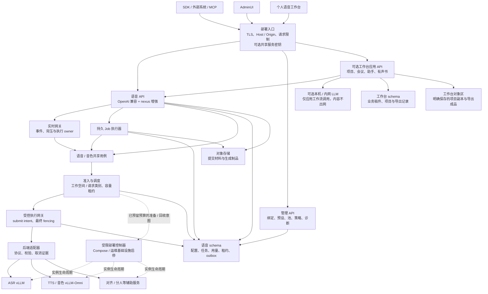

# SpeechNexus 产品与架构设计

SpeechNexus 是面向 Linux 的企业级语音服务底座，采用 OpenAI 兼容的 ASR/TTS 子集及音色创作等增强协议。WebUI 包含 AdminUI 与个人语音工作台；首期不建设用户身份认证体系，采用可信共享部署。

本文是 SpeechNexus 独立项目的主设计，定义产品范围、职责边界、技术基线与验收要求。[整体技术方案](architecture/technical-blueprint.md)负责工程选型与组件协作，[语音接口](architecture/speech-api.md)负责公共协议细节，[资源治理](architecture/runtime-governance.md)负责调度、持久化与数据生命周期；共同构成后续实现依据。已确认产品边界见 [ADR 0001](decisions/0001-product-boundaries-and-authentication-scope.md)，模型、引擎与加载策略见 [ADR 0002](decisions/0002-speech-models-engines-and-loading.md)，内网 LLM 与内容网络边界见 [ADR 0003](decisions/0003-workbench-llm-network-boundary.md)，集群就绪架构与单机 MVP 同构部署见 [ADR 0004](decisions/0004-cluster-ready-architecture-and-single-node-mvp.md)。存在冲突时先修订设计与决策，不以偶然实现替代契约。

**实现状态：仓库已建立工程骨架与运营健康检查，尚未实现语音业务 API 或真实工作台。** `active` 表示本文是当前维护的设计基线，不表示语音、音色、模型能力或服务指标已经实现。参数是初始设计值；性能、质量、容量及恢复指标须在目标部署验证。文档版本独立于未来软件版本。

阅读入口：[产品工作流](#2-产品结构与用户工作流) · [统一接口](#4-语音接口与传输选择) · [场景预设](#5-场景参数与预设) · [共享访问边界](#6-首期访问边界与身份体系演进) · [资源治理](#7-资源治理与持久任务) · [模型后端](#8-模型后端与执行接口) · [部署与验收](#10-部署拓扑与故障行为) · [实施路线](#13-实施路线与配套文档)

## 1. 产品定位与范围

### 1.1 产品定位

- 产品名称为 **SpeechNexus**，由 SpeechRail 的产品经验与架构启发；使用独立仓库。
- 后端是企业级语音服务底座，面向应用集成，采用 **OpenAI 兼容 + 增强协议**；增强能力包括音色创作。
- 部署于提供 vLLM 推理能力的 Linux 环境，不绑定具体硬件。
- 同时提供实时 ASR、非实时 ASR、实时 TTS、非实时 TTS，使用参数和预设适配不同业务。
- WebUI 定位为 **AdminUI + 个人语音工作台**，面向不同需求的使用者。
- **短期不建设用户身份认证体系**，不将登录、用户目录、角色权限或企业身份源作为首期前置。
- 工作台场景包括语音助手、会议助手、提词器、实时字幕、Audio Book 等。

### 1.2 技术基线

| 决策 | 基线与理由 |
| --- | --- |
| 部署形态 | 首期采用可信网络内的独立部署；无登录、共享服务数据，不承诺用户或租户隔离；外部入口可复用部署方现有网关 |
| 项目关系 | 在 SpeechNexus 按模块提取 SpeechRail 领域代码与测试，不给现有 macOS 产品增加 Linux 分支 |
| 产品分层 | 语音底座、AdminUI、个人工作台职责分开；底座可在无 WebUI、无 LLM、无工作台业务数据库时运行 |
| 兼容协议 | OpenAI Audio 和 Realtime 的明确子集用于标准调用；扩展资源使用 `/v1/nexus/`，扩展事件使用 `nexus.*` |
| 增强能力 | 音色设计、克隆、试听、校验与版本发布，以及预设、Job、能力快照、资源调度和运维管理 |
| 后端组织 | 模块化 FastAPI 语音服务；实时网关、任务执行与调度按需要分进程；工作台业务模块独立依赖公开语音协议 |
| Web 技术 | React + TypeScript；`/admin` 与 `/workbench` 为两个产品入口，可共用组件和部署；首期不实现登录 BFF |
| 数据权威 | PostgreSQL 保存版本、任务、用量、调度租约与工作台记录；语音与工作台表分 schema；对象存储保存明确提交的材料与生成制品 |
| 队列 | PostgreSQL 持久任务与事务性 outbox；Redis 仅为可选加速层，不是任务或容量租约的唯一真相 |
| 访问边界 | 浏览器同源访问与明确 Host / Origin 策略；可选共享服务密钥只用于部署入口，不演化为首期用户体系 |
| 推理环境 | 应用与推理容器独立锁定依赖，按支持矩阵和资格验证确定版本 |
| 可选 LLM | 工作台只接本机 / 内网服务，默认关闭；业务内容不得出网，首期不管理 LLM 模型部署 |
| 工程协作 | 契约先行，公共 / 执行 / 部署控制协议分开；显式 SQL 与迁移、生成客户端、部署内观测，见整体技术方案 |
| 产品交付 | 先验证四类语音能力、音色创作闭环与资源治理，再完善两个 WebUI 入口和场景应用 |

技术基线用于组织实现；实际引擎组合、容量与部署入口须按资格流程确定，不能由技术选型推断能力已经可用。

### 1.3 目标、非目标与失败条件

目标是让企业应用使用稳定、可观测、可调度、可追溯的语音能力；外部开发者不依赖 WebUI 即可完成标准和增强调用；维护者与普通使用者获得符合各自任务的界面。

首期不实现账号注册、登录、SSO / OIDC、用户目录、服务账号体系、RBAC / ACL、多租户隔离、个人配额、个人内容私有化或双人分权审核。保留未来身份接入位置，但不提前建设无使用者的身份表、权限矩阵与 RLS。公共 SaaS 计费、多地域容灾、电话交换系统、实名声纹识别、模型训练和通用 Agent 工具市场也不在首版。

企业级首先体现在接口契约、输入边界、资源准入、故障恢复、版本、运维与部署资格。助手、会议纪要和有声书编排属于可选工作台应用层；语音底座不提供完整 OpenAI Realtime LLM response、tool call 或业务记忆协议。

以下情况属于设计失败：标准推理必须先进入 WebUI；工作台业务逻辑进入语音核心；仅因有 `/admin` 页面就宣称存在权限隔离；将共享数据标成“仅自己可见”；后台任务挤占实时容量；取消未停止就归还算力；把预览当终稿；重试重复发布；把不存在的模型能力伪装成参数选项。

## 2. 产品结构与用户工作流

### 2.1 三个产品面与目标使用者

| 产品面 | 面向需求 | 首期责任 |
| --- | --- | --- |
| 企业语音服务底座 | 业务开发者、外部系统、SDK / MCP 调用方 | 标准 ASR/TTS、音色创作、预设、Job、能力、资源与运维接口；不依赖 WebUI |
| AdminUI | 部署维护者、模型与服务维护者 | 查看运行事实，维护绑定、预设、音色生命周期、池预算、任务和诊断 |
| 个人语音工作台 | 转写、配音、会议、助手、提词、字幕和有声书使用者 | 按任务组织采集、编辑、试听、续作与导出，隐藏无关技术参数 |

这里的维护者与使用者是产品受众，不是首期权限角色。`/admin` 与 `/workbench` 的入口切换只改变功能视图；在同一无认证入口可达时，两类功能均可被该入口调用，不能靠隐藏导航保护管理 API。

“个人”描述任务体验，**不表示服务端按用户保存私有空间**。首期一个部署有默认工作空间，可增设工作空间与项目整理内容，但它们只是内容和预算分组；不同工作空间也不构成安全隔离。浏览器本地可以保存布局、主题、最近选择和未提交编辑状态，不将浏览器 UUID、昵称或 localStorage 当作身份或所有权证据。

### 2.2 AdminUI 与工作台信息架构

| 入口 | 导航 / 首屏任务 | 主要产物 |
| --- | --- | --- |
| AdminUI | 服务概览：可用能力、队列、延迟、失败与资源水位 | 运行事实与诊断入口 |
| AdminUI | 模型服务与绑定：注册已有服务、版本、就绪与资格 | 可追溯绑定与容量 manifest |
| AdminUI | 资源与策略：逻辑池、父预算、并发、队列、用量和保留 | 部署 / 工作空间策略 |
| AdminUI | 预设与音色管理：草稿、校验、默认指针、发布、退役 | 不可变 revision 与来源记录 |
| AdminUI | 全局任务与运维：查询、取消、恢复、配置记录 | 操作记录与恢复结果 |
| 工作台 | 首页：选择转写、配音、音色创作或实时场景 | 当前任务与继续工作入口 |
| 工作台 | 文件转写：上传、语言与预设、校对与导出 | 转写、字幕和可选辅助结果 |
| 工作台 | 配音与音色创作：文本、声音、描述设计 / 样本克隆、试听 | 音频、候选音色与确认记录 |
| 工作台 | 实时工作室：字幕、会议、助手与提词 | 实时文字、可选保存记录与跟随状态 |
| 工作台 | 有声书：章节、角色、换声、局部生成与导出 | 章节和整书制品 |
| 工作台 | 项目 / 资源 / 任务：工作空间内容、共享音色、进度与续作 | 内容分组、任务结果与版本 |

不展示登录、注册、成员、角色、租户、个人配额等尚未建设的入口。界面按能力与功能配置显示未配置、准备中、可用、容量已满、失败和下一步。资源列表明确“当前部署共享”，不使用“仅自己可见”或“只有管理员可操作”的文案。

### 2.3 任务路径

1. **语音助手**：选择配置好的助手与声音 → 开始 → ASR 预览 → 工作台判断轮次完成 → 应用调用 LLM → 稳定文本送 TTS → 浏览器播放。工作台控制插话、停止播放与取消旧 TTS。
2. **会议助手**：创建会议并选择采集和保存方式 → 实时转写 → 可选匿名分人 → 标记要点 → 保存封存版本 → 可选调用 LLM 生成纪要 → 校对导出。不保存源音频就不承诺会后重识别整场会议。
3. **提词器**：导入稿件 → 开始跟随 → 可修订预览匹配稿件位置 → 随时暂停、手动定位或继续。识别修订不允许无界跳转。
4. **实时字幕**：选择输入和显示方式 → 开始 → 展示可修订文字 → 定稿封存 → 可选保存导出。显示换行不决定声学切段。
5. **有声书**：导入 TXT → 整理章节与角色 → 确认稿件和声音 → 按章生成 → 校验试听 → 局部重做 → 导出。文本或声音变动只使相应依赖失效。
6. **音色创作**：选择描述设计或样本克隆 → 提交描述 / 素材 → 获得候选与试听 → 修改或校验 → 确认发布 revision → 用同一 voice 引用进行 TTS。草稿、生成成功、质量校验与发布是不同状态，协议见 [音色创作协议](architecture/speech-api.md#17-音色创作与增强协议)。

助手预算切段不等于用户说完一轮，分人事件不决定文字定稿。工作台负责业务轮次和项目状态，语音底座只返回其协议负责的事实。

### 2.4 Web 采集与播放边界

麦克风、文件和外部系统推流是首批输入来源。浏览器麦克风使用 HTTPS；系统声音、共享窗口或标签页声音受浏览器与操作系统支持限制，需建立客户端资格列表，不能承诺与原生 App 等价的全局采集能力。[MDN 采集说明](https://developer.mozilla.org/en-US/docs/Web/API/MediaDevices/getUserMedia)、[屏幕音频限制](https://developer.mozilla.org/en-US/docs/Web/API/MediaDevices/getDisplayMedia)

客户端通过 AudioWorklet 在有界缓冲中转换 PCM，明确申请设备权限；停止、离开或失败时释放设备。播放器维护自己的播放进度、缓冲和 generation，丢弃旧 generation 迟到音频。页面关闭、休眠、后台节流和断网应产生可见状态。设备权限由浏览器与操作系统管理，与应用用户身份认证无关。

## 3. 领域模型与架构边界

### 3.1 核心概念

| 对象 | 语义与权威 |
| --- | --- |
| `DeploymentContext` | 服务端配置解析的部署与策略上下文，首期不含已认证的人或租户 |
| `Workspace` | 默认或显式的内容、预设与预算分组；不是用户或租户边界 |
| `WorkbenchProject` / `WorkbenchExportJob` / `WorkbenchExportArtifact` | 可选工作台拥有的项目、导出任务与成品；与底座 Job / Artifact 分属不同资源 |
| `ScenarioProfileRevision` | 不可变场景策略与参数覆盖范围 |
| `ModelBindingRevision` | 逻辑模型到不可变制品与执行配置的绑定，关联部署资格；不等于当前模型进程 |
| 模型运行实例 | 节点上的具体进程 / 容器及 generation、配置与就绪事实，独立于绑定发布和音色版本 |
| `VoiceDraft` / `VoiceRevision` | 音色候选与已发布版本；分别记录来源、校验、兼容绑定与后端私有映射 |
| `PronunciationRevision` | 不可变发音资源 |
| `SpeechCommand` / `VoiceCommand` | ASR/TTS 意图与音色设计 / 克隆 / 试听 / 校验意图；共享准入、执行与 receipt 规则 |
| `Operation` | 执行身份，供 REST、Job 和实时操作关联；不代表用户身份 |
| `RealtimeSession` | 有界短期实时连接及执行 owner / 资源租约，不承载业务历史 |
| `Job` / `JobStep` | 持久任务与可恢复步骤；每次重试有新的 attempt |
| `Artifact` / `ExecutionReceipt` | 明确保存的制品与 requested / effective / observed 执行事实 |
| `ResourcePool` / `AdmissionLease` | 逻辑资源池、容量事实与带 fencing token 的准入租约 |

segment_id、turn_id、render_unit_id 和 job_id 不互相复用，通过显式关联连接。文中执行 owner 只指网关、worker 或会话的运行所有者，不得据此宣称用户权限。未来身份信息由独立入口适配器补入上下文，不要求首期创建 `Organization`、`User`、`Principal` 或 membership 表。

### 3.2 结构图



### 3.3 模块职责与进程模型

| 模块 | 拥有 | 不拥有 |
| --- | --- | --- |
| AdminUI | 管理视图与操作反馈 | 用户目录、角色权威、模型进程 |
| 个人工作台 | 任务体验、采集、播放、编辑、试听 | 对底座的内部数据库访问、推理协议差异 |
| 部署入口 / 可选代理 | TLS、Host / Origin、请求限制与可选服务凭据注入 | 首期用户登录、个人会话与权限系统 |
| 工作台应用 API / 导出 worker | 项目 / 稿件、助手 / 纪要、有声书编排与导出；通过公开 API 获取底座结果 | 直接访问引擎、写入底座任务 / 制品状态或改变模型计算预算 |
| 语音 / 音色用例 | 命令、能力、执行配方、音色生命周期和结果 | LLM prompt、业务历史与页面状态 |
| 实时网关 | 音频时钟、段身份、连接、背压 | 永久 PCM、客户端播放完成事实 |
| 作业执行器 / 调度器 | 步骤、恢复、资源向量、配额、租约和发布 | 任意绕过网关的模型调用 |
| 受控执行网关 / adapter | 最终提交屏障、引擎 request_id、协议转换、完成 / abort 证据 | 人员角色或工作台项目编辑 |
| 受限部署控制器 | 按已预留预算的意图启停批准实例、报告启动 / 停止事实 | 推理提交、业务发布、任意容器管理或资源准入裁决 |
| 推理运行时 | 计算、内部 batching、模型 / codec 状态 | 业务数据库和产品访问策略 |

语音底座首版执行角色为 `api`、`realtime-gateway`、`job-worker`、`scheduler`、`execution-gateway`；应用角色可共用镜像，backend 与 execution-gateway 独立部署。受限部署控制器属于部署基础设施，承担自动按需启停。工作台应用是可选模块，可与 API 同镜像，但通过公开 DTO / SDK 调用语音 API，不导入 vendor 代码或共写语音持久化表。工作台需要导出时增加受限 workbench-export-worker，不写底座 JobStep。开发者可以只部署底座，不启动 WebUI、工作台模块或 LLM。

两类 schema 可使用同一 PostgreSQL 实例，凭据与写入权按模块职责分开；这属于组件边界，不是用户隔离。推理使用独立镜像和网络边界。所有引擎调用经过受控执行网关，API 和工作台没有可绕过网关的网络入口或凭据。vLLM batching 优化已获准请求，平台调度控制进入量、期限与预算。

## 4. 语音接口与传输选择

四类语音能力共享命令、版本解析、准入、执行身份与 receipt；传输方式按任务选择，业务层不直接依赖引擎协议。

| 使用需求 | 公开入口 | 结果与边界 |
| --- | --- | --- |
| 有界文件转写 | `POST /v1/audio/transcriptions` | OpenAI Audio 转写子集；短请求同步返回，长任务显式改 Job |
| 完整文本合成 | `POST /v1/audio/speech` | OpenAI Audio TTS 子集；默认 MP3，可声明 WAV / PCM；音频流不等于增量文本输入 |
| 实时识别 / 增量文本合成 | 创建 nexus session，再连接 `/v1/realtime` | ASR 使用声明的 OpenAI 事件子集；TTS、可修订预览、背压与整体终态使用 `nexus.*` |
| 持久化 ASR / TTS | `POST /v1/nexus/jobs` | 版本固定、查询 / 取消 / 续作与已提交 Artifact；内容可在保留期内下载 |
| 音色创作 | `/v1/nexus/voice-designs`、`/voice-clones` 与草稿子资源 | 生成、修改后再生成、试听、校验和显式发布；生产 TTS 只引用已发布版本 |
| 可选应用业务 | `/v1/workbench/` | 会议、助手、提词、有声书与独立导出；不宣称 OpenAI 兼容 |

标准 REST 请求不要求 nexus、workspace 或工作台项目字段。兼容范围、默认值、错误、幂等、会话状态、音色版本与调用示例以[语音接口](architecture/speech-api.md)为准。Realtime 使用 SpeechNexus 会话协商，不能宣称任意 OpenAI Realtime 客户端无修改可用；底座不承载 LLM response、tool call 或播放完成事实。

## 5. 场景参数与预设

### 5.1 四类配置分离

| 配置 | 内容 | 谁能改变 |
| --- | --- | --- |
| 业务工作流 | 助手轮次、提词匹配、会议保存、角色与章节 | 工作台使用者；不要求底座认识业务项目 |
| 场景预设 | ASR 结束与复核策略、TTS 文本规划、参数覆盖、所需能力 | 经管理功能编辑 / 发布，首期无人员权限判定 |
| 模型绑定 | 引擎、权重 revision、精度、参数域、辅助能力与资格 | 部署维护流程 / AdminUI；不接受推理请求动态改地址 |
| 治理策略 | 并发、配额、保留、队列期限、运行池与服务级别 | 部署配置 / AdminUI；与推理参数独立 |

推理请求的 overrides 不能控制调度优先级、资源池上限、引擎地址、模型路径或部署策略。即使首期同一入口可调用管理功能，也必须通过明确管理资源修改策略，不能在普通推理 payload 中越过类型边界。预设名不能绕过资源规则。

### 5.2 参数字典

| 字段 | 类型 / 初始范围 | 语义与约束 |
| --- | --- | --- |
| `asr.language` | `auto` 或支持的语言 ID | 显式语言必须被绑定支持；自动检测可返回 unknown |
| `asr.preview_interval_ms` | integer，100–5000 | 预览调度周期；不代表服务保证每周期都有新结果 |
| `asr.max_segment_ms` | integer，1000–30000 | 有界识别段的预算；必须不小于 preview_interval_ms |
| `asr.finalization` | `full_segment / streaming_finalize` | 完整段复核或流式结束定稿；两者终稿均不强制保留错误预览 |
| `asr.final_deadline_ms` | integer，100–10000 | 从段关闭到正文 final 的期限，取服务端允许范围；required 辅助步骤使用独立期限 |
| `asr.auxiliary_deadline_ms` | integer，100–10000 | 正文定稿后等待 required 辅助步骤的上限；默认 5000，不与正文 final 期限混淆 |
| `asr.rollback_tokens` | integer，0–32 | 适配器支持时的重解码启发式；不支持则拒绝覆盖，不伪造执行 |
| `asr.turn_detection.mode` | `server_vad / manual` | 自动关闭识别段或由客户端 commit；不能决定助手业务轮次 |
| `asr.turn_detection.silence_duration_ms` | integer，200–3000 | 仅 server_vad 有效；与场景结束策略共同决定切段 |
| `asr.vocabulary_set_revision` | 不可变资源引用或 null | 有界术语提示；不提供强制替换未识别文本的保证 |
| `asr.alignment` | `off / required / best_effort` | 是否要求独立时间对齐；required 无能力就拒绝 |
| `asr.diarization` | `off / required / best_effort` | 匿名分人，绑定独立声明最大人数、重叠支持与延迟 |
| `tts.voice_id / voice_revision` | 资源引用 | 提交时固定版本，验证发布状态、工作空间引用和模型兼容性 |
| `tts.language` | 支持的语言或 auto | 与音色和模型的能力域求交 |
| `tts.text_commit_mode` | `explicit / sentence` | 客户端冻结文本或规划器按安全句界冻结 |
| `tts.audio_delivery` | `complete / chunked` | 完整结果或音频分块，与文本提交模式独立 |
| `tts.speed` | number；建议 UI 0.8–1.2 | 允许范围来自具体绑定；不能只改回显而不改输出 |
| `tts.instructions` | 有界 string 或 null | 仅绑定声明支持时开放；禁止把整段业务 prompt 默认送入声音模型 |
| `tts.pronunciation_revision` | 资源引用或 null | 固定的发音词典；保留原始文本与声学文本摘要 |
| `tts.seed` | integer 或 null | 只有后端声明支持时生效；不承诺跨版本相同波形 |
| `tts.planner.max_chars` | integer；建议 40–400 | 管理员预设中的分段预算，受绑定支持范围限制 |
| `tts.planner.max_wait_ms` | integer，100–3000 | sentence 模式等待完整句界的最大时间；到期不强制合成不安全尾部 |
| `output.transcript_format` | `json / text / verbose_json / srt / vtt` | 后三者按实际辅助能力开放 |
| `output.audio_format` | `mp3 / wav / pcm` REST 基线 | 标准 REST 默认 mp3；实时 PCM descriptor 独立协商，其他格式经 encoder / 客户端资格验证后发布 |
| `output.save_artifacts` | boolean | 普通同步 / 实时默认 false，Job 固定 true；受数据策略约束 |

不引入多个含义相似的 alias。ASR 嵌套 VAD 字段在 OpenAI 投影中映射到官方 turn_detection 结构；统一内部命令只保留一种语义。

### 5.3 初始预设矩阵

下列值来自 SpeechRail 的场景经验与本方案的起始选择，不是 Linux / vLLM 最优参数。`full_segment` 只有绑定能够在有界段上执行完整复核时才可用。

| profile_id | 预览 ms | 静音 ms | 段长上限 ms | ASR finalization | TTS 策略 | 默认执行类别 |
| --- | --- | --- | --- | --- | --- | --- |
| `assistant-turn` | 800 | 1200 | 20000 | full_segment | 稳定文本显式提交，音频分块 | realtime |
| `assistant-duplex` | 600 | 900 | 20000 | full_segment | 显式提交，分块，应用控制插话 | realtime |
| `meeting-accurate` | 1000 | 900 | 20000 | full_segment | 默认不启用 TTS | realtime |
| `caption-live` | 500 | 400 | 8000 | full_segment | 默认不启用 TTS | realtime |
| `teleprompter-follow` | 400 | 400 | 8000 | streaming_finalize | 默认不启用 TTS | realtime |
| `file-accurate` | 不请求预览 | 文件分段策略 | 30000 | full_segment | 不启用 | batch |
| `speech-interactive` | 不启用 ASR | — | — | — | 显式或安全句界提交，分块，较短单元 | interactive / realtime |
| `audiobook-consistent` | 不启用 ASR | — | — | — | 显式提交，较长叙述单元，完整制品 | batch |

meeting-accurate 的 alignment 默认 best_effort、diarization 默认 off；用户选择“区分说话人”后切换到显式的 required 或 best_effort 派生预设，不能因缺模型悄悄变回单人。caption-live 默认不等待分人；teleprompter-follow 只将 hypothesis 用于位置匹配，不用它改写稿件。audiobook-consistent 默认固定 voice、词典、模型与 planner revision，并要求生产质量资格。

预设不携带任意 `priority` 数字。执行类别是策略建议，最终类别由入口、能力和部署治理规则决定：不能在 Job 中提交 assistant profile 就获得实时资源保留；不适配入口的 profile 直接拒绝。

### 5.4 合并、验证与发布规则

解析顺序为绑定默认值 → 已发布预设值 → schema / 预设允许的 overrides。部署 / 工作空间治理不是可覆盖的默认值，而是最终请求的硬约束。输入超出允许范围时拒绝并说明有效范围，不静默 clamp；唯一自动收紧的是协商规则明确允许的资源段预算：

```text
effective_max_segment_ms = min(
  requested_max_segment_ms,
  model_binding.max_segment_ms,
  requested_auxiliary_capabilities.max_segment_ms,
  workspace_policy.max_segment_ms
)
```

如果调用方设定 `constraints.require_exact_parameters=true`，任何自动收紧都返回 422；否则在 effective_configuration 中返回实际值和原因。hard deadline 与所需能力无法同时满足时拒绝，不给出看似有效的组合。

Profile revision 包含 schema_version、required_capabilities、parameters、override_allowlist、override_ranges、SLO 引用与验证记录。发布前执行 schema、能力组合、负样本与质量对照检查；可发布为 experimental 或 production。`override_ranges` 只能约束 allowlist 内的路径，显式范围必须满足 `minimum <= maximum`，allowlist 项没有范围时仅受基础参数 schema 和绑定域约束；同一 capability 只能出现一次，约束不能为空或反向；ASR 的 `max_segment_ms` 不得小于 `preview_interval_ms`。生产预设只绑定具备对应质量资格的模型 / 音色。回滚只是将默认指针切回旧 revision，不修改已固定的作业。

## 6. 首期访问边界与身份体系演进

### 6.1 首期明确不建设的体系

首期不提供用户注册 / 登录、密码、OIDC / SSO、用户目录、服务账号生命周期、RBAC、项目 ACL、成员邀请、个人配额、组织切换或多租户 RLS。不通过隐藏 AdminUI、伪造 anonymous user 表或浏览器 UUID 实现替代身份体系；语音执行不依赖这些未来组件。

默认访问模式为 trusted_network：由部署维护者选择可信网络、监听地址和入口路由，使用者无需在 SpeechNexus 登录。该默认是部署建议，部署前仍需显式配置入口。首期所有可达客户端共享服务功能与数据；不承诺人级保密、归属或操作分权。

### 6.2 网络、服务凭据与浏览器边界

| 边界 | 首期设计 |
| --- | --- |
| 用户身份 | 不建立，审计 actor 标为 anonymous；昵称只可作为调用方自述 |
| 共享服务密钥 | 可选部署配置，SDK 用 Bearer；所有持有者共享入口权限，不形成用户或角色 |
| 已有企业网关 | 可由部署方复用其网络准入或现有认证；SpeechNexus 首期不建设身份源，也不默认信任转发的用户名头 |
| AdminUI 与管理 API | 页面与 API 路径分开便于配置入口；首期默认没有人级权限差异 |
| 管理面部署隔离 | 如需限制管理入口，由独立监听 / 路由 allowlist 或既有网关同时限制页面与管理 API；只隔离静态页面无效 |
| 浏览器来源 | 同源请求；写请求与 WS 执行 Origin / Host 校验，不开放任意 CORS；不使用登录 cookie |
| 后端服务凭据 | 在部署 Secret 配置，不进入页面、Job、日志或公开结果；浏览器需共享密钥时由同源代理在服务器侧注入 |
| 引擎网络 | 只允许受控 execution gateway / adapter 调用，不因无用户认证就向客户端开放模型管理口 |

Origin / Host 与网络限制是部署入口控制，不能证明访问者是谁。非浏览器调用不依赖 Origin 充当身份认证；当 Origin 缺失时采用明确的 SDK 路由策略和已配置入口规则。无认证的共享部署不适合用来宣称对不互信使用者的数据隔离。

### 6.3 数据、音色与发布边界

工作空间与项目用于整理内容和分配预算。读写校验对象存在、workspace 引用一致、状态、版本、格式、保留及功能策略，不校验不存在的用户归属。所有通过同一入口访问共享工作空间的调用方可以读取、修改或取消该空间允许的资源；UI 需明确提示共享性质。

语音底座与工作台数据按模块分 schema，跨资源复合引用防止误关联；数据库只对服务开放，客户端不持有可任意 SQL 的连接。首期不以 RLS 声称用户 / 租户隔离。对象 key、staging 和 backend_voice_handle 始终内部化，下载经受控资源 API，导出源样本 / 特征可由部署功能策略整体关闭；策略不是按人授权。

音色草稿、试听、校验、发布与退役保留独立状态；发布只允许通过声明的 API 与事务规则完成，不可直接透传上游音色注册接口。生产质量校验和显式确认保留，但首期不宣称双人审批或某个角色专属。

### 6.4 资源禁用、执行裁决与操作记录

首期使用 policy_revision 和资源 state / revision 处理绑定禁用、音色退役、源资产删除与发布竞争。变更、revision 增长及通知 outbox 在同一事务提交；新准入、最终 submit intent 和 Artifact publication 在裁决事务中读取相同策略 / 资源行或等价可串行化版本。强制禁用 / 删除先提交则后续新执行提交与发布拒绝，发布先提交则保留已发生的成功事实，后续读取仍遵守当前保留与功能策略；普通退役对已固定任务的处理见下一段。

默认 retire 禁止新任务引用，已经固定版本的在途任务可在有界依赖租期内完成。普通删除先列出有效的持久依赖与执行租约并拒绝破坏；emergency_disable / 显式级联或强制删除才取消所确认范围内的在途与排队意图，未完成的 Artifact 不得再发布。强制禁用事件主动传播到网关与 worker，并以最长 30 秒策略刷新租期兜底；停止新 credit 和外发字节，取消引擎后按真实停止证据释放资源。新准入和发布始终重新读取权威状态，不能把该刷新期限当作宽限。已交付内容无法追回；这套规则不是用户权限撤销。

操作记录包括 anonymous / shared_credential 类型、可选凭据标签、request_id、来源类别、动作、资源、时间、policy_revision 和必要变更摘要；不记录密钥、原始音频、完整正文或声音特征。不能据此回答“具体哪位员工做了什么”，也不能将执行 owner 当成员身份。

### 6.5 未来身份体系的独立演进

未来明确需要不互信使用者共用部署、个人内容私有化、按人配额或角色分权时，再立项身份与授权阶段，单独设计 IdP / 用户目录 / Principal、权限、租户、撤销、数据库隔离与迁移。首期只保留入口上下文适配位置，不创建空壳身份系统，不将该阶段列为 P0–P5 的依赖。

接入身份后需要重新定义 owner / 授权投影、缓存键、幂等作用域、对象下载与长连接撤销；不能把部署共享凭据直接改名为用户账号。历史共享内容先归入明确共享范围，经确认再分配归属，不伪造历史创建人或私有权限。该演进不改变 ASR/TTS 兼容字段和音色 revision 的领域语义。

## 7. 资源治理与持久任务

平台调度位于模型计算之前：部署 / 工作空间 / 执行类别额度、队列期限、父物理预算与 engine / stage 增量预算共同限制准入。实时容量有明确保留，后台以有界单元公平轮转；逻辑池映射到同一物理设备时共享父预算。实际并发与吞吐来自 CapacityManifest 资格报告，公共接口不绑定设备型号和数量。

PostgreSQL 是任务、版本、用量、资源租约和事务性 outbox 的权威；对象存储保存明确提交的输入与产物。受控 execution gateway 独占引擎入口，提交前建立 intent 并执行 fencing。TTL、客户端断开、HTTP 取消接受或逻辑任务终结均不能单独证明算力已停止；不确定资源保持 quarantine，确认停止后才可重新分配。

Job 使用 at-least-once 执行、步骤去重和幂等发布。输出先写私有 staging，校验后与任务状态、取消、策略和 attempt 一起原子提交引用。输入按稳定区间去重；输出按各 attempt 的实际生成量计消耗。TTS 已接受但未冻结的文本保留额度，首次冻结才结算，未冻结尾部取消释放。

完整的池预算、调度算法、取消 / 接管屏障、计量键、状态机、保存和删除规则见[资源治理与持久化](architecture/runtime-governance.md)。工作台项目副本与整书导出由工作台拥有，不能写底座 JobStep / Artifact。

## 8. 模型后端与执行接口

### 8.1 服务中立的适配端口

| Port | 必须表达的行为 |
| --- | --- |
| `CapabilityProvider` | 无副作用读取绑定、readiness、参数域与执行限制 |
| `BatchAsrPort` | 对有界音频单元识别，返回正文、语言、真实辅助证据与 receipt |
| `StreamingAsrPort` | 开启 / 追加 / 关闭有界段、可替换预览、最终结果与显式取消 |
| `TtsPort` | 执行完整或冻结文本单元，报告真实音频 descriptor 与生成结果 |
| `StreamingTtsPort` | 文本提交与音频流分别控制、背压、取消和结束确认 |
| `VoiceDesignPort` / `VoiceClonePort` / `VoiceValidationPort` | 生成候选、构建可复用声音、校验并报告 preview_only / 可发布证据，复用受控执行与结果发布 |
| `AlignmentPort` / `DiarizationPort` | 与 source text / audio revision 绑定的独立辅助结果 |
| `ExecutionControlPort` | 由受控 execution gateway 实现 submit、status、abort、最终提交屏障、completion evidence、fencing / attempt 对齐 |

端口接受已经通过入口 / 资源策略检查和规范化的命令，不接受原始 HTTP 请求、用户可控引擎 URL 或 bearer token。vendor 输出在 adapter 边界验证；未知字段、错误格式、无终态、空音频、样本数不符和跨 attempt 结果不能直接成为成功结果。

### 8.2 初始后端路线

首选验证路径已由 [ADR 0002](decisions/0002-speech-models-engines-and-loading.md#1-模型与推理引擎)确认并集中维护完整模型标识：文件 / 完整段复核使用 Qwen3-ASR-1.7B，实时使用 Qwen3-ASR-0.6B，均经 vLLM；TTS 使用 vLLM-Omni，CustomVoice 负责预设音色，VoiceDesign 负责描述设计，Base 负责样本克隆与创作音色的后续复用合成，三者均选 12Hz / 1.7B checkpoint。每个实例的模型和 stage 配置由绑定明确声明，流式能力逐绑定验证。[vLLM 模型列表](https://docs.vllm.ai/en/stable/models/supported_models/)、[vLLM-Omni TTS 示例](https://docs.vllm.ai/projects/vllm-omni/en/stable/user_guide/examples/online_serving/text_to_speech/)

辅助能力独立执行：官方 Silero VAD ONNX 使用 ONNX Runtime CPU；Qwen3-ForcedAligner-0.6B 使用官方 `qwen_asr` / PyTorch CUDA；`nvidia/Nemotron-3-Diarization` 使用 NeMo / PyTorch CUDA，首轮验证实时 / 离线最多八位说话人的范围，更大人数后端尚未选择。具体制品、版本、精度与容量仍待锁定和资格验证，不因选型而声明生产可用。

音色设计必须验证“描述 → VoiceDesign 候选 / 参考 → Base 克隆与复用校验 → 显式发布不可变 VoiceRevision → 后续 Base 合成”；仅有试听音频的候选保持 preview_only。样本克隆、再生成、试听、校验、发布与后续生命周期均属于首版范围。SpeechRail 的 MLX、CoreML、Swift worker 和模型制品不能直接充当 Linux 实现；是否增加其他后端由资格证据决定。

### 8.3 运行与发布

绑定 revision、发布资格和运行实例分开建模，不能共用一条把准备、就绪、回收与退役混在一起的状态链；具体状态及允许迁移由 P0 机器契约分别定义。准备、加载和热身由平台自动协调，实际进程 / 容器启停交给受限部署控制器；资格验证仍是受控发布门禁。已启用的实时 ASR 及承担实时合成的 CustomVoice / Base 必须预加载、热身并常驻，实例就绪后才能准入；公共实时请求不等待模型冷启动。

实时预设使用 `full_segment` 时，1.7B 复核属于实时执行配方的依赖，须在准入前可服务，并纳入实时等待、容量和混合负载资格。required 辅助同样纳入全阶段预算；不能先给 0.6B 发槽，再无保障地等复核或辅助模型。文件任务复用剩余预算，不能阻塞实时定稿。完整配方与内部协议见[整体技术方案](architecture/technical-blueprint.md#5-语音与音色执行配方)。

VoiceDesign 随允许等待的音色创作任务按需加载并在空闲时回收，克隆 / 校验优先按受控预算复用 Base；VAD 在 CPU 常驻且会话状态隔离。文件与其他辅助绑定的加载策略由部署资格分别确定。使用预先锁定的本地权重，不在推理请求中下载。调度器先预留加载、热身和完整阶段峰值预算；不足时创建任务排队，不借用实时保留。回收先封锁新分派并协调在途执行，确认停止才释放预算，未知清理保持 quarantine；见[按需加载与实例回收](architecture/runtime-governance.md#16-按需加载与实例回收)。卸载不退役绑定或删除音色资产与版本，再次加载重新核对实例 readiness。

应用依赖、推理依赖和模型文件分别锁定与构建。vLLM-Omni 要求与匹配主、次版本的 vLLM 组合安装，发布时核对正式发布制品，不能混用 latest 文档中的实验配置和旧镜像。[上游版本关系](https://docs.vllm.ai/projects/vllm-omni/en/stable/getting_started/installation/)

升级建立新 binding revision，通过协议与质量资格验证后只切换新请求；旧会话 drain、旧 Job 完成或显式取消。回滚恢复默认指针与旧镜像，保留旧数据 / 音色 revision，不跨越未验证的数据库迁移。容器健康、模型 ready、可准入和质量资格分别上报。

## 9. 个人工作台业务与版本依赖

本节属于可选工作台应用层。AdminUI 不拥有这些业务稿件；语音底座不依赖本节的项目、LLM 或 UI 状态。外部系统可以直接使用相同公开语音协议实现自己的应用。

### 9.1 转写与会议

声学原文、人工校对、纪要三层分别保存，纪要引用明确的 sealed TranscriptDocument revision。更改正文只使相关纪要候选过期，不覆盖原转写；源记录删除时按依赖策略清理或提示相关制品。说话人名称由业务用户在项目层备注，语音引擎仍只处理会话匿名标签。

文件 ASR 采用有界解码与交叠切分，使用采样时间轴和去重规则合并；不能直接拼接每块 text 导致重复或缺尾。跨块分人由独立辅助会话管理，有明确人数、状态与 reset 边界。没有能力时拒绝 required 分人，不按文本内容猜测说话人。

### 9.2 提词与助手

提词状态独立保存稿件版本、可见位置、手动接管与恢复点；来自旧稿件 revision 或旧 stream_epoch 的匹配结果不可推动当前稿件。位置匹配只在有限窗口内前进，低置信或修订导致的歧义暂缓自动跳转，并保留键盘与手动操作。

助手轮次通过应用 `turn_id` 归并多个 ASR segment。应用决定用户完成输入、LLM 调用、可朗读文本、播放与插话；网络 rollover、局部 final 或 TTS 完成不能冒充这些决定。LLM 输出与导入文本均视为不可信数据，严格解析后展示或合成，不能直接成为命令、SQL、HTML 或管理员配置。

### 9.3 有声书

每个 render_unit 固定原稿 / 工作稿 revision、章节与角色、voice_revision、pronunciation_revision、model_binding_revision、profile_revision 与文本规划 revision。编辑一段文字或换角色声音后，只将依赖该版本的单元标为 stale；未变单元可复用其已验证制品。

工作台将明确选择保存的 render_unit 音频通过底座公开下载 API 获取，校验 source Artifact 摘要 / receipt 后写入自己的 saved_assets；项目引用已提交副本，而非把底座普通 30 天结果 TTL 当作永久保存承诺。复制未完成或底座源已过期时，该单元不能被标为可导出，需恢复或重做；不会把底座 Job 成功状态改成失败。

整章 / 整书合并属于工作台：`POST /v1/workbench/books/{book_id}/exports` 接收固定的 casting revision、可选单元子集和目标格式，在服务端解析不可变导出清单并分配 `manifest_revision`，以 Idempotency-Key 创建 `202 WorkbenchExportJob`。`GET /v1/workbench/exports/{export_id}` 查询，`POST .../{export_id}/cancellations` 取消，`GET .../{export_id}/content` 下载已成功的 WorkbenchExportArtifact。状态与取消 / 提交竞争采用 [作业与产物发布](architecture/runtime-governance.md#22-作业与产物发布) 的同类规则，但记录、outbox、staging 和制品提交全部位于工作台 schema / 对象区，不创建或修改底座 JobStep / Artifact。

可选 workbench-export-worker 负责有界解码、格式统一、音量处理与拼接；使用单独配置的 CPU / 内存 / 并发 / 临时磁盘上限，其预留计入部署整体预算，不借用语音 realtime 保留。工作台导出不调用推理引擎，关闭工作台或导出 worker 不影响底座。导出按单元检查取消，恢复只认已提交检查点；结果先 staging、校验后原子发布，不因对象已存在就宣称成功。

只有所有 required 单元存在已保存副本、版本一致、质量与格式校验通过，才发布整章 / 整书 WorkbenchExportArtifact。成品同时固定 `export_id`、与所属 Job 完全相等的 `manifest_revision`、内容摘要和大于零的字节数，使 Job 记录到期后仍能追溯实际导出清单；发布事务校验这些字段后才提交。导出成功与 artifact.published 事件必须引用属于同一 `export_id` 的成品，不能把其他任务或旧清单的 Artifact 混入本事件流。部分成功显示明确进度，禁止将不完整 WAV、缺章清单或空文件标为成品。质量检查、试听和确认记录独立保存；首期确认者只能是匿名操作记录，不承诺角色审核或双人分权。

### 9.4 本机 / 内网 LLM

助手与纪要使用默认关闭的可选集成，只连接部署批准的本机 / 内网 LLM，业务内容不得出网；不接公有云，也不在失败时切换外网端点。凭据只在服务端，界面展示处理内容范围，执行固定稿件 / 转写、模型与模板版本。首期不负责 LLM 模型部署和生命周期；未配置 LLM 不影响独立语音底座及工作台基础能力。

LLM 拥有工作台自己的任务、取消与结果，失败不改写成功转写，也不让底座重做整条语音链。若共享物理设备，其占用必须纳入部署预算与混合负载资格。出站限制覆盖 LLM 代理、浏览器资源和日志 / 观测导出；内网 URL 本身不是内容未出网的证明。产品决定见 [ADR 0003](decisions/0003-workbench-llm-network-boundary.md)，工程衔接见[工作台与内网 LLM](architecture/technical-blueprint.md#9-工作台与内网-llm)。

## 10. 部署拓扑与故障行为

### 10.1 不绑定硬件的三种拓扑

| 拓扑 | 组成 | 适用与边界 |
| --- | --- | --- |
| 技术验证 | 单部署、应用角色分进程、少量已批准引擎、PG 与对象存储 | 验证协议与资源行为；单节点不承诺高可用 |
| 企业试点 | API / 网关 / worker 可独立扩容，两个 WebUI 入口可选，数据有备份，推理按池管理 | 可信群体共享使用；每个瓶颈由资格报告确定，不承诺个人隔离 |
| 企业生产 | 无状态 API 多副本、网关分片 / owner 路由、数据库 / 存储高可用与推理故障冗余 | 需独立确认入口准入边界；首期适用于可信环境或既有网关，不自动获得身份 / 多租户能力 |

使用 Docker / Compose 交付验证拓扑；需要编排时提供 Kubernetes 部署。核心代码只依赖配置和服务端点，不依赖 Kubernetes API，不自动假定同机 GPU 或共享磁盘。底座可以 headless 部署；AdminUI / 工作台为可选服务，关闭工作台不会删除或阻断底座 Job。

### 10.2 故障矩阵

| 故障 | 行为与恢复 |
| --- | --- |
| API 实例退出 | 幂等请求协调；outbox / Job 不丢失；浏览器重新请求业务状态 |
| 网关退出 | 当前 WS 断开、实时 operation 取消协调；新会话显式 gap，不透明复制模型状态 |
| worker 退出 | 检查 attempt 与 staging，确认旧执行结束后接管可恢复步骤 |
| 推理引擎退出 | 隔离 binding、受影响 operation 失败；实时明确结束，后台在策略允许时重试 |
| PostgreSQL 不可用 | 新准入与修改 fail-closed；有限收尾；不能降级为内存队列继续持久任务 |
| 对象存储不可用 | 不发布未验证 Artifact；保留待恢复步骤；实时不保存模式可按已批准策略运行 |
| Redis 不可用 | 回到 PG 权威路径或保守限流；不丢任务、不丢资源禁用通知 |
| 可选部署网关不可用 | 对应入口不可达；直接底座仅按显式配置提供服务，不自动绕过网关或切换到公开入口 |
| 取消状态未知 | quarantine 对应执行资源，后台协调，不提前释放或重复执行 |
| 配额记账延迟 | 在已有有效预留内执行；无法预留新额度时拒绝，不无界透支 |

### 10.3 可移植部署制品

新仓库提交应用 / 推理镜像锁、依赖锁、模型清单摘要、环境变量 schema、数据库迁移、配置示例和回滚手册；不提交真实凭据、源音频、私有声音或模型权重。持久数据挂载与临时缓冲分开，临时区有配额与启动清理范围。

备份覆盖数据库、对象清单、声音与预设版本引用，执行定期恢复演练。生产前为选定拓扑冻结 RPO / RTO，初始评估目标可采用 RPO ≤15 分钟、RTO ≤60 分钟；这依赖实际备份和恢复验证，不属于硬件无关的默认承诺。

## 11. 可观测性与验收标准

### 11.1 指标与相关性

使用 request_id、operation_id、job_id、attempt_id、stream_epoch 和 engine revision 串联事件。业务正文、音频、Base64、完整 prompt、声音特征、密钥和私有模型路径不进入日志。部署 / 工作空间维度在用量库保留；首期不生成个人用量归因，不将高基数 session / job ID 作为 Prometheus label。

必须分别测量：排队时间、准入等待、模型执行、ASR 预览 / final、TTS 首可播放音频、音频间隔、实时输入延迟、失败与取消确认延迟、活跃 / quarantine 槽、PCM buffer、设备与主机内存、Job 续作 / 重复发布、配额 / 功能策略拒绝。客户端单独记录采集、网络、缓冲和播放阶段的无内容统计。

### 11.2 初始服务目标与口径

首轮在当前 Linux ARM64 / NVIDIA GB10 部署验证至少同时运行 1 路实时 ASR + 1 路实时 TTS；硬件属于部署资格，不进入公共协议。该混合负载下的 ASR 首预览与 TTS 首音频要求已经确认，其余性能数值仍为 P0/P1 候选目标。所有指标均须在指定 binding、语言、输入类型和负载下取得证据，不能由本文直接声明已达标。

| 指标 | 验收要求 / 候选目标与口径 |
| --- | --- |
| ASR 预览 | 已确认首轮要求：满足最低识别窗且对应音频进入服务后，首个有效预览 P95 ≤1000 ms |
| 字幕显示延迟 | 客户端可对齐采样时钟后的有效字词显示滞后 P95 ≤1500 ms |
| ASR 正文 final | segment_closed 到正文 completed / failed 的 P95 ≤2000 ms；包含最终复核等待；required 辅助另报延迟 |
| 实时 TTS | 已确认首轮要求：冻结文本获接受到首可播放 PCM 的 P95 ≤800 ms；网络与播放另报 |
| TTS 连续性 | 正常网络与已资格负载下无持续 buffer underrun；报告音频 gap 分布与次数 |
| 控制 API | 无大文件传输的常规读写 P95 ≤300 ms，排队 / 推理不混入此口径 |
| 组件与资源边界 | 无 WebUI 依赖；引擎不能绕过准入；错误 workspace 引用、旧 attempt 与内部路径不进入有效结果 |
| 内容网络边界 | LLM 仅本机 / 内网；服务、代理、页面资源和观测链路不得向部署外发送业务内容 |
| 正确性 | 有效 operation 唯一逻辑终态；无输入样本静默丢失、重复发布和失效 attempt 续作 |
| 质量 | 在冻结语料上对照批处理基线，按语言 / 场景冻结 CER/WER、数字与专名错误、DER / 归属指标、TTS 可懂度与音色稳定性阈值 |

普通文件吞吐、并发会话数和最大 TTS 持续生成速率保留在每部署 CapacityManifest，不在未指定硬件时给出虚构数字。超负载测试应显示受控拒绝与有界延迟，而非靠降低准确率、丢音或增加无限队列“通过”。

必须另测 VoiceDesign 冷加载、热身、执行和回收与实时服务共存时的延迟、峰值资源和排队行为。1+1 性能通过不能替代完整音色创作验收，也不能证明更高并发、质量或长时稳定性已通过。

### 11.3 最小充分的验证层级

| 层级 | 核心验收 | 依赖 |
| --- | --- | --- |
| 契约 / fake | REST、WS、Job、MCP 对相同命令参数域与错误一致；预览修订、空成功、唯一终态 | 不加载模型、不用私人音频 |
| 访问与数据边界 | 无登录启动、两个视图不伪装权限；Host / Origin、可选共享密钥、workspace 引用、内部字段、禁用 / 发布竞争 | 测试数据库、对象存储与明确的入口配置 |
| 音色增强 | 描述 → VoiceDesign 候选 / 参考 → Base 克隆与复用校验 → 显式发布 → 后续 Base TTS；另验样本克隆、再生成、试听及退役 / 禁用 / 删除；preview_only 拒绝发布 | fake voice adapter，随后在获准环境验证真实路径 |
| 调度与故障注入 | 并发抢槽、双工原子预留、旧 fencing、未知取消、断电后恢复与去重 | fake engine 与可控故障 |
| 实例生命周期 | 实时预热、VoiceDesign 按需加载、完整阶段峰值预留、预算不足排队、drain / 确认停止后回收、未知清理隔离 | fake controller / engine，随后验证目标部署与实时共存 |
| 引擎集成 | 文件 / 流式实际能力、采样率、辅助结果、文本分段、abort 确认 | 选定版本与获准运行环境 |
| 语音质量 / 混合负载 | 代表性语言 / 噪声 / 长语音 / 数字，实时与后台同时执行，长会话资源曲线 | 经授权语料与独立运行许可 |
| Web 端到端 | 实际采集 / 播放 / 权限拒绝 / 网络断开 / 稿件跟随 / 有声书续作 | 获准浏览器与 UI 自动化范围 |
| 内网 LLM / 内容边界 | 集成关闭与不可用、内容范围和版本、插话取消、无外网回退、受控出站测试 | fake LLM，随后验证批准的内网服务与部署网络 |
| 发布资格 | 备份恢复、迁移与回滚、模型绑定资格、生产数据保留 / 删除 | 目标拓扑与明确验收记录 |

验收记录必须列出模型 / 引擎版本、拓扑、语料范围、负载、通过标准、实际结果与未验证项。协议测试、真实推理、质量基准、长时负载和浏览器流程分别提供证据；局部通过不能代替整体发布资格。

## 12. 架构取舍与部署决策

### 12.1 架构取舍

| 问题 | 采用 | 放弃的替代与代价 |
| --- | --- | --- |
| 产品关系 | 独立语音底座，AdminUI 与工作台为两个可选使用面 | 把底座与特定 Web 工作流绑定会限制企业系统集成 |
| 首期身份 | 不建设用户体系，可信共享部署，可复用已有入口 | 提前做 SSO / RBAC / 多租户会扩大范围；代价是首期不具备个人隔离与分权 |
| 协议 | OpenAI 明确子集 + nexus 增强 | 全部透传引擎会泄漏采样率、取消与音色注册差异；所有能力塞进兼容字段又破坏标准语义 |
| 音色 | 独立候选 / 校验 / 发布协议，统一 Job 与资源控制 | 在 speech instructions 中隐式创建声音会使普通 TTS 获得未声明的持久副作用 |
| 后端组织 | 模块化后端，执行角色按需要独立，工作台分模块 | 全微服务增加运维；全单进程不能隔离长任务与实时连接 |
| 队列与存储 | PG 权威 + outbox，Redis 可选 | 消息队列与任务真相分离不清会引入重复执行和状态冲突 |
| 资源 | 保留实时容量、按工作空间与任务公平准入 | 无限制混用不能建立实时预算；首期不提供按人公平性 |
| 断线 | 显式 gap、新 epoch，后台 Job 可恢复 | 无缝重放需持久音频与严格播放 ACK，扩大协议与数据成本 |
| 复用与参数 | 按模块提取，经验值经目标环境验证 | 直接复制 macOS 生命周期或本机参数会误判 Linux 的质量与容量 |

### 12.2 部署前必须确定的条件

| 决策 | 当前默认 / 责任阶段 |
| --- | --- |
| 首批语言与领域语料 | 中文普通话 + 中英混说起步；P0 冻结代表性噪声、数字和专名样本 |
| 首期入口 | trusted_network，无登录；监听地址、Host / Origin、是否复用网关或共享密钥在部署前确定 |
| 管理面限制 | 默认无按人差异；需要限制时配置管理页面和 API 的部署路由，不能仅隐藏按钮 |
| 保存与内容确认 | 采用 [保存与删除策略](architecture/runtime-governance.md#23-保存与删除默认值)；工作台展示共享属性；音色显式确认，双人分权不在首期 |
| 系统音频采集 | 按浏览器资格开放，不承诺与原生 App 全平台等价 |
| 引擎 / 硬件 / 吞吐 | 支持矩阵与 CapacityManifest 资格化；依据实际混合负载冻结容量 |
| LLM 接入 / 内容网络 | 仅本机 / 内网、默认关闭、业务内容不出网；具体内网服务与出站约束按部署验证 |
| 未来用户体系 | 等实际隔离 / 角色 / 个人配额需求出现后独立立项，不作为 P0–P5 前置 |
| 公共 SaaS / 多地域 | 不在首版，需要另做运营、身份、隔离与容灾设计 |

[ADR 0001](decisions/0001-product-boundaries-and-authentication-scope.md)记录产品边界和身份范围，[ADR 0002](decisions/0002-speech-models-engines-and-loading.md)记录模型与加载策略，[ADR 0003](decisions/0003-workbench-llm-network-boundary.md)记录内网 LLM 与内容网络边界；技术细节以本文和配套设计为基线。P0 将公共 / 内部协议、资源 / 取消、持久任务 / 发布、版本 / 保留转为机器契约与相应 ADR；不把选型决定当作机器契约冻结或资格通过，也不把未来身份方案引入当前依赖。

## 13. 实施路线与配套文档

实施按 P0 契约、P1 独立语音底座、P2 AdminUI / 基础工作台、P3 实时工作流、P4 有声书、P5 生产资格推进。P1 先验证标准文件 ASR / 文本 TTS，再验证实时 ASR / TTS 和可复用音色路径；每段以可运行闭环验收。身份体系不在 P0–P5 的前置依赖中。

- [整体技术方案](architecture/technical-blueprint.md)：技术基线、内部控制、事务 / 迁移、执行配方、Web / 内网 LLM、观测和当前工程交接顺序。
- [分阶段实施计划](plans/2026-10-22-speechnexus-implementation-plan.md)：阶段退出条件、工作包、P0 交接产物与预算假设。
- [SpeechRail 复用边界](architecture/speechrail-reuse.md)：可提取领域模型、需重写的基础设施、平台专属部分、固定来源及许可证。
- [设计审查记录](audits/2026-10-22-speechnexus-design-review.md)：问题、修正裁决、核验来源和未验证项。
- [文档索引](README.md)：主设计、配套设计、决策及过程记录。

上游官方文档的核验日期为 2026-10-22，链接就近标注在相应设计中。stable 页面不等于已锁定运行版本；实施必须记录具体发行版、commit 与模型 revision。SpeechRail 的既有运行结果不能作为 SpeechNexus 的 Linux 性能或质量证据。
